# **D5.1 UC Specification and Analysis Results** 

## Executive summary

This document constitutes the first deliverable, which is the use case specification and analysis (D5.1) prepared by the work package 5 of the LSP APTITUDE. The document provides the validated business, functional, and technical profile of the European version of the mobile Vehicle Registration Certificate (EU-mVRC). The EU-mVRC is a digital equivalent of the physical vehicle registration document and an electronic attestation of attributes stored within the European Digital Identity Wallet.

The specification is intended for WP5 members, developers, LSP APTITUTE project coordinators, the European Commission, and everybody interested in the mobile vehicle registration certificate. The specification has been divided into two parts i.e. the business part describing the ecosystem and foundations and the second part presenting the technical requirements. The readers focused on the regulatory and functional context can focus on the chapters 1-6, 10. The readers primarily interested in the technical details should refer to the chapters 4–9. The document includes two rulebooks: EU-mVRC rulebook, whose lecture is recommended to everybody as it contains all the data which the mVRC contains, and the mVRC delegation permission rulebook, which is a technical attestation supporting the execution of the delegation scenario. The specification was developed by WP5, which brings together public and private entities from eleven countries: ten EU member states and Ukraine, and is led by the Centre for Information Technology (Poland). This document is a result of a structured process of stocktaking, cross-country data mapping, and intensive discussions about the structure of the mVRC and the scope of tested scenarios. 

The core output of WP5 in this deliverable is the EU-mVRC rulebook and technical requirements and descriptions of the most common use cases. WP5's work is grounded in the ISO/IEC TS 7367-2 standard providing the mobile vehicle certificate data scheme (mso_mdoc) and the proposed Directive 2025/0096 (COD) on vehicle registration documents and vehicle registration data (current status: Council General Approach under ongoing legislative negotiations) introducing the mVRC as a mandatory, free-of-charge attestation issued into the EUDI wallet. The mVRC data model is structured around three namespace layers: the ISO namespace (core mVC elements), the EU namespace (EU-specific extensions), and the member state namespace for national data. Both mandatory and optional identifiers have been agreed and verified against the existing and upcoming laws and across all WP5 members. Moreover, the mVRC lifecycle has been specified to cover issuance via OpenID4VCI, secure storage in the wallet, proximity presentation of the attestation (ISO 18013-5, via Bluetooth or NFC) and its remote presentation (OpenID4VP) as well as delegation and verification of the revocation status based on the status lists. The delegation model is a novel WP5 contribution and governs how natural persons and organisations can grant time-limited, controlled access to the mVRC to third parties in compliance with the EUDI wallet framework. 

The specification comprises nine scenarios for the mVRC, which cover the main business cases or real-life situations e.g. roadside checks, parking access, technical inspections, mVRC presentation for ferry onboarding, sharing the document with a family member or a customer and the like. In accordance with the grant agreement of the LSP APTITUDE, the following scenarios have been defined:

*	**Group 1 (the mVRC of a vehicle owner or holder is used)**: scenario 1A (issuance), 1B (remote data sharing), 1C (proximity presentation of the mVRC)
*	**Group 2 (the delegated mVRC is used): scenario 2A (wallet-to-wallet issuance of the delegated mVRC)**, 2B (organisation-to-wallet issuance), 2C (remote sharing of the delegated mVRC), 2D (proximity presentation of the delegated mVRC)
*	**Group 3 (the mVRC and mDL of a vehicle owner or holder are used)**: scenario 3A (mVRC + mDL remote presentation), 3B (mVRC + mDL proximity presentation)

The publication of this specification marks the transition from the definition phase to the implementation phase. Each scenario is accompanied by sequence diagrams, and the high-level requirements per role define what each pilot participant, for instance, issuer, wallet provider, verifier, needs to build or provide. This document aims to reduce ambiguity helping organisations enter the implementation phase with a shared understanding of what a compliant mVRC looks like, how it behaves across the defined lifecycle stages, and what is required of each actor in each scenario. WP5 will continue iterating this specification to ensure alignment of the document with the changing acts and technical standards and include conclusions and improvements from the next phases of the project (implementation and interoperability tests). 


## 1. Introduction

Mobile vehicle registration certificates have been evolving rapidly in the past year thanks to both  European and international efforts. The European Union is actively working on the proposed Directive 2025/0096 (COD) on vehicle registration documents and vehicle registration data (current status: Council General Approach under ongoing legislative negotiations), which introduces a major shift in how we see the vehicle documents, making them part of the whole digital identity infrastructure. In addition, ISO has published a new standard ISO/IEC 7367-2:2026 on the mobile vehicle certificate defining the data model for the document, which is an important step towards interoperability. 

All those efforts have created a solid basis for the work package 5 in the LSP APTITUDE implementing the mobile vehicle registration certificate. WP5 is also drawing on the experiences of the previous pilot projects, especially the LSP POTENTIAL where mobile driving licenses were successfully tested. Thanks to the engagement of the WP5 participants and expertise of other work packages, we are pleased to present you the first deliverable of WP5 focusing on the use case specification and analysis.

### 1.1. Purpose of the document

This document summarises all the critical aspects of the mVRC ecosystem. The first part of the report is more business-oriented, whereas the second part focuses on the technical details. It is the result of eight months of discussions and intense technical work of the WP5 participants.

The objective is to present a comprehensive guide for the mobile vehicle registration certificates. The document includes and describes in detail the legal requirements and international standards, which WP5 will rely on in the development phase, mVRC lifecycle and WP5's approach to them, presentation of the ecosystem together with actors and roles, user-centric summary of all the scenarios WP5 intends to test, and the technical details of the scenarios encompassing necessary protocols, interoperability requirements, and the mVRC rulebook. The report will also highlight core challenges and limitations, which will influence the implementation of the mVRC within the LSP APTITUDE. Last but not least, the report consolidates insights gathered during the stocktaking phase e.g. existing local solutions.

The report establishes a common knowledge base and shared understanding of the mVRC and should serve as a guide for the next stages of WP5 (implementation, testing, and validation). Some parts of this document are currently available on GitHub, for instance the mVRC rulebook, and may be subject to change as the project evolves. All the necessary updates will be made on GitHub. The links will be shared in this report or at the later stages of the project when the document is publicly available. 

### 1.2. Pilot objectives, Aptitude project context

The objective is to design, implement and demonstrate a mobile vehicle registration certificate using the EUDI wallet. The work package 5 intends to showcase that EU citizens can hold a secure and interoperable mVRC credential proving their ownership, holder, or consumer (delegated owner) rights for a specific vehicle.

This initiative facilitates transactions with the use of mVRCs across the EU. At this time, 11 countries in total participate in the work package 5: Austria, Czechia, France, Germany, Greece, Latvia, Lithuania, the Netherlands, Poland, Portugal, and Ukraine.

Our main ambitions are:
-	demonstrate a successful integration of the mVRC into the EUDI wallet framework, including secure issuance, storage, presentation and verification mechanisms;
-	ensure that the mVRC fully complies with the EUDIW Architecture Reference Framework (ARF) and eIDAS requirements and the proposal for a Directive 2025/0096 (COD) on vehicle registration documents and vehicle registration data;
-	conduct interoperability tests within 9 scenarios including mVRC issuance and its remote and proximity presentation, delegation of the mVRC from an EUDI wallet user to another EUDI wallet user, delegation of the mVRC from an organisation to its customer, the remote or proximity presentation of the delegated mVRC, combined presentation of the mVRC and mDL. The scenarios are described in Chapter 6 and 8 of this document;
-	provide concrete recommendations regarding the technical feasibility of the use case, regulatory alignment and operational readiness of the mVRC within the EUDI wallet ecosystem.

Where appropriate, WP5 cooperates with other work packages, for example WP2 or WP7, to ensure interoperability and compliance with the existing standards and regulations.

## 2. Report methodology

This deliverable was developed through a structured data collection process and an iterative methodology, organised around four key activities:

-	Stakeholder engagement – all relevant participants involved in WP5 contributed their expertise, knowledge, and feedback throughout the process.
-	Input collection – regulatory, technical, and operational information was gathered from a wide range of relevant sources to ensure a comprehensive evidence base.
-	Analysis and report development – legal, technical, and organisational aspects were assessed and integrated to provide a consolidated overview of the current state of affairs. The resulting findings were synthesised into a coherent, validated, and project-aligned document designed to support subsequent WP5 activities and future project developments. 
-	Quality assurance – feedback was collected from all WP5 participants, as well as other APTITUDE stakeholders, in accordance with the project's established quality assurance procedures.

Throughout these activities, particular attention was given to maintaining alignment with related work packages, ensuring consistency and coherence across project outputs, especially with WP2 and WP7. This methodological approach is intended to ensure that the findings presented in this deliverable accurately reflect both the strategic objectives of the LSP APTITUDE and the capabilities and priorities of WP5.

### 2.1. Stakeholder involvement

Stakeholder participation played a central role in the stocktaking phase. WP5 engaged its members and ISO representatives, bringing together key actors from the mVRC ecosystem. Several forms of engagement were established:

-	**Stakeholder interviews** – conducted with mVRC issuers, wallet providers, private-sector organisations such as leasing companies, other WP5 members, and ISO representatives responsible for the ISO/IEC 7367-2:2026 standard.
-	**mVRC presentations by WP5 members** – participating countries were invited to present their national mVRC implementations to share experiences and provide inspiration.
-	**Written contributions from WP5 participants** – structured inputs were submitted by consortium members via email or questionnaires, including comments on scenario flows, technology aspects, and operational considerations.
-	**Workshops and working sessions** – several dedicated workshops were organised within the WP5 framework to discuss key topics, including use case scenarios, the mVRC rulebook, and delegation flows.

<br>

All WP5 participants contributed according to their expertise and responsibilities. The following stakeholder groups were involved:

-	**mVRC issuers** – provided insights on credential issuance, delegation mechanisms, scenario flows, data used during the testing phase, the mVRC rulebook, and the mVRC data model.
-	**Wallet providers** – shared technical perspectives related to wallet architecture, secure storage, user journeys, interoperability, and device-bound elements.
-	**Leasing companies** – contributed their perspectives on the delegation model.

This multi-stakeholder approach ensured that the analysis provides a realistic, operationally informed, and interoperability-focused perspective on mVRC deployment.

### 2.2. Sources and tools

The stocktaking exercise drew upon a variety of complementary information sources to establish a comprehensive understanding of the mVRC landscape. These sources included:

-	Relevant European regulatory frameworks, notably the proposal for a Directive 2025/0096 (COD) on vehicle registration documents and vehicle registration data, the eIDAS framework, and the related implementing acts (see Chapter 3 – State of Affairs).
-	International standards and technical specifications, with particular emphasis on ISO/IEC 7367-2:2026, ISO/IEC 18013-5:2021, and ISO/IEC 18013-7:2025 etc. (see Chapter 3 – State of Affairs).
-	A survey distributed to WP5 members via Nextcloud between 1 December 2025 and 26 January 2026. The survey gathered information on participants' involvement in the different use case scenarios, their respective roles within the ecosystem, and their level of familiarity with, and needs related to, the European Digital Identity Wallet (EUDIW) framework.
-	National vehicle registration practices, including country-specific information and existing mVRC implementation initiatives.
-	Workshops related to mapping of mVRC elements from the rulebook onto the local vehicle certificates to identify differences in presence and ensure the interoperability of the mVRC profile across different countries.

By combining documentary analysis with direct input from project participants, the stocktaking process captured a broad range of regulatory, technical, and operational perspectives relevant to the development of the mVRC ecosystem. 

### 2.2 Glossary

This specification uses the terminology specified in the <a href="https://github.com/APTITUDE-Consortium/aptitude-eudi-wallet-specs/blob/main/docs/glossary-definitions.md">LSP APTITUDE glossary</a>.

## 3. State of affairs
### 3.1. Legal context
The current legal situation in the EU can be characterised as a transitional model, in which existing regulations based on physical registration documents are gradually being supplemented and replaced by those based on mobile solutions. In this context, the mVRC represents a natural step in the evolution of the EU legal system towards full digitisation, interoperability, and integration with the European digital identity infrastructure.

The basis for the uniform format of registration documents in the European Union is **the Council Directive 1999/37/EC**  of 29th of April 1999 on the registration documents for vehicles (together with Directive 2014/46/EU, which amends it), which harmonises the structure and scope of data contained in vehicle registration certificates, specifying both mandatory and optional elements. This regulation ensures the legibility and comprehensibility of documents in a cross-border context and enables their mutual recognition by the member states, which serves as the foundation for the further digitisation of documents, including the mVRC. At the same time, the development of the legal framework in this area is continuing through **the Proposal for a Directive of the European Parliament and of the Council 2025/0096 (COD) (COM(2025) 179 final)**, which is currently undergoing the co-decision procedure and provides for the repeal of Directive 1999/37/EC and the introduction of a modernised approach to vehicle registration and the management of registration data. The proposal is part of the broader EU Roadworthiness Package.

The proposal explicitly defines the concept of the mobile vehicle registration certificate (mVRC) as an electronic attestation of attributes that the member states are required to issue free of charge as part of the European Digital Identity Wallet in accordance with the eIDAS 2.0 regulation. It also specifies the key functionalities of this solution. The digital wallet must enable the user to download and securely store the issued mVRC, view it, and transmit it to authorised entities, including enforcement authorities, in a manner that allows for immediate verification of the vehicle's roadworthiness. At the same time, the possibility of selective data sharing is provided, meaning that the user retains control over the scope of the information that they present. The system also provides for automatic or user-initiated data updates (e.g., in the event of a change in the vehicle's status) and the ability to reissue the document within the wallet.

The amendment to the Directive 1999/37/EC aims to adapt the regulations to the digital reality and enhance interoperability among the member states. The proposal introduces a target model in which the mobile vehicle registration certificates will become the primary form of documentation in the member states, while ensuring data consistency between physical and digital versions and compliance with technical standards (including ISO), along with full integration into the European digital identity infrastructure. Moreover, it supports citizen safety by enabling quick and reliable verification of vehicle legality and effective tracking of their status in cross-border traffic.

A key element enabling the transition from traditional, physical vehicle registration documents to fully digital equivalents is undoubtedly **the eIDAS 2.0 Regulation** (EU Regulation 2024/1183 of the European Parliament and of the Council of 11th of April 2024 amending Regulation (EU) No 910/2014 as regards establishing the European Digital Identity Framework), which provides a coherent legal framework for electronic identification, trust services, and the management of digital identity attributes across the European Union. The main objective of eIDAS 2.0 is the introduction of **the European Digital Identity Wallet (EUDI Wallet)**, a digital service provided by a public or private entity authorised by a member state. The EUDI wallet allows users to securely authenticate themselves both online and offline, store and present digital identity attributes (e.g. PID, mDL, or mVRC documents), and perform electronic signing and other identity-related operations. The system ensures full control over the user data in accordance with the minimal disclosure principle. The system also enables pseudonymisation, and all the attestations must be certified and must comply with high security and accessibility standards. As a result, documents such as the mVRC can function as Electronic Attestations of Attributes (EAA) linked to the user's identity, stored in the EUDI Wallet and shared on-demand with authorised entities. The wallet is recognised across all the EU member states, ensuring interoperability and secure use in both online and offline services. This solution allows mVRC to become an integral part of the European digital document ecosystem, combining functionality, security, and user control in a single tool.

The foundation for the digitisation of vehicle registries and cross-border data exchange is established by **the EU Directive 2015/413** of the European Parliament and of the Council of 11th of March 2015 on facilitating cross-border exchange of information on road-safety-related traffic offences, which sets a framework for sharing data on vehicles and their owners among the member states, effectively ensuring uniform access to the data across the European Union. The implementation of these objectives relies mostly on the EUCARIS, which is a system enabling the exchange of vehicle data, their owners and holders, and even on insurance policies, for the purpose of combating terrorism and cross-border crime. This directive   drives the development of mobile registration documents and supports their use in an international context and sets the direction for the further digitization of vehicle registration systems within the EU.

Another regulation playing a significant role in building a coherent vehicle data ecosystem in the EU is **the EU Regulation 2018/858** of the European Parliament and of the Council of 30th of May 2018 on the approval and market surveillance of motor vehicles and their trailers, and of systems, components and separate technical units intended for such vehicles. Although this act does not directly govern the vehicle registration process, it constitutes one of the pillars enabling the development of digital registration documents, including the mVRC. The regulation establishes a framework for the vehicle type approval, defines a standardised set of the vehicle technical data, and mandates the issuance of a Certificate of Conformity (CoC), which serves as the primary source of information used at the registration stage. As a result, the mVRC can rely on uniform and verified data from the type-approval process, which enhances its interoperability and enables automatic verification in the cross-border environment.

Furthermore, the Commission Implementing Regulation (EU) 2021/133 sets out preliminary requirements regarding the format and structure of the electronic CoC data and designates the EUCARIS system as the channel for the data exchange between manufacturers and national type-approval authorities. It introduces the obligation to use standard Initial Vehicle Information (IVI) messages and basic rules for communication security and IVI data verification. Additionally, the Commission Implementing Regulation (EU) 2024/1061 goes further by introducing more advanced provisions regarding the secure exchange of certificate of conformity in electronic format (eCoC). It specifies the obligation to use a secure connection and a structured XML format when exchanging IVI messages in the EUCARIS system, the validation of electronic signatures, the logging of all messages to ensure their traceability, and the use of a unique vehicle identifier (VIN), as well as regulating data access rules.

All of the regulations, those directly related to vehicle type approval and registration, and those governing the electronic exchange of data, have a key impact on the mVRC's profile. They have introduced regulatory uniformity, system compatibility and the security of data and citizens across the EU by creating a coherent, reliable, and interoperable ecosystem of digital registration documents.

### 3.2. ISO Standards
In the context of the works on the mVRC profile, international ISO standards are of vital importance as they form the foundation for ensuring the consistency and interoperability of the designed solutions at the EU level. Their significance has already been emphasised at the regulatory level – directives on the mobile vehicle registration certificates highlight the need for these solutions to be based on the ISO standards. Consequently, as part of the LSP APTITUDE project, the mVRC profile is being designed in accordance with the relevant ISO standards to secure its compliance with EU requirements and readiness for operation in the cross-border environment.  The use of ISO standards enables the harmonisation of data structures and processing methods, whilst enhancing the security, reliability and scalability of the solution. As a result, the mVRC can be effectively integrated with the national vehicle registration systems, digital wallets and verification infrastructure, and can be recognised and accepted by various entities across the European Union. These standards therefore constitute a major element in building a trusted and interoperable ecosystem for digital vehicle documents.

- **ISO/IEC 7367-2:2026**

  The key reference point for designing the mVRC profile and its document structure is the ISO 7367-2. Although this standard has not yet been formally finalised, the project work was conducted based on its most recent draft version, made available for the purposes of the project. The developed mVRC model is therefore fully compliant with this standard.
  
  The ISO/IEC 7367-2 standard is part of the ISO 7367 series, which defines the mdoc schema and supplements it with the data structure for the mobile vehicle registration certificate (mVRC). This standard specifies how vehicle data is represented in a digital form so that it can serve as reliable confirmation of the information contained in the national vehicle registries and meet the conditions required for issuing the document.

  According to the standard's provisions, the mVRC performs two basic functions. First, it serves as a confirmation of the vehicle's registration data-reflecting information held by the issuing authority, such as the vehicle owner or holder (user), vehicle identifiers and technical and configuration parameters. Second, it serves as a compliance confirmation, indicating that the vehicle meets specific formal requirements, such as payment of applicable taxes, validity of the technical inspection, or possession of mandatory insurance.

  Additionally, the standard provides for the use of the mVRC as a tool to support the enforcement of traffic regulations, particularly in the context of roadside inspections. This enables, among other things, the verification of authorisation to use the vehicle, owner or holder identification, and checking the conditions for the vehicle's admission to traffic (e.g. access restrictions for specific vehicle categories).

- **ISO/IEC 18013-5:2021**

  Another relevant reference point for the mVRC profile is the ISO 18013-5 standard, which is part of the ISO 18013 series. This series establishes a common foundation for the international use and mutual recognition of mobile documents, while allowing for the application of national privacy regulations and administrative requirements. This standard defines the mobile document (mdoc) model and standardises the interfaces between the user's wallet, the verification device (reader), and the issuing authority's infrastructure. This enables various entities, also in cross-border scenarios, to read the document's data, link it to its holder, and verify its origin and integrity.

  ISO 18013-5 plays an important role in preventing the fragmentation of the digital document ecosystem. Without a common standard, national solutions may remain inconsistent, which would significantly limit their use beyond borders. A standardised approach ensures interoperability between different systems, devices, and jurisdictions.

  In the context of the mVRC, this standard provides proven mechanisms for proximity data presentation and verification, based on strong cryptographic foundations and the principle of selective data disclosure, which enables the secure and controlled sharing of information. As a result, it is one of the main elements in building an interoperable and secure ecosystem for the mobile vehicle documents in Europe and forms the foundation for solutions such as the EUDI Wallet.

- **ISO/IEC 18013-7:2025** and ISO/IEC CD TS 18013-7 (under development)

  ISO 18013-7 supplements ISO 18013-5 with guidelines for presenting a mobile document to a verifier via the Internet, thereby extending its scope of application to include remote (online) scenarios (OID4VP). As this LSP project also involves the use of the mVRC in online scenarios, this standard is significant, and the solutions being developed in this area are based on its principles.

- **ISO/IEC 23220 series**

  Mobile electronic document applications (mDoc apps) are a key component of modern electronic identification systems, enabling users to authenticate, identify themselves, and optionally sign digital documents. They can support multiple digital credentials, coexist with other eID apps on the same device, and operate across multiple devices belonging to the same user, allowing flexible management of credentials and attributes.   
  The ISO/IEC 23220 series provides a technical framework for such applications, covering secure channel establishment, data element naming conventions, API call serialisation, and data transport over different communication protocols. This series ensures interoperability, exchangeability, and security of mDoc apps, while enabling deployment across various mobile and hardware environments.

  The ISO/IEC 23220 series supports both proximity scenarios, using NFC, Bluetooth Low Energy, or Wi-Fi, and remote scenarios over the Internet. This allows mDoc apps to be used in a wide range of daily life contexts, including government services, finance, healthcare, education, corporate, and private applications.

### 3.3. Existing mVRC implementations
The WP5 leaders conducted a questionnaire among eleven WP5 members (10 member states and Ukraine) between 1 December, 2025 and 26 January, 2026. WP5 members were asked about existing mVRC credentials in their countries. Germany, Austria, France, Portugal, Ukraine stated that they had an mVRC credential in production. In addition, the Netherlands, the Czech Republic, Greece, France, and Poland had a similar credential, document, or a related service available. It is worth noting that existing national implementations, though often advanced and used by citizens, do not fully meet the requirements of the eIDAS 2.0 regulation, particularly in terms of interoperability, the verifiable credentials model, and integration with the European Digital Identity Wallet.

Despite this, they constitute a valuable source of knowledge and inspiration. As part of the work on the mVRC profile, WP5 draws on the experiences of these countries, both at the technical level and in terms of user experience. Examples of solutions, such as applications developed in Germany or Austria, were presented during regular meetings of the WP5 working group and serve as an important reference point for further work.

At the same time, there are countries, such as Poland, that do not yet have a fully-fledged mobile vehicle registration certificate, but offer users access to vehicle data through national digital applications. In such cases, the information is retrieved from the national vehicle registries and can be displayed within the national digital wallet, which also represents a step towards the future implementation of the mVRC.

- **Austria**

   Austria, the mobile vehicle registration certificate operates as part of the eAusweise app, which serves as a central tool for storing and presenting digital documents and credentials. The app allows users to present vehicle data and other documents in a digital form directly on their smartphone, in particular by generating temporary QR codes that can be scanned by authorised entities to verify the data. Access to the app is via the ID Austria system, which ensures secure user authentication (including the two-factor authentication).

  This solution is recognised by public authorities as a valid proof within the country. Users can present the digital document during checks in Austria without the need to carry the paper version. The application also offers additional features, such as notifications of impending document expiry dates and the ability to delegate the vehicle registration certificate to other people for a specified period, enabling third parties to use the vehicle legally without the need to hand over the physical document. Its scope is gradually being expanded to include further types of digital certificates.

- **Germany**

  An example of a national implementation of a mobile vehicle registration certificate is the i-Kfz application, developed by the KBA (Kraftfahrt-Bundesamt) and the technical service provider Bundesdruckerei on behalf of the Federal Ministry of Transport (BMV). It is a tool that allows users to store and manage their digital vehicle registration certificate on iOS and Android devices. In Germany, the digital document is recognised as an equivalent to its paper counterpart and can be used, for example, during police checks or technical inspections. The application for natural persons was launched in November 2025. Since March 2026 it is available for legal entities.

  The process of issuing a digital document in the i-Kfz app for natural persons is based on the electronic identity (eID) authentication. Legal persons alternatively may use a token (QR code) generated during vehicle registration. The data displayed in the app is retrieved directly from the KBA register. The users can delegate their vehicle registration certificate to others via QR codes, specifying the duration of their validity, as well as revoke access to delegated documents. The application provides full control over the lifecycle of the vehicle registration certificate, both the primary and delegated versions, and supports a delegation model. Additionally, it offers a feature for automatically updating vehicle inspection dates and providing reminders of their upcoming expiration.

- **Poland**

  Poland does not have an official, legally recognised mobile vehicle registration certificate (mVRC) that could fully replace the traditional registration certificate for the purposes of traffic stops or other official procedures. Instead, the mObywatel application (the Polish digital identity wallet) features the “My vehicles” service, available to users as part of electronic public services, which allows vehicle owners and co-owners to quickly access key information about their vehicles, retrieved directly from the Central Registry of Vehicles and Drivers (CEPiK). The “My vehicles” service allows the users, among other things, to view the technical vehicle data such as make, model, registration number, or VIN, as well as to monitor the expiration dates of mandatory liability insurance (OC) and the validity of the vehicle's technical inspection, with the option to refresh the data on demand. However, the “My vehicles” section itself does not have a legal standing equivalent to a physical registration certificate and does not replace it in formal situations, such as handling matters at the Department of Motor Vehicles, undergoing a vehicle inspection, taking out an insurance policy, or crossing a national border. Additionally, the mObywatel application sends notifications informing the user of upcoming deadlines for mandatory liability insurance and vehicle technical inspections, helping the vehicle owner ensure that the required documents remain valid.

Although none of the three example applications meet the requirements set forth in the EU's eIDAS 2.0 regulation, the experience gained from creating those services is an essential step towards the fully compliant mVRC, which WP5 will develop as part of this LSP project.

### 3.4. Current constraints and limitations
During the work on the mVRC profile, several limitations and challenges have been identified that have a significant impact on the design and testing of the solution. Some of these barriers were known from the outset of the project, due to the nature of national systems, legal regulations, or consortium requirements, while others have emerged during the specification phase. Despite these difficulties, the WP5 team is working to overcome the encountered limitations and develop a solution that is usable, universal, and best suited to the needs of the member states and various stakeholders.

The identified challenges are the following:

- **Limited participation of national registries and responsible authorities** – A limited number of national vehicle registries and institutions responsible for implementing the laws related to the mVRC is participating in the project. This complicates, among other things, data mapping, the harmonisation of solutions, and the development of a final version of the mVRC profile.

- **Limited participation of the EU member states** – Despite the efforts to ensure that the mVRC profile addresses the needs of all the member states, only 11 countries are participating in the LSP. This makes it difficult to fully validate the profile across the EU.

- **An unsettled regulatory environment for the mVRC** – The regulatory framework affecting mVRC is still evolving. This includes directives and regulations related to vehicle registration, ISO standards, and implementing acts under eIDAS 2.0 (e.g., those concerning onboarding to a new digital wallet). Consequently, key components of the pilot project, including the EUDI Wallet, remain under development, necessitating a flexible approach to the design of the mVRC profile.

- **Use of simplifications in the mVRC pilot phase** – Simplifications are introduced to enable testing of the interoperable mVRC solution. If certain functionalities or data are unavailable in the production environment (e.g. national registries), they may be simulated or provided through manual input.

- **Time constraints** – The pilot is being carried out according to a strict schedule, which limits the time available to address the additional, more complex scenarios and the ideas for advanced cross-border use cases.

- **The diversity of business needs** – The current pilot group of relying parties is dominated by representatives of companies specialising in long-term vehicle rental, whose requirements for business travel and document management differ from those operating in the short-term rental sector. The mVRC profile must take these differences into account. However, the limited representation of certain segments makes it challenging to capture a comprehensive set of requirements, often necessitating the reconciliation of differing needs and stakeholder expectations.

- **Existing implementations and user expectations** – Some member states have already implemented mVRCs within their national digital wallets, which significantly shapes user experience and expectations. While citizens expect familiar functionalities to support mVRC adoption, the final European profile must comply with EU regulations (eIDAS 2.0) and ensure interoperability with national systems across all the member states. Identifying these limitations during the pilot phase provides valuable insights that support better preparation for future production deployment, helping to minimise risks and improve implementation efficiency. It enables not only the validation of the core assumptions of the mVRC profile, but also the verification of its interoperability under real cross-border conditions. In the long term, this contributes to the development of a solution capable of operating across the European Union in compliance with applicable regulations and user expectations.


## 4. mVRC profile
### 4.1. High-level description
The mVRC is a mobile vehicle registration certificate and represents a digital equivalent of the traditional vehicle registration document. It is designed as an interoperable credential, which can be used across the European Union, stored and presented with the use of the European Digital Identity Wallet (EUDI Wallet) on a mobile device.

The development of the mVRC profile is based on a set of requirements derived from the EU regulations and technical standards described in Section 3 of this document, which define both the data scope and the way it is structured and exchanged. The detailed data model is specified in the dedicated mVRC rulebook, which includes a set of mandatory attributes required for vehicle identification and status verification, as well as optional attributes that may be used depending on national requirements or specific use cases.

The mVRC profile also incorporates standardised data exchange patterns (request/response), issuer-related security structures (such as IssuerSigned and IssuerAuth/MSO), as well as protocols supporting both proximity and remote interaction flows. In addition, the mVRC profile is based on the ISO/IEC 18013-5 mdoc format. These elements form the foundation of interoperability within the EUDI wallet ecosystem. The mVRC profile also specifies the use of document types and namespaces in line with ISO standards, provides more detailed guidance on the use of data elements, and introduces additional namespaces managed at the EU or a member state level.

The design of the mVRC profile includes the diversity of national vehicle registration systems and existing practices based on the input from project participants and an analysis of current solutions. As a result, the mVRC profile represents a balance between the EU-level harmonisation and the flexibility required to accommodate the specific needs of individual member states. At the same time, its key objective is cross-border interoperability, meaning that a document issued in one member state can be verified and accepted in the other.

Ultimately, the mVRC profile establishes a coherent framework for a digital vehicle document, serving as a foundation for the further development of mobility-related and vehicle management services in a digital, cross-border EU environment.

### 4.2. mVRC lifecycle
In accordance with the approach defined in the Architecture and Reference Framework (ARF), the lifecycle of an mVRC (as an Electronic Attestation of Attributes – EAA) within the EUDI Wallet ecosystem begins when a user, using their wallet unit, requests an attestation provider to issue the mVRC attestation to their wallet unit. The mVRC is issued to the user's wallet unit following successful authentication and the establishment of trust between the wallet unit and the attestation provider.

Once activated in the wallet, the mVRC enters the valid state, during which it can be used. The document is stored in the wallet and can be presented, delegated or deleted. Subsequently, the mVRC may transition to the expired state, automatically losing validity at the end of its defined validity period, or to the revoked state if it is intentionally revoked.

The lifecycle phases described in this specification are realised through protocol interactions and trust mechanisms defined in the RFCs developed within WP2 of the LSP Aptitude, including RFC001. The presentation and verification of mVRC attestations within the EUDI wallet ecosystem are further aligned with ETSI‑based presentation profiling, as described in the RFC002.

- **Issuance**

  At this stage, the attestation is created, cryptographically bound, and digitally signed by the mVRC issuer, ensuring its authenticity and integrity. The mVRC issuer acts as the authoritative source of the attestation, in accordance with the trust framework defined by eIDAS 2.0, its implementing acts, and the Architecture and Reference Framework (ARF). Following the successful issuance, the mVRC is securely transferred to the wallet unit and stored under the sole control of the holder, enabling its subsequent secure presentation and selective disclosure within the EUDI wallet ecosystem. The wallet unit acts exclusively as a secure storage and presentation component and does not assume issuer or validation responsibilities.

  The mVRC issuance process is based on the OpenID for Verifiable Credential Issuance (OpenID4VCI) 1.0 standard. The PID credential is optionally used to verify the user's identity prior to issuance. Detailed information on the mVRC issuance process is provided in the RFC document for Scenario 1A (Section 8.1 of this specification) together with some optional steps.

- **Storage**

  After the successful issuance and user approval, the mVRC is stored within the user's wallet unit. The wallet provider attests that the corresponding private key is stored in a Wallet Secure Cryptographic Application / Wallet Secure Cryptographic Device (WSCA/WSCD) or an equivalent certified keystore, consistent with applicable wallet certification requirements, and the wallet unit proves possession of this key during the issuance process. Access to the mVRC is protected by the user authentication mechanisms implemented by the wallet unit. If applicable, any embedded disclosure policies received during issuance are stored locally and enforced during subsequent presentation interactions.

- **Presentation**

  Within the EUDI wallet ecosystem, the presentation of an mVRC can occur only after the credential has been issued to the user's wallet unit and activated. The user can present single identifiers or groups of identifiers from their mVRC to a relying party instance or another wallet unit, according to the user's consent and the successful authentication of the recipient.

  Two presentation protocols are used depending on the scenario:

  -	Proximity presentation using ISO/IEC 18013-5:

  This protocol supports secure attestation presentation in close-range scenarios. An initial communication channel is established using QR codes or NFC, followed by data exchange over BLE, NFC, or Wi‑Fi Aware. ISO/IEC 18013-5 ensures confidentiality and authenticity of exchanged data and supports authentication of the relying party. Although originally designed for mobile driving licences, the protocol is generic and applicable to other attestation types including mVRCs.

  -	Remote presentation using OpenID4VP:

  For remote presentation scenarios, the wallet unit uses the OpenID4VP 1.0 protocol. OpenID4VP defines standardised message structures, transaction flows, and security mechanisms that enable the wallet unit to present attestations in response to a request from a relying party, based on explicit user consent. The protocol is built on OAuth 2.0 and leverages its security properties to ensure confidentiality, data authenticity, transaction binding, and protection. OpenID4VP supports both same‑device and cross‑device presentation scenarios within the EUDI wallet ecosystem.

- **Delegation**

  Delegation of an mVRC enables the owner or holder to grant temporary access to the attestation for third parties, such as family members, friends or customers of leasing companies or car rental companies without transferring the vehicle ownership. This delegation can occur only after issuance. The delegated mVRC can be created as a time-bound copy of the primary mVRC, valid for a predefined period. The users to whom an mVRC is delegated can be called consumers as defined in the mVRC rulebook. The consumers are not able to modify or delegate the delegated mVRCs.

  The delegated mVRC is derived from the primary mVRC and reflects its state at the time of issuance. Within the LSP scenarios, continuous synchronisation, update or automatic re‑issuance of the delegated mVRC is considered out of scope. As a result, changes to the primary mVRC (such as updates resulting from administrative changes or technical inspections, or revocation of delegations by the owner, who retains full control over all active delegations) are not automatically propagated to already issued delegated mVRCs.

- **Re-issuance**

  An mVRC can, in principle, be a subject to re‑issuance during its lifecycle to reflect changes in the state of the vehicle or the attestation. The ARF identifies re‑issuance as conceptual mechanism for reflecting updated information, whereby a new attestation is issued to the wallet unit, replacing a previously issued instance. Any mechanisms of live synchronisation or updates of an existing mVRC attestation with national and, especially cross‑border vehicle registers, would introduce significant technical and operational complexity and are therefore not addressed within the scope of the LSP.

  While the ARF mentions the potential use of mechanisms such as OpenID4VC device-bound refresh tokens for the credential refresh, neither the technical realisation nor the operational processes for re‑issuance are normatively specified. Consequently, the implementation of re‑issuance is not included in any of the WP5 scenarios.

- **Expiration**

  The mVRC can include a predefined validity period after which it automatically transitions to an expired state and can no longer be presented for verification. The expiration is time‑based and does not require any action from the issuer. This mechanism is particularly relevant for temporary usage scenarios, such as delegated access in rental or family‑sharing contexts, where the right to present the mVRC is intentionally limited to a defined timeframe. Once expired, the mVRC becomes unusable for a presentation, preventing further use.

- **Deletion**

  A user may choose to delete the mVRC from the wallet unit at any time. The deletion is a local action performed under user control and authentication. It results in the removal of the credential from the wallet unit.

  It remains an open question whether the deletion of an mVRC from the wallet unit should trigger a revocation request to the attestation provider or whether the attestation should continue to be considered valid on the issuer's side until it expires naturally or is revoked through established revocation mechanisms.

  Within the scope of the LSP, no definitive requirements are defined for propagating user‑initiated deletion events to the attestation provider. Consequently, the deletion of an mVRC from the wallet unit does not automatically imply revocation of the attestation at the issuer side. Any potential linkage between deletion and revocation is considered out of scope of the LSP and may be addressed by individual member states or in future iterations of the specification.

- **Revocation**

  The revocation occurs when the attestation provider actively invalidates the mVRC prior to its natural expiration. This may be a result of changes in the vehicle's administrative or legal status. The revocation process ensures that outdated or invalid credentials cannot be used for verification, thereby maintaining the integrity of the digital vehicle registration across EU systems and preventing potential misuse during the cross-border travel or administrative procedures.

  Within the LSP, no detailed functional or technical requirements are defined regarding the conditions under which national registries initiate revocation events, nor how such events are triggered and transmitted to the attestation providers. These aspects are considered out of scope of the LSP and remain the responsibility of each member state.

  In line with eIDAS 2.0, two technical approaches to revocation are generally supported: Attestation Status Lists (ASL) and Attestation Revocation Lists (ARL). From the perspective of changing the status of an mVRC attestation to revoked as part of its lifecycle, the LSP assumes the use of the status list. Accordingly, the scope of the LSP is limited to the verification of the revocation status based on the status lists published by the attestation provider.

Within the WP5 scope, the lifecycle of the mVRC is intentionally limited to the stages that are essential for demonstrating interoperability, security, and practical usability within the EUDI wallet ecosystem. WP5 focuses on issuance of the mVRC using OpenID4VCI, remote (online) and proximity presentation, and delegation of the mVRC attestation. These stages cover the core usage scenarios of the mVRC within the pilot.

At the same time, re‑issuance, deletion, and revocation are explicitly out of scope, and none of the pilot scenarios include the implementation or validation of these lifecycle stages. Introducing the additional lifecycle stages could result in very complex and expanded flows, and this could pose a risk that not all the scenarios will be tested during the implementation and testing phase.

### 4.3. Rulebook for the mVRC and WP5 assumptions

The activities within WP5 are based on the ongoing refinement of the mVRC rulebook, which serves as the primary reference point for the entire mVRC profile. As part of this work, analyses have been conducted including the review and mapping of elements derived from national vehicle registers across the member states participating in the work package 5. This process included the identification and classification of data elements according to their status (mandatory, optional, or conditional) in a national context, as well as their comparison across different countries.

The rulebook is directly based on ISO 7367-2 and on the EU directives: EU DIR 2025/0096, EU DIR 1999/37. The profile is compliant with the requirements of the European Digital Identity Framework (EUDI wallet). In this context, the mVRC is issued as a mobile attestation (QEAA or Pub-EAA), managed by the EUDI wallet and operating within the broader ecosystem defined by the ARF.

The rulebook follows a structured approach to data harmonisation combining international standards with the EU regulatory requirements. It distinguishes between three primary namespaces: the ISO namespace, which reflects elements defined at the international standard level, the EU namespace, which adds data elements required at the European level, and the domestic namespace relevant for country-specific identifiers. However, WP5 will mainly work with the ISO and EU namespaces for the purpose of the pilot.

The rulebook also defines and clarifies key roles within the mVRC ecosystem. Concepts such as owner, holder, and user are grounded in the existing EU legal definitions. In addition, the concept of a consumer is introduced to refer to the individual who effectively uses the vehicle without necessarily being its legal owner or holder, for example in cases where the vehicle is delegated while formal ownership remains with another natural or legal person.

The rulebook, and consequently the mVRC profile, is expected to evolve over time. Multiple iterations have already been produced as a result of discussions, technical workshops, and input from the participating member states. Further changes are expected, particularly during the implementation and development phases, as new requirements, regulatory changes, and practical deployment experiences emerge.


## 5. Description of ecosystem – actor and roles

The mVRC ecosystem is designed as an interoperable environment that reflects the intended use of the mobile vehicle registration certificates within the European Union. A key requirement in the pilot is a tight integration with the European Digital Identity Wallet (EUDI wallet), which serves as the central element of all the analysed use cases. This means that each use case involves using the wallet as a tool for storing, presenting, and sharing mVRCs in the digital form. Another key requirement is the cross-border nature of the scenarios, meaning they involve at least one EUDI wallet issued in one member state and a relying party from another country. This approach enables a practical validation of interoperability, trust relationships, and compliance with the European legal and technical frameworks.


Depending on the specific scenario, different actors and roles are involved in the mVRC ecosystem. Some of these roles are mandatory for the correct execution of a given scenario, while others are optional or context-dependent. The following sections provide an overview of all those actors describing their responsibilities and contributions. 

- **User / mVRC owner or holder**

  The mVRC owner corresponds to the legal owner of the vehicle. There may be one or more vehicle owners. The owner holds financial control over the vehicle, including the right to sell, transfer, or dispose of the vehicle, and is recorded as the owner of the vehicle in the systems maintained by the authority issuing the mVRC in accordance with the rules of that authority. The mVRC owner is not necessarily the holder of the mobile vehicle registration certificate, but remains the principal subject associated with the attestation.
  
  The mVRC holder is also a natural or legal person. The mVRC holder is granted the right of use and benefit of the vehicle by the owner of the vehicle and is recorded as the user of the vehicle in the systems maintained by the authority issuing the mVRC. The mVRC holder controls a wallet unit used to receive, store, and present different electronic attestation of attributes (EAAs). Within the mVRC ecosystem, the owner or holder can act as a delegator, enabling controlled and time‑limited use of the vehicle and delegated presentation of the mVRC, without transferring the ownership of the vehicle or holder status of the attestation.

  For the purpose of the WP5 scenarios, the term “owner” refers to a person who is both the vehicle owner and the certificate holder, unless stated otherwise. Therefore, the person who requests issuance, presents the primary mVRC, or initiates its delegation acts as both the owner and the holder.

- **mVRC consumer (delegated user)**
  
  The mVRC consumer is a natural or legal person who has been granted the right of use and benefit of the vehicle on the basis of a legal right other than ownership or holder status, such as a rental contract or family sharing arrangement. The consumer is designated through delegation by the vehicle owner or holder and is authorised to use the vehicle and to present the mVRC within a limited scope and for a defined period of time. The consumer does not hold the mVRC as a registered holder, does not control the primary attestation, and cannot further delegate or modify the mVRC. At any given time, only one consumer may be associated with a vehicle within the mVRC ecosystem.

- **EUDI Wallet instance**

  The EUDI wallet instance is a mobile digital wallet application acting on behalf of a natural person as a secure holder of verifiable credentials and a presenter of verifiable presentations. It is compliant with eIDAS 2.0 and the Architecture and Reference Framework (ARF) for the European Digital Identity Wallet. The wallet manages cryptographic keys under user control, enforces explicit user consent, ensures holder binding, and supports selective disclosure using standardised issuance and presentation protocols such as OpenID4VCI and OpenID4VP. In the context of the mVRC, EUDI wallet instances operate in different roles depending on whether they represent the vehicle owner or primary holder or a consumer.

  **EUDI wallet instance – vehicle owner / primary holder**

  The EUDI wallet instance for the vehicle owner or primary holder acts on behalf of the person who owns the vehicle or is recognised as the primary holder of the mVRC. It securely stores the source mVRC issued by the competent authority and enables its presentation in proximity or remote verification scenarios. In delegation scenarios, this wallet presents the source mVRC and proof of identity to support the issuance of a delegated mVRC, while ensuring user consent, selective disclosure, and cryptographic binding of the source credential to the owner or holder.

  **EUDI wallet instance – consumer (delegated user)**

  The EUDI wallet instance for the consumer (delegated user) acts on behalf of a user who has been granted delegated rights to use the vehicle. It serves as the target wallet for the issuance of a delegated mVRC and completes the applicable OpenID4VCI flow. After a successful identity verification, the wallet stores the delegated mVRC, ensures cryptographic holder binding, and enables presentation of the delegated mVRC strictly within the scope and validity defined by the delegation.

  **European Business Wallets (future consideration)**

  The concept of the business wallets refers to digital wallet instances operated on behalf of legal persons, enabling organisations to receive, manage and present verifiable credentials in a manner comparable to natural persons, while supporting organisational identity, roles and authorisations. Within the broader European Digital Identity Framework, the business wallets are expected to play a key role in enabling digital interactions for companies, including representation, delegation of authority, and access to company-related services.

  The business wallets are not included in the scope of the defined scenarios, and no issuance, delegation or presentation flows involving organisational wallet instances are considered. The scenarios described in this document are limited to wallet instances controlled by natural persons, acting as vehicle owners, holders or delegated users.

  Nevertheless, the business wallets are acknowledged as a relevant future extension of the ecosystem. Their integration may introduce additional roles and interaction patterns, particularly in scenarios involving fleet management, corporate vehicle ownership or organisational delegation. The definition and standardisation of such interactions remain outside the scope of this LSP.

- **Attestation issuer**

  The attestation issuer (or attestation provider) is a trusted entity (service) within the EUDI wallet ecosystem responsible for issuing, signing, and managing the lifecycle of electronic attestations of attributes (EAAs) issued to the EUDI wallet instances. The issuer retrieves and validates authoritative source data from competent registries, applies the required assurance and compliance checks, and issues cryptographically protected credentials bound to the wallet holder using keys attested in the Wallet Unit Attestation (WUA). The issuer ensures compliance with the eIDAS 2.0 trust requirements, applicable EU and national legislation, and relevant data and security specifications including ISO/IEC 7367‑2, while adhering to standardised protocols such as OpenID4VCI and HAIP.

  The issuer typically exposes separate logical interfaces fulfilling the roles of an authorisation server, credential issuer, and verifier, which may be implemented within a single application or as independent component. The detailed architecture and interfaces between these components are out the scope of the LSP and the RFC documents. Throughout the credential lifecycle, the issuer remains the authoritative source for the validity and status of the issued attestations.

  **mVRC issuer**
  
  In the context of mVRC, the issuer is responsible for issuing source mVRC attestations representing vehicle registration data retrieved from verified and authentic national vehicle registers. The mVRC issuer validates vehicle‑related attributes, applies the appropriate assurance level, and issues an mVRC cryptographically bound to the wallet holder. It manages the lifecycle of the mVRC, including status information such as validity, suspension, and revocation, and supports standardised issuance and verification protocols to enable interoperable use across jurisdictions.
  
  **Delegated mVRC issuer**
  
  In the context of the delegated mVRC, the issuer issues mVRC attestations to consumers (delegated users) based on verified delegation conditions. This may include verification of the vehicle owner or primary holder, validation of delegation permissions, and verification of the consumer's identity. The delegated mVRC issuer issues a distinct delegated mVRC attestation, bound to the consumer's wallet and constrained by the scope, purpose, and validity defined during delegation. The issuer remains responsible for the lifecycle and status management of the delegated mVRC, ensuring that revocation or suspension can be enforced consistently.
  
  **mDL issuer**
  
  The mDL issuer is responsible for issuing a mobile driving licence attestation to the EUDI wallet instances. The mDL issuer validates licence data, applies the required assurance checks, and issues cryptographically protected mDL credentials bound to the wallet holder. As with mVRC and delegated mVRC, the mDL issuer manages the attestation lifecycle, including updates, suspension, revocation, and status verification, to ensure long‑term trust and legal recognition within the EUDI wallet ecosystem.

- **mVRC data provider / National vehicle registry**

  An mVRC data provider, acting as an authentic source, is an authoritative registry (National Vehicle Registry) or backend system that provides verified vehicle data required for the issuance of the mVRC attestations or where applicable, delegated mVRC attestations. As defined in the Architecture and Reference Framework (ARF), the entity supplies accurate, up-to-date, and authoritative vehicle registration data, as specified in the mVRC profile, to the mVRC issuer for the purpose of issuing electronic attestations of attributes (EAAs).

  Depending on national or organisational arrangements, the National Vehicle Registry may operate as a standalone system, be integrated within the mVRC issuer's infrastructure, or directly fulfil the role of the mVRC issuer itself. In all cases, the registry remains the authoritative source of truth for vehicle registration data used throughout the lifecycle of mVRC and delegated mVRC attestations.

- **mVRC / mDL verifier or proximity reader**

  An mVRC/mDL verifier is a relying party within the EUDI wallet ecosystem that requests and verifies the presentation of an mVRC, a delegated mVRC, an mDL, or a combination of them in order to perform a specific service or function. Verifiers may include public authorities, private service providers, or automated systems that rely on verified vehicle or driving licence data without assuming control over credential issuance or lifecycle management.

  **In remote (online) scenarios**, an mVRC verifier, delegated mVRC verifier, mDL verifier act as a service provider requesting verifiable presentations from the EUDI wallet instances using OpenID4VP presentation protocols. Typical examples include ferry booking and boarding services, tolling and vignette systems, parking and access management platforms, or any other online services that require verification of a vehicle registration, ownership information, delegated usage rights, or driving licence data. In this context, the verifier validates the authenticity, integrity, issuer trust, and current status of the presented attestations in accordance with applicable trust frameworks, assurance profiles, and interoperability specifications.

  **In proximity scenarios**, the verification is performed by an mVRC, mDL or combined proximity reader, which is a relying party device or system used during in‑person interactions. Proximity readers include law enforcement roadside equipment, parking or access control machines, operators of restricted areas (e.g. environmental zones or underground car parks), vehicle technical inspection centres, or ferry boarding operators. These readers rely on standardised proximity presentation mechanisms aligned with ISO/IEC 18013‑5, to request, receive, and verify mVRC or mDL attestations from EUDI wallet instances.
  
  In proximity scenarios, an additional role of an individual user operating the verification device may be present. It is a natural person operating or supervising a proximity verification device, such as a police officer, who initiates or oversees the verification process. This role is optional, as some proximity verification scenarios may involve fully automated readers that do not require active human participation. In all proximity scenarios, verification is limited to validation and policy enforcement and does not grant the reader or its user the ability to issue, modify, or delegate credentials.

- **Trusted list provider**

  A trusted list provider is an authoritative body responsible for maintaining, managing, signing, and publishing trusted lists within the European Digital Identity Wallet ecosystem. The trusted list provider ensures the availability of reliable, verifiable, and up-to-date information on the current and historical status of entities included in such lists, enabling wallets, issuers, verifiers, and other relying parties to establish and assess trust relationships in a consistent, interoperable, and verifiable manner in accordance with eIDAS 2.0 and the Architecture and Reference Framework (ARF). The trusted list provider operates in accordance with ETSI TS 119 612 and any implementing acts adopted under Article 22 of Regulation (EU) No 910/2014 as amended.

- **PID / mDL provider**

  **A PID provider** is a trusted entity responsible for verifying a user's identity in compliance with LoA high requirements and issuing Person Identification Data (PID) credentials to the user's wallet unit. The PID provider signs PID credentials and maintains authoritative status information, which can be accessed in a privacy‑preserving manner by wallets and relying parties to validate PID presentations. The trust in the PID provider is established through ecosystem‑specific governance and trusted entity listings, rather than through eIDAS trusted lists. A PID provider may, but does not have to, be the same organisation as a wallet provider. Where a single organisation performs both roles, it is required to comply with the full set of requirements applicable to each role separately. In the delegation scenarios, the PID provider may support identity verification of the vehicle owner or holder where the PID is used as the identity credential.
  
  **An mDL provider** is a trusted entity responsible for issuing mobile driving licence (mDL) credentials to eligible users and maintaining authoritative status information related to issued mDLs. The mDL provider signs mDL credentials and makes the information required to validate mDL presentations available. Where relevant, the mDL provider may support the identity verification of the vehicle owner, holder, or consumer, particularly in delegation or authorisation use cases.

- **Wallet provider**

  A wallet provider is a member state or an organisation mandated or recognised by a member state to make a certified EUDI wallet solution available to users. The wallet provider delivers and manages wallet units, enabling users to store, manage, and present Person Identification Data (PID), electronic attestations of attributes (QEAA, PuB‑EAA, or EAA), and other personal data under the user's sole control. This includes ensuring that users retain exclusive control over sensitive cryptographic material, such as private keys associated with their wallet unit.
  
  From the perspective of other actors in the EUDI wallet ecosystem, the wallet provider is responsible for all components of the wallet unit, including ensuring access to a Wallet Secure Cryptographic Device (WSCD) with a security level sufficient to support the high level of assurance as required for the PID usage. This responsibility applies even where the WSCD is integrated into the user device and not supplied directly by the wallet provider.
  
  The wallet provider is responsible for provisioning and lifecycle management of wallet instances, for maintaining authoritative status information related to those instances, and for issuing Wallet Unit Attestations (WUA) and Wallet Instance Attestations (WIA) used to establish trust in wallets during credential issuance and presentation processes. The trust in the wallet provider is established through ecosystem governance mechanisms and dedicated trusted entity lists, and all wallet solutions made available to users must be certified.

An ecosystem defined in this way enables a clear and structured understanding of the roles, responsibilities, and trust relationships between the different participants involved in the mVRC scenarios. The structure, with the EUDI wallet at its core, supports the practical tests and cross‑border cases. This enables a realistic evaluation of interoperability, governance arrangements, and compliance with the European legal and technical frameworks in more realistic conditions.


## 6. Scenarios – summary

This section provides a consolidated overview of the key scenarios, describing the end-to-end use cases of the mVRC within the European Digital Identity Wallet ecosystem. The scenarios address issuance, delegation and presentation of the mVRC, including both remote and proximity interactions, as well as combined use cases involving both the mVRC and mobile driving licence (mDL) attestations.

The scenarios are designed to address real world interactions across the European Union, ranging from roadside checks and vehicle inspections to digital services such as parking, ferry bookings and tolling. They reflect the needs of vehicle owners, consumers, public authorities, issuers and service providers, while ensuring compliance with the requirements of eIDAS 2.0 and the Architecture and Reference Framework. To ensure consistency and to clearly structure these different needs, the scenarios have been organised into three groups, each reflecting the main real world usage patterns of mVRC within the European Digital Identity Wallet ecosystem.

The first group covers use cases in which the mVRC is held and used directly by **the vehicle owner, who, for the purposes of the LSP scenarios, is also assumed to be the holder of the certificate**. This group includes the issuance of the mVRC, as well as its presentation for data sharing purposes in both remote and proximity interactions. The second group focuses on the delegation scenarios, addressing situations in which vehicle usage rights are granted to a third party. It includes delegated mVRC issuance in a wallet-to-wallet (w2w) model and an organisation-to-wallet (o2w) model, as well as the remote and proximity presentation of the delegated mVRC by the consumer. The third group addresses scenarios requiring the combined presentation of mVRC and mobile driving licence (mDL) attestations, covering both remote and proximity interactions where verification of the vehicle registration and driving entitlement is needed within a single transaction.


All the presentation scenarios described in this section are designed to support selective disclosure of attributes, allowing the user to share only the minimum set of the mVRC or delegated mVRC data required for a specific use case. This design is aligned with the data minimisation and user control principles defined in the eIDAS 2.0 and is implemented through OpenID4VP presentation definitions combined with wallet-mediated user consent. This model supports a high level of assurance, strong cryptographic protection, explicit user consent, and cross‑border interoperability within the European Wallet Ecosystem.

To further clarify the scenarios, it is necessary to identify the roles that are required across all scenarios. The table below provides an overview of the key actors participating in the mVRC issuance and presentation workflows. Each role is classified as either required or optional, depending on whether it is essential in a given scenario.

 Role \ Scenario                                  | 1A | 1B | 1C | 2A | 2B | 2C | 2D | 3A | 3B |
|-------------------------------------------------|----|----|----|----|----|----|----|----|----|
| Owner (user/holder)                             | r  | r  | r  | r  | r  | -  | -  | r  | r  |
| Consumer (delegated user)                       | -  | -  | -  | r  | r  | r  | r  | -  | -  |
| EUDI wallet instance (owner)                    | r  | r  | r  | r  | -  | -  | -  | r  | r  |
| EUDI wallet instance (consumer)                 | -  | -  | -  | r  | r  | r  | r  | -  | -  |
| mVRC issuer                                     | r  | o  | o  | r  | r  | o  | o  | o  | o  |
| mDL issuer                                      | -  | -  | -  | -  | -  | -  | -  | o  | o  |
| mVRC remote verifier                            | -  | r  | -  | -  | -  | r  | -  | r  | -  |
| mDL remote verifier                             | -  | -  | -  | -  | -  | -  | -  | r  | -  |
| National vehicle registry (mVRC data provider)  | o  | -  | -  | o  | o  | -  | -  | -  | -  |
| Trusted list provider                           | o  | o  | o  | o  | o  | o  | o  | o  | o  |
| PID provider                                    | o  | -  | -  | o  | o  | -  | -  | -  | -  |
| mDL provider                                    | -  | -  | -  | o  | o  | -  | -  | -  | -  |
| Wallet provider                                 | o  | -  | -  | o  | o  | -  | -  | -  | -  |
| mVRC proximity verifier\reader                  | -  | -  | r  | -  | -  | -  | r  | -  | r  |
| mDL proximity verifier\reader                   | -  | -  | -  | -  | -  | -  | -  | -  | r  |
| mVRC & mDL proximity reader operator            | -  | -  | o  | -  | -  | -  | o  | -  | o  |

r - required / o - optional		

### 6.1. Motivation, business drivers and pain points from RFCs

- **Regulatory and architectural motivation**

  The scenarios aim to support the digital issuance, delegation and presentation of the mVRC, and their combined use with mobile driving licence (mDL) attestations, in full alignment with the Regulation (EU) No 910/2014 as amended by eIDAS 2.0 and the Architecture and Reference Framework (ARF) for the European Digital Identity Wallet (EUDI Wallet).

  All scenarios are based on standardised and interoperable protocols, in particular OpenID for Verifiable Credential Issuance (OpenID4VCI), OpenID for Verifiable Presentations (OpenID4VP), the High Assurance Interoperability Profile (HAIP) and, where applicable, ISO/IEC 18013-5 for proximity interactions, which together provide a common communication layer for secure credential exchange within the European Digital Identity Wallet ecosystem.

  Additionaly, the purpose is to enable the selective disclosure, allowing users to retain control over which mVRC attributes are shared in a given interaction and to avoid unnecessary data exposure, in line with privacy principles defined in the eIDAS 2.0 regulation.

- **Business drivers**

  From the perspective of citizens and residents, there is a growing expectation that vehicle registration documents can be handled in a fully digital, secure and interoperable way, without reliance on their paper versions. Users want to present their mVRC both remotely, when interacting with online services, and locally in proximity situations, using a single, trusted digital wallet. Furthermore, there is a strong need for a legally reliable mechanism to delegate vehicle usage rights to the third parties (such as family members, employees, or rental and leasing customers) in a way that clearly defines the scope and validity period of those rights. This is essential so that the person who actually uses the vehicle can independently benefit from the functionalities enabled by the mVRC, for example by presenting it during roadside checks, paying for parking, or purchasing ferry tickets. All of these capabilities must operate seamlessly across borders, enabling the mVRC and delegated mVRC credentials to be accepted and used throughout the European Union.

  From the perspective of public authorities, issuers, and service providers, the main driver is the need for a common, standardised model for issuing and presenting the mVRC that simplifies integration across the member states. For the public authorities in particular, it is crucial to have timely access to reliable and verifiable data on vehicles registered in other countries, for example in the context of roadside checks, law enforcement activities or administrative procedures. Therefore, official mVRC issuers must remain the trusted and authoritative source of vehicle registration data and delegated usage rights, ensuring legal certainty and consistent governance across jurisdictions. At the same time, verifiers require clear and reliable cryptographic assurances and straightforward processing rules that can be applied consistently in the cross-border scenarios, allowing services to scale across the EU while maintaining a high level of security and trust.

- **Pain points in the current landscape**

  Current issuance models for the mVRC and similar documents are highly fragmented, as they are typically based on national identity verification mechanisms, legacy systems or bespoke technical integrations. Many of these approaches are designed primarily for domestic use and are not aligned with OpenID4VCI, OpenID4VP or the HAIP, which results in limited interoperability beyond national borders.
  
  Another significant challenge is the lack of a standardised and formally defined concept of the delegated vehicle usage rights. In many cases, the delegation is handled implicitly, for example through the physical handover of a paper registration document. Such approach does not provide a portable, wallet-based proof of the delegated rights and cannot be reliably reused or verified across different services or member states. As a result, the use of vehicle  services by consumers is often constrained, as they cannot independently execute required interactions and must rely on the vehicle owner or holder for actions such as roadside checks, parking access, technical inspections. In practical terms, this frequently means that the vehicle owner or holder must remain involved in transactions or administrative actions, even when they are not the ones using the vehicle, which reduces usability, limits automation, and undermines the effectiveness of the document delegation in everyday scenarios.
  
  Existing solutions frequently fail to provide a consistent and sufficiently strong level of security and assurance. Cryptographic holder binding is often missing or insufficiently implemented, explicit user consent during presentation is not consistently enforced, and protection mechanisms against replay and misuse remain limited. As a result, verifiers may not be able to reliably determine whether the presented data is authentic, up-to-date, and legitimately associated with the presenting user.
  
  Finally, the inconsistency of current solutions leads to high integration and operational costs for all ecosystem participants. Wallet providers and verifiers are forced to support multiple non-standard presentation mechanisms and data models, while issuers must maintain different issuance and verification processes depending on the national context. This fragmentation reduces scalability, increases complexity, and ultimately undermines the goal of seamless, cross-border use of digital vehicle credentials within the European Union.

### 6.2. High-level user journeys per scenario

#### **SCENARIO GROUP 1 – mVRC owned by the vehicle owner**

- **Scenario 1A – mVRC issuance**

  This scenario describes the issuance of a mobile Vehicle Registration Certificate (mVRC) to an end user's EUDI wallet. The purpose of the scenario is to establish a harmonised, high‑assurance issuance process for an official vehicle registration credential that can be securely stored and later presented by the user across the European Digital Identity Wallet ecosystem.

  
  | Field name | Description | Example values |
  |-----------|-------------|---------------|
  | **Scenario summary** | High-level description of the scenario | The issuance of an mVRC to an end user's EUDI wallet after successful identity verification and validation of vehicle registration data, ensuring holder binding and cross‑border interoperability. |
  | **User story** | User-centric description | As a vehicle owner, John wants to receive a vehicle registration certificate in his EUDI wallet so that he can use it digitally and securely across the EU. |
  | **Actors** | Actors involved in the scenario | 1. Owner of the vehicle (John) (required); <br> 2. EUDI wallet instance (required); <br> 3. mVRC issuer (required); <br> 4. National vehicle registry (optional); <br> 5. Trusted list provider (optional); <br> 6. PID provider (optional); <br> 7. Wallet provider (optional). |
  | **Context & preconditions** | The conditions that must be met before the scenario starts | 1. John is the owner of the vehicle. <br> 2. John has an activated EUDI wallet. <br> 3. The mVRC issuer is recognised as trusted. <br> 4. Vehicle registration data exists in an authoritative registry. <br> 5. A valid identity credential (PID) is available if required. |
  | **User journey (business flow of events)** | High-level business flow | 1. John initiates the mVRC issuance from the wallet. <br> 2. Identity and vehicle ownership are verified. <br> 3. The issuer validates the registration data. <br> 4. The mVRC is issued. <br> 5. The wallet stores the mVRC and confirms success to the user. |

  ```mermaid
  flowchart TB
    John["John (vehicle owner)"]
    Wallet[John's EUDI wallet]
    Issuer[mVRC issuer]

    John -->|Initiates mVRC issuance| Wallet
    Wallet -->|Requests issuance| Issuer

    Issuer -->|Issues mVRC| Wallet
    Wallet -->|Stores mVRC and confirms issuance| John
  ```

- **Scenario 1B – mVRC remote data sharing**

  This scenario describes the remote presentation and verification of the mVRC data by a vehicle owner through the EUDI wallet in an online context. In this scenario, the user, who already holds a valid mVRC in their EUDI wallet, is requested to share selected vehicle registration data with a remote service provider acting as an mVRC verifier.
  
  The scenario focuses on user control, selective disclosure, interoperability and trust ensuring that only the required data is shared, with the user's explicit consent, in line with the principles defined in eIDAS 2.0.

  
  | Field name | Description | Example values |
  |-----------|-------------|---------------|
  | **Scenario summary** | High-level description of the scenario | The remote sharing of mVRC data from an end user's EUDI wallet to an mVRC verifier for an online service, enabling selective disclosure, user control and cross‑border interoperability. |
  | **User story** | User-centric description | As the vehicle owner, John wants to present selected vehicle registration data from his EUDI Wwllet to an authorised party during an in‑person interaction so that he can complete vehicle‑related checks without using physical documents. |
  | **Actors** | Actors involved in the scenario | 1. Owner of the vehicle, e.g. John (required); <br> 2. EUDI wallet instance (required); <br> 3. mVRC verifier (required); <br> 4. mVRC issuer (optional); <br> 5. Trusted list provider (optional). |
  | **Context & preconditions** | The conditions that must be met before the scenario starts | 1. John has an activated EUDI wallet. <br> 2. John holds a valid mVRC in his EUDI wallet. <br> 3. The mVRC was issued by a recognised and trusted mVRC issuer. <br> 4. The mVRC verifier is reachable through a remote (online) interaction. <br> 5. Network connectivity is available. |
  | **User journey (business flow of events)** | High-level business flow | 1. John accesses an online service that requires vehicle registration data. <br> 2. The service requests selected mVRC attributes via the EUDI wallet. <br> 3. John reviews the request and provides explicit consent. <br> 4. The wallet presents the requested mVRC data. <br> 5. The mVRC verifier validates the received data and proceeds with the service. |

  ```mermaid
  flowchart TB
    John["John (vehicle owner)"]
    Wallet[John's EUDI wallet]
    Verifier[mVRC verifier]

    John -->|Initiates online service interaction| Wallet
    Wallet -->|Requests consent for data sharing| John
    John -->|Provides explicit consent| Wallet

    Wallet -->|Presents selected mVRC data| Verifier
    Verifier -->|Validates mVRC data| Wallet

    Wallet -->|Confirms successful data sharing| John
  ```

- **Scenario 1C – mVRC proximity data sharing**

  This scenario describes the proximity presentation and verification of the mVRC data by the vehicle owner through the EUDI wallet. In this scenario, the user, who already holds a valid mVRC in his EUDI wallet, is requested to present selected vehicle registration data to a nearby party (a proximity verifier), for example during roadside checks or other vehicle‑related interactions.

  The scenario focuses on user control, selective disclosure and trust in proximity interactions, ensuring that only the required vehicle registration data is presented, with the user's explicit consent, in line with the principles defined in eIDAS 2.0.

  
  | Field name | Description | Example values |
  |-----------|-------------|---------------|
  | **Scenario summary** | High-level description of the scenario | The proximity‑based presentation and verification of the mVRC data from an end user's EUDI wallet to a local verifier, enabling selective disclosure and trusted in‑person interactions. |
  | **User story** | User-centric description | As the vehicle owner, John wants to present selected vehicle registration data from his EUDI wallet during an in‑person interaction so that he can complete vehicle checks without using physical documents. |
  | **Actors** | Actors involved in the scenario | 1. Owner of the vehicle, e.g. John (required); <br> 2. EUDI wallet instance (required); <br> 3. mVRC proximity reader (required); <br> 4. mVRC issuer (optional); <br> 5. Trusted list provider (optional); <br> 6. Wallet provider (optional). |
  | **Context & preconditions** | The conditions that must be met before the scenario starts | 1. John has an activated EUDI wallet. <br> 2. John holds a valid mVRC in his EUDI Wallet. <br> 3. The mVRC was issued by a recognised and trusted mVRC issuer. <br> 4. The proximity reader is physically present and authorised to request the mVRC data. <br> 5. A secure proximity communication channel can be established. |
  | **User journey (business flow of events)** | High-level business flow | 1. John is requested to present some vehicle registration data during an in‑person interaction. <br> 2. The EUDI wallet establishes a proximity connection with the reader. <br> 3. John reviews the request and provides explicit consent. <br> 4. The wallet presents the requested mVRC data. <br> 5. The proximity reader validates the received data and completes the on‑site check or procedure. |

  ```mermaid
  flowchart TB
    John["John (vehicle owner)"]
    Wallet[John's EUDI wallet]
    Reader[mVRC verifier]

    John -->|Initiates or responds to proximity request| Wallet
    Wallet -->|Requests consent for proximity data sharing| John
    John -->|Provides explicit consent| Wallet

    Wallet -->|Presents the selected mVRC data<br/>via proximity interaction| Reader
    Reader -->|Reads and validates mVRC data| Wallet

    Wallet -->|Confirms successful data presentation| John
    ```

---
#### **SCENARIO GROUP 2 – Delegated mVRC**

- **Scenario 2A – issuance of the delegated mVRC (wallet-to-wallet)**

  This scenario describes the issuance of a delegated mVRC from one EUDI wallet to another. In this scenario, the user, who is the owner of the vehicle and the holder of the primary mVRC, grants a consumer the right to use and present the mVRC under defined conditions, without transferring the ownership or the primary holder status.

  The scenario focuses on the controlled delegation, user consent and secure transfer of rights, ensuring that the delegation is explicitly authorised, limited in scope, and managed by the vehicle owner. The delegated mVRC allows the consumer to interact with services requiring vehicle registration data in line with the principles defined in eIDAS 2.0.

  | Field name | Description | Example values |
  |-----------|-------------|---------------|
  | **Scenario summary** | High-level description of the scenario | The issuance of the delegated mVRC from the vehicle owner's EUDI wallet to a consumer's wallet, enabling controlled and time‑limited use and presentation of vehicle registration data without transferring ownership. |
  | **User story** | User-centric description | As the vehicle owner, John wants to delegate the right to use and present his vehicle registration certificate to Peter so that Peter can operate the vehicle and interact with services based on the delegated rights. |
  | **Actors** | Actors involved in the scenario | 1. Owner of the vehicle, e.g. John (required); <br> 2. Consumer (a delegated user), e.g. Peter (required); <br> 3. EUDI wallet instance of the consumer (required); <br> 4. EUDI wallet instance of the owner (conditional; required only where owner or holder authentication and verification is performed through OpenID4VP); <br> 5. mVRC & delegated mVRC issuer (required); <br> 6. National vehicle registry (optional); <br> 7. Trusted list provider (optional); <br> 8. PID provider (optional); <br> 9. mDL provider (optional); <br> 10. Wallet provider (optional). |
  | **Context & preconditions** | he conditions that must be met before the scenario starts | 1. The vehicle owner or holder is entitled to delegate vehicle usage rights. <br> 2. The vehicle is associated with a valid mVRC. <br> 3. The consumer has an activated EUDI wallet. <br> 4. The mVRC issuer is recognised as trusted. |
  | **User journey (business flow of events)** | High-level business flow | 1. John initiates the delegation process through the mVRC issuer service and defines the scope and validity period of the delegated vehicle privileges. <br> 2. The mVRC issuer verifies John's identity and entitlement to delegate the vehicle, either through an OpenID4VP presentation flow or through another authentication and verification mechanism provided by the Issuer service. <br> 3. After successful verification, the mVRC issuer creates a verified delegation transaction and generates a QR Code containing or referencing a credential offer for the delegated mVRC. <br> 4. John presents the QR Code to Peter. <br> 5. Peter scans the QR Code using his EUDI wallet and initiates the delegated mVRC issuance process. <br> 6. The mVRC issuer verifies Peter's identity before issuing the delegated mVRC. <br> 7. The mVRC issuer issues the delegated mVRC to Peter's EUDI wallet. <br> 8. Peter stores the delegated mVRC and can subsequently use it. |

  ```mermaid
  flowchart TB
    Owner["John (vehicle owner)"]
    Issuer["mVRC & delegated mVRC issuer"]
    WalletConsumer["Peter's EUDI wallet"]
    Peter["Peter (consumer)"]

    Owner -->|Defines and authorises delegation| Issuer

    Issuer -->|Provides issuance initiation data| Peter

    Peter -->|Starts issuance| WalletConsumer

    WalletConsumer -->|Requests delegated mVRC| Issuer

    Issuer -->|Issues delegated mVRC| WalletConsumer

    WalletConsumer -->|Stores delegated mVRC| Peter
  ```

- **Scenario 2B – issuance of the delegated mVRC (organisation-to-wallet)**

  This scenario describes the issuance of a delegated mVRC from an organisation acting as the vehicle owner to a consumer's EUDI wallet. In this scenario, the organisation, which is the registered owner of the vehicle and associated with the primary mVRC, grants the consumer the right to use and present the mVRC under defined conditions, without transferring any ownership rights.

  The scenario focuses on the controlled delegation, user consent and the secure transfer of usage rights, ensuring that the delegation is explicitly authorised, limited in scope, and managed by the organisation as the vehicle owner. The delegated mVRC enables the consumer to interact with services requiring vehicle registration data, in line with the principles defined in eIDAS 2.0.


  | Field name | Description | Example values |
  |-----------|-------------|---------------|
  | **Scenario summary** | High-level description of the scenario | The issuance of a delegated mVRC from an organisation acting as the vehicle owner to a consumer's EUDI wallet, enabling controlled and time‑limited use and presentation of vehicle registration data without transferring the ownership. |
  | **User story** | User-centric description | An organisation that owns a vehicle wants to delegate the right to use and present the vehicle registration certificate to Peter so that Peter can operate the vehicle and interact with services. |
  | **Actors** | Actors involved in the scenario | 1. Organisation, acting as the vehicle owner (required); <br> 2. Consumer (a delegated user), e.g. Peter (required); <br> 3. Consumer's EUDI wallet instance (required); <br> 4. Organisation mVRC Delegation Permission Issuer (required); <br> 5. mVRC & delegated mVRC Issuer (required); <br> 6. National vehicle registry (optional); <br> 7. Trusted list provider (optional); <br> 8. PID provider (optional); <br> 9. Wallet provider (optional). |
  | **Context & preconditions** | The conditions that must be met before the scenario starts | 1. The organisation is the registered owner of the vehicle and is associated with a valid primary mVRC. <br> 2. Peter has an active EUDI Wallet. <br> 3. The mVRC issuer is recognised as trusted. |
  | **User journey (business flow of events)** | High-level business flow | 1. The organisation defines the delegation scope and conditions, including the validity period and delegated vehicle privileges. <br> 2. Peter initiates issuance of an mVRC Delegation Permission using his EUDI Wallet. <br> 3. Peter's identity is verified and the organisation issues the mVRC Delegation Permission to Peter's EUDI Wallet. <br> 4. Peter stores the mVRC Delegation Permission. <br> 5. Peter initiates delegated mVRC issuance with the official mVRC Issuer. <br> 6. The mVRC Issuer verifies Peter's identity and validates the presented mVRC Delegation Permission. <br> 7. The mVRC Issuer issues the delegated mVRC to Peter's EUDI Wallet. <br> 8. Peter stores the delegated mVRC and can subsequently use it for vehicle-related interactions. |

  ```mermaid
  flowchart TB
    Org["Organisation (vehicle owner)"]
    WalletConsumer["Peter's EUDI Wallet"]
    Peter["Peter (consumer)"]
    PermIssuer["mVRC Delegation Permission Issuer"]
    MVRCIssuer["mVRC & delegated mVRC Issuer"]

    Org -->|Defines delegation scope and conditions| PermIssuer

    Peter -->|Requests delegation permission| WalletConsumer
    WalletConsumer -->|Requests mVRC Delegation Permission| PermIssuer

    PermIssuer -->|Issues mVRC Delegation Permission| WalletConsumer

    WalletConsumer -->|Presents delegation permission| MVRCIssuer

    MVRCIssuer -->|Issues delegated mVRC| WalletConsumer

    WalletConsumer -->|Stores delegated mVRC| Peter
  ```

- **Scenario 2C – remote presentation of the delegated mVRC**

  This scenario describes the remote presentation and verification of the delegated mVRC data by the consumer (delegated user), who has been granted delegated usage rights and holds a valid delegated mVRC in his EUDI wallet. In this scenario, the consumer is requested to share the selected vehicle registration data with a remote service provider acting as a delegated mVRC verifier.

  The scenario focuses on user control, selective disclosure and interoperability, ensuring that only the required data is shared with the consumer's explicit consent. The delegated mVRC enables the consumer to interact with remote services, in line with the principles defined in eIDAS 2.0.


  | Field name | Description | Example values |
  |-----------|-------------|---------------|
  | **Scenario summary** | High-level description of the scenario | The remote sharing of the delegated mVRC data from a consumer's EUDI wallet to a service provider, enabling the consumer (delegated user) to present vehicle registration data. |
  | **User story** | User-centric description | As the consumer, Peter wants to remotely share vehicle registration data from his EUDI wallet with an online service so that he can perform actions based on the rights granted by the vehicle owner without using any physical documents. |
  | **Actors** | Actors involved in the scenario | 1. Consumer (delegated user), e.g. Peter (required); <br> 2. Consumer's EUDI wallet instance (required); <br> 3. mVRC verifier (required); <br> 4. mVRC issuer (optional); <br> 5. Trusted list provider (optional). |
  | **Context & preconditions** | The conditions that must be met before the scenario starts | 1. Peter holds a valid delegated mVRC in his EUDI wallet. <br> 2. The EUDI wallet is active and capable of remote presentation. <br> 3. The delegated mVRC was issued by a recognised and trusted issuer. <br> 4. The service provider acts as an mVRC (delegated) verifier and is reachable through an online interaction. <br> 5. Network connectivity is available. |
  | **User journey (business flow of events)** | High-level business flow | 1. Peter accesses an online service that requires vehicle registration data. <br> 2. The service requests selected attributes of the delegated mVRC via the EUDI wallet. <br> 3. Peter reviews the request and provides explicit consent. <br> 4. The EUDI wallet presents the requested data of the delegated mVRC to the verifier. <br> 5. The verifier validates the received data and proceeds with the service. |

  ```mermaid
  flowchart TB
    Peter["Peter (consumer)"]
    Wallet[EUDI wallet]
    Verifier["mVRC verifier"]

    Peter -->|Accesses online service| Wallet
    Wallet -->|Requests consent for data sharing| Peter
    Peter -->|Provides explicit consent| Wallet

    Wallet -->|Presents delegated mVRC data| Verifier
    Verifier -->|Validates data| Wallet

    Wallet -->|Confirms successful data sharing| Peter
  ```

- **Scenario 2D – proximity presentation of the delegated mVRC**

  This scenario describes the proximity presentation and verification of the delegated mVRC by a consumer (delegated user), who has been granted delegated usage rights and holds a valid delegated mVRC in their EUDI wallet. In this scenario, the consumer is requested to present selected vehicle registration data to a relying party acting as an mVRC proximity verifier, for example during roadside checks or other on‑site interactions.

  The scenario focuses on user control, selective disclosure and trust in proximity interactions, ensuring that only the required data is presented with the consumer's explicit consent. The delegated mVRC enables the consumer to perform interactions in local contexts, in line with the principles defined in eIDAS 2.0.

  | Field name | Description | Example values |
  |-----------|-------------|---------------|
  | **Scenario summary** | High-level description of the scenario | The proximity data sharing of the delegated mVRC from the consumer's EUDI wallet to a local verifier, enabling on site validation of vehicle registration data. |
  | **User story** | User-centric description | As the consumer, Peter wants to present vehicle registration data from his EUDI wallet during an in-person interaction so that he can complete vehicle checks or procedures based on rights granted by the vehicle owner without using physical documents. |
  | **Actors** | Actors involved in the scenario | 1. Consumer (delegated user), e.g. Peter (required); <br> 2. Consumer's EUDI wallet instance (required); <br> 3. mVRC proximity verifier (required); <br> 4. mVRC proximity reader user (optional, e.g. an officer or operator using the reader); <br> 5. mVRC issuer (delegated) (optional). |
  | **Context & preconditions** | The conditions that must be met before the scenario starts | 1. Peter holds a valid delegated mVRC in his EUDI wallet. <br> 2. The EUDI wallet is capable of proximity interactions. <br> 3. The delegated mVRC was issued by a recognised and trusted issuer. <br> 4. The proximity verifier is physically present and authorised to request the mVRC data. <br> 5. A secure proximity communication channel can be established. |
  | **User journey (business flow of events)** | High-level business flow | 1. Peter opens his EUDI wallet and initiates a proximity presentation. <br> 2. The EUDI wallet generates a QR code containing parameters needed to establish a secure connection and presents it. <br> 3. The proximity verifier scans the QR code and establishes a secure channel to the EUDI wallet. <br> 4. The verifier connects to the EUDI wallet and requests specific mVRC data. <br> 5. Peter reviews the request and provides explicit consent. <br> 6. The EUDI wallet presents the selected delegated mVRC data. <br> 7. The verifier validates the received data and completes the on-site check. |

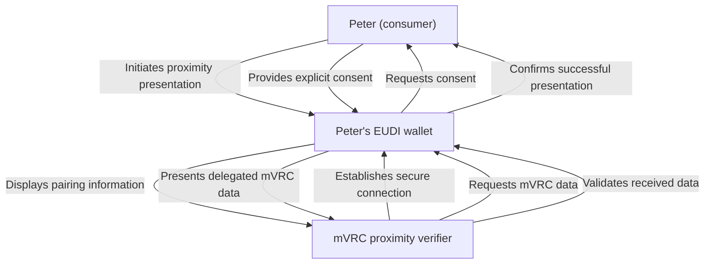

---
#### **SCENARIO GROUP 3 – mVRC & mDL presentation**

- **Scenario 3A – mVRC & mDL remote data sharing**

  This scenario describes the remote presentation and verification of both a mobile Driving Licence (mDL) and a mobile Vehicle Registration Certificate (mVRC) within a single transaction using the EUDI wallet. In this scenario, the owner of the vehicle, who holds both credentials in the wallet, is requested to provide selected data from both the mDL and the mVRC to a remote service provider acting as a combined verifier. The scenario addresses the limitation of current solutions, where users are required to present two separate physical documents or a combination of physical and digital credentials.
  
  The scenario focuses on user control, selective disclosure and interoperability, ensuring that only the required data from both credentials is shared with the vehicle owner's explicit consent, in line with the principles defined in eIDAS 2.0.

  | Field name | Description | Example values |
  |-----------|-------------|---------------|
  | **Scenario summary** | High-level description of the scenario | The remote sharing of both mDL and mVRC data from a vehicle owner's EUDI wallet to a service provider, enabling combined verification of driving licence and vehicle registration data within a single transaction. |
  | **User story** | User-centric description | As a vehicle owner, John wants to share both his driving licence and vehicle registration data from his EUDI wallet in a single interaction so that he can complete vehicle related services without presenting multiple documents separately. |
  | **Actors** | Actors involved in the scenario | 1. Owner, e.g. John (required); <br> 2. EUDI wallet instance (required); <br> 3. mVRC & mDL verifier (required); <br> 4. mVRC issuer (optional); <br> 5. mDL issuer (optional); <br> 6. Trusted list provider (optional). |
  | **Context & preconditions** | The conditions that must be met before the scenario starts | 1. John has an activated EUDI wallet. <br> 2. John holds a valid mDL and mVRC in the EUDI wallet. <br> 3. Both credentials were issued by recognised and trusted issuers. <br> 4. The EUDI wallet supports combined presentation of multiple credentials. <br> 5. The verifier is reachable through an online interaction. <br> 6. Network connectivity is available. |
  | **User journey (business flow of events)** | High-level business flow | 1. John accesses an online service that requires both driving licence and vehicle registration data. <br> 2. The service requests selected attributes from both mDL and mVRC via the EUDI wallet. <br> 3. John reviews the combined request and provides explicit consent. <br> 4. The EUDI wallet presents the requested data from both credentials to the verifier. <br> 5. The verifier validates the received data and proceeds with the service. |

  ```mermaid
  flowchart TB
    John["John (vehicle owner)"]
    Wallet[EUDI wallet]
    Verifier[mVRC & mDL verifier]

    John -->|Accesses online service| Wallet
    Wallet -->|Requests combined data sharing| John
    John -->|Provides explicit consent| Wallet

    Wallet -->|Presents mDL and mVRC data| Verifier
    Verifier -->|Validates received data| Wallet

    Wallet -->|Confirms successful presentation| John
  ```

- **Scenario 3B – mVRC & mDL proximity data sharing**

  This scenario describes the proximity presentation and verification of both a mobile Driving Licence (mDL) and a mobile Vehicle Registration Certificate (mVRC) within a single transaction using the EUDI wallet. In this scenario, the owner of the vehicle, who holds both credentials in the Wallet, is requested to present selected data from both credentials to a nearby party acting as a combined mVRC & mDL proximity verifier, for example during roadside checks or other on‑site interactions. The scenario addresses the limitations of current practices, where the users are required to present multiple physical documents separately.
  
  The scenario focuses on user control, selective disclosure and trust in proximity interactions, ensuring that only the required data from both credentials is presented with the user's explicit consent, in line with the principles defined in eIDAS 2.0.

  | Field name | Description | Example values |
  |-----------|-------------|---------------|
  | **Scenario summary** | High-level description of the scenario | The proximity sharing of both mDL and mVRC data from a vehicle owner's EUDI wallet to a local verifier, enabling combined verification of driving licence and vehicle registration data in a single interaction. |
  | **User story** | User-centric description | As the vehicle owner, John wants to present both his driving licence and vehicle registration data from his EUDI wallet during an in-person interaction so that he can complete checks without presenting multiple documents separately. |
  | **Actors** | Actors involved in the scenario | 1. Owner, e.g. John (required); <br> 2. EUDI wallet instance (required); <br> 3. mVRC & mDL proximity verifier (required); <br> 4. mVRC & mDL proximity reader (optional); <br> 5. mVRC issuer (optional); <br> 6. mDL issuer (optional); <br> 7. Trusted list provider (optional). |
  | **Context & preconditions** | The conditions that must be met before the scenario starts | 1. John has an activated EUDI wallet. <br> 2. John holds a valid mDL and mVRC in his EUDI wallet. <br> 3. The EUDI wallet is capable of proximity interactions. <br> 4. Both credentials were issued by recognised and trusted issuers. <br> 5. The verifier is physically present and authorised to request data. <br> 6. A secure proximity communication channel can be established. |
  | **User journey (business flow of events)** | High-level business flow | 1. John opens the EUDI wallet and initiates a proximity presentation. <br> 2. The EUDI wallet generates a QR code containing parameters needed to establish a secure connection and presents it. <br> 3. The proximity verifier scans the QR code and establishes a secure channel to the EUDI wallet. <br> 4. The verifier connects to the EUDI wallet and requests specific mDL and mVRC data. <br> 5. John reviews the request and provides explicit consent. <br> 6. The EUDI wallet presents the selected mVRC and mDL data. <br> 7. The verifier validates the received data and completes the on-site check. |

  ```mermaid
  flowchart TB
    John["John (vehicle owner)"]
    Wallet[EUDI wallet]
    Reader[mVRC & mDL proximity verifier]

    John -->|Initiates proximity interaction| Wallet
    Wallet -->|Displays pairing information| Reader

    Reader -->|Establishes secure connection| Wallet
    Reader -->|Requests combined mDL and mVRC data| Wallet

    Wallet -->|Requests consent| John
    John -->|Provides explicit consent| Wallet

    Wallet -->|Presents mDL and mVRC data| Reader
    Reader -->|Validates received data| Wallet

    Wallet -->|Confirms successful presentation| John
  ```

## 7. High level requirements (per role)

This section defines the high-level requirements for the roles involved across the scenarios described in this document.

The requirements are derived from:

  - the ARF definition of the wallet's functionality and user control,
  - interaction models defined in OpenID4VCI and OpenID4VP,
  - regulatory principles defined in eIDAS 2.0, including explicit user consent and data minimisation,
  - and, where applicable, the delegation model introduced within the LSP scenarios.

The requirements establish a common baseline of capabilities necessary to ensure interoperability, security and compliance with the principles defined in eIDAS 2.0 and the Architecture and Reference Framework (ARF). They are defined independently of specific scenarios and reflect the functional and trust related responsibilities of each role within the European Digital Identity Wallet ecosystem.

- **User – as an owner / holder / consumer**
  
  The user, acting as an owner or holder of credentials (mVRC or mDL), and, where applicable, as a delegated user (consumer), SHALL fulfil the following requirements.
  
  **Core control and interaction capabilities**

  The user SHALL:

  - control the use of the EUDI wallet and all credentials stored within it;
  - be able to receive and securely store the credentials issued to the wallet;
  - be able to initiate interactions, including issuance, presentation and delegation processes;
  - retain control over when and how the credentials are used or presented;
  - be able to access and manage the credentials held in the wallet.

  **Credential issuance**
  
  The user SHALL:

  - be able to accept or reject credential issuance requests;
  - ensure that the issued credentials are stored securely in the EUDI wallet;
  - control whether the credentials are retained or deleted within the wallet.

  **Consent and data disclosure**

  In line with the eIDAS 2.0 and ARF principles, the user SHALL:

  - review data requests prior to any disclosure;
  - provide explicit and informed consent before sharing any credential data;
  - be able to refuse or cancel any data sharing requests;
  - be informed about which data elements are being requested and for what purpose;
  - dispose of a wallet supporting selective disclosure mechanisms to share only the minimum required mVRC data.

  **Presentation of the credentials**

  The user SHALL: 
  - be able to trigger the presentation of the credentials through the EUDI wallet;
  - be able to present selected attributes from one or multiple credentials;
  - use the credentials in a manner consistent with the granted rights and applicable constraints.

  **Delegation model (LSP requirements)**

  The delegation model introduced in the LSP scenarios extends the standard owner / holder model by allowing controlled sharing of usage rights.

  The owner / primary holder SHALL:

  - be able to grant delegated usage rights for the mVRC;
  - define the scope and conditions of the delegation (e.g. validity period);
  - retain control over all the active delegations;
  - be able to revoke the delegated rights at any time;
  - ensure that delegation does not transfer any ownership or primary holder status.

  The consumer SHALL:

  - be able to receive the delegated credentials into the EUDI wallet;
  - use the delegated credentials in accordance with the defined scope and conditions;
  - be able to present the delegated credentials when required;
  - understand that the usage rights are derived from the delegation and may be revoked.

<br>

- **EUDI wallet instances**

  The EUDI wallet instances SHALL:

  - securely store the credentials and associated cryptographic material;
  - support holder binding mechanisms associated with the credential format;
  - support credential issuance flows using OpenID4VCI;
  - support presentation flows based on OpenID4VP;
  - enforce explicit user consent prior to any data disclosure;
  - support the selective disclosure of attributes;
  - support both remote and proximity interaction models (same-device and cross-device OpenID4VP interaction models as well as ISO/IEC 18013-5 proximity flows);
  - ensure secure communication with issuers and verifiers;
  - enable presentation of an mVRC or the mVRC together with an mDL within a single interaction;
  - process and return verifiable presentation bound to the nonce provided by the verifier;
  - support issuance, storage and presentation of the delegated mVRC;
  - support the management of the delegated credentials, where applicable.

<br>

- **Issuers (mVRC, delegated mVRC, mDL)**

  Issuers SHALL: 

  - verify the identity and eligibility of the subject prior to credential issuance, where applicable; 
  - issue credentials compliant with ARF and relevant standards (OpenID4VCI, mdoc format); 
  - ensure integrity and authenticity of the credentials through cryptographic signing; 
  - bind the credentials to the intended holder where required; 
  - support issuance flows compatible with EUDI wallet interactions; 
  - ensure that the issued credentials can be validated across the member states.

<br>

- **Verifiers (remote and proximity)**

  Verifiers SHALL:

  - request only the minimum set of attributes required for a given use case;
  - support request and processing of credential presentations using OpenID4VP;
  - construct presentation request using Digital Credentials Query Language (DCQL) and request only credentials and claims required for the intended purpose;
  - validate the authenticity, integrity and validity of the presented credentials;
  - verify trust anchors and certificate status using appropriate trust infrastructure;
  - support both single‑credential and multi‑credential scenarios (e.g. mVRC and mDL);
  - ensure secure communication with the EUDI wallet;
  - provide transparency to the user regarding requested data;
  - generate a fresh cryptographically random nonce for every presentation request and validate the binding of the returned presentation to that nonce.

<br>

- **Other optional supporting roles**

  Optional actors such as PID providers, national registries, mDL providers or wallet providers SHALL:

  - support identity verification processes;
  - provide authoritative data used in the credential issuance;
  - enable supporting infrastructure required for wallet operation;
  - contribute to interoperability across implementations and the member states.

## 8. Technical details of the scenarios

The technical approach for the mVRC is defined for the purpose of this LSP and reflects a jointly agreed baseline for the implementation and testing of the scenarios. While tailored to the needs of the pilot phase,  it will allow reuse and extension in future production environments. The approach has been developed collaboratively with the WP5 members. For some scenarios, different implementation options were considered, and a common baseline was agreed through joint discussions in order to ensure interoperability and consistency across participating implementations.

The mVRC ecosystem described in this document builds on a set of requirements derived from the applicable regulatory frameworks, including eIDAS 2.0, as well as established technical standards and specifications. It is designed to be fully aligned with the EUDI wallet framework as an integral part of its ecosystem. The design combines standardised protocols, credential formats and trust mechanisms to ensure that the scenarios can be implemented consistently across different systems and jurisdictions. The technical approach ensures compliance with the EUDI wallet trust and security principles, including user control, data minimisation and selective disclosure. The following represent some of the key technical principles and foundational building blocks:

- **Credential security and data protection**
  -	Cryptographic binding and proof‑of‑possession, ensuring that credentials can only be used by the legitimate holder;
  -	Selective disclosure, enabling sharing of only the required data elements in line with the data minimisation principles;

- **Credential formats and data structures**
  -	ISO/IEC 18013‑5 (mdoc format), providing a standardised structure for credentials;
  -	ISO/IEC 7367-2, providing the data structure for the mobile vehicle registration certificate (mVRC).

- **Issuance and presentation protocols**
  -	OpenID for Verifiable Credential Issuance (OpenID4VCI) 1.0, aligned with the High Assurance Interoperability Profile (HAIP) 1.0, supporting secure and interoperable credential issuance;
  -	OpenID for Verifiable Presentations (OpenID4VP) 1.0, enabling structured, consent‑based presentation of credential data;
  -	OAuth 2.0, providing the underlying authorisation framework for secure interaction flows;

- **Proximity interaction layer**
  -	Proximity interaction mechanisms based on ISO/IEC 18013‑5, enabling secure device to device communication in proximity scenarios;

- **Trust and regulatory framework**
  -	Electronic Signatures and Trust Infrastructures (ETSI TS 119 472 series), defining profiles for Electronic Attestation of Attributes (EAA), including credential structure and issuance processes;
  -	Trust and validation mechanisms aligned with eIDAS trust models, including the use of the EU trusted lists (e.g. ETSI TS 119 612).

Implementation libraries or reusable software components supporting mVRC scenarios should be published in the project GitHub repository and kept available and reasonably up-to-date for the duration of the relevant implementation and interoperability activities.

### 8.1. Scenario 1A – mVRC issuance

#### 8.1.1. Functional requirements

Scenario 1A is based on OpenID4VCI 1.0 aligned with the High Assurance Interoperability Profile (HAIP) 1.0 and leverages standardised trust frameworks and credential formats to ensure interoperable issuance of the mVRC attestations to the EUDI wallet.

**EUDI Wallet Instance**

| Index | Requirement title | Description | Priority | Acceptance criteria |
|------------|------------------|-------------|--------|---------------------|
| FR-W1A-001 | ETSI Issuance Profile Support  | EUDI Wallet SHALL support the ETSI TS 119 472-3 issuance profile elements applicable to this scenario, including processing of signed Credential Issuer Metadata, issuer information, access certificate material, Wallet Instance Attestation, Key Attestation, and trust validation where required by the applicable trust policy. | High | Wallet successfully completes an OpenID4VCI issuance flow and receives an mVRC attestation. |
| FR-W1A-002 | mVRC Data Model and Structure Support | The EUDI Wallet Instance SHALL support processing, storage, and presentation of mVRC credentials using a data model and structure compliant with ISO 7367 and the applicable mVRC rulebook, ensuring consistent interpretation of mVRC data across issuers and verifiers. | High | The wallet correctly processes and presents mVRC credentials conforming to the standardized data model and structure without data loss or misinterpretation. |
| FR-W1A-003 | mVRC Credential Format Support | EUDI wallet SHALL support receiving, processing, and storing mVRC attestations encoded as mso_mdoc. | High | Wallet stores and later retrieves an issued mVRC in mso_mdoc format. |
| FR-W1A-004 | OpenID4VCI Issuance Support with HAIP Profile Elements | EUDI Wallet SHALL support the OpenID4VCI 1.0 issuance workflow to obtain mVRC attestations, applying the HAIP 1.0 profile elements required for this scenario, including credential offer processing, authorization code flow, token handling, credential request handling, holder binding, and secure proof-of-possession. | High | Wallet successfully completes the OpenID4VCI authorization code issuance flow and receives an mVRC attestation.|
| FR-W1A-005 | Credential Offer Initialisation | EUDI wallet SHALL support both cross device and same device flows (QR code or deep link) . | High | Issuance succeeds using both redirect-based and wallet-initiated initiation mechanisms. |
| FR-W1A-006 | User Consent for  Issuance | EUDI wallet SHALL display information about offered mVRC to be issued and require explicit user consent before proceeding. | High | User can approve or cancel issuance after reviewing credential information. |
| FR-W1A-007 | Signed Credential Issuer Metadata Processing| EUDI Wallet SHALL support processing of signed OpenID4VCI Credential Issuer Metadata where required by ETSI TS 119 472-3. The Wallet SHALL verify that the metadata is signed and that the JWS protected header contains the certificate material required by the ETSI profile. | High | Wallet retrieves signed Credential Issuer Metadata, verifies the signature and certificate material, and uses the metadata to continue the issuance flow. |
| FR-W1A-008 | PAR Endpoint Support | The wallet SHALL support Pushed Authorization Requests (PAR) when required by the authorization server policy. | High | Wallet initiates authorization using PAR and receives a request URI. |
| FR-W1A-009 | PKCE Support | The wallet SHALL support PKCE for authorization code flows, including code verifier and challenge handling. | High | Token exchange succeeds only with a valid PKCE code verifier. |
| FR-W1A-010 | Client Attestation JWT Support | The Wallet SHALL support client authentication using Client Attestation JWT where required. In this scenario, the Client Attestation JWT SHALL be provided as a Wallet Instance Attestation (WIA), in accordance with ARF TS3 and the applicable OpenID4VCI / ETSI TS 119 472-3 profile requirements | High | Wallet successfully completes the authorization and token request flow using a valid WIA and corresponding proof-of-possession when Client Attestation JWT authentication is required. |
| FR-W1A-011 | Owner Identity Verification Support | The wallet SHOULD be able to perform PID-based identity verification when the issuer requires confirmation of the vehicle owner's identity prior to mVRC issuance.  | Medium | Wallet completes issuance when owner identity verification succeeds and fails when it is required but not completed. |
| FR-W1A-012 | OpenID4VP Identity Verification Support | If applicable, EUDI wallet SHALL support OpenID4VP 1.0 to present a PID attestation for identity verification when required prior to mVRC issuance. | Medium | Wallet successfully responds to an OpenID4VP presentation request requiring PID verification. |
| FR-W1A-013 | PID Attestation Format Support | If applicable, EUDI wallet SHALL present PID attestations encoded as mso_mdoc or SD-JWT VC. | Medium | Wallet presents PID attestations in both supported formats when requested. |
| FR-W1A-014 | User Consent for  Verification | If applicable, EUDI wallet SHALL display information about requested PID data prior to mVRC issuance and require explicit user consent before proceeding. | Medium | User can approve or cancel verification process after reviewing authorization request. |
| FR-W1A-015 |Key Attestation (KA) in Credential Request Proof |The Wallet SHALL include a Key Attestation (KA) in the proof sent to the Credential Endpoint when required, in accordance with ARF TS3 and OpenID4VCI Appendix D: Key Attestations. The KA SHALL attest the wallet-controlled key used for holder binding of the issued mVRC attestation. | High |Wallet successfully sends a credential request containing a valid KA and proof-of-possession for the attested wallet-controlled key, and receives an mVRC attestation bound to that key. |
| FR-W1A-016 | Holder Binding and Proof-of-Possession | EUDI wallet SHALL support holder binding and proof-of-possession mechanisms in line with HAIP requirements. | High | Issuance succeeds only when valid proof-of-possession is provided. |
| FR-W1A-017 | Display of mVRC Credential Data | The EUDI Wallet SHALL display the core data contained in a successfully issued mVRC credential to the user after completion of the issuance process. | High | The EUDI Wallet displays the mVRC credential only after successful issuance and validation, with data accurately reflecting the credential payload.<br> If issuance or validation fails, the mVRC credential is not displayed to the user.
| FR-W1A-018 | Secure Storage of mVRC | EUDI wallet SHOULD securely store issued mVRC attestations and associated metadata. | High | Issued mVRC is securely stored and accessible only with user authorization. |
| FR-W1A-019 | Protocol Error Handling | EUDI wallet SHALL handle protocol, validation, and network errors gracefully and inform the user. | Medium | Wallet displays meaningful error messages when issuance fails. |
| FR-W1A-020 | Issuer Access Certificate Validation (ETSI LOTE) | The wallet SHOULD validate the issuer's access certificate using an ETSI Trusted List where applicable. | Medium | Wallet accepts issuers with trusted certificates and rejects invalid ones. |
| FR-W1A-021 | Issuer Registration Certificate Validation (ETSI LOTE) | The wallet SHOULD validate the issuer's registration certificate using an ETSI Trusted List where required. | Medium | Wallet rejects issuance from issuers with invalid registration status. |
| FR-W1A-022 | Issuer Seal Validation (ETSI LOTE/LOTL) | The wallet SHOULD validate the cryptographic seal on the issued mVRC using trusted list material. | Medium | Wallet stores only mVRC attestations signed by trusted issuers. |
| FR-W1A-023 | DPoP Support | The Wallet SHALL support DPoP for token requests and related proof handling when required by the Authorization Server. | High | The wallet successfully completes token requests when DPoP is required. Requests with missing, invalid, or expired DPoP proof are rejected. |
| FR-W1A-024 | Interactive Authorization Endpoint Support | The EUDI Wallet Instance MAY support the Interactive Authorization Endpoint from OpenID4VCI 1.1(draft) as an alternative authorization interaction model for credential issuance. | Medium | The wallet successfully completes issuance using the Interactive Authorization Endpoint when supported by the Issuer. |

**mVRC issuer**

| Index | Requirement title | Description | Priority | Acceptance criteria |
|----------|------------------|-------------|----------|---------------------|
| FR-I1A-001 | ETSI Issuance Profile Support | The mVRC Issuer SHALL support the ETSI TS 119 472-3 issuance profile elements applicable to this scenario, including publication of signed Credential Issuer Metadata, issuer information, access certificate material, Wallet Instance Attestation, Key Attestation, and trust validation where required by the applicable trust policy. | High | Issuer successfully completes an OpenID4VCI issuance flow with a compliant Wallet and issues an mVRC attestation only when the required ETSI profile elements are present and valid. |
| FR-I1A-002 | mVRC Data Model and Structure Compliance | The mVRC Issuer SHALL issue mVRC credentials using a data model and structure compliant with ISO 7367 and the applicable mVRC rulebook, ensuring consistent semantics, field definitions, and encoding across issuers and jurisdictions. | High | Issued mVRC credentials conform to the standardized data model and structure and are successfully processed by compliant EUDI Wallets |
| FR-I1A-003 |OpenID4VCI Issuance Support with HAIP Profile Elements | The mVRC Issuer SHALL support the OpenID4VCI 1.0 issuance workflow for mVRC attestations, applying the HAIP 1.0 profile elements required for this scenario, including credential offer generation, authorization code flow, token handling, credential request processing, holder binding, and secure proof-of-possession validation.| High | Issuer successfully completes the OpenID4VCI authorization code issuance flow with a compliant Wallet and returns an mVRC attestation bound to the wallet-controlled key. |
| FR-I1A-004 | Provide Credential Offer for issuance initiation | The Issuer SHALL generate and provide a credential offer (object or credential_offer_uri) that can be encoded as a QR code or deep link to initiate issuance. | High | A user can open an issuer page, obtain a QR/deep link, and the wallet can resolve the offer and start issuance. |
| FR-I1A-005 | OAuth/OID4VCI Authorization Server for issuance | The Issuer SHALL provide (or integrate with) an OAuth 2.0 / OpenID4VCI to authorize wallet access to issuance and issue access tokens for the credential endpoint. | High | The wallet obtains an authorization code and exchanges it for an access token that is accepted by the credential endpoint. |
| FR-I1A-006 | Publish Authorization Server metadata | The Authorization Server shall expose authorization server metadata (/.well-known/oauth-authorization-server) including required endpoints and capabilities (token, authorization, PAR if used). | High | The wallet retrieves AS metadata and can locate the authorization and token endpoints (and PAR endpoint if required). |
| FR-I1A-007 | Signed Credential Issuer Metadata Publication| The mVRC Issuer SHALL publish signed OpenID4VCI Credential Issuer Metadata where required by ETSI TS 119 472-3. The Issuer SHALL sign the metadata using the private key corresponding to the public key in Access Certificate and SHALL include the certificate material required by the ETSI profile in the JWS protected header. | High | Wallet retrieves the signed Credential Issuer Metadata, verifies the metadata signature and certificate material, and uses the metadata to continue the issuance flow. |
| FR-I1A-008 | Support for Pushed Auth Request | The Authorization Server shall support Pushed Authorization Requests (PAR). | High | The wallet sends an authorization request to PAR, receives a request_uri, and completes authorization successfully. |
| FR-I1A-009 | Support for PKCE | The Authorization Server shall require and validate PKCE for authorization code flows. | High | Token exchange succeeds with a valid code_verifier and fails with an invalid code_verifier. |
| FR-I1A-010 | Support Client Attestation JWT authentication | The Authorization Server SHALL support client authentication using Client Attestation JWT provided as a Wallet Instance Attestation (WIA), in accordance with ARF TS3 and the applicable OpenID4VCI / ETSI TS 119 472-3 profile requirements. | High | Token requests using a valid WIA and corresponding proof-of-possession succeed, invalid and expired attestations are rejected. |
| FR-I1A-011 | Vehicle Owner identity verification via OpenID4VP | The Issuer/AS may require confirmation of the vehicle owner's identity prior to issuing mVRC; when required, the Issuer shall enforce OpenID4VP-based PID verification before completing authorization/issuance. | Medium | If policy requires verification, issuance is blocked until a valid PID presentation is received; if policy does not require it, issuance proceeds without VP. |
| FR-I1A-012 | Verifier interface for PID validation (OpenID4VP 1.0) | When owner identity verification is used, the Issuer SHALL implement a Verifier interface compliant with OpenID4VP 1.0 to request and validate PID presentations (mso_mdoc or SD-JWT VC). | Medium | The verifier accepts a valid PID presentation satisfying the presentation definition and returns a success result; invalid presentations are rejected. |
| FR-I1A-013 | Key Binding during mVRC Issuance| The mVRC Issuer SHALL support a key binding mechanism during the issuance of mVRC credentials, binding the issued credential to a cryptographic key controlled by the EUDI Wallet holder. | High |The Issuer verifies a cryptographic proof of possession of a wallet-controlled private key during mVRC issuance and binds the credential to the corresponding public key.<br>If key binding verification fails, the mVRC credential is not issued. |
| FR-I1A-014 | Vehicle Registry integration  | The Issuer MAY query an Vehicle Registry to retrieve authoritative vehicle/owner attributes used to populate the issued mVRC attestation. | Medium | When enabled, the Issuer retrieves registry data and the issued mVRC reflects those authoritative attributes; if no record is found, issuance fails with an appropriate error. |
| FR-I1A-015 | Nonce endpoint support  | The Issuer SHOULD expose a nonce endpoint to provide a c_nonce (and expiry) for proof freshness, where required by policy. | Medium | The wallet can obtain a c_nonce from the nonce endpoint and issuance succeeds using a fresh proof; stale nonce results in a rejected credential request. |
| FR-I1A-016 | Validate wallet proof-of-possession | The Issuer shall validate proof-of-possession in credential requests to ensure holder binding and prevent replay, aligned with the applicable ecosystem profile. | High | Credential issuance succeeds with a valid proof and fails if the proof is missing, invalid, or replayed. |
| FR-I1A-017 | Key Attestation Validation in Credential Request Proof | The mVRC Issuer SHALL validate the Key Attestation (KA) included in the credential request proof when required, in accordance with ARF TS3 and OpenID4VCI Appendix D: Key Attestations. The Issuer SHALL verify that the proof demonstrates possession of the private key corresponding to the public key attested in the KA and used for holder binding of the issued mVRC attestation. | High |Issuer issues a key-bound mVRC attestation only after successfully validating the KA and the corresponding proof-of-possession for the attested wallet-controlled key. |
| FR-I1A-018 | PID seal trust verification | The Issuer (Verifier) SHOULD validate keys/certificates/seals using trusted lists where applicable (ETSI LOTE), either online or via cached material. | Medium | Issuer (Verifier) rejects interactions that do not satisfy trust policy (e.g., untrusted seals) and proceeds for trusted ones. |
| FR-I1A-019 | KA and WIA seal trust verification | The Issuer (Verifier) SHOULD validate keys/certificates/seals using trusted lists where applicable (ETSI LOTE), either online or via cached material. | Medium | Issuer rejects interactions that do not satisfy trust policy (e.g., untrusted seals) and proceeds for trusted ones. |
| FR-I1A-020 | Notification endpoint support | The Issuer MAY expose a notification endpoint for the wallet to send issuance acknowledgements or status notifications. | Medium | After successful issuance, the wallet can send a notification and the Issuer responds with success without affecting issuance outcome. |
| FR-I1A-021 | PID status list verification | The mVRC issuer (verifier) SHOULD verify the PID instance using the PID status list upon receiving the PID presentation. | Medium | The issuer rejects mVRC issuance process if the PID instance status is not valid. |
| FR-I1A-022 | Error handling and standards-compliant responses | The Issuer shall return standards-compliant error responses for invalid requests, unsupported formats, missing prerequisites (e.g., verification required), and policy violations. | High | Negative tests produce deterministic, protocol-compliant errors that the wallet can surface to the user. |
| FR-I1A-023 | Support secure session management for issuance | The Issuer SHALL manage issuance sessions securely (state/nonce, anti-CSRF, replay protection) across browser redirects and wallet interactions. | High | The authorization completes only for matching state/nonce/session context; mismatches are rejected. |
| FR-I1A-024 | Support mVRC Status List | The mVRC Issuer SHOULD support the use of a status list mechanism for issued mVRC credentials in order to enable revocation and suspension checks throughout the credential lifecycle. The Issuer SHALL publish and maintain a status list endpoint compliant with the applicable VC status list specification and include a reference to the corresponding status entry in each issued mVRC credential. The status list SHALL be kept up to date to accurately reflect the current validity state of issued mVRC credentials. | Medium | * An issued mVRC credential contains a valid reference to a status list entry<br> * The wallet or verifier can retrieve the referenced status list from the Issuer (or a designated status list service) <br> * The status value correctly reflects the credential state (e.g. valid, revoked, suspended)<br> * Updating the status list (e.g. marking a credential as revoked) is reflected in subsequent status checks without re-issuance of the credential. |
| FR-I1A-025 | Support DPoP | The Authorization Server shall support DPoP for token requests. | High | Token requests with a valid DPoP proof succeed; requests with missing or invalid DPoP proof are rejected. |
| FR-I1A-026 | Interactive Authorization Endpoint Support | The Authorization Server MAY support the Interactive Authorization Endpoint from OpenID4VCI 1.1(draft) as an alternative authorization interaction model for credential issuance. | Medium | The Issuer successfully completes issuance using the Interactive Authorization Endpoint when supported by the Wallet. |

---

#### 8.1.2. Protocol profile

**OpenID4VCI**

Specification: OpenID for Verifiable Credential Issuance 1.0  
Profile: High Assurance Interoperability Profile (HAIP) 1.0  
Flow: Authorization Code Flow

Characteristics:
- Credential issuance initiated via a credential offer (QR code or deep link);
- Supported credential offer schemes: eu-eaa-offer, haip-vci, and openid-credential-offer;
- Credential format: mso_mdoc;
- Authorization Code Flow with PKCE;
- Support for Pushed Authorization Requests (PAR);
- Support for Client Attestation JWT authentication using Wallet Instance Attestation (WIA);
- Support for DPoP proof handling where required by the Authorization Server;
- Support for Key Attestation (KA) for holder-bound credential issuance;
- Holder binding using proof-of-possession mechanisms;
- Support for Signed Credential Issuer Metadata in accordance with ETSI TS 119 472-3;
- Support for request URI methods: GET and POST;
- Support for credential status management using IETF Status Lists;
- Optional support for OpenID4VCI 1.1 Interactive Authorization Endpoint.

<br>

**OpenID4VP**

Specification: OpenID for Verifiable Presentations 1.0  
Profile: High Assurance Interoperability Profile (HAIP) 1.0 

Characteristics:
- Request/response-based presentation flow using authorization requests;
- Support for remote presentation of mVRC and, where applicable, PID credentials;
- Support for response mode: direct_post.jwt;
- Credential format: mso_mdoc;
- Support for selective disclosure of requested attributes;
- Holder binding using proof-of-possession mechanisms;
- Optional use for PID-based identity verification prior to mVRC issuance;
- Support for Digital Credentials Query Language (DCQL) credential and claim requests;
- Supported request schemes: eu-eaap, haip-vp, and mdoc-openid4vp;
- Authorization requests implemented using JSON Web Token (JAR) by reference;
- Client identifier prefix type: x509_hash (as defined by HAIP 1.0);
- Use of nonce values for replay protection;
- Support for credential status verification using IETF Status Lists.

---

#### 8.1.3.	Trust and security mechanisms

The scenario relies on a combination of cryptographic and trust mechanisms, including:

- Holder binding and proof-of-possession (PoP);
- Wallet Instance Attestation (WIA) used as Client Attestation JWT in accordance with ARF TS 3, ETSI TS 119 472-3 and applicable OpenID4VCI profiles;
- Key Attestation (KA) for attesting wallet-controlled keys used for holder binding of issued credentials;
- Client authentication using Client Attestation JWT and corresponding proof-of-possession;
- DPoP protection for token requests where required by the Authorization Server;
- Signed Credential Issuer Metadata in accordance with ETSI TS 119 472-3;
- PKCE and OAuth 2.0 Authorization Code Flow protections;
- Pushed Authorization Requests (PAR);
- Nonce-based replay protection mechanisms;
- Validation of issuer access certificates and registration certificates using ETSI Trusted Lists;
- Validation of credential issuer seals and signatures using ETSI trust infrastructure;
- Validation of Wallet Provider trust anchors using ETSI Trusted Lists where applicable;
- Validation of PID trust anchors and signatures when identity verification is performed;
- Validation of PID status information where PID-based identity verification is performed;
- Credential status verification using IETF Status Lists;
- Validation of Key Attestation and Wallet Instance Attestation status information where applicable;
- Alignment with ETSI TS 119 472-3 issuance profiles and HAIP 1.0 requirements.

---

#### 8.1.4.	Endpoints

The following endpoints are used as part of the issuance flow:

| Standard | Endpoint | Usage in Scenario | Reference |
|----------|----------|------------------|-----------|
| OpenID4VCI 1.0 / HAIP 1.0 / ETSI TS 119 472-3 | Credential Offer Endpoint | Required | [OpenID4VCI 1.0](https://openid.net/specs/openid-4-verifiable-credential-issuance-1_0.html#section-4), [HAIP 1.0](https://openid.net/specs/openid4vc-high-assurance-interoperability-profile-1_0.html#section-4.2), [ETSI TS 119 472-3](https://www.etsi.org/deliver/etsi_ts/119400_119499/11947203/01.01.01_60/ts_11947203v010101p.pdf)  |
| OpenID4VCI 1.0 / HAIP 1.0 / ETSI TS 119 472-3 | Authorization Endpoint | Required | [OpenID4VCI 1.0](https://openid.net/specs/openid-4-verifiable-credential-issuance-1_0.html#name-authorization-endpoint), [HAIP 1.0](https://openid.net/specs/openid4vc-high-assurance-interoperability-profile-1_0.html#section-4.3), [ETSI TS 119 472-3](https://www.etsi.org/deliver/etsi_ts/119400_119499/11947203/01.01.01_60/ts_11947203v010101p.pdf) |
| RFC 9126 / OpenID4VCI 1.0 / HAIP 1.0 / ETSI TS 119 472-3 | Pushed Authorization Request (PAR) | Required | [RFC 9126](https://www.rfc-editor.org/rfc/rfc9126.html), [OpenID4VCI 1.0](https://openid.net/specs/openid-4-verifiable-credential-issuance-1_0.html#section-5.1.4), [ETSI TS 119 472-3](https://www.etsi.org/deliver/etsi_ts/119400_119499/11947203/01.01.01_60/ts_11947203v010101p.pdf) |
| OpenID4VCI 1.0 / HAIP 1.0 / ETSI TS 119 472-3 | Token Endpoint | Required | [OpenID4VCI 1.0](https://openid.net/specs/openid-4-verifiable-credential-issuance-1_0.html#section-6), [HAIP 1.0](https://openid.net/specs/openid4vc-high-assurance-interoperability-profile-1_0.html#section-4.4), [ETSI TS 119 472-3](https://www.etsi.org/deliver/etsi_ts/119400_119499/11947203/01.01.01_60/ts_11947203v010101p.pdf)  |
| OpenID4VCI 1.0 / HAIP 1.0 | Nonce Endpoint | Required | [OpenID4VCI 1.0](https://openid.net/specs/openid-4-verifiable-credential-issuance-1_0.html#section-7) |
| OpenID4VCI 1.0 / HAIP 1.0 / ETSI TS 119 472-3 | Credential Endpoint | Required | [OpenID4VCI 1.0](https://openid.net/specs/openid-4-verifiable-credential-issuance-1_0.html#section-8), [HAIP 1.0](https://openid.net/specs/openid4vc-high-assurance-interoperability-profile-1_0.html#section-4.5), [ETSI TS 119 472-3](https://www.etsi.org/deliver/etsi_ts/119400_119499/11947203/01.01.01_60/ts_11947203v010101p.pdf) |
| OpenID4VCI 1.0 / ETSI TS 119 472-3 | Notification Endpoint | Optional | [OpenID4VCI 1.0](https://openid.net/specs/openid-4-verifiable-credential-issuance-1_0.html#section-11), [ETSI TS 119 472-3](https://www.etsi.org/deliver/etsi_ts/119400_119499/11947203/01.01.01_60/ts_11947203v010101p.pdf) |
| OpenID4VCI 1.0 / HAIP 1.0 / ETSI TS 119 472-3 | Credential Issuer Metadata Endpoint | Required | [OpenID4VCI 1.0](https://openid.net/specs/openid-4-verifiable-credential-issuance-1_0.html#section-12.2), [HAIP 1.0](https://openid.net/specs/openid4vc-high-assurance-interoperability-profile-1_0.html#section-4.1), [ETSI TS 119 472-3](https://www.etsi.org/deliver/etsi_ts/119400_119499/11947203/01.01.01_60/ts_11947203v010101p.pdf) |
| RFC 8414 / OpenID4VCI 1.0 | Authorization Server Metadata Endpoint | Required | [RFC 8414](https://datatracker.ietf.org/doc/html/rfc8414), [Attestation-Based Client Authentication](https://www.ietf.org/archive/id/draft-ietf-oauth-attestation-based-client-auth-08.html#name-authorization-server-metada), [DPOP](https://www.rfc-editor.org/rfc/rfc9449.html#section-5.1), [OpenID4VCI 1.1 draft](https://openid.github.io/OpenID4VCI/openid-4-verifiable-credential-issuance-1_1-wg-draft.html#name-interactive-authorization-e)  |
| Token Status List | Status List Endpoint | Optional | [Token Status List](https://datatracker.ietf.org/doc/draft-ietf-oauth-status-list/) |
| OpenID4VCI 1.1 draft | Interactive Authorization Endpoint (`/iae`) | Optional | [OpenID4VCI 1.1 draft](https://openid.github.io/OpenID4VCI/openid-4-verifiable-credential-issuance-1_1-wg-draft.html#name-interactive-authorization-e) |
| OpenID4VP 1.0 / HAIP 1.0 | Authorization Endpoint | Required | [OpenID4VP 1.0](https://openid.net/specs/openid-4-verifiable-presentations-1_0.html#section-5), [HAIP 1.0](https://openid.net/specs/openid4vc-high-assurance-interoperability-profile-1_0.html#section-5) |
| OpenID4VP 1.0 | Direct POST JWT | Required | [OpenID4VP 1.0](https://openid.net/specs/openid-4-verifiable-presentations-1_0.html#section-8.3.1) |
| Implementation-specific | Init Endpoint | Optional | N/A |
| Implementation-specific | Status Endpoint | Optional | N/A |

---

#### 8.1.5.	Technical interaction flow / sequence diagrams

The following sequence diagram reflects the OpenID4VCI issuance process of the scenario 1A and illustrates the technical interaction flow, showing the main steps and exchanges between the EUDI wallet, the mVRC issuer and supporting components.

##### Basic flow

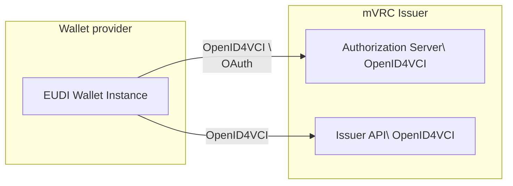

##### Sequence diagram

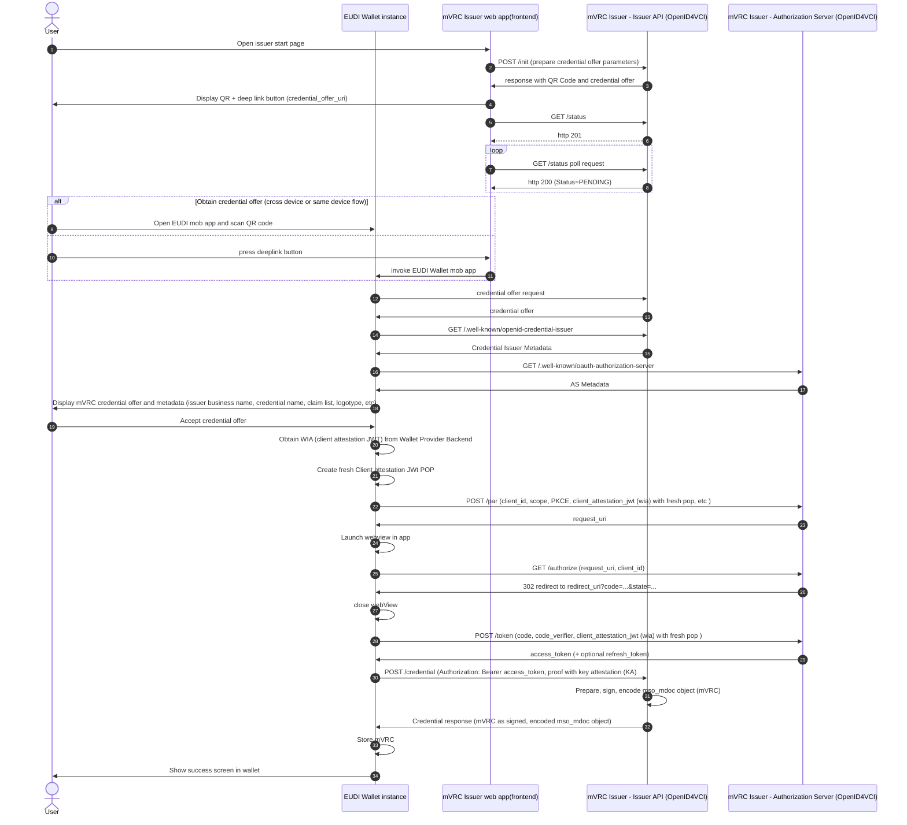

---

##### Extended flow (OpenID4VCI 1.0)

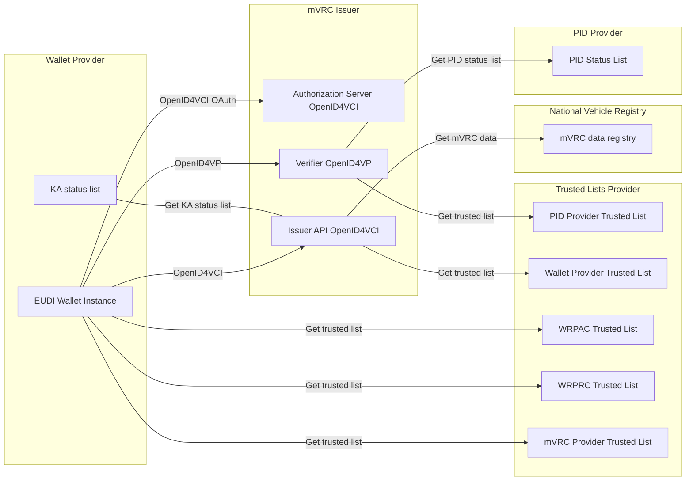

##### Sequence diagram

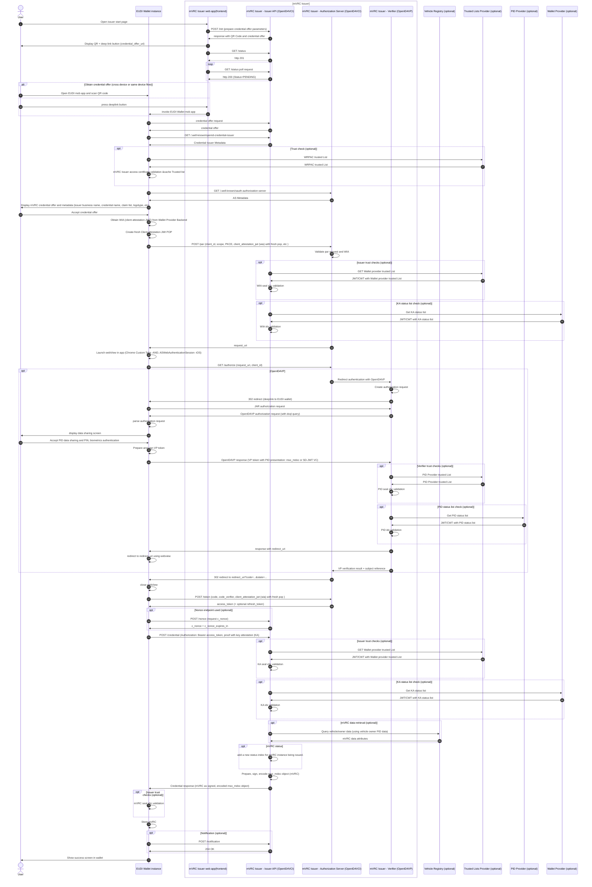

---

##### Extended flow (OpenID4VCI 1.1 with iae)

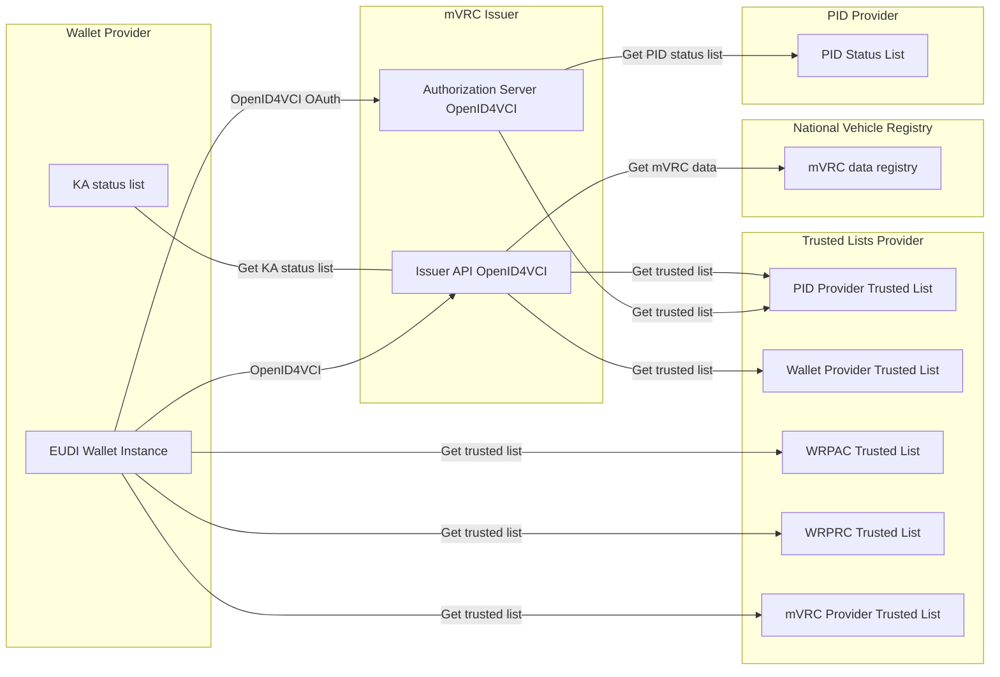

##### Sequence diagram
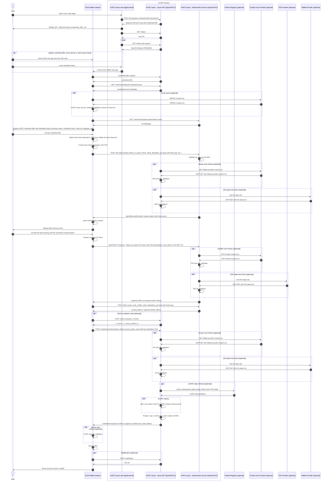

### 8.2. Scenario 1B – mVRC remote data sharing

#### 8.2.1. Functional requirements

Scenario 1B is based on OpenID4VP 1.0, aligned with the High Assurance Interoperability Profile (HAIP) 1.0, and leverages standardised trust frameworks and credential formats to ensure interoperable and secure remote presentation of the mVRC data from the EUDI wallet to a verifier.

**EUDI Wallet Instance**

| Index | Requirement Title | Description | Priority | Acceptance Criteria |
|------:|-------------------|-------------|----------|---------------------|
| FR-W1B-01 | Support OpenID4VP | The wallet SHALL support the OpenID for Verifiable Presentations (OpenID4VP) 1.0 protocol for remote presentation of mVRC data. | High | The wallet can successfully complete an OpenID4VP flow with a compliant Verifier. |
| FR-W1B-02 | ETSI Presentation Profile Support | The Wallet SHALL support the ETSI TS 119 472-2 presentation profile elements applicable to this scenario, including signed Request Object processing, verifier identification, verifier information processing, encrypted presentation response, and holder binding. | High | Wallet successfully completes a remote mVRC presentation flow with a compliant Verifier and releases mVRC data only after successful request processing, user consent, and proof-binding. |
| FR-W1B-03 | HAIP 1.0 Profile Elements | The Wallet SHALL support the relevant High Assurance Interoperability Profile (HAIP) 1.0 requirements for presentation flows in this scenario. | High | Presentation flows apply the relevant HAIP-defined security and assurance requirements. |
| FR-W1B-04 | Support mso_mdoc Format | The wallet SHALL support the mso_mdoc credential format for mVRC credentials, in accordance with ISO/IEC 18013-5 and applicable EUDI Wallet profiles. | High | The wallet can successfully receive, store, and present mVRC credentials in mso_mdoc format. |
| FR-W1B-05 | mVRC Data Model Compliance | The wallet SHALL support the standardized mVRC data model and structure as defined by ISO 7367 and the applicable mVRC rulebook. | High | The wallet correctly interprets and processes mVRC data elements according to the standardized model and structure. |
| FR-W1B-06 | User Consent | The wallet SHALL require explicit user consent before disclosing any mVRC data to a Verifier. | High | No mVRC data is shared without an explicit user-approval action. |
| FR-W1B-07 | Key Binding Support | The wallet SHALL support key binding mechanisms to ensure that presented mVRC data is cryptographically bound to the wallet instance. | High | Presentations include a valid proof of possession bound to a wallet-controlled key. |
| FR-W1B-08 | Cross-Device and Same-Device Flow | The wallet SHALL support cross-device flows using QR code scanning and same-device flows using deeplinks to initiate authorization requests. | High | Both QR-based and deeplink-based authorization requests can be successfully initiated. |
| FR-W1B-09 | Authorization Request Initialization | The wallet SHALL be able to initialize the OpenID4VP authorization request based on Verifier-provided parameters. | High | The wallet correctly processes and responds to an OpenID4VP authorization request. |
| FR-W1B-10 | Verifier Registration Certificate Handling | The wallet SHALL support processing and validation of Verifier registration certificates. | Medium | Registration certificates are successfully parsed and validated when present. |
| FR-W1B-11 | Verifier Trust Validation | The wallet SHALL verify the trust of the Verifier using registration and access certificates against trusted lists. | High | Presentations proceed only if the Verifier trust check succeeds. |
| FR-W1B-12 | DCQL Credential Sets Support | The wallet SHALL support DCQL credential sets as defined by the Verifier presentation request. | High | The wallet correctly resolves and processes DCQL credential sets. |
| FR-W1B-13 | DCQL Claim Sets Support | The wallet SHALL support DCQL claim sets to determine which claims are requested for presentation. | High | Requested claim sets are correctly interpreted and processed. |
| FR-W1B-14 | DCQL Value Constraints Support | The wallet SHALL support DCQL value constraints when selecting data for presentation. | Medium | Presented data complies with DCQL-defined value constraints. |
| FR-W1B-15 | Selective Disclosure | The wallet SHALL support selective disclosure mechanisms to share only the minimum required mVRC data. | High | Only user-approved and requested attributes are included in the presentation. |
| FR-W1B-16 | Data Sharing Preview | The wallet SHALL present the user with a clear preview of the data to be shared, including the Verifier identity and the purpose of data sharing. | High | The user can review requested data, Verifier name, and purpose before consent. |
| FR-W1B-17 | Optional Attribute Selection | The wallet SHALL allow the user to select or deselect optional mVRC attributes prior to presentation. | Medium | Optional attributes can be toggled on or off by the user. |
| FR-W1B-18 | VP Token Encryption | The wallet SHALL encrypt the verifiable presentation when using the `direct_post.jwt` response mode. | High | The VP token is transmitted in encrypted form to the Verifier. |
| FR-W1B-19 | Success Screen Presentation | The wallet SHALL display a success screen after a successful mVRC data presentation transaction. | Low | A clear success confirmation is shown to the user after completion. |
| FR-W1B-20 | Post-Presentation Redirect | The wallet SHALL support redirection after a successful mVRC data presentation, when requested by the Verifier. | Low | The wallet correctly performs a redirect following a successful transaction. |
| FR-W1B-21 | Verifier Metadata Resolution | The wallet SHALL resolve and process Verifier metadata as defined by OpenID4VP to determine supported formats, algorithms, and response modes. | High | The wallet successfully retrieves and applies Verifier metadata during the presentation flow. |
| FR-W1B-22 | Nonce Handling and Replay Protection | The wallet SHALL support nonce handling and include nonce values in verifiable presentations to prevent replay attacks. | High | Presentations include a valid nonce and are rejected if nonce validation fails. |
| FR-W1B-23 | Error Handling and User Feedback | The wallet SHALL handle protocol, trust, and validation errors and present a meaningful error state to the user. | Medium | Errors are correctly detected and a user-readable error message is displayed. |
| FR-W1B-24 | User-Initiated Cancellation | The wallet SHALL allow the user to cancel the presentation process at any time before mVRC data disclosure. | Medium | The user can abort the flow and no data is disclosed after cancellation. |
| FR-W1B-25 | Secure Presentation State Handling | The wallet SHALL securely maintain presentation state across redirects or application context switches during the presentation flow. | Medium | The presentation flow can be resumed or safely terminated without data leakage or corruption. |
| FR-W1B-26 | Support for DC API | The wallet MAY support remote presentation flows using a Digital Credentials API (DC API) supported by the user agent or platform. | Medium | If implemented, the wallet can be invoked through a DC API-compatible user agent or platform and can successfully complete a DC API-based presentation flow. |
| FR-W1B-27 | DC API protocol | If the wallet supports DC API flows, it SHALL support the org-iso-mdoc presentation protocol value. The wallet MAY additionally support openid4vp-v1-signed. | Medium | When DC API support is implemented, the wallet can successfully complete a DC API-based presentation flow using org-iso-mdoc. Additional OpenID4VP Annex A protocol values, if implemented, are processed correctly. |

**mVRC Verifier (service provider)**

| Index | Requirement Title | Description | Priority | Acceptance Criteria |
|------:|-------------------|-------------|----------|---------------------|
| FR-V1B-01 | Support OpenID4VP | The Verifier SHALL support the OpenID for Verifiable Presentations (OpenID4VP) 1.0 protocol to request and receive mVRC presentations. | High | The Verifier successfully completes an OpenID4VP flow with a compliant EUDI Wallet. |
| FR-V1B-02 | ETSI Presentation Profile Support | The Verifier SHALL support the ETSI TS 119 472-2 presentation profile elements applicable to this scenario, including signed Request Object generation, verifier identification, verifier information, encrypted presentation response handling, and holder binding validation. | High | The Verifier successfully completes a remote mVRC presentation flow with a compliant Wallet and validates the presentation response, verifier context, and proof-binding. | 
| FR-V1B-03 | HAIP 1.0 Profile Elements | The Verifier SHALL support the relevant High Assurance Interoperability Profile (HAIP) 1.0 requirements for presentation flows in this scenario. | High | Presentation requests and validation processes apply the relevant HAIP-defined security and assurance requirements. |
| FR-V1B-04 | Support mso_mdoc Format | The Verifier SHALL support verification of mVRC presentations using the mso_mdoc credential format, in accordance with ISO/IEC 18013-5 and applicable EUDI Wallet profiles. | High | The Verifier successfully validates mVRC presentations in mso_mdoc format. |
| FR-V1B-05 | mVRC Data Model Compliance | The Verifier SHALL validate presented mVRC data against the standardized mVRC data model and structure as defined by ISO 7367 and the applicable mVRC rulebook. | High | Presented mVRC data is correctly validated against the standardized data model and rejected if non-compliant. |
| FR-V1B-06 | Authorization Endpoint Exposure | The Verifier SHALL expose an Authorization Endpoint to initiate presentation requests in accordance with OpenID4VP. | High | Wallets can initiate presentation flows using the Verifier Authorization Endpoint. |
| FR-V1B-07 | Presentation Query | The Verifier SHALL define and communicate presentation requirements using standardized mechanisms (DCQL). | High | Wallets can correctly interpret requested credential and claim requirements. |
| FR-V1B-08 | DCQL Credential Sets Definition | The Verifier SHALL support DCQL credential sets to specify acceptable mVRC credentials. | Low | Wallets can resolve requested DCQL credential sets. |
| FR-V1B-09 | DCQL Claim Sets Definition | The Verifier SHALL support DCQL claim sets to specify required and optional mVRC claims. | Medium | Wallets can correctly identify required and optional claims. |
| FR-V1B-10 | DCQL Value Constraints | The Verifier SHALL support DCQL value constraints to restrict acceptable values of requested claims. | Medium | Presented mVRC data is validated against DCQL value constraints. |
| FR-V1B-11 | Nonce Generation | The Verifier SHALL generate and provide a nonce to bind the presentation to a specific transaction and prevent replay attacks. | High | Presentations without a valid nonce are rejected. |
| FR-V1B-12 | Direct Post Endpoint Support | The Verifier SHALL support receiving verifiable presentations using the `direct_post.jwt` response mode. | High | The Verifier successfully receives and processes VP tokens via direct_post.jwt mode. |
| FR-V1B-13 | VP Token Decryption | The Verifier SHALL support decryption of encrypted VP tokens when using `direct_post.jwt`. | High | Encrypted VP tokens are successfully decrypted and validated. |
| FR-V1B-14 | Key Binding Validation | The Verifier SHALL validate cryptographic proofs binding the presented mVRC data to the wallet-controlled key. | High | Presentations without valid key binding proofs are rejected. |
| FR-V1B-15 | Selective Disclosure Processing | The Verifier SHALL correctly process selectively disclosed mVRC data and validate it against the signed credential structure. | High | Selectively disclosed attributes are successfully verified. |
| FR-V1B-16 | User Redirect Handling | The Verifier SHALL support redirecting the user back to a web application or frontend after successful presentation. | High | The user is redirected after successful completion of the presentation flow. |
| FR-V1B-17 | Error Handling | The Verifier SHOULD handle protocol, validation, and trust errors and provide appropriate error responses. | Medium | Errors are returned using standardized error responses. |
| FR-V1B-18 | mVRC Seal Validation | The Verifier SHOULD validate the cryptographic seal applied to the mVRC credential against trusted lists to ensure that the credential was issued by a trusted mVRC Issuer. | Medium | The Verifier successfully validates the mVRC seal using trusted list information and rejects credentials with invalid or untrusted seals. |
| FR-V1B-19 | mVRC Status Verification | The Verifier SHOULD verify the current validity status of the mVRC credential using the applicable mVRC status list . | Medium | mVRC credentials with revoked or suspended status are correctly detected and rejected by the Verifier. |
| FR-V1B-20 | Success Screen Presentation | After successful verification of the mVRC presentation, the Verifier SHALL redirect the user and present a success screen displaying the mVRC data that was shared during the verification process. | High | The user is redirected to a success page and can view the mVRC data that was disclosed as part of the verification. |
| FR-V1B-21 | Business Process Continuation | After successful mVRC verification, the Verifier MAY allow the user to continue the intended business process, such as purchasing ferry tickets, buying an electronic toll vignette, or subscribing to a parking service. | Low | The user can proceed with the business process following successful verification. |
| FR-V1B-22 | Pre-Verification Business Flow | The Verifier MAY support initiating and maintaining the business process context prior to mVRC verification, ensuring a seamless transition into the verification flow. | Low | The business process context is preserved when transitioning from the service flow to the mVRC verification flow. |
| FR-V1B-23 | Support for DC API | The Verifier MAY support remote presentation flows using a Digital Credentials API (DC API) supported by the user agent or platform. | Medium | If implemented, the Verifier can successfully complete a DC API-based presentation flow through a DC API-compatible user agent or platform. |
| FR-V1B-24 | DC API protocol | If the Verifier supports DC API flows, it SHALL support the org-iso-mdoc presentation protocol value. The Verifier MAY additionally support openid4vp-v1-signed. | Medium | When DC API support is implemented, the Verifier can successfully initiate and process a DC API-based presentation flow using org-iso-mdoc. Additional OpenID4VP Annex A protocol values, if implemented, are processed correctly. |

---

#### 8.2.2. Protocol profile

**OpenID4VP**

Specification: OpenID for Verifiable Presentations 1.0  
Profile: High Assurance Interoperability Profile (HAIP) 1.0  

Characteristics:
- Request/response-based presentation flow using authorization requests;
- Support for remote presentation of mVRC credentials and, where applicable, additional credentials such as PID, delegated mVRC or mDL;
- Support for response mode: direct_post.jwt;
- Credential format: mso_mdoc;
- Support for selective disclosure of requested attributes;
- Holder binding using proof-of-possession mechanisms;
- Support for Digital Credentials Query Language (DCQL) credential and claim requests;
- Supported request schemes: eu-eaap, haip-vp, and mdoc-openid4vp;
- Authorization requests implemented using JSON Web Token (JAR) by reference;
- Client identifier prefix type: x509_hash (as defined by HAIP 1.0);
- Use of nonce values for replay protection;
- Support for credential status verification using IETF Status Lists.

<br>

**Digital Credentials API (DC API) – optional**

Where supported, remote presentation may also be performed using a Digital Credentials API (DC API). The use of DC API is optional and depends onon the  platform support and implementation choices. OpenID4VP remains the primary and interoperable mechanism for remote presentations.

Specification: Digital Credentials API (Draft)  

Characteristics:
- Optional alternative presentation mechanism complementary to OpenID4VP;
- Browser- or platform-mediated DC API request;
- Support for credential format: `mso_mdoc`;
- Required protocol value: `org-iso-mdoc`;
- Optional support for `openid4vp-v1-signed`;
- Response mode: `dc_api.jwt`;
- Support for holder binding and proof-of-possession mechanisms;
- Support for credential status verification using IETF Status Lists;
- Support for verifier-defined presentation requirements and selective disclosure;
- Integration with platform or user-agent credential mediation capabilities.

---

#### 8.2.3.	Trust and security mechanisms

The scenario relies on a combination of cryptographic and trust mechanisms to ensure secure and reliable presentation and validation of mVRC data, including:


- Holder binding and proof-of-possession (PoP);
- Nonce-based replay protection mechanisms;
- Verifier authentication and identification in accordance with ETSI TS 119 472-2;
- Signed Request Objects in accordance with OpenID4VP and ETSI TS 119 472-2;
- Validation of verifier registration certificates;
- Validation of verifier access certificates;
- Verification of verifier trust status using ETSI Trusted Lists;
- Encryption of presentation responses when using direct_post.jwt;
- Validation of mVRC issuer signatures and seals;
- Validation of mVRC issuer trust anchors using ETSI Trusted Lists;
- Credential status verification using IETF Status Lists;
- Selective disclosure mechanisms ensuring data minimisation;
- Digital Credentials Query Language (DCQL) for structured credential and claim requests;
- Alignment with ETSI TS 119 472-2 presentation profiles and HAIP 1.0 requirements.

---

#### 8.2.4.	Endpoints

| Standard | Endpoint | Usage in Scenario | Reference |
|----------|----------|------------------|-----------|
| OpenID4VP 1.0 / JAR / HAIP 1.0 | Authorization Endpoint | Required | [OpenID4VP 1.0](https://openid.net/specs/openid-4-verifiable-presentations-1_0.html#section-5), [JAR RFC RFC 9101](https://www.rfc-editor.org/rfc/rfc9101.html#section-5.2) |
| OpenID4VP 1.0 | Direct POST JWT Endpoint | Required | [OpenID4VP 1.0](https://openid.net/specs/openid-4-verifiable-presentations-1_0.html#section-8.3.1) |
| Implementation-specific | Init Endpoint | Optional | N/A |
| Implementation-specific | Status Endpoint | Optional | N/A |

---

#### 8.2.5.	Technical interaction flow – sequence diagrams

The following sequence diagrams illustrate the OpenID4VP-based remote presentation flow for scenario 1B and show the technical interaction between the EUDI wallet, the mVRC Verifier and supporting components.

##### Basic flow

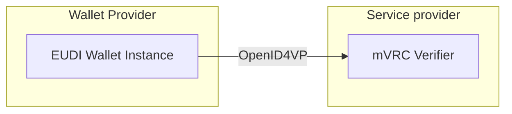

##### Sequence diagram
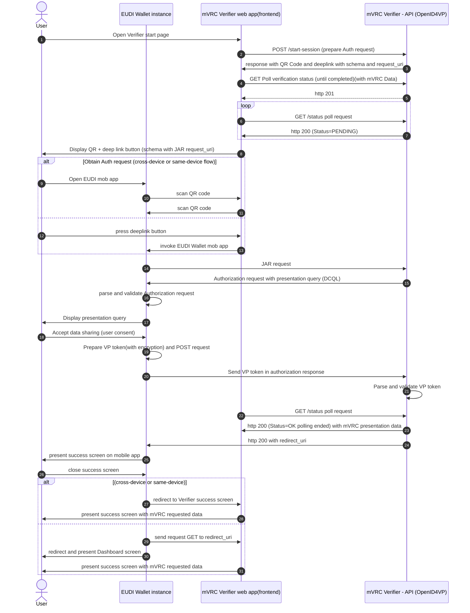

---

##### Extended flow
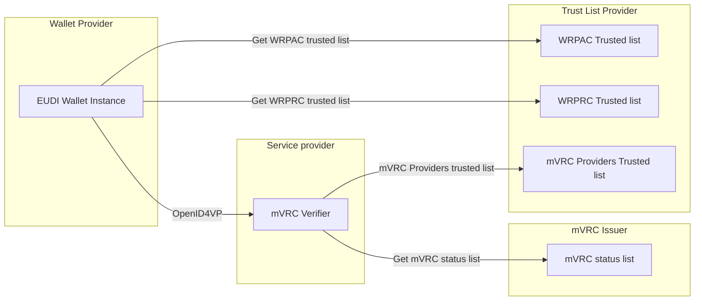

##### Sequence diagram
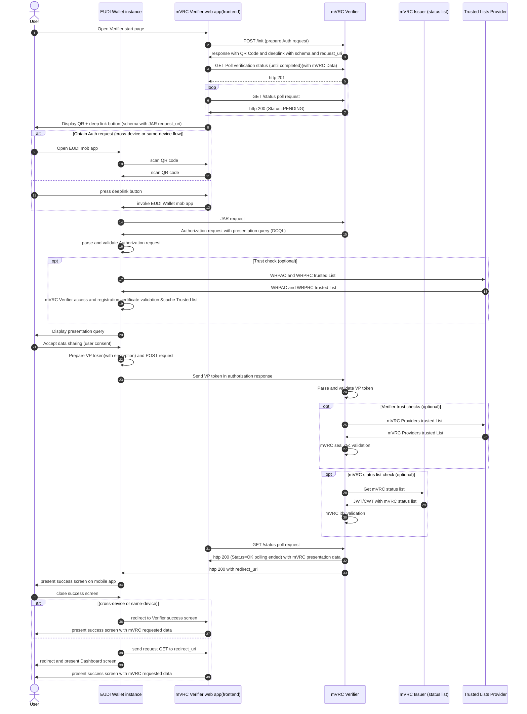

### 8.3. Scenario 1C – mVRC proximity data sharing

#### 8.3.1.	Functional requirements

Scenario 1C is based on proximity presentation mechanisms defined in ISO/IEC 18013‑5 and ISO/IEC TS 23220 standards and supports secure and interoperable in‑person presentation of mVRC data from the EUDI wallet to a proximity verifier/reader.

**EUDI Wallet Instance**

 Index | Requirement Title | Description | Priority | Acceptance Criteria |
|------:|-------------------|-------------|----------|---------------------|
| FR-W1C-01 | ISO/IEC 18013-5 Proximity Presentation Support | The Wallet SHALL support proximity-based presentation of mVRC attestations in accordance with ISO/IEC 18013-5, using Bluetooth Low Energy (BLE) for device engagement and secure data transfer. | High | The Wallet can successfully establish a proximity session with a compliant Reader device over BLE, complete device engagement, and transmit requested mVRC data in compliance with ISO/IEC 18013-5. |
| FR-W1C-02 | ETSI Presentation Profile Elements | The Wallet SHALL support the ETSI TS 119 472-2 presentation profile elements applicable to this proximity scenario, including reader/verifier identification, reader authentication where applicable, trust validation, encrypted session handling, holder binding, and status validation where applicable. | High | The Wallet successfully completes a proximity mVRC presentation flow with a compliant Reader and releases mVRC data only after successful request processing, user consent, secure session establishment, and proof-binding. |
| FR-W1C-03 | BLE Peripheral Server Mode Support | The Wallet SHALL support Bluetooth Low Energy (BLE) Peripheral Server Mode for proximity-based presentation of mVRC attestations in accordance with ISO/IEC 18013-5. | High | The Wallet can operate as a BLE peripheral, advertise availability, establish a secure session with a compliant Reader acting as central, and successfully transmit requested mVRC data. |
| FR-W1C-04 | BLE Central Client Mode Support | The Wallet MAY support Bluetooth Low Energy (BLE) Central Client Mode for proximity-based presentation of mVRC attestations in accordance with ISO/IEC 18013-5. | Low | If implemented, the Wallet can operate as a BLE central device, discover and connect to a compliant Reader acting as peripheral, establish a secure session, and transmit requested mVRC data in compliance with ISO/IEC 18013-5. |
| FR-W1C-05 | BLE Transport with Optional L2CAP Support | The Wallet MAY support Bluetooth Low Energy L2CAP Connection-Oriented Channels (CoC) as a transport mechanism for enhanced interoperability and performance. | Medium | If L2CAP CoC is implemented, it functions correctly for proximity data exchange. |
| FR-W1C-06 | Session Encryption Enforcement | The Wallet SHALL establish an encrypted session in accordance with ISO/IEC 18013-5 before transmitting any mVRC data. | High | No mVRC data is transmitted before a secure session is successfully established. |
| FR-W1C-07 | Support mso_mdoc Format | The Wallet SHALL support the mso_mdoc credential format for mVRC credentials, in accordance with ISO/IEC 18013-5 and applicable EUDI Wallet profiles. | High | The Wallet can successfully receive, store, and present mVRC credentials in mso_mdoc format. |
| FR-W1C-08 | mVRC Data Model Compliance | The Wallet SHALL support the standardized mVRC data model and structure as defined by ISO 7367 and the applicable mVRC rulebook. | High | The Wallet correctly interprets and processes mVRC data elements according to the standardized model and structure. |
| FR-W1C-09 | User Consent | The Wallet SHALL require explicit user consent before disclosing any mVRC data to a Reader. | High | No mVRC data is shared without an explicit user-approval action. |
| FR-W1C-10 | Key Binding Support | The Wallet SHALL support key binding mechanisms to ensure that presented mVRC data is cryptographically bound to the Wallet instance. | High | Presentations include a valid proof of possession bound to a wallet-controlled key. |
| FR-W1C-11 | mdoc Authentication Method | The Wallet SHOULD use MAC Authentication for mdoc device authentication in accordance with ISO/IEC 18013-5. If MAC Authentication is not technically feasible in the given implementation context, the Wallet MAY use mdoc ECDSA / EdDSA Authentication. | High | The Wallet uses MAC Authentication for mdoc device authentication where technically feasible. Where MAC Authentication cannot be used, the Wallet successfully performs mdoc ECDSA / EdDSA Authentication. |
| FR-W1C-12 | Reader Registration Certificate Handling | The Wallet SHALL support processing and validation of Reader registration certificates. | Medium | Registration certificates are successfully parsed and validated when present. |
| FR-W1C-13 | Reader Trust Validation | The Wallet SHALL verify the trust of the Reader using registration and access certificates against trusted lists. | High | Presentations proceed only if the Reader trust check succeeds. |
| FR-W1C-14 | Selective Disclosure | The Wallet SHALL support selective disclosure mechanisms to share only the minimum required mVRC data. | High | Only user-approved and requested attributes are included in the presentation. |
| FR-W1C-15 | Data Sharing Preview | The Wallet SHALL present the user with a clear preview of the data to be shared, including the Reader identity and the purpose of data sharing. | High | The user can review requested data, Reader name, and purpose before consent. |
| FR-W1C-16 | Optional Attribute Selection | The Wallet SHALL allow the user to select or deselect optional mVRC attributes prior to presentation. | Medium | Optional attributes can be toggled on or off by the user. |
| FR-W1C-17 | Success Screen Presentation | The Wallet SHALL display a success screen after a successful mVRC data presentation transaction. | High | A clear success confirmation is shown to the user after completion. |
| FR-W1C-18 | Error Handling and User Feedback | The Wallet SHALL handle protocol, trust, and validation errors and present a meaningful error state to the user. | Medium | Errors are correctly detected and a user-readable error message is displayed. |
| FR-W1C-19 | User-Initiated Cancellation | The Wallet SHALL allow the user to cancel the presentation process at any time before mVRC data disclosure. | Medium | The user can abort the flow and no data is disclosed after cancellation. |
| FR-W1C-20 | Device Engagement via QR and BLE | The Wallet SHALL support ISO/IEC 18013-5 device engagement using QR Code initiation and Bluetooth Low Energy (BLE) transport. | High | The Wallet can successfully initiate or respond to device engagement using a QR Code and establish a BLE proximity session with a compliant Reader. |
| FR-W1C-21 | Optional NFC Device Engagement Support | The Wallet MAY support ISO/IEC 18013-5 device engagement using Near Field Communication (NFC) as an alternative proximity transport mechanism. | Low | If implemented, the Wallet can successfully complete device engagement and data exchange over NFC in accordance with ISO/IEC 18013-5. |

**mVRC Proximity Reader**

| Index | Requirement Title | Description | Priority | Acceptance Criteria |
|------:|-------------------|-------------|----------|---------------------|
| FR-R1C-01 | ISO/IEC 18013-5 Proximity Presentation Support | The Reader SHALL support ISO/IEC 18013-5 proximity sessions for requesting and validating mVRC attestations over Bluetooth Low Energy (BLE). | High | The Reader can successfully establish a proximity session with a compliant Wallet and complete device engagement in accordance with ISO/IEC 18013-5. |
| FR-R1C-02 | ETSI Presentation Profile Elements | The Reader SHALL support the ETSI TS 119 472-2 presentation profile elements applicable to this proximity scenario, including Reader identification, reader authentication where applicable, trust validation, encrypted session handling, holder binding validation, and status validation where applicable. | High | The Reader successfully completes a proximity mVRC presentation flow with a compliant Wallet and validates the presentation response, reader context, trust information, and proof-binding. |
| FR-R1C-03 | BLE Central Mode Support | The Reader SHALL support Bluetooth Low Energy (BLE) Central mode when interacting with a Wallet acting as Peripheral. | High | The Reader can scan, discover and connect to a compliant Wallet advertising availability. |
| FR-R1C-04 | Optional BLE Peripheral Mode Support | The Reader MAY support BLE Peripheral mode for interoperability scenarios. | Low | If implemented, the Reader can accept connections from a compliant Wallet acting as Central. |
| FR-R1C-05 | Session Encryption Enforcement | The Reader SHALL establish and enforce an encrypted session in accordance with ISO/IEC 18013-5 before requesting or receiving any mVRC data. | High | No credential data is accepted before a secure session is successfully established. |
| FR-R1C-06 | mso_mdoc Format Support | The Reader SHALL support parsing and validating mso_mdoc credentials in accordance with ISO/IEC 18013-5 and applicable EUDI Wallet profiles. | High | The Reader successfully parses and processes received mVRC attestations in mso_mdoc format. |
| FR-R1C-07 | Data Model Compliance | The Reader SHALL interpret mVRC data elements in accordance with ISO 7367 and the applicable mVRC rulebook. | High | Received attributes are correctly mapped and validated against standardized data models. |
| FR-R1C-08 | Proof-of-Possession Validation | The Reader SHALL verify cryptographic proof-of-possession and holder binding for the received attestation. | High | The Reader rejects presentations where proof-of-possession validation fails. |
| FR-R1C-09 | mdoc Authentication Method Validation | The Reader SHALL support validation of both MAC Authentication and mdoc ECDSA / EdDSA Authentication in accordance with ISO/IEC 18013-5. | High | The Reader successfully validates mdoc presentations using MAC Authentication and mdoc presentations using ECDSA / EdDSA Authentication, and rejects presentations where the authentication method or cryptographic validation fails. |
| FR-R1C-10 | mVRC Seal Validation | The Reader SHOULD validate the cryptographic seal applied to the mVRC credential against trusted lists to ensure that the credential was issued by a trusted mVRC Issuer. | Medium | The Reader successfully validates the mVRC seal using trusted list information and rejects credentials with invalid or untrusted seals. |
| FR-R1C-11 | mVRC Status Verification | The Reader SHOULD verify the current validity status of the mVRC credential using the applicable mVRC status list, such as revocation or suspension status. | Medium | mVRC credentials with revoked or suspended status are correctly detected and rejected by the Reader. |
| FR-R1C-12 | Reader Authentication | The Reader SHALL support reader authentication mechanisms in accordance with ISO/IEC 18013-5 where applicable. | High | The Reader presents valid reader authentication data and is successfully authenticated by the Wallet when required. |
| FR-R1C-13 | Replay Protection Validation | The Reader SHALL ensure protection against replay attacks by validating session freshness and verifying that each mVRC presentation is cryptographically bound to the active ISO/IEC 18013-5 session. | High | Presentations that are not cryptographically bound to the active session or that reuse prior session parameters are rejected. |
| FR-R1C-14 | Error Handling | The Reader SHOULD detect protocol, validation and trust errors and provide an appropriate system response. | Medium | Invalid or non-compliant presentations are rejected and logged. |
| FR-R1C-15 | Session Termination Handling | The Reader SHALL properly terminate BLE sessions and securely dispose of session keys after completion. | Medium | Session keys are invalidated after session closure. |
| FR-R1C-16 | Optional L2CAP Support | The Reader MAY support BLE L2CAP Connection-Oriented Channels (CoC) as a transport enhancement. | Medium | If implemented, L2CAP CoC sessions function correctly and interoperably. |
| FR-R1C-17 | Success Screen Presentation | After successful verification of the mVRC presentation, the Reader SHALL present a success screen displaying the mVRC data that was shared during the verification process. | High | A clear success confirmation is shown to the Reader User after completion. |
| FR-R1C-18 | Device Engagement via QR and BLE | The Reader SHALL support ISO/IEC 18013-5 device engagement using QR Code scanning and Bluetooth Low Energy (BLE) transport. | High | The Reader can scan a QR Code, establish a BLE proximity session and successfully complete device engagement with a compliant Wallet. |
| FR-R1C-19 | Optional NFC Device Engagement Support | The Reader MAY support ISO/IEC 18013-5 device engagement using Near Field Communication (NFC) as an alternative proximity transport mechanism. | Low | If implemented, the Reader can successfully complete device engagement and receive credential data over NFC in accordance with ISO/IEC 18013-5. |
| FR-R1C-20 | Optional Attribute Request Definition | The Reader MAY define the scope and mandatory or optional property of requested mVRC attributes within a proximity verification session. | Medium | If implemented, the Reader can specify the scope of requested mVRC attributes or predefined mVRC data sets, including which attributes are mandatory and which are optional, and the Wallet processes the request according to that query. |

---

#### 8.3.2.	Protocol profile

**ISO/IEC 18013‑5 / Proximity mdoc (BLE)**

Specification: ISO/IEC 18013-5:2021  

Characteristics:

- Proximity-based presentation of mVRC attestations using ISO/IEC 18013-5;
- Device-to-device interaction using Bluetooth Low Energy (BLE);
- Device engagement using QR Code (required) and NFC (optional);
- Credential format: mso_mdoc;
- Support for selective disclosure of requested attributes;
- Holder binding using proof-of-possession mechanisms;
- Support for Reader authentication where applicable;
- Support for encrypted session establishment and secure data transfer;
- Wallet operating mode: BLE Peripheral Server (required) and BLE Central Client (optional);
- Reader operating mode: BLE Central Client (required) and BLE Peripheral Server (optional);
- Supported BLE profiles: GATT (required) and L2CAP Connection-Oriented Channels (optional);
- Support for credential status verification using IETF Status Lists;
- Support for Reader registration and access certificate validation;
- Support for trust validation using ETSI Trusted Lists;
- MAC Authentication preferred for mdoc device authentication;
- Support for mdoc ECDSA / EdDSA Authentication where MAC Authentication is not technically feasible.

---

#### 8.3.3.	Trust and security mechanisms

The scenario relies on a combination of cryptographic and trust mechanisms to ensure secure and reliable proximity presentation and validation of mVRC data, including:

- Holder binding and proof-of-possession (PoP);
- Encrypted session establishment and secure session management in accordance with ISO/IEC 18013-5;
- Use of ephemeral keys and session key derivation for proximity communication;
- Reader authentication mechanisms in accordance with ISO/IEC 18013-5 where applicable;
- MAC Authentication for mdoc device authentication where supported;
- mdoc ECDSA / EdDSA Authentication where MAC Authentication is not technically feasible;
- Validation of Reader registration and access certificates using ETSI Trusted Lists;
- Validation of Reader trust status using ETSI Trusted Lists;
- Validation of mVRC issuer signatures and seals;
- Validation of mVRC issuer trust anchors using ETSI Trusted Lists;
- Verification of mVRC credential status using IETF Status Lists;
- Selective disclosure mechanisms supporting data minimisation principles;
- Alignment with ETSI TS 119 472-2 presentation profiles and applicable ISO/IEC 18013-5 requirements.

---

#### 8.3.4. Endpoints

Proximity interactions do not rely on traditional network endpoints. Communication is performed directly between the EUDI wallet and the reader device using short range communication technologies.

Where applicable, backend services such as status list servers may be queried by the reader during validation.

---

#### 8.3.5.	Technical interaction flow – sequence diagrams

The following sequence diagram illustrates the proximity presentation flow for the scenario 1C and shows the technical interaction between the user's EUDI wallet, the reader device and supporting components.

The diagram presents the main steps involved in the establishment of the session, secure data exchange and validation of mVRC data using ISO/IEC 18013 5 proximity mechanisms.

##### Basic flow
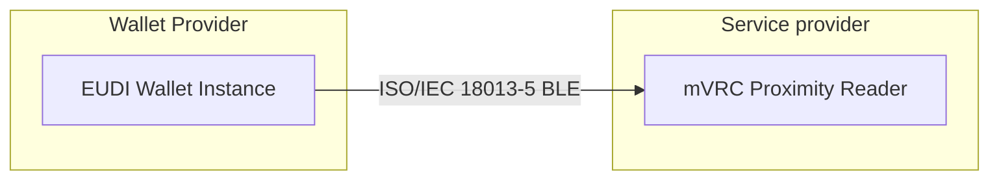

##### Sequence diagram

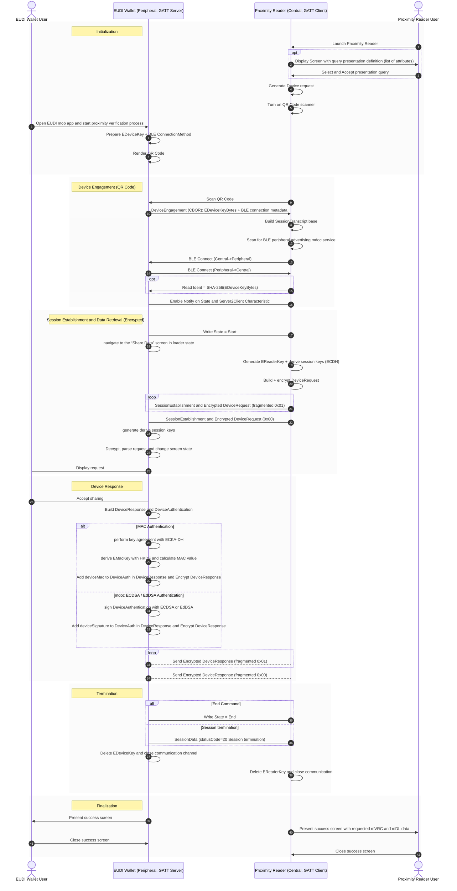

---

##### Extended flow
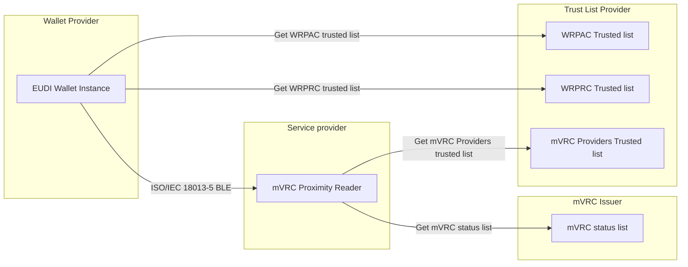

##### Sequence diagram

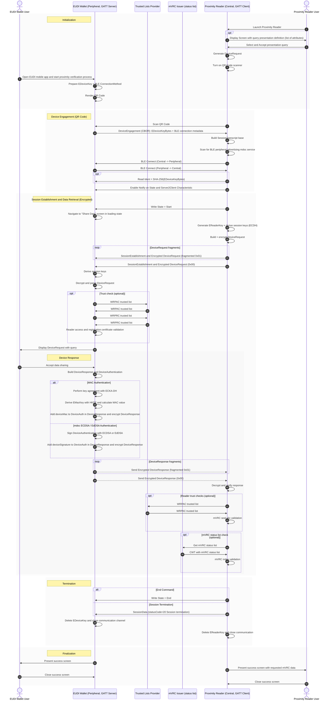

### 8.4. Scenario 2A – Delegated mVRC issuance (w2w)

#### 8.4.1.	Functional requirements

Scenario 2A is based on a delegated mVRC issuance model, where a vehicle owner or holder authorises the issuance of a delegated mVRC credential to another user (consumer) using the EUDI wallets.

The scenario combines OpenID4VCI 1.0 for issuance of the delegated mVRC to the consumer (delegated user) wallet and, where owner or holder verification is performed using the wallet, OpenID4VP 1.0 aligned with HAIP 1.0 for verification of the vehicle owner or holder.

The delegation flow requires authorisation of the delegation by the vehicle owner or holder. Where owner or holder verification is performed through OpenID4VP, they present the source mVRC and an identity credential. Alternatively, the mVRC issuer may perform owner or holder authentication and verification using another mechanism.

Following successful verification and delegation authorisation, a delegated mVRC credential containing the defined scope of vehicle privileges, consumer identity data, and validity period is issued to the consumer wallet.


**User (vehicle owner or holder) EUDI Wallet Instance**

Before delegated mVRC issuance can proceed, the vehicle owner SHALL be authenticated and verified by the mVRC issuer service. This authentication and verification MAY be performed either through a redirect-based OpenID4VP presentation flow involving the user EUDI wallet instance or through an alternative authentication and verification mechanism provided by the mVRC issuer service, such as a web-based or native application flow.

The requirements in this section apply only when vehicle owner authentication and verification are performed through a redirect-based OpenID4VP presentation flow using the User EUDI wallet instance. Where the mVRC issuer service uses another authentication and verification mechanism, the requirements defined in this section are not applicable.


| Index | Requirement Title | Description | Priority | Acceptance Criteria |
|------:|-------------------|-------------|----------|---------------------|
| FR-WO2A-00 | Conditional Applicability of Owner/holder Wallet Requirements | The User EUDI Wallet instance is required only where the vehicle owner or holder authentication and verification is performed using an OpenID4VP-based presentation flow. Where the vehicle owner or holder is authenticated and verified through another mechanism provided by the mVRC Issuer service, such as a web-based or native application flow, the remaining requirements in this section do not apply. | High | The scenario can proceed either with OpenID4VP-based owner or holder verification using the User EUDI Wallet instance or with an alternative owner or holder authentication and verification mechanism provided by the mVRC Issuer service. |
| FR-WO2A-01 | OpenID4VP Support for Owner/ holder Verification | If owner or holder verification is implemented using OpenID4VP, the Wallet SHALL support the OpenID for Verifiable Presentations (OpenID4VP) 1.0 protocol for remote presentation of credentials required in the delegation initiation flow. | High| Where OpenID4VP-based owner or holder verification is used, the Wallet successfully completes an OpenID4VP flow with a compliant Verifier operated by the mVRC Issuer service. |
| FR-WO2A-02 | ETSI Presentation Profile Support | If owner or holder verification is implemented using OpenID4VP, the Wallet SHALL support the ETSI TS 119 472-2 presentation profile elements applicable to this scenario, including signed Request Object processing, verifier identification, verifier information processing, encrypted presentation response, and holder binding. | High | Where OpenID4VP-based owner or holder verification is used, the Wallet releases credential data only after successful request processing, user consent, and proof-binding. |
| FR-WO2A-03 | HAIP 1.0 Profile Elements | If owner or holder verification is implemented using OpenID4VP, the Wallet SHALL support the relevant High Assurance Interoperability Profile (HAIP) 1.0 requirements for presentation flows in this scenario. | Medium | Where OpenID4VP-based owner or holder verification is used, the presentation flow applies the relevant HAIP-defined security and assurance requirements. |
| FR-WO2A-04 | Support mso_mdoc Format for mVRC | If owner or holder verification is implemented using OpenID4VP, the Wallet SHALL support presentation of source mVRC credentials encoded as `mso_mdoc`, in accordance with ISO/IEC 18013-5 and applicable EUDI Wallet profiles. | High | Where OpenID4VP-based owner or holder verification is used, the Wallet successfully presents the source mVRC credential in `mso_mdoc` format. |
| FR-WO2A-05 | mVRC Data Model Compliance | If owner or holder verification is implemented using OpenID4VP, the Wallet SHALL support the standardized mVRC data model and structure as defined by ISO 7367 and the applicable mVRC rulebook. | High | The Wallet correctly interprets and processes mVRC data elements according to the standardized model and structure. |
| FR-WO2A-06 | Support Identity Credential in mso_mdoc Format | If owner or holder verification is implemented using OpenID4VP and an identity credential is requested, the Wallet SHALL support presentation of the required identity credential, such as PID or mDL, in `mso_mdoc` format where applicable. | High | Where requested, the Wallet successfully presents the required identity credential in the expected format. |
| FR-WO2A-07 | Combined Presentation Support | If owner or holder verification is implemented using OpenID4VP and both the source mVRC and an identity credential are required, the Wallet SHALL support combined presentation of both credentials within the same OpenID4VP transaction when requested by the Verifier. | High| The Wallet successfully completes a presentation flow in which both the source mVRC and the required identity credential are presented in the same transaction. |
| FR-WO2A-08 | User Consent | The wallet SHALL require explicit user consent before disclosing credential data to a Verifier. | High | No credential data is shared without an explicit user-approval action. |
| FR-WO2A-09 | Key Binding Support | The wallet SHALL support key binding mechanisms to ensure that presented credential data is cryptographically bound to the wallet instance. | High | Presentations include a valid proof of possession bound to a wallet-controlled key. |
| FR-WO2A-10 | Cross-Device and Same-Device Flow | The wallet SHALL support cross-device flows using QR code scanning and same-device flows using deeplinks to initiate authorization requests. | High | Both QR-based and deeplink-based authorization requests can be successfully initiated. |
| FR-WO2A-11 | Authorization Request Initialization | The wallet SHALL be able to initialize the OpenID4VP authorization request based on Verifier-provided parameters. | High | The wallet correctly processes and responds to an OpenID4VP authorization request. |
| FR-WO2A-12 | Verifier Registration Certificate Handling | The wallet SHALL support processing and validation of Verifier registration certificates. | Medium | Registration certificates are successfully parsed and validated when present. |
| FR-WO2A-13 | Verifier Trust Validation | The wallet SHALL verify the trust of the Verifier using registration and access certificates against trusted lists. | High | Presentations proceed only if the Verifier trust check succeeds. |
| FR-WO2A-14 | Selective Disclosure | The wallet SHALL support selective disclosure mechanisms to share only the minimum required credential data. | High | Only user-approved and requested attributes are included in the presentation. |
| FR-WO2A-15 | Data Sharing Preview | The wallet SHALL present the user with a clear preview of the data to be shared, including the Verifier identity and the purpose of data sharing. | High | The user can review requested data, Verifier name, and purpose before consent. |
| FR-WO2A-16 | Optional Attribute Selection | The wallet SHALL allow the user to select or deselect optional attributes prior to presentation. | Medium | Optional attributes can be toggled on or off by the user. |
| FR-WO2A-17 | VP Token Encryption | The wallet SHALL encrypt the verifiable presentation when using the `direct_post.jwt` response mode. | High | The VP token is transmitted in encrypted form to the Verifier. |
| FR-WO2A-18 | Success Screen Presentation | The wallet SHALL display a success screen after a successful credential presentation transaction. | Low | A clear success confirmation is shown to the user after completion. |
| FR-WO2A-19 | Post-Presentation Redirect | The wallet SHALL support redirection after a successful credential presentation, when requested by the Verifier. | Low | The wallet correctly performs a redirect following a successful transaction. |
| FR-WO2A-20 | Verifier Metadata Resolution | The wallet SHALL resolve and process Verifier metadata as defined by OpenID4VP to determine supported formats, algorithms, and response modes. | High | The wallet successfully retrieves and applies Verifier metadata during the presentation flow. |
| FR-WO2A-21 | Nonce Handling and Replay Protection | The wallet SHALL support nonce handling and include nonce values in verifiable presentations to prevent replay attacks. | High | Presentations include a valid nonce and are rejected if nonce validation fails. |
| FR-WO2A-22 | Error Handling and User Feedback | The wallet SHALL handle protocol, trust, and validation errors and present a meaningful error state to the user. | Medium | Errors are correctly detected and a user-readable error message is displayed. |
| FR-WO2A-23 | User-Initiated Cancellation | The wallet SHALL allow the user to cancel the presentation process at any time before credential data disclosure. | Medium | The user can abort the flow and no data is disclosed after cancellation. |

**Consumer's EUDI Wallet Instance**

| Index | Requirement Title | Description | Priority | Acceptance Criteria |
|------:|-------------------|-------------|----------|---------------------|
| FR-WD2A-01 | OpenID4VCI Issuance Support | The Wallet SHALL support the OpenID for Verifiable Credential Issuance (OpenID4VCI) protocol for issuance of delegated mVRC attestations, including credential offer processing, authorization, token handling, and credential requests. | High | The Wallet successfully completes an OpenID4VCI issuance flow with a compliant Issuer and receives a delegated mVRC attestation. |
| FR-WD2A-02 | ETSI Issuance Profile Support | For redirect-based OpenID4VCI issuance flows, the Wallet SHALL support the ETSI TS 119 472-3 issuance profile elements applicable to this scenario. | High | The Wallet successfully completes redirect-based delegated mVRC issuance flows that apply the ETSI issuance profile requirements. |
| FR-WD2A-03 | HAIP 1.0 Profile Elements | The Wallet SHALL support the relevant High Assurance Interoperability Profile (HAIP) 1.0 requirements for issuance flows in this scenario. | High | Delegated mVRC issuance flows apply the relevant HAIP-defined security and assurance requirements. |
| FR-WD2A-04 | Delegated mVRC Data Model and Structure Support | The EUDI Wallet Instance SHALL support processing, storage, and presentation of delegated mVRC credentials using a data model and structure compliant with ISO 7367, the applicable mVRC rulebook, and the delegated vehicle privileges model used in the scenario. | High | The wallet correctly processes and presents delegated mVRC credentials conforming to the expected data model and structure without data loss or misinterpretation. |
| FR-WD2A-05 | Delegated mVRC Credential Format Support | The EUDI Wallet Instance SHALL support receiving, processing, and storing delegated mVRC attestations encoded as `mso_mdoc`. | High | The wallet stores and later retrieves an issued delegated mVRC in `mso_mdoc` format. |
| FR-WD2A-06 | Credential Offer Initialization | The Wallet SHALL support QR Code-based initiation of the delegated mVRC issuance flow using issuance initiation data generated by the mVRC Issuer service after successful vehicle owner or holder verification. | High | Issuance succeeds when the consumer scans the QR Code containing or referencing the credential offer or issuance initiation data generated for the verified delegation transaction. |
| FR-WD2A-07 | User Consent for Issuance | The EUDI Wallet Instance SHALL display information about the offered delegated mVRC and require explicit user consent before proceeding. | High | The user can approve or cancel issuance after reviewing credential information. |
| FR-WD2A-08 | PKCE Support | The wallet SHALL support PKCE for authorization code flows, including code verifier and challenge handling. | High | Token exchange succeeds only with a valid PKCE code verifier. |
| FR-WD2A-09 | Client Attestation JWT Support | The Wallet SHALL support client authentication using Client Attestation JWT where required. In this scenario, the Client Attestation JWT SHALL be provided as a Wallet Instance Attestation (WIA), in accordance with ARF TS3 and the applicable OpenID4VCI / ETSI TS 119 472-3 profile requirements. | High | Token requests using a valid WIA and corresponding proof-of-possession succeed where Client Attestation JWT authentication is required. |
| FR-WD2A-10 | Consumer Identity Verification Support | The Wallet SHALL support consumer identity verification prior to delegated mVRC issuance using the verification interaction model selected by the Issuer. The verification MAY be performed using a redirect-based OpenID4VP presentation flow or an IAE-based OpenID4VP interaction within the OpenID4VCI authorization process. | High | The Wallet completes delegated mVRC issuance only after successful consumer identity verification using the interaction model selected by the Issuer. |
| FR-WD2A-11 | Redirect-Based OpenID4VP Identity Verification | Where consumer identity verification is implemented using redirect-based OpenID4VP, the Wallet SHALL support OpenID4VP 1.0 for presentation of the required consumer identity credential prior to delegated mVRC issuance. | High | The Wallet successfully completes the redirect-based OpenID4VP identity verification flow and returns the required presentation response. |
| FR-WD2A-12 | IAE-Based OpenID4VP Identity Verification | Where consumer identity verification is implemented using an IAE-based OpenID4VP interaction, the Wallet SHALL support processing an OpenID4VP request provided through the Interactive Authorization Endpoint and submitting the corresponding OpenID4VP response according to the supported OpenID4VCI 1.1 interaction model. | High | The Wallet successfully processes the OpenID4VP request, completes the required presentation, and submits the resulting response through the Interactive Authorization Endpoint. |
| FR-WD2A-13 | Identity Credential Format Support | The Wallet SHALL support presentation of the consumer identity credential encoded as mso_mdoc where required by the Issuer. | High | The Wallet presents the required consumer identity credential in the expected format when requested. |
| FR-WD2A-14 | User Consent for Verification | The Wallet SHALL display information about requested identity data prior to delegated mVRC issuance and require explicit user consent before proceeding. | High | The consumer can approve or cancel the verification process after reviewing the requested identity data. |
| FR-WD2A-15 | Key Attestation in Credential Request Proof | The Wallet SHALL include a Key Attestation (KA) in the credential request proof when required, in accordance with ARF TS3 and OpenID4VCI Appendix D: Key Attestations. The proof SHALL demonstrate possession of the private key corresponding to the public key attested in the KA and used for holder binding of the issued delegated mVRC attestation. | High | The Wallet successfully obtains a key-bound delegated mVRC attestation after submitting a credential request containing a valid KA and proof-of-possession for the attested wallet-controlled key. |
| FR-WD2A-16 | Holder Binding and Proof-of-Possession | The EUDI Wallet Instance SHALL support holder binding and proof-of-possession mechanisms in line with HAIP requirements. | High | Issuance succeeds only when valid proof-of-possession is provided. |
| FR-WD2A-17 | Display of Delegated mVRC Credential Data | The EUDI Wallet Instance SHALL display the core data contained in a successfully issued delegated mVRC credential to the user after completion of the issuance process. | High | The wallet displays the delegated mVRC credential only after successful issuance and validation, with data accurately reflecting the credential payload. If issuance or validation fails, the delegated mVRC credential is not displayed to the consumer (delegated user). |
| FR-WD2A-18 | Secure Storage of Delegated mVRC | The EUDI Wallet Instance SHOULD securely store issued delegated mVRC attestations and associated metadata. | High | The issued delegated mVRC is securely stored and accessible only with user authorization. |
| FR-WD2A-19 | Protocol Error Handling | The EUDI Wallet Instance SHALL handle protocol, validation, and network errors gracefully and inform the consumer (delegated user). | Medium | The wallet displays meaningful error messages when issuance fails. |
| FR-WD2A-20 | Issuer Access Certificate Validation (ETSI TL) | The wallet SHOULD validate the Issuer's access certificate using an ETSI Trusted List where applicable. | Medium | The wallet accepts issuers with trusted certificates and rejects invalid ones. |
| FR-WD2A-21 | Issuer Registration Certificate Validation (ETSI TL) | The wallet SHOULD validate the Issuer's registration certificate using an ETSI Trusted List where required. | Medium | The wallet rejects issuance from issuers with invalid registration status. |
| FR-WD2A-22 | Issuer Seal Validation (ETSI TL) | The wallet SHOULD validate the cryptographic seal on the issued delegated mVRC using trusted list material. | Medium | The wallet stores only delegated mVRC attestations signed by trusted issuers. |
| FR-WD2A-23 | DPoP Support | The wallet SHALL support DPoP for token requests and related proof handling when required by the Authorization Server. | High | The wallet successfully completes token requests when DPoP is required. Requests with missing, invalid, or expired DPoP proof are rejected. |
| FR-WD2A-24 | ETSI Issuance Profile Support | The EUDI Wallet Instance SHALL support the applicable provisions of the ETSI issuance profile used in the scenario. | High | The wallet successfully completes issuance flows that apply the ETSI issuance profile requirements. Flows fail when required profile elements are missing or invalid. |
| FR-WD2A-25 | Interactive Authorization Endpoint Support | Where the Issuer uses the IAE-based OpenID4VP interaction model for consumer identity verification, the Wallet SHALL support the Interactive Authorization Endpoint as part of the delegated mVRC issuance flow. | High | The Wallet successfully completes delegated mVRC issuance using the Interactive Authorization Endpoint when this interaction model is selected by the Issuer. |

**mVRC / Delegated mVRC Issuer**


| Index | Requirement Title | Description | Priority | Acceptance Criteria |
|------:|-------------------|-------------|----------|---------------------|
| FR-I2A-001 | Delegation Service Support | The Issuer SHALL provide a dedicated service enabling the vehicle owner or holder to initiate delegated mVRC issuance. | High | The vehicle owner or holder can access a service that starts the delegated mVRC issuance workflow. |
| FR-I2A-002 | Delegation Parameter Input | The Issuer SHOULD allow the vehicle owner or holder to define the validity period and scope of delegated vehicle privileges. | Medium | The service accepts delegation scope and validity period input before issuance proceeds. |
| FR-I2A-003 | Vehicle Owner or Holder Verification | The Issuer SHALL verify the identity of the vehicle owner or holder and the entitlement to initiate the delegation before the delegated mVRC issuance process proceeds. The verification MAY be performed using an OpenID4VP presentation flow or another authentication and verification mechanism provided by the mVRC Issuer service, such as a web-based or native application flow. | High | Delegated mVRC issuance proceeds only after successful verification of the vehicle owner or holder identity and delegation entitlement. |
| FR-I2A-004 | OpenID4VP Owner Verification | The Issuer MAY support OpenID4VP 1.0 to request and validate presentation of the source mVRC and, where required, an identity credential from the vehicle owner or holder during delegation initiation. | Medium | Where OpenID4VP owner or holder verification is used, the Issuer successfully completes an OpenID4VP flow in which the vehicle owner or holder presents the required credentials. |
| FR-I2A-005 | Alternative Owner Authentication in Issuer Service | The Issuer MAY support vehicle owner or holder authentication and entitlement verification through another authentication mechanism provided by the mVRC Issuer service, such as a web-based or native application flow. | Medium | Where the alternative owner authentication mechanism is used, delegated mVRC issuance proceeds only after the Issuer service confirms the owner or holder identity and entitlement to delegate the vehicle. |
| FR-I2A-006 | ETSI Presentation Profile Support for Owner Verification | Where OpenID4VP owner or holder verification is used, the Issuer SHALL support the ETSI TS 119 472-2 presentation profile elements applicable to this scenario, including signed Request Object generation, verifier identification, verifier information, encrypted presentation response handling, and holder binding validation. | Medium | Where OpenID4VP owner or holder verification is used, the Issuer validates the presentation response, verifier context, and proof-binding in accordance with the applicable presentation profile elements. |
| FR-I2A-007 | Support OpenID4VCI Issuance | The Issuer SHALL support OpenID4VCI issuance flows for issuance of delegated mVRC credentials to the consumer Wallet. | High | The Issuer successfully completes an OpenID4VCI issuance flow with a compliant consumer Wallet. |
| FR-I2A-008 | ETSI Issuance Profile Support | The Issuer and Authorization Server SHALL support the ETSI TS 119 472-3 issuance profile elements applicable to the delegated mVRC issuance flow, including the applicable OpenID4VCI, authorization, token, credential issuance, issuer metadata, trust, and certificate validation requirements. | High | The Issuer successfully completes delegated mVRC issuance flows with compliant Wallets using the applicable ETSI TS 119 472-3 issuance profile elements. Issuance fails where required profile elements, trust material, or certificate validation requirements are missing or invalid. |
| FR-I2A-009 | Authorization Code Flow Support | The Issuer SHALL support the authorization code flow for delegated mVRC issuance. | High | The Issuer successfully issues a delegated mVRC using the authorization code flow. |
| FR-I2A-010 | Credential Offer Support | The Issuer SHALL provide a credential offer for the delegated mVRC issuance flow and make it available through issuance initiation data, such as a QR Code or credential offer URI. | High | The consumer Wallet can obtain and process the credential offer and start delegated mVRC issuance. |
| FR-I2A-011 | Consumer Identity Verification | The Issuer SHALL verify the identity of the consumer before issuing the delegated mVRC. The verification MAY be performed using an OpenID4VP presentation flow or an IAE-based OpenID4VP interaction within the OpenID4VCI authorization process, depending on the implementation model supported by the Issuer and the Wallet. | High | A delegated mVRC is issued only after successful consumer identity verification. |
| FR-I2A-012 | OpenID4VP Consumer Verification | Where consumer identity verification is implemented using OpenID4VP, the Issuer SHALL request and validate presentation of the required consumer identity credential using OpenID4VP 1.0. | High | Delegated mVRC issuance proceeds only after the required consumer identity credential has been successfully validated through the OpenID4VP flow. |
| FR-I2A-013 | IAE-Based OpenID4VP Consumer Verification | Where consumer identity verification is implemented using an IAE-based OpenID4VP interaction, the Issuer SHALL return or provide an OpenID4VP request through the Interactive Authorization Endpoint and validate the resulting OpenID4VP response before issuing the delegated mVRC. | High | The consumer Wallet receives a valid OpenID4VP request through the Interactive Authorization Endpoint and completes identity verification before issuance proceeds. |
| FR-I2A-014 | Consumer Identity Credential Support | The Issuer SHALL support requesting, processing, and validating the consumer identity credential, using PID or mDL, prior to issuance of the delegated mVRC. | High | Delegated mVRC issuance succeeds only when the required consumer identity credential is successfully validated. |
| FR-I2A-015 | Support mso_mdoc Format for Delegated mVRC | The Issuer SHALL issue delegated mVRC credentials in `mso_mdoc` format. | High | The delegated mVRC is issued in `mso_mdoc` format and can be processed by a compliant Wallet. |
| FR-I2A-016 | Delegated mVRC Data Model Compliance | The Issuer SHALL issue delegated mVRC credentials using a data model and structure compliant with ISO 7367, the applicable mVRC rulebook, and the delegated vehicle privileges model used in the scenario. | High | The issued delegated mVRC conforms to the expected data model and structure. |
| FR-I2A-017 | Delegated mVRC Generation | The Issuer SHALL generate the delegated mVRC containing the delegated privileges, consumer data, and the validity period defined during the delegation process. | High | The issued credential contains the expected delegation scope, consumer data, and validity period. |
| FR-I2A-018 | Credential Signing | The Issuer SHALL sign the delegated mVRC using its applicable signing certificate and trust chain. | High | The delegated mVRC is cryptographically signed and can be validated by relying parties. |
| FR-I2A-019 | Holder Binding Support | The Issuer SHALL issue the delegated mVRC bound to the consumer Wallet in accordance with the applicable proof-of-possession and holder binding requirements. | High | The issued delegated mVRC is cryptographically bound to the consumer Wallet. |
| FR-I2A-020 | PKCE Validation | The Issuer SHALL support and validate PKCE in authorization code issuance flows. | High | Token exchange succeeds only when a valid PKCE code verifier is presented. |
| FR-I2A-021 | Support Client Attestation JWT Authentication | The Authorization Server SHALL support client authentication using Client Attestation JWT provided as a Wallet Instance Attestation (WIA), in accordance with ARF TS3 and the applicable OpenID4VCI / ETSI TS 119 472-3 profile requirements. | High | Token requests using a valid WIA and corresponding proof-of-possession succeed; invalid, expired, or untrusted attestations are rejected. |
| FR-I2A-022 | Key Attestation Validation in Credential Request Proof | The Issuer SHALL validate the Key Attestation (KA) included in the credential request proof when required, in accordance with ARF TS3 and OpenID4VCI Appendix D: Key Attestations. The Issuer SHALL verify that the proof demonstrates possession of the private key corresponding to the public key attested in the KA and used for holder binding of the issued delegated mVRC attestation. | High | The Issuer issues a key-bound delegated mVRC attestation only after successfully validating the KA and the corresponding proof-of-possession for the attested wallet-controlled key. |
| FR-I2A-023 | DPoP Validation | The Issuer SHALL support and validate DPoP for token requests where required by the Authorization Server. | High | Token requests with missing, invalid, or expired DPoP proof are rejected. |
| FR-I2A-024 | Issuer Metadata Publication | The Issuer SHALL publish the metadata required for delegated mVRC issuance, including supported credential configurations, proof types, endpoints, authorization capabilities, and IAE support where applicable. | High | A compliant Wallet can retrieve and use Issuer metadata to complete the delegated mVRC issuance flow. |
| FR-I2A-025 | Signed Credential Issuer Metadata Publication | The Issuer SHALL publish signed OpenID4VCI Credential Issuer Metadata where required by ETSI TS 119 472-3. The Issuer SHALL sign the metadata using the private key corresponding to the public key in the Issuer Access Certificate and SHALL include the certificate material required by the ETSI profile in the JWS protected header. | High | The Wallet retrieves the signed Credential Issuer Metadata, verifies the metadata signature and certificate material, and uses the metadata to continue the delegated mVRC issuance flow. |
| FR-I2A-026 | Issuer Access Certificate and Trust Validation Support | The Issuer SHALL use issuer access certificates and trust material in accordance with the applicable ETSI TS 119 472-3 and trust framework requirements for delegated mVRC issuance. | High | Wallets can validate the Issuer's trust status and certificate material during delegated mVRC issuance using the applicable trusted list or trust framework information. |
| FR-I2A-027 | Trust Validation of Wallet and Presented Credentials | The Issuer SHOULD validate the trust status of wallets and presented credentials according to the applicable trust framework and trusted list material. | Medium | Untrusted wallets or credentials are detected and rejected according to the applicable trust model. |
| FR-I2A-028 | Registry Maintenance | The Issuer SHALL maintain a registry of issued delegated mVRC credentials. | Medium | Issued delegated mVRC credentials are recorded in the Issuer registry. |
| FR-I2A-029 | Error Handling | The Issuer SHOULD handle protocol, validation, and trust errors and return consistent error responses. | Medium | Errors are returned in a consistent form and logged for diagnostics. |
| FR-I2A-030 | Session Linking Between Owner or Holder and Consumer | The Issuer SHALL maintain linkage between the verified vehicle owner or holder session and the consumer issuance session. | High | The delegated mVRC is issued only within the verified delegation transaction initiated by the vehicle owner or holder. |
| FR-I2A-031 | Issuance Initiation Data for Consumer Wallet | After successful vehicle owner or holder verification, the Issuer SHALL enable continuation to the consumer issuance step by generating issuance initiation data, such as a QR Code containing or referencing a credential offer for the delegated mVRC. The QR Code SHALL be presented to the consumer so that the consumer can scan it with their Wallet and initiate the delegated mVRC issuance flow. | High | After successful owner or holder verification, the Issuer generates issuance initiation data that can be presented to the consumer and successfully scanned by the consumer Wallet to start delegated mVRC issuance. |

---

#### 8.4.2	Attestation description

The data model for **delegated mVRC** is presented in the mVRC rulebook, which is based on ISO/IEC DTS 7367-2. The EU mVRC profile has been added to the rulebook based on the Proposal of the Directive of the European Parliament and of the Council on the registration documents for vehicles and vehicle registration data recorded in national vehicle registers and repealing Council Directive 1999/37/EC (November, 2025).

The delegated mVRC reuses the standard mVRC vehicle registration data structure and adds a delegation object in a dedicated namespace, `org.iso.7367.2.1.EU.delegation`, to describe the delegated right to use the vehicle. This RFC proposes an initial structure of that object for interoperability testing.

##### 8.4.2.1 Mandatory attributes

| Data Identifier | Definition | Data type | Example value |
|---|---|---|---|
| `delegation_permission_id` | Unique identifier of the mVRC delegation permission or delegated  mVRC issuance transaction. | string | `00b91349-f07a-44d8-94c6-db69f2b72a1a` |
| `privileges_scope` | Overall scope of delegated vehicle privileges. | string | `full` |
| `delegating_user` |  Name of the legal person who is the vehicle owner or holder and ordered the delegation  | object | |

##### 8.4.2.2 Conditional attributes

| Data Identifier | Definition | Data type | Example value |
|---|---|---|---|
| `partial_privileges` | SHALL be present when `vehicle_privileges.privileges_scope` is set to `partial`. | array of strings | `["drive", "road_suitability"]` |
| `organization_name` | Name of the legal person who is the vehicle owner or holder and ordered the delegation. | string | Example Rental Company |
| `family_name` | Family name of the natural person who is the vehicle owner or holder and ordered the delegation. | string | Mustermann |
| `given_name` | Given name of the natural person who is the vehicle owner or holder and ordered the delegation. | string | Max |

##### 8.4.2.3 Object encoding

| **Data Identifier** | **Attribute identifier** | **Encoding format** | **Namespace**|
|------------------------|--------------|------------------|------------------|
| `delegation_permission_id` | `delegation_permission_id` | tstr | `org.iso.7367.2.1.EU.delegation`|
| `vehicle_privileges` |   `vehicle_privileges` | map, see [Attribute vehicle_privileges](#Attribute-vehicle_privileges) | `org.iso.7367.2.1.EU.delegation`|
| `delegating_user` | Organization or natural person who is the vehicle owner or holder and ordered the delegation. | object | `{ "organization_name": "Example Rental Company" }` |

<br>

###### Attribute vehicle_privileges

The attribute `vehicle_privileges` is encoded as a type `vehicle_privileges`. Using CDDL notation as specified in RFC 8610, the encoding of this attribute is:

```cddl
vehicle_privileges = {
  "privileges_scope": privileges_scope_enum,
  ? "partial_privileges": [+ partial_privilege_enum]
}

privileges_scope_enum = "full" / "partial"

partial_privilege_enum = "drive"
                       / "road_suitability"
                       / "id_plate"
                       / "technical_properties"

```

`vehicle_privileges` SHALL contain the key-value pair `privileges_scope`.

If `privileges_scope` is set to `partial`, the key-value pair `partial_privileges` SHALL be present and SHALL contain one or more values from the allowed set.

If `privileges_scope` is set to `full`, the key-value pair `partial_privileges` SHALL NOT be present.

If present, `partial_privileges` SHALL contain one or more values from the following set:

**`drive`, `road_suitability`, `id_plate`, `technical_properties`**

<br>

###### Attribute delegating_user

The attribute `delegating_user` is encoded as a type `delegating_user`. Using CDDL notation as specified in RFC 8610, the encoding of this attribute is:

```cddl
delegating_user = delegating_organization / delegating_natural_person

delegating_organization = {
  "organization_name": tstr
}

delegating_natural_person = {
  "family_name": tstr,
  "given_name": tstr
}
```


If `organization_name` is present, `family_name` and `given_name` SHALL be absent.

If `given_name` is present, `family_name` SHALL also be present and `organization_name` SHALL be absent.

<br>

###### CDDL definition

```cddl
delegated_mVRC_delegation_object = {
  "delegation_permission_id": tstr,
  "vehicle_privileges": vehicle_privileges,
  "delegating_user": delegating_user
}

vehicle_privileges = {
  "privileges_scope": privileges_scope_enum,
  ? "partial_privileges": [+ partial_privilege_enum]
}

privileges_scope_enum = "full" / "partial"

partial_privilege_enum = "drive"
                       / "road_suitability"
                       / "id_plate"
                       / "technical_properties"

delegating_user = delegating_organization / delegating_natural_person

delegating_organization = {
  "organization_name": tstr
}

delegating_natural_person = {
  "family_name": tstr,
  "given_name": tstr
}

```

<br>

###### Object example in mso_mdoc

```cbor-diag
"org.iso.7367.2.1.EU.delegation": [
  24(<<{
    "digestID": 0,
    "random": h'7F9C2BA4E88F827D616045507605853E',
    "elementIdentifier": "delegation_permission_id",
    "elementValue": "00b91349-f07a-44d8-94c6-db69f2b72a1a"
  }>>),
  24(<<{
    "digestID": 1,
    "random": h'9D5ED678FE57BCCA610140957AFAB571',
    "elementIdentifier": "vehicle_privileges",
    "elementValue": {
      "privileges_scope": "partial",
      "partial_privileges": [
        "drive",
        "id_plate"
      ]
    }
  }>>),
  24(<<{
    "digestID": 2,
    "random": h'0D61F8370CAD1D412F80B84D143E1257',
    "elementIdentifier": "delegating_user",
    "elementValue": {
      "family_name": "Mustermann",
      "given_name": "Max"
    }
  }>>)
]
```

---

#### 8.4.3.	Protocol profile

**OpenID4VP (owner verification)**

Specification: OpenID for Verifiable Presentations 1.0  
Profile: High Assurance Interoperability Profile (HAIP) 1.0  

Characteristics:

- Request/response presentation flow using authorization requests;
- Supported request schemes: `eu-eaap`, `haip-vp`, and `mdoc-openid4vp`;
- Authorization requests implemented using JSON Web Token (JAR) by reference;
- Support for response mode: `direct_post.jwt`;
- Credential format: `mso_mdoc`;
- Holder binding using proof-of-possession mechanisms;
- Client identifier prefix type: `x509_hash`;
- Support for credential status verification using IETF Status Lists;
- Trust validation using ETSI Trusted Lists and ETSI LOTE;
- Alignment with APTITUDE RFC002 and ETSI TS 119 472-2

<br>

**OpenID4VCI (delegated issuance)**

Specification: OpenID for Verifiable Credential Issuance 1.0 / 1.1  
Profile: High Assurance Interoperability Profile (HAIP) 1.0  
Flow: Authorization Code Flow  

Characteristics:

- Interactive Authorization Endpoint (IAE) may be used for consumer identity verification where supported;
- Credential offer schemes: `haip-vci`, `openid-credential-offer`;
- Credential format: `mso_mdoc`;
- Immediate issuance model;
- Support for IAE response mode: `iae_post.jwt`, where IAE is used;
- Holder binding using proof-of-possession mechanisms;
- Support for Wallet Instance Attestation (WIA);
- Support for Key Attestation (KA) in credential request proofs;
- Support for Client Attestation JWT;
- Support for DPoP where required by the Authorization Server;
- Support for credential status verification using IETF Status Lists;
- Alignment with APTITUDE RFC001 and ETSI TS 119 472-3.

---

#### 8.4.4.	Trust and security mechanisms

The scenario relies on a combination of cryptographic and trust mechanisms to ensure secure delegation, verification and issuance of mVRC data, including:

- Holder binding and proof-of-possession (PoP);
- Wallet Instance Attestation (WIA);
- Client Attestation JWT authentication;
- Key Attestation (KA) in credential request proofs;
- DPoP proof validation where required;
- Nonce-based replay protection mechanisms;
- Validation of Issuer registration and access certificates using ETSI Trusted Lists;
- Validation of Issuer trust status using ETSI Trusted Lists;
- Validation of credential authenticity, integrity, issuer signatures, seals, validity periods, and usage constraints;
- Validation of subject consistency between presented credentials;
- Verification of credential trust status and credential status using IETF Status Lists;
- Verification of WIA and KA trust information using ETSI Trusted Lists;
- Selective disclosure mechanisms supporting data minimisation principles;
- Alignment with ETSI TS 119 472-2 presentation profiles;
- Alignment with ETSI TS 119 472-3 issuance profiles.

---

#### 8.4.5. Endpoints


| Standard | Endpoint | Usage in Scenario | Reference |
|----------|----------|-------------------|------------|
| OpenID4VCI 1.0 / HAIP 1.0 / ETSI TS 119 472-3 | Credential Offer Endpoint | Required. | [OpenID4VCI 1.0](https://openid.net/specs/openid-4-verifiable-credential-issuance-1_0.html#section-4), [HAIP 1.0](https://openid.net/specs/openid4vc-high-assurance-interoperability-profile-1_0.html#section-4.2), [ETSI TS 119 472-3](https://www.etsi.org/deliver/etsi_ts/119400_119499/11947203/01.01.01_60/ts_11947203v010101p.pdf) |
| OpenID4VCI 1.0 / HAIP 1.0 / ETSI TS 119 472-3 | Authorization Endpoint | Required. | [OpenID4VCI 1.0](https://openid.net/specs/openid-4-verifiable-credential-issuance-1_0.html#name-authorization-endpoint), [HAIP 1.0](https://openid.net/specs/openid4vc-high-assurance-interoperability-profile-1_0.html#section-4.3), [ETSI TS 119 472-3](https://www.etsi.org/deliver/etsi_ts/119400_119499/11947203/01.01.01_60/ts_11947203v010101p.pdf) |
| RFC 9126 / OpenID4VCI 1.0 / HAIP 1.0 / ETSI TS 119 472-3 | Pushed Authorization Request (PAR) Endpoint | Required. | [RFC 9126](https://www.rfc-editor.org/rfc/rfc9126.html), [OpenID4VCI 1.0](https://openid.net/specs/openid-4-verifiable-credential-issuance-1_0.html#section-5.1.4), [ETSI TS 119 472-3](https://www.etsi.org/deliver/etsi_ts/119400_119499/11947260/ts_11947203v010101p.pdf) |
| OpenID4VCI 1.0 / HAIP 1.0 / ETSI TS 119 472-3 | Token Endpoint | Required. | [OpenID4VCI 1.0](https://openid.net/specs/openid-4-verifiable-credential-issuance-1_0.html#section-6), [HAIP 1.0](https://openid.net/specs/openid4vc-high-assurance-interoperability-profile-1_0.html#section-4.4), [ETSI TS 119 472-3](https://www.etsi.org/deliver/etsi_ts/119400_119499/11947203/01.01.01_60/ts_11947203v010101p.pdf) |
| OpenID4VCI 1.0 / HAIP 1.0 | Nonce Endpoint | Required. | [OpenID4VCI 1.0](https://openid.net/specs/openid-4-verifiable-credential-issuance-1_0.html#section-7), [HAIP 1.0](https://openid.net/specs/openid4vc-high-assurance-interoperability-profile-1_0.html) |
| OpenID4VCI 1.0 / HAIP 1.0 / ETSI TS 119 472-3 | Credential Endpoint | Required. | [OpenID4VCI 1.0](https://openid.net/specs/openid-4-verifiable-credential-issuance-1_0.html#section-8), [HAIP 1.0](https://openid.net/specs/openid4vc-high-assurance-interoperability-profile-1_0.html#section-4.5), [ETSI TS 119 472-3](https://www.etsi.org/deliver/etsi_ts/119400_119499/11947203/01.01.01_60/ts_11947203v010101p.pdf) |
| OpenID4VCI 1.0 / ETSI TS 119 472-3 | Notification Endpoint | Optional. | [OpenID4VCI 1.0](https://openid.net/specs/openid-4-verifiable-credential-issuance-1_0.html#section-11), [ETSI TS 119 472-3](https://www.etsi.org/deliver/etsi_ts/119400_119499/11947203/01.01.01_60/ts_11947203v010101p.pdf) |
| OpenID4VCI 1.0 / HAIP 1.0 / ETSI TS 119 472-3 | Credential Issuer Metadata Endpoint | Required. | [OpenID4VCI 1.0](https://openid.net/specs/openid-4-verifiable-credential-issuance-1_0.html#section-12.2), [HAIP 1.0](https://openid.net/specs/openid4vc-high-assurance-interoperability-profile-1_0.html#section-4.1), [ETSI TS 119 472-3](https://www.etsi.org/deliver/etsi_ts/119400_119499/11947203/01.01.01_60/ts_11947203v010101p.pdf) |
| RFC 8414 / OpenID4VCI 1.0 / OAuth Attestation-Based Client Authentication / DPoP | Authorization Server Metadata Endpoint | Required. | [RFC 8414](https://datatracker.ietf.org/doc/html/rfc8414), [OAuth Attestation-Based Client Authentication](https://www.ietf.org/archive/id/draft-ietf-oauth-attestation-based-client-auth-08.html#name-authorization-server-metada), [DPoP](https://www.rfc-editor.org/rfc/rfc9449.html#section-5.1), [OpenID4VCI 1.0](https://openid.net/specs/openid-4-verifiable-credential-issuance-1_0.html) |
| OpenID4VCI 1.1 draft | Interactive Authorization Endpoint (`/iae`) | Optional; required only where consumer identity verification is performed through an IAE-based OpenID4VP interaction within the OpenID4VCI authorization process. | [OpenID4VCI 1.1 draft](https://openid.github.io/OpenID4VCI/openid-4-verifiable-credential-issuance-1_1-wg-draft.html#name-interactive-authorization-e) |
| OpenID4VP 1.0 / JAR / HAIP 1.0 / ETSI TS 119 472-2 | Authorization Endpoint | Required where OpenID4VP is used for owner or consumer verification. | [OpenID4VP 1.0](https://openid.net/specs/openid-4-verifiable-presentations-1_0.html#section-5), [JAR RFC 9101](https://www.rfc-editor.org/rfc/rfc9101.html#section-5.2), [ETSI TS 119 472-2](https://www.etsi.org/deliver/etsi_ts/119400_119499/11947202/01.02.01_60/ts_11947202v010201p.pdf)ETSI TS 119 472-2 | Direct POST JWT Endpoint | Required where OpenID4VP uses the `direct_post.jwt` response mode for owner or consumer verification. | [OpenID4VP 1.0](https://openid.net/specs/openid-4-verifiable-presentations-1_0.html#section-8.3.1), [ETSI TS 119 472-2](https://www.etsi.org/deliver/etsi_ts/119400_119499/11947202/01.02.01_60/ts_11947202en Status List | Status List Endpoint | Optional. | [Token Status List](https://datatracker.ietf.org/doc/draft-ietf-oauth-status-list/) |
| Implementation-specific | Init Endpoint | Optional; may be used by the mVRC Issuer service to create a verified delegation transaction and generate issuance initiation data. | N/A |
| Implementation-specific | Status Endpoint | Optional; may be used by the mVRC Issuer service to track owner verification and consumer issuance progress. | N/A |

---

#### 8.4.6.	Technical interaction flow – sequence diagrams

The following diagrams illustrate the delegated mVRC issuance flow for the scenario 2A and show the technical interaction between the EUDI wallet of the vehicle owner, the consumer's EUDI wallet, the mVRC issuer and supporting components.

##### Basic flow

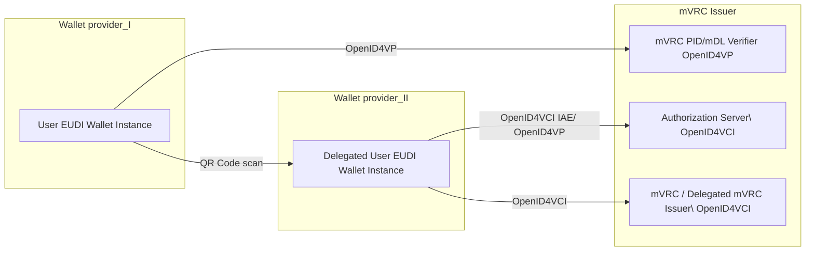

##### Sequence diagram

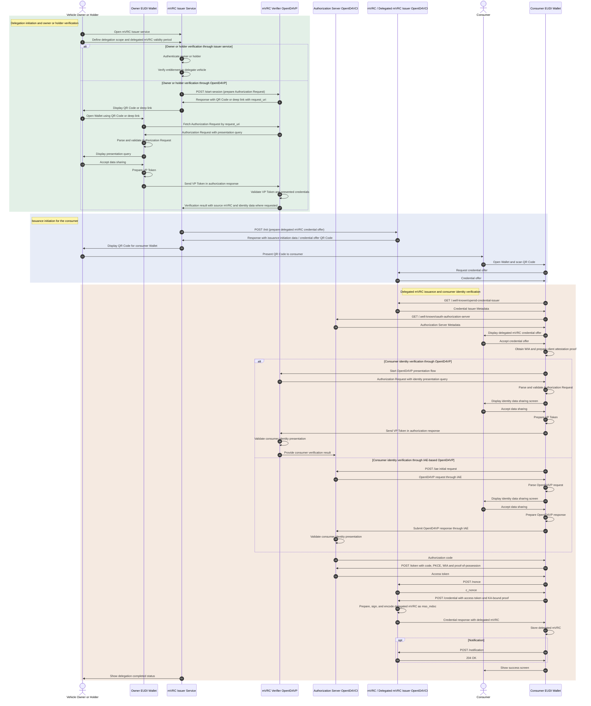

---

##### Extended flow

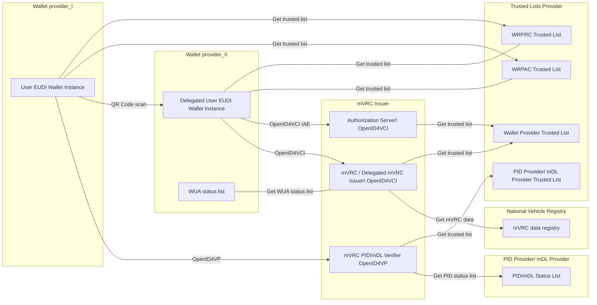

##### Sequence diagram

```mermaid
sequenceDiagram
  autonumber

  actor U as User (Vehicle Owner or Holder)
  participant WO as User EUDI Wallet Instance

  box mVRC Issuer
    participant V as mVRC PID/mDL Verifier OpenID4VP
    participant AS as Authorization Server OpenID4VCI
    participant I as mVRC / Delegated mVRC Issuer OpenID4VCI
  end

  participant R as National Vehicle Registry
  participant PIDSL as PID/mDL Status List

  box Trusted Lists Provider
    participant TLP as PID/mDL Provider Trusted List
    participant TLW as Wallet Provider Trusted List
    participant TLACP as WRPAC Trusted List
    participant TLRCP as WRPRC Trusted List
  end

  participant WPB as WUA Status List
  actor DU as Delegated User
  participant WD as Delegated User EUDI Wallet Instance

  rect rgba(100, 170, 120, 0.18)
    Note left of U: Delegation initiation and owner or holder verification

    U->>V: Open mVRC Issuer service and start delegation
    U->>V: Define delegation scope and delegated mVRC validity period

    alt Owner or holder verification through issuer service
      V->>V: Authenticate owner or holder
      V->>V: Verify entitlement to delegate vehicle
    else Owner or holder verification through OpenID4VP
      V->>WO: Authorization Request with presentation query
      WO->>WO: Parse and validate Authorization Request

      opt Wallet trust checks for Verifier
        WO->>TLACP: Get WRPAC Trusted List
        TLACP->>WO: WRPAC Trusted List
        WO->>TLRCP: Get WRPRC Trusted List
        TLRCP->>WO: WRPRC Trusted List
        WO->>WO: Validate Verifier access and registration certificates
      end

      WO->>U: Display presentation query
      U->>WO: Accept data sharing
      WO->>WO: Prepare VP Token
      WO->>V: Send VP Token in authorization response
      V->>V: Parse and validate VP Token

      opt Presented credential trust checks
        V->>TLP: Get PID/mDL Provider Trusted List
        TLP->>V: PID/mDL Provider Trusted List
        V->>V: Validate PID/mDL issuer trust and credential seal
      end

      opt PID/mDL status check
        V->>PIDSL: Get PID/mDL status list
        PIDSL->>V: PID/mDL status list
        V->>V: Validate PID/mDL status
      end

      V->>V: Verify owner or holder identity and entitlement
    end
  end

  rect rgba(120, 150, 210, 0.18)
    Note left of U: Issuance initiation for consumer

    V->>I: POST /init (prepare delegated mVRC credential offer)

    opt mVRC data retrieval
      I->>R: Query vehicle / owner data
      R->>I: mVRC data attributes
    end

    I->>I: Create verified delegation transaction
    I->>I: Generate issuance initiation data / credential offer QR Code
    I->>V: Response with QR Code / credential offer URI
    V->>U: Display QR Code for consumer Wallet
    U->>DU: Present QR Code to delegated user
    DU->>WD: Open Wallet and scan QR Code
    WD->>I: Request credential offer
    I->>WD: Credential offer
  end

  rect rgba(200, 140, 90, 0.18)
    Note left of DU: Delegated mVRC issuance and consumer identity verification

    WD->>I: GET /.well-known/openid-credential-issuer
    I->>WD: Credential Issuer Metadata

    opt Issuer trust checks by Wallet
      WD->>TLACP: Get WRPAC Trusted List
      TLACP->>WD: WRPAC Trusted List
      WD->>TLRCP: Get WRPRC Trusted List
      TLRCP->>WD: WRPRC Trusted List
      WD->>WD: Validate Issuer access and registration certificates
    end

    WD->>AS: GET /.well-known/oauth-authorization-server
    AS->>WD: Authorization Server Metadata
    WD->>DU: Display delegated mVRC credential offer
    DU->>WD: Accept credential offer

    WD->>WD: Obtain WIA and prepare client attestation proof

    alt Consumer identity verification through OpenID4VP
      WD->>V: Start OpenID4VP presentation flow
      V->>WD: Authorization Request with identity presentation query
      WD->>WD: Parse and validate Authorization Request

      opt Wallet trust checks for Verifier
        WD->>TLACP: Get WRPAC Trusted List
        TLACP->>WD: WRPAC Trusted List
        WD->>TLRCP: Get WRPRC Trusted List
        TLRCP->>WD: WRPRC Trusted List
        WD->>WD: Validate Verifier access and registration certificates
      end

      WD->>DU: Display identity data sharing screen
      DU->>WD: Accept data sharing
      WD->>WD: Prepare VP Token
      WD->>V: Send VP Token in authorization response
      V->>V: Validate consumer identity presentation

      opt Consumer credential trust checks
        V->>TLP: Get PID/mDL Provider Trusted List
        TLP->>V: PID/mDL Provider Trusted List
        V->>V: Validate PID/mDL issuer trust and credential seal
      end

      opt Consumer PID/mDL status check
        V->>PIDSL: Get PID/mDL status list
        PIDSL->>V: PID/mDL status list
        V->>V: Validate PID/mDL status
      end

      V->>AS: Provide consumer verification result

    else Consumer identity verification through IAE-based OpenID4VP
      WD->>AS: POST /iae initial request with PKCE and WIA
      AS->>AS: Validate client attestation and request

      opt Authorization Server trust checks
        AS->>TLW: Get Wallet Provider Trusted List
        TLW->>AS: Wallet Provider Trusted List
        AS->>AS: Validate WIA trust and proof-of-possession
      end

      AS->>WD: OpenID4VP request through IAE
      WD->>WD: Parse OpenID4VP request
      WD->>DU: Display identity data sharing screen
      DU->>WD: Accept data sharing
      WD->>WD: Prepare OpenID4VP response
      WD->>AS: Submit OpenID4VP response through IAE
      AS->>AS: Validate consumer identity presentation

      opt Consumer credential trust checks
        AS->>TLP: Get PID/mDL Provider Trusted List
        TLP->>AS: PID/mDL Provider Trusted List
        AS->>AS: Validate PID/mDL issuer trust and credential seal
      end

      opt Consumer PID/mDL status check
        AS->>PIDSL: Get PID/mDL status list
        PIDSL->>AS: PID/mDL status list
        AS->>AS: Validate PID/mDL status
      end
    end

    AS->>WD: Authorization code
    WD->>AS: POST /token with code, PKCE, WIA and proof-of-possession
    AS->>AS: Validate token request

    opt Authorization Server trust checks
      AS->>TLW: Get Wallet Provider Trusted List
      TLW->>AS: Wallet Provider Trusted List
      AS->>AS: Validate WIA trust and proof-of-possession
    end

    AS->>WD: Access token

    WD->>I: POST /nonce
    I->>WD: c_nonce
    WD->>I: POST /credential with access token and KA-bound proof

    opt Issuer trust checks for Wallet / KA
      I->>TLW: Get Wallet Provider Trusted List
      TLW->>I: Wallet Provider Trusted List
      I->>I: Validate KA issuer trust and proof-of-possession
    end

    opt WUA / KA status check
      I->>WPB: Get WUA / KA status list
      WPB->>I: WUA / KA status list
      I->>I: Validate WUA / KA status
    end

    I->>I: Prepare, sign, and encode delegated mVRC as mso_mdoc
    I->>WD: Credential response with delegated mVRC

    opt Issuer trust check by Wallet
      WD->>WD: Validate delegated mVRC issuer seal and certificate chain
    end

    WD->>WD: Store delegated mVRC

    opt Notification
      WD->>I: POST /notification
      I->>WD: 204 OK
    end

    WD->>DU: Show success screen
    I->>V: Update issuance status
    V->>U: Show delegation completed status
  end
```

### 8.5. Scenario 2B – Delegated mVRC issuance (o2w)

#### 8.5.1. Functional requirements

Scenario 2B is based on a delegated mVRC issuance model in which an organisation (e.g. a rental or leasing company) authorises a consumer (delegated user) to obtain a delegated mVRC credential. The scenario combines OpenID4VP for identity verification and authorisation validation, and OpenID4VCI for issuance of both the mVRC delegation permission and the delegated mVRC. The mVRC delegation permission is defined in a dedicated rulebook and is used as a short-lived authorisation credential within the issuance flow.

**Consumer (Delegated User) EUDI Wallet Instance**

| Index | Requirement Title | Description | Priority | Acceptance Criteria |
|------:|-------------------|-------------|----------|---------------------|
| FR-WD2B-001 | ETSI Issuance Profile Support | The EUDI Wallet Instance SHALL support the ETSI TS 119 472-3 issuance profile elements applicable to both OpenID4VCI issuance flows in this scenario, including processing of signed Credential Issuer Metadata, issuer information, access certificate material, Wallet Instance Attestation, Key Attestation, and trust validation where required by the applicable trust policy. | High | The Wallet successfully completes the OpenID4VCI issuance flows and receives the mVRC Delegation Permission and the delegated mVRC. |
| FR-WD2B-002 | Delegated mVRC Data Model and Structure Support | The EUDI Wallet Instance SHALL support processing, storage, and presentation of delegated mVRC credentials using a data model and structure compliant with ISO 7367, the applicable mVRC rulebook, and the delegated vehicle privileges model used in the scenario. | High | The Wallet correctly processes and presents delegated mVRC credentials conforming to the expected data model and structure without data loss or misinterpretation. |
| FR-WD2B-003 | Delegated mVRC Credential Format Support | The EUDI Wallet Instance SHALL support receiving, processing, and storing delegated mVRC attestations encoded as `mso_mdoc`. | High | The Wallet stores and later retrieves an issued delegated mVRC in `mso_mdoc` format. |
| FR-WD2B-004 | mVRC Delegation Permission Credential Support | The EUDI Wallet Instance SHALL support receiving, processing, storing, and presenting the mVRC Delegation Permission credential issued by the Organization. | High | The Wallet successfully receives, stores, and later presents the mVRC Delegation Permission in the delegated mVRC issuance flow. |
| FR-WD2B-005 | mVRC Delegation Permission Lifetime Handling | The EUDI Wallet Instance SHALL support handling the mVRC Delegation Permission as a short-lived credential intended for use in the delegated mVRC issuance flow. | High | The Wallet correctly recognizes the mVRC Delegation Permission usage constraints and uses it only within its valid lifetime and intended issuance context. |
| FR-WD2B-006 | OpenID4VCI Issuance Support with HAIP Profile Elements | The EUDI Wallet Instance SHALL support the OpenID4VCI issuance workflows used to obtain the mVRC Delegation Permission and the delegated mVRC, applying the HAIP 1.0 profile elements required for this scenario, including credential offer processing, authorization code flow, token handling, credential request handling, holder binding, and secure proof-of-possession. | High | The Wallet successfully completes both OpenID4VCI issuance flows and receives the mVRC Delegation Permission and the delegated mVRC. |
| FR-WD2B-007 | Credential Offer Initialisation | The EUDI Wallet Instance SHALL support credential offer and issuance initiation methods used in the scenario, including QR Code and deep link-based initiation, same-device continuation, and cross-device initiation where applicable. | High | The Wallet successfully starts issuance of the mVRC Delegation Permission and the delegated mVRC using the supported initiation methods. |
| FR-WD2B-008 | User Consent for Issuance | The EUDI Wallet Instance SHALL display information about the offered credential and require explicit user consent before proceeding with issuance of the mVRC Delegation Permission or the delegated mVRC. | High | The user can approve or cancel issuance after reviewing credential information. |
| FR-WD2B-009 | Signed Credential Issuer Metadata Processing | The EUDI Wallet Instance SHALL support processing of signed OpenID4VCI Credential Issuer Metadata where required by ETSI TS 119 472-3. The Wallet SHALL verify that the metadata is signed and that the JWS protected header contains the certificate material required by the ETSI profile. | High | The Wallet retrieves signed Credential Issuer Metadata, verifies the signature and certificate material, and uses the metadata to continue the issuance flow. |
| FR-WD2B-010 | PAR Endpoint Support | The Wallet SHALL support Pushed Authorization Requests (PAR) when required by the Authorization Server policy. | High | The Wallet initiates authorization using PAR and receives a request URI. |
| FR-WD2B-011 | PKCE Support | The Wallet SHALL support PKCE for authorization code flows, including code verifier and challenge handling. | High | Token exchange succeeds only with a valid PKCE code verifier when PKCE is required. |
| FR-WD2B-012 | Authorization Code Flow Support | The EUDI Wallet Instance SHALL support the OpenID4VCI authorization code flow for issuance of the mVRC Delegation Permission and the delegated mVRC where used in the scenario. | High | The Wallet successfully completes issuance flows using the authorization code flow. |
| FR-WD2B-013 | Client Attestation JWT Support | The Wallet SHALL support client authentication using Client Attestation JWT where required. In this scenario, the Client Attestation JWT SHALL be provided as a Wallet Instance Attestation (WIA), in accordance with ARF TS3 and the applicable OpenID4VCI / ETSI TS 119 472-3 profile requirements. | High | The Wallet successfully completes authorization and token request flows using a valid WIA and corresponding proof-of-possession when Client Attestation JWT authentication is required. |
| FR-WD2B-014 | Consumer Identity Verification Support | The Wallet SHALL support consumer identity verification prior to issuance of the mVRC Delegation Permission and/or the delegated mVRC where required by the Organization or the official mVRC Issuer. The verification may be performed using an OpenID4VP presentation flow or an IAE-based OpenID4VP interaction within the OpenID4VCI authorization process. | High | The Wallet completes issuance when consumer identity verification succeeds and fails when verification is required but not completed. |
| FR-WD2B-015 | OpenID4VP Identity Verification Support | Where consumer identity verification is performed using OpenID4VP, the EUDI Wallet Instance SHALL support OpenID4VP 1.0 to present the required PID and, where required by the official mVRC Issuer, the mVRC Delegation Permission. | Medium | The Wallet successfully responds to an OpenID4VP presentation request requiring PID and, where applicable, mVRC Delegation Permission presentation. |
| FR-WD2B-016 | ETSI Presentation Profile Support | Where consumer identity verification is performed using an OpenID4VP presentation flow, the EUDI Wallet Instance SHALL support the ETSI TS 119 472-2 presentation profile elements applicable to this scenario, including signed Request Object processing, verifier identification, verifier information processing, encrypted presentation response, holder binding, and trust validation where required by the applicable trust policy. | High | The Wallet successfully completes OpenID4VP-based consumer verification and releases data only after successful request processing, verifier trust validation where required, user consent, and proof-binding. |
| FR-WD2B-017 | PID Attestation Format Support | Where PID-based verification is required, the EUDI Wallet Instance SHALL support presentation of PID attestations encoded as `mso_mdoc` or SD-JWT VC, depending on the supported credential format requested by the verifier or authorization server. | Medium | The Wallet presents PID attestations in the requested supported format. |
| FR-WD2B-018 | User Consent for Verification | The EUDI Wallet Instance SHALL display information about requested identity and authorization data prior to credential issuance and require explicit user consent before proceeding. | Medium | The user can approve or cancel the verification process after reviewing the authorization or presentation request. |
| FR-WD2B-019 | IAE-Based OpenID4VP Verification Support | Where consumer verification is performed through an IAE-based OpenID4VP interaction, the EUDI Wallet Instance SHALL support processing an OpenID4VP request provided through the Interactive Authorization Endpoint and submitting the corresponding OpenID4VP response according to the supported OpenID4VCI 1.1 interaction model. | High | The Wallet successfully processes the OpenID4VP request provided through the Interactive Authorization Endpoint and submits the resulting response before issuance proceeds. |
| FR-WD2B-020 | Key Attestation (KA) in Credential Request Proof | The Wallet SHALL include a Key Attestation (KA) in the proof sent to the Credential Endpoint when required, in accordance with ARF TS3 and OpenID4VCI Appendix D: Key Attestations. The KA SHALL attest the wallet-controlled key used for holder binding of the issued mVRC Delegation Permission or delegated mVRC attestation. | High | The Wallet successfully sends a credential request containing a valid KA and proof-of-possession for the attested wallet-controlled key, and receives an attestation bound to that key. |
| FR-WD2B-021 | Holder Binding and Proof-of-Possession | The EUDI Wallet Instance SHALL support holder binding and proof-of-possession mechanisms in line with HAIP requirements. | High | Issuance succeeds only when valid proof-of-possession is provided. |
| FR-WD2B-022 | Combined Presentation Support | Where required by the official mVRC Issuer, the EUDI Wallet Instance SHALL support presentation of the mVRC Delegation Permission together with the required PID within the same verification interaction, either through OpenID4VP or through an IAE-based OpenID4VP interaction. | High | The Wallet successfully presents both the mVRC Delegation Permission and the required PID when requested by the official mVRC Issuer. |
| FR-WD2B-023 | Display of mVRC Delegation Permission Data | The EUDI Wallet Instance SHALL display the core data contained in a successfully issued mVRC Delegation Permission to the user after completion of the issuance process. | High | The Wallet displays the mVRC Delegation Permission only after successful issuance and validation, with data accurately reflecting the credential payload. |
| FR-WD2B-024 | Display of Delegated mVRC Credential Data | The EUDI Wallet Instance SHALL display the core data contained in a successfully issued delegated mVRC credential to the user after completion of the issuance process. | High | The Wallet displays the delegated mVRC credential only after successful issuance and validation, with data accurately reflecting the credential payload. If issuance or validation fails, the delegated mVRC credential is not displayed to the user. |
| FR-WD2B-025 | Secure Storage of Delegated Credentials | The EUDI Wallet Instance SHOULD securely store issued mVRC Delegation Permission credentials, delegated mVRC attestations, and associated metadata. | High | Issued credentials are securely stored and accessible only with user authorization. |
| FR-WD2B-026 | Protocol Error Handling | The EUDI Wallet Instance SHALL handle protocol, validation, and network errors gracefully and inform the user. | Medium | The Wallet displays meaningful error messages when issuance or verification fails. |
| FR-WD2B-027 | Issuer Access Certificate Validation (ETSI LOTE) | The Wallet SHOULD validate the Issuer's access certificate using ETSI LOTE / trusted list mechanisms where applicable. | Medium | The Wallet accepts issuers with trusted access certificates and rejects issuers with invalid or untrusted access certificates where required by the applicable trust policy. |
| FR-WD2B-028 | Issuer Registration Certificate Validation (ETSI LOTE) | The Wallet SHOULD validate the Issuer's registration certificate using ETSI LOTE / trusted list mechanisms where required. | Medium | The Wallet rejects issuance from issuers with invalid or untrusted registration status where registration certificate validation is required. |
| FR-WD2B-029 | Issuer Seal Validation (ETSI LOTE/LOTL) | The Wallet SHOULD validate the cryptographic seal on the issued delegated mVRC and, where applicable, on the mVRC Delegation Permission using trusted list material. | Medium | The Wallet stores only credentials signed by trusted issuers where issuer seal validation is required by the applicable trust policy. |
| FR-WD2B-030 | DPoP Support | The Wallet SHALL support DPoP for token requests and related proof handling when required by the Authorization Server. | High | The Wallet successfully completes token requests when DPoP is required. Requests with missing, invalid, or expired DPoP proof are rejected. |
| FR-WD2B-031 | Interactive Authorization Endpoint Support | The EUDI Wallet Instance MAY support the Interactive Authorization Endpoint from OpenID4VCI 1.1 draft as an alternative authorization interaction model for credential issuance. | Medium | The Wallet successfully completes issuance using the Interactive Authorization Endpoint when supported by the Issuer. |

**Organisation mVRC Delegation Permission Issuer**

| Index | Requirement Title | Description | Priority | Acceptance Criteria |
|------:|-------------------|-------------|----------|---------------------|
| FR-O2B-001 | ETSI Issuance Profile Support | The Organization SHALL support the ETSI TS 119 472-3 issuance profile elements applicable to issuance of the mVRC Delegation Permission, including publication of signed Credential Issuer Metadata, issuer information, access certificate material, Wallet Instance Attestation, Key Attestation, and trust validation where required by the applicable trust policy. | High | The Organization successfully completes an OpenID4VCI issuance flow with a compliant Wallet and issues an mVRC Delegation Permission only when the required ETSI profile elements are present and valid. |
| FR-O2B-002 | mVRC Delegation Permission Data Model and Structure Compliance | The Organization SHALL issue mVRC Delegation Permission credentials using the data model and structure defined for this scenario and the applicable mVRC Delegation Permission rulebook. | High | The issued mVRC Delegation Permission conforms to the expected data model and structure and can be processed by a compliant Wallet and by the official mVRC Issuer. |
| FR-O2B-003 | OpenID4VCI Issuance Support with HAIP Profile Elements | The Organization SHALL support the OpenID4VCI issuance workflow for mVRC Delegation Permission attestations, applying the HAIP 1.0 profile elements required for this scenario, including credential offer generation, authorization code flow, token handling, credential request processing, holder binding, and secure proof-of-possession validation. | High | The Organization successfully completes the OpenID4VCI authorization code issuance flow with a compliant Wallet and returns an mVRC Delegation Permission bound to the wallet-controlled key. |
| FR-O2B-004 | Delegation Service Support | The Organization SHALL provide a web application or equivalent service enabling the consumer to initiate the mVRC Delegation Permission issuance process after completion of the relevant business formalities. | High | The consumer can access a service that starts the mVRC Delegation Permission issuance process. |
| FR-O2B-005 | Delegation Scope and Validity Management | The Organization SHALL manage the rental period or other business validity period and the scope of delegated vehicle privileges in accordance with the business agreement and use them as input to issuance of the mVRC Delegation Permission. | High | The issued mVRC Delegation Permission reflects the validity period and scope of delegated privileges defined in the business agreement. |
| FR-O2B-006 | Credential Offer and Issuance Initiation Support | The Organization SHALL generate and provide the data required to initiate issuance of the mVRC Delegation Permission in the consumer Wallet, such as a credential offer or credential offer URI. | High | The Wallet can resolve the credential offer and start the mVRC Delegation Permission issuance flow. |
| FR-O2B-007 | OAuth / OpenID4VCI Authorization Server for Issuance | The Organization SHALL provide or integrate with an OAuth 2.0 / OpenID4VCI Authorization Server to authorize Wallet access to mVRC Delegation Permission issuance and issue access tokens for the Credential Endpoint. | High | The Wallet obtains an authorization code and exchanges it for an access token that is accepted by the Credential Endpoint. |
| FR-O2B-008 | Authorization Server Metadata Publication | The Authorization Server SHALL expose authorization server metadata, including required endpoints and capabilities such as authorization, token, PAR where used, DPoP where required, client attestation support, and IAE support where applicable. | High | The Wallet retrieves Authorization Server metadata and can locate the endpoints and capabilities required to complete mVRC Delegation Permission issuance. |
| FR-O2B-009 | Signed Credential Issuer Metadata Publication | The Organization SHALL publish signed OpenID4VCI Credential Issuer Metadata where required by ETSI TS 119 472-3. The Organization SHALL sign the metadata using the private key corresponding to the public key in the Issuer Access Certificate and SHALL include the certificate material required by the ETSI profile in the JWS protected header. | High | The Wallet retrieves signed Credential Issuer Metadata, verifies the metadata signature and certificate material, and uses the metadata to continue the issuance flow. |
| FR-O2B-010 | Pushed Authorization Request Support | The Authorization Server SHALL support Pushed Authorization Requests (PAR) where required by the applicable profile or Authorization Server policy. | High | The Wallet sends an authorization request to the PAR endpoint, receives a request URI, and completes authorization successfully. |
| FR-O2B-011 | PKCE Validation | The Authorization Server SHALL require and validate PKCE for authorization code flows. | High | Token exchange succeeds with a valid code verifier and fails with an invalid code verifier. |
| FR-O2B-012 | Support Client Attestation JWT Authentication | The Authorization Server SHALL support client authentication using Client Attestation JWT provided as a Wallet Instance Attestation (WIA), in accordance with ARF TS3 and the applicable OpenID4VCI / ETSI TS 119 472-3 profile requirements. | High | Token requests using a valid WIA and corresponding proof-of-possession succeed; invalid, expired, or untrusted attestations are rejected. |
| FR-O2B-013 | Consumer Identity Verification | The Organization SHALL verify the identity of the consumer before issuing the mVRC Delegation Permission. The verification MAY be performed using an OpenID4VP presentation flow or an IAE-based OpenID4VP interaction within the OpenID4VCI authorization process. | High | The mVRC Delegation Permission is issued only after successful consumer identity verification. |
| FR-O2B-014 | OpenID4VP Verification Support | Where consumer identity verification is implemented using OpenID4VP, the Organization SHALL implement a Verifier interface compliant with OpenID4VP 1.0 to request and validate presentation of the required PID. | Medium | The Organization successfully completes an OpenID4VP flow in which the consumer presents the required PID. |
| FR-O2B-015 | ETSI Presentation Profile Support | Where consumer identity verification is implemented using OpenID4VP, the Organization SHALL support the ETSI TS 119 472-2 presentation profile elements applicable to this scenario, including signed Request Object generation, verifier identification, verifier information, encrypted presentation response handling, holder binding validation, and trust validation where required by the applicable trust policy. | High | The Organization validates the presentation response, verifier context, trust information, and proof-binding in accordance with the applicable ETSI TS 119 472-2 profile elements. |
| FR-O2B-016 | IAE-Based OpenID4VP Verification Support | Where consumer identity verification is implemented using an IAE-based OpenID4VP interaction, the Authorization Server SHALL provide an OpenID4VP request through the Interactive Authorization Endpoint and validate the resulting OpenID4VP response before issuing the mVRC Delegation Permission. | High | The Wallet receives a valid OpenID4VP request through the Interactive Authorization Endpoint and completes the required presentation before issuance proceeds. |
| FR-O2B-017 | Identity Credential Processing and Validation | The Organization SHALL support requesting, processing, and validating the consumer identity credential, using PID, before issuance of the mVRC Delegation Permission. | High | The mVRC Delegation Permission is issued only when the required PID is successfully validated. |
| FR-O2B-018 | Support mso_mdoc Format for Presented Identity Credentials | The Organization SHALL support processing presented identity credentials encoded as `mso_mdoc`, where applicable in the scenario. | High | The Organization successfully processes the required identity credential in the expected format. |
| FR-O2B-019 | Same-Device Flow Continuation Support | The Organization SHALL support continuation from the verification step to the issuance step on the same mobile device where this interaction model is used. | High | After successful verification, the consumer can continue the issuance flow on the same device without restarting the transaction. |
| FR-O2B-020 | mVRC Delegation Permission Generation | The Organization SHALL generate an mVRC Delegation Permission containing the delegated vehicle privileges and validity period established in the business process. | High | The issued mVRC Delegation Permission contains the expected delegation scope and validity period. |
| FR-O2B-021 | Support mso_mdoc Format for mVRC Delegation Permission | The Organization SHALL issue the mVRC Delegation Permission in `mso_mdoc` format. | High | The mVRC Delegation Permission is issued in `mso_mdoc` format and can be processed by a compliant Wallet and by the official mVRC Issuer. |
| FR-O2B-022 | Credential Signing | The Organization SHALL sign the mVRC Delegation Permission using its applicable signing certificate and trust chain. | High | The mVRC Delegation Permission is cryptographically signed and can be validated by the official mVRC Issuer and other relying parties where applicable. |
| FR-O2B-023 | Holder Binding Support | The Organization SHALL issue the mVRC Delegation Permission bound to the consumer Wallet in accordance with the applicable proof-of-possession and holder binding requirements. | High | The issued mVRC Delegation Permission is cryptographically bound to the consumer Wallet. |
| FR-O2B-024 | Nonce Endpoint Support | The Organization SHOULD expose a Nonce Endpoint to provide a `c_nonce` and expiry for proof freshness where required by policy or profile. | Medium | The Wallet can obtain a `c_nonce` from the Nonce Endpoint and issuance succeeds using a fresh proof; stale nonce values result in rejected credential requests. |
| FR-O2B-025 | Validate Wallet Proof-of-Possession | The Organization SHALL validate proof-of-possession in credential requests to ensure holder binding and prevent replay, aligned with the applicable ecosystem profile. | High | Credential issuance succeeds with a valid proof and fails if the proof is missing, invalid, or replayed. |
| FR-O2B-026 | Key Attestation Validation in Credential Request Proof | The Organization SHALL validate the Key Attestation (KA) included in the credential request proof when required, in accordance with ARF TS3 and OpenID4VCI Appendix D: Key Attestations. The Organization SHALL verify that the proof demonstrates possession of the private key corresponding to the public key attested in the KA and used for holder binding of the issued mVRC Delegation Permission. | High | The Organization issues a key-bound mVRC Delegation Permission only after successfully validating the KA and the corresponding proof-of-possession for the attested wallet-controlled key. |
| FR-O2B-027 | DPoP Validation | The Authorization Server SHALL support and validate DPoP for token requests where required. | High | Token requests with a valid DPoP proof succeed; requests with missing, invalid, or expired DPoP proof are rejected. |
| FR-O2B-028 | PID Trust and Status Validation | The Organization or Verifier SHOULD validate the trust status and status list information of the presented PID according to the applicable trust framework and trusted list material. | Medium | The Organization rejects mVRC Delegation Permission issuance where the PID issuer is untrusted or the presented PID status is not valid, where such validation is required by policy. |
| FR-O2B-029 | Wallet, WIA, and KA Trust Validation | The Organization and Authorization Server SHOULD validate Wallet trust information, WIA trust information, and KA trust information using trusted lists or equivalent trust material where required by the applicable trust policy. | Medium | Requests using untrusted, expired, or invalid Wallet, WIA, or KA material are rejected where trust validation is required. |
| FR-O2B-030 | mVRC Delegation Permission Usage Management | The Organization SHOULD support usage management for issued mVRC Delegation Permission credentials where required by the scenario, including expiry handling or prevention of reuse where applicable. This requirement does not imply a mandatory status check for the mVRC Delegation Permission. | Medium | Where usage management is required by the test scenario, the official mVRC Issuer can determine whether the mVRC Delegation Permission is acceptable for delegated mVRC issuance based on validity, expiry, and usage constraints. |
| FR-O2B-031 | Secure Session Management and Error Handling | The Organization SHALL manage mVRC Delegation Permission issuance sessions securely, including state and nonce handling, anti-CSRF protection, replay protection, and linkage between the verified consumer identity, delegation scope, and credential issuance. The Organization SHALL return standards-compliant error responses for invalid requests, unsupported formats, missing prerequisites, failed verification, trust validation failures, and policy violations. | High | Authorization and issuance complete only for matching state, nonce, and session context; mismatches and invalid requests are rejected with deterministic, protocol-compliant errors that the Wallet can surface to the user. |

**mVRC / Delegated mVRC Issuer**

| Index | Requirement Title | Description | Priority | Acceptance Criteria |
|------:|-------------------|-------------|----------|---------------------|
| FR-I2B-001 | ETSI Issuance Profile Support | The mVRC and delegated mVRC Issuer SHALL support the ETSI TS 119 472-3 issuance profile elements applicable to delegated mVRC issuance in this scenario, including publication of signed Credential Issuer Metadata, issuer information, access certificate material, Wallet Instance Attestation, Key Attestation, and trust validation where required by the applicable trust policy. | High | The Issuer successfully completes an OpenID4VCI issuance flow with a compliant Wallet and issues a delegated mVRC only when the required ETSI profile elements are present and valid. |
| FR-I2B-002 | Delegated mVRC Data Model and Structure Compliance | The Issuer SHALL issue delegated mVRC credentials using a data model and structure compliant with ISO 7367, the applicable mVRC rulebook, and the delegated vehicle privileges model used in this scenario. | High | Issued delegated mVRC credentials conform to the expected data model and structure and are successfully processed by compliant EUDI Wallets. |
| FR-I2B-003 | OpenID4VCI Issuance Support with HAIP Profile Elements | The Issuer SHALL support the OpenID4VCI issuance workflow for delegated mVRC attestations, applying the HAIP 1.0 profile elements required for this scenario, including credential offer generation, authorization code flow, token handling, credential request processing, holder binding, and secure proof-of-possession validation. | High | The Issuer successfully completes the OpenID4VCI authorization code issuance flow with a compliant Wallet and returns a delegated mVRC attestation bound to the wallet-controlled key. |
| FR-I2B-004 | Delegated mVRC Issuance Service Support | The Issuer SHALL provide a dedicated service enabling the delegated user to request issuance of a delegated mVRC based on a previously issued mVRC Delegation Permission. | High | The user can access a service that starts the delegated mVRC issuance process. |
| FR-I2B-005 | Credential Offer and Issuance Initiation Support | The Issuer SHALL generate and provide the data required to initiate delegated mVRC issuance in the consumer Wallet, such as a credential offer or credential offer URI that can be encoded as a QR Code or deep link. | High | The Wallet can resolve the credential offer and start the delegated mVRC issuance flow. |
| FR-I2B-006 | OAuth / OpenID4VCI Authorization Server for Issuance | The Issuer SHALL provide or integrate with an OAuth 2.0 / OpenID4VCI Authorization Server to authorize Wallet access to delegated mVRC issuance and issue access tokens for the Credential Endpoint. | High | The Wallet obtains an authorization code and exchanges it for an access token that is accepted by the Credential Endpoint. |
| FR-I2B-007 | Authorization Server Metadata Publication | The Authorization Server SHALL expose authorization server metadata, including required endpoints and capabilities such as authorization, token, PAR where used, DPoP where required, client attestation support, and IAE support where applicable. | High | The Wallet retrieves Authorization Server metadata and can locate the endpoints and capabilities required to complete delegated mVRC issuance. |
| FR-I2B-008 | Signed Credential Issuer Metadata Publication | The Issuer SHALL publish signed OpenID4VCI Credential Issuer Metadata where required by ETSI TS 119 472-3. The Issuer SHALL sign the metadata using the private key corresponding to the public key in the Issuer Access Certificate and SHALL include the certificate material required by the ETSI profile in the JWS protected header. | High | The Wallet retrieves signed Credential Issuer Metadata, verifies the metadata signature and certificate material, and uses the metadata to continue the delegated mVRC issuance flow. |
| FR-I2B-009 | Pushed Authorization Request Support | The Authorization Server SHALL support Pushed Authorization Requests (PAR) where required by the applicable profile or Authorization Server policy. | High | The Wallet sends an authorization request to the PAR endpoint, receives a request URI, and completes authorization successfully. |
| FR-I2B-010 | PKCE Validation | The Authorization Server SHALL require and validate PKCE for authorization code flows. | High | Token exchange succeeds with a valid code verifier and fails with an invalid code verifier. |
| FR-I2B-011 | Support Client Attestation JWT Authentication | The Authorization Server SHALL support client authentication using Client Attestation JWT provided as a Wallet Instance Attestation (WIA), in accordance with ARF TS3 and the applicable OpenID4VCI / ETSI TS 119 472-3 profile requirements. | High | Token requests using a valid WIA and corresponding proof-of-possession succeed; invalid, expired, or untrusted attestations are rejected. |
| FR-I2B-012 | Consumer Authorization and Identity Verification | The Issuer SHALL verify the consumer authorization and identity before issuing the delegated mVRC. This verification SHALL include validation of the mVRC Delegation Permission and the required PID. The verification MAY be performed using an OpenID4VP presentation flow or an IAE-based OpenID4VP interaction within the OpenID4VCI authorization process. | High | A delegated mVRC is issued only after successful validation of the mVRC Delegation Permission and the required PID. |
| FR-I2B-013 | OpenID4VP Verification Support | Where consumer authorization and identity verification is implemented using OpenID4VP, the Issuer SHALL implement a Verifier interface compliant with OpenID4VP 1.0 to request and validate presentation of the mVRC Delegation Permission and the required PID. | Medium | The Issuer successfully completes an OpenID4VP flow in which the Wallet presents the required mVRC Delegation Permission and PID. |
| FR-I2B-014 | ETSI Presentation Profile Support | Where consumer authorization and identity verification is implemented using OpenID4VP, the Issuer SHALL support the ETSI TS 119 472-2 presentation profile elements applicable to this scenario, including signed Request Object generation, verifier identification, verifier information, encrypted presentation response handling, holder binding validation, and trust validation where required by the applicable trust policy. | High | The Issuer validates the presentation response, verifier context, trust information, and proof-binding in accordance with the applicable ETSI TS 119 472-2 profile elements. |
| FR-I2B-015 | IAE-Based OpenID4VP Verification Support | Where consumer authorization and identity verification is implemented using an IAE-based OpenID4VP interaction, the Authorization Server SHALL provide an OpenID4VP request through the Interactive Authorization Endpoint and validate the resulting OpenID4VP response before issuing the delegated mVRC. | High | The Wallet receives a valid OpenID4VP request through the Interactive Authorization Endpoint and completes the required presentation before issuance proceeds. |
| FR-I2B-016 | mVRC Delegation Permission Validation | The Issuer SHALL validate the authenticity, integrity, validity period, delegation scope, and applicability of the presented mVRC Delegation Permission before issuing the delegated mVRC. | High | The delegated mVRC is issued only if the mVRC Delegation Permission is successfully validated and is applicable to the current issuance transaction. |
| FR-I2B-017 | mVRC Delegation Permission Usage Constraint Validation | The Issuer SHALL validate that the presented mVRC Delegation Permission is used within its valid lifetime and intended issuance context. Where the mVRC Delegation Permission is defined as one-time use for the test scenario, the Issuer SHALL prevent reuse after successful delegated mVRC issuance. | High | The delegated mVRC is issued only if the mVRC Delegation Permission is valid, unexpired, and acceptable for the current issuance transaction. |
| FR-I2B-018 | Identity Credential Processing and Validation | The Issuer SHALL support requesting, processing, and validating the consumer identity credential, using PID, before issuance of the delegated mVRC. | High | The delegated mVRC is issued only when the required PID is successfully validated. |
| FR-I2B-019 | Support mso_mdoc Format for Presented Credentials | The Issuer SHALL support processing presented credentials encoded as `mso_mdoc`, including the mVRC Delegation Permission and PID where applicable. | High | The Issuer successfully processes the required presented credentials in the expected format. |
| FR-I2B-020 | Subject Consistency Validation | The Issuer SHALL verify that the consumer receiving the delegated mVRC is consistent with the authorization context represented by the mVRC Delegation Permission and the presented PID, where applicable to the credential design. | High | The delegated mVRC is issued only when the presented identity is consistent with the authorization context represented by the mVRC Delegation Permission. |
| FR-I2B-021 | Delegation Data Mapping and Delegated mVRC Generation | The Issuer SHALL generate the delegated mVRC using the validated mVRC Delegation Permission and the Issuer's own vehicle dataset. The Issuer SHALL map the relevant data from the mVRC Delegation Permission to the delegated mVRC as defined in the **mVRC Delegation Permission data mapping** section of this RFC. | High | The issued delegated mVRC contains data consistent with the validated mVRC Delegation Permission and the Issuer's vehicle dataset. Issuance fails if required delegation data is missing, inconsistent, expired, or not applicable to the identified vehicle and Organization. |
| FR-I2B-022 | Support mso_mdoc Format for Delegated mVRC | The Issuer SHALL issue delegated mVRC credentials in `mso_mdoc` format. | High | The delegated mVRC is issued in `mso_mdoc` format and can be processed by a compliant Wallet. |
| FR-I2B-023 | Credential Signing | The Issuer SHALL sign the delegated mVRC using its applicable signing certificate and trust chain. | High | The delegated mVRC is cryptographically signed and can be validated by relying parties. |
| FR-I2B-024 | Holder Binding Support | The Issuer SHALL issue the delegated mVRC bound to the consumer Wallet in accordance with the applicable proof-of-possession and holder binding requirements. | High | The issued delegated mVRC is cryptographically bound to the consumer Wallet. |
| FR-I2B-025 | Vehicle Registry Integration | The Issuer MAY query a National Vehicle Registry or equivalent authoritative data source to retrieve authoritative vehicle attributes used to populate the issued delegated mVRC attestation. | Medium | When enabled, the Issuer retrieves registry data and the issued delegated mVRC reflects authoritative vehicle attributes; if required data cannot be retrieved, issuance fails with an appropriate error. |
| FR-I2B-026 | Nonce Endpoint Support | The Issuer SHOULD expose a Nonce Endpoint to provide a `c_nonce` and expiry for proof freshness where required by policy or profile. | Medium | The Wallet can obtain a `c_nonce` from the Nonce Endpoint and issuance succeeds using a fresh proof; stale nonce values result in rejected credential requests. |
| FR-I2B-027 | Validate Wallet Proof-of-Possession | The Issuer SHALL validate proof-of-possession in credential requests to ensure holder binding and prevent replay, aligned with the applicable ecosystem profile. | High | Credential issuance succeeds with a valid proof and fails if the proof is missing, invalid, or replayed. |
| FR-I2B-028 | Key Attestation Validation in Credential Request Proof | The Issuer SHALL validate the Key Attestation (KA) included in the credential request proof when required, in accordance with ARF TS3 and OpenID4VCI Appendix D: Key Attestations. The Issuer SHALL verify that the proof demonstrates possession of the private key corresponding to the public key attested in the KA and used for holder binding of the issued delegated mVRC attestation. | High | The Issuer issues a key-bound delegated mVRC only after successfully validating the KA and the corresponding proof-of-possession for the attested wallet-controlled key. |
| FR-I2B-029 | PID Trust and Status Validation | The Issuer or Verifier SHOULD validate the trust status and status list information of the presented PID according to the applicable trust framework and trusted list material. | Medium | The Issuer rejects delegated mVRC issuance where the PID issuer is untrusted or the presented PID status is not valid, where such validation is required by policy. |
| FR-I2B-030 | mVRC Delegation Permission Issuer Trust Validation | The Issuer SHOULD validate the signature, certificate material, and issuer trust of the mVRC Delegation Permission using the applicable LOTE / trusted list material where required by the applicable trust policy. | Medium | Where trust validation is required, delegated mVRC issuance proceeds only when the mVRC Delegation Permission is signed by a trusted Organization or issuer recognized for the scenario. |
| FR-I2B-031 | Delegated mVRC Status List Support | The Issuer SHOULD support a status list mechanism for issued delegated mVRC credentials in order to enable revocation and suspension checks throughout the credential lifecycle. | Medium | Issued delegated mVRC credentials contain a valid reference to a status list entry, and the status list can be retrieved and used to determine the current credential status. |
| FR-I2B-032 | DPoP Validation | The Authorization Server SHALL support and validate DPoP for token requests where required by the Authorization Server policy or applicable profile. | High | Token requests with a valid DPoP proof succeed; requests with missing, invalid, or expired DPoP proof are rejected where DPoP is required. |
| FR-I2B-033 | Secure Session Management and Error Handling | The Issuer SHALL manage delegated mVRC issuance sessions securely, including state and nonce handling, anti-CSRF protection, replay protection, and linkage between the validated authorization context and credential issuance. The Issuer SHALL return standards-compliant error responses for invalid requests, unsupported formats, missing prerequisites, failed verification, trust validation failures, and policy violations. | High | Authorization and issuance complete only for matching state, nonce, and session context; mismatches and invalid requests are rejected with deterministic, protocol-compliant errors that the Wallet can surface to the user. |

---

#### 8.5.2	Attestation description

The data model for **delegated mVRC** is presented in the mVRC rulebook, which is based on ISO/IEC DTS 7367-2. The EU mVRC profile has been added to the rulebook based on the Proposal of the Directive of the European Parliament and of the Council on the registration documents for vehicles and vehicle registration data recorded in national vehicle registers and repealing Council Directive 1999/37/EC (November, 2025).

The delegated mVRC reuses the standard mVRC vehicle registration data structure and adds a delegation object in a dedicated namespace, `org.iso.7367.2.1.EU.delegation`, to describe the delegated right to use the vehicle. This RFC proposes an initial structure of that object for interoperability testing.

##### 8.5.2.1 Mandatory attributes

| Data Identifier | Definition | Data type | Example value |
|---|---|---|---|
| `delegation_permission_id` | Unique identifier of the mVRC delegation permission or delegated  mVRC issuance transaction. | string | `00b91349-f07a-44d8-94c6-db69f2b72a1a` |
| `privileges_scope` | Overall scope of delegated vehicle privileges. | string | `full` |
| `delegating_user` |  Name of the legal person who is the vehicle owner or holder and ordered the delegation  | object | |

##### 8.5.2.2 Conditional attributes

| Data Identifier | Definition | Data type | Example value |
|---|---|---|---|
| `partial_privileges` | SHALL be present when `vehicle_privileges.privileges_scope` is set to `partial`. | array of strings | `["drive", "road_suitability"]` |
| `organization_name` | Name of the legal person who is the vehicle owner or holder and ordered the delegation. | string | Example Rental Company |
| `family_name` | Family name of the natural person who is the vehicle owner or holder and ordered the delegation. | string | Mustermann |
| `given_name` | Given name of the natural person who is the vehicle owner or holder and ordered the delegation. | string | Max |

##### 8.5.2.3 Object encoding

| **Data Identifier** | **Attribute identifier** | **Encoding format** | **Namespace**|
|------------------------|--------------|------------------|------------------|
| `delegation_permission_id` | `delegation_permission_id` | tstr | `org.iso.7367.2.1.EU.delegation`|
| `vehicle_privileges` |   `vehicle_privileges` | map, see [Attribute vehicle_privileges](#Attribute-vehicle_privileges) | `org.iso.7367.2.1.EU.delegation`|
| `delegating_user` | Organization or natural person who is the vehicle owner or holder and ordered the delegation. | object | `{ "organization_name": "Example Rental Company" }` |

<br>

###### Attribute vehicle_privileges

The attribute `vehicle_privileges` is encoded as a type `vehicle_privileges`. Using CDDL notation as specified in RFC 8610, the encoding of this attribute is:

```cddl
vehicle_privileges = {
  "privileges_scope": privileges_scope_enum,
  ? "partial_privileges": [+ partial_privilege_enum]
}

privileges_scope_enum = "full" / "partial"

partial_privilege_enum = "drive"
                       / "road_suitability"
                       / "id_plate"
                       / "technical_properties"

```

`vehicle_privileges` SHALL contain the key-value pair `privileges_scope`.

If `privileges_scope` is set to `partial`, the key-value pair `partial_privileges` SHALL be present and SHALL contain one or more values from the allowed set.

If `privileges_scope` is set to `full`, the key-value pair `partial_privileges` SHALL NOT be present.

If present, `partial_privileges` SHALL contain one or more values from the following set:

**`drive`, `road_suitability`, `id_plate`, `technical_properties`**

<br>

###### Attribute delegating_user

The attribute `delegating_user` is encoded as a type `delegating_user`. Using CDDL notation as specified in RFC 8610, the encoding of this attribute is:

```cddl
delegating_user = delegating_organization / delegating_natural_person

delegating_organization = {
  "organization_name": tstr
}

delegating_natural_person = {
  "family_name": tstr,
  "given_name": tstr
}
```


If `organization_name` is present, `family_name` and `given_name` SHALL be absent.

If `given_name` is present, `family_name` SHALL also be present and `organization_name` SHALL be absent.

<br>

###### CDDL definition

```cddl
delegated_mVRC_delegation_object = {
  "delegation_permission_id": tstr,
  "vehicle_privileges": vehicle_privileges,
  "delegating_user": delegating_user
}

vehicle_privileges = {
  "privileges_scope": privileges_scope_enum,
  ? "partial_privileges": [+ partial_privilege_enum]
}

privileges_scope_enum = "full" / "partial"

partial_privilege_enum = "drive"
                       / "road_suitability"
                       / "id_plate"
                       / "technical_properties"

delegating_user = delegating_organization / delegating_natural_person

delegating_organization = {
  "organization_name": tstr
}

delegating_natural_person = {
  "family_name": tstr,
  "given_name": tstr
}

```

<br>

###### Object example in mso_mdoc

```cbor-diag
"org.iso.7367.2.1.EU.delegation": [
  24(<<{
    "digestID": 0,
    "random": h'7F9C2BA4E88F827D616045507605853E',
    "elementIdentifier": "delegation_permission_id",
    "elementValue": "00b91349-f07a-44d8-94c6-db69f2b72a1a"
  }>>),
  24(<<{
    "digestID": 1,
    "random": h'9D5ED678FE57BCCA610140957AFAB571',
    "elementIdentifier": "vehicle_privileges",
    "elementValue": {
      "privileges_scope": "partial",
      "partial_privileges": [
        "drive",
        "id_plate"
      ]
    }
  }>>),
  24(<<{
    "digestID": 2,
    "random": h'0D61F8370CAD1D412F80B84D143E1257',
    "elementIdentifier": "delegating_user",
    "elementValue": { "organization_name": "Example Rental Company" }
  }>>)
]
```

<br>

###### mVRC Delegation Permission

This scenario also introduces an additional attestation, the **mVRC Delegation Permission**, whose data model and structure are defined in a dedicated **mVRC Delegation Permission rulebook**.

The **mVRC Delegation Permission** is issued by the organization to the consumer as a short-lived credential proving authorization to obtain a delegated mVRC for a defined scope of vehicle privileges and validity period. The final **delegated mVRC** is then issued by the official **mVRC issuer** in accordance with the applicable mVRC rulebook and profile assumptions.

<br>

##### mVRC Delegation Permission data mapping

| mVRC Delegation Permission identifier | mVRC Delegation Permission path                                            | delegated mVRC target identifier    | delegated mVRC target path                                         |
| ------------------------------------- | -------------------------------------------------------------------------- | ----------------------------------- | ------------------------------------------------------------------ |
| `delegation_permission_id`            | `eu.europa.ec.eudiw.mvrc.delegation_permission.1:delegation_permission_id` | `delegation_permission_id`          | `org.iso.7367.2.1.EU.delegation:delegation_permission_id`          |
| `vehicle_privileges`                  | `eu.europa.ec.eudiw.mvrc.delegation_permission.1:vehicle_privileges`       | `vehicle_privileges`                | `org.iso.7367.2.1.EU.delegation:vehicle_privileges`                |
| `issuing_organization`                | `eu.europa.ec.eudiw.mvrc.delegation_permission.1:issuing_organization`     | `delegating_user.organization_name` | `org.iso.7367.2.1.EU.delegation:delegating_user.organization_name` |
| `expiration_date_time`                | `eu.europa.ec.eudiw.mvrc.delegation_permission.1:expiration_date_time`     | `valid_to`                          | `delegated_mVRC_payload:valid_to`                                  |

---

#### 8.5.3.	Protocol profile

**OpenID4VCI (permission + delegated mVRC)**

Specification: OpenID for Verifiable Credential Issuance 1.0 / 1.1  
Profile: High Assurance Interoperability Profile (HAIP) 1.0  
Flow: Authorization Code Flow

Characteristics:
- Interactive Authorization Endpoint (IAE) may be used for authentication and presentation of required credentials where supported;
- Credential offer schemes: `haip-vci`, `openid-credential-offer`;
- Credential format: `mso_mdoc`;
- Immediate issuance model;
- Support for IAE response mode: `iae_post.jwt`, where IAE is used;
- Holder binding using proof-of-possession mechanisms;
- Support for Wallet Instance Attestation (WIA);
- Support for Key Attestation (KA) in credential request proofs;
- Support for Client Attestation JWT;
- Support for DPoP where required by the Authorization Server;
- Support for credential status verification using IETF Status Lists;
- Alignment with APTITUDE RFC001 and ETSI TS 119 472-3.

<br>

**OpenID4VP**

Specification: OpenID for Verifiable Presentations 1.0  
Profile: High Assurance Interoperability Profile (HAIP) 1.0  

Characteristics:
- Request/response presentation flow using authorization requests;
- Support for response mode: `direct_post.jwt`;
- Credential format: `mso_mdoc`;
- Support for selective disclosure of requested attributes;
- Holder binding using proof-of-possession mechanisms;
- Support for combined presentation of PID and mVRC Delegation Permission;
- Authorization requests implemented using JSON Web Token (JAR) by reference;
- Supported request schemes: `eu-eaap`, `haip-vp`, and `mdoc-openid4vp`;
- Client identifier prefix type: `x509_hash`;
- Use of nonce values for replay protection;
- Support for credential status verification using IETF Status Lists;
- Alignment with APTITUDE RFC002 and ETSI TS 119 472-2.

---

#### 8.5.4.	Trust and security mechanisms

The scenario relies on a combination of cryptographic and trust mechanisms to ensure secure issuance and validation of both the mVRC dDelegation pPermission and the delegated mVRC, including:

- Holder binding and proof-of-possession (PoP);
- Wallet Instance Attestation (WIA);
- Client Attestation JWT authentication;
- Key Attestation (KA) in credential request proofs;
- DPoP proof validation where required;
- Nonce-based replay protection mechanisms;
- Validation of Organization and Issuer registration and access certificates using ETSI Trusted Lists;
- Validation of Organization and Issuer trust status using ETSI Trusted Lists;
- Validation of credential authenticity, integrity, issuer signatures, seals, validity periods, and usage constraints;
- Validation of subject consistency between presented credentials;
- Verification of credential trust status and credential status using IETF Status Lists;
- Verification of WIA and KA trust information using ETSI Trusted Lists;
- Selective disclosure mechanisms supporting data minimisation principles;
- Alignment with ETSI TS 119 472-2 presentation profiles;
- Alignment with ETSI TS 119 472-3 issuance profiles.

---

#### 8.5.5.	Endpoints

The endpoints below apply to the two OpenID4VCI issuance processes used in Scenario 2B:

1. issuance of the **mVRC Delegation Permission** by the Organization; and
2. issuance of the **delegated mVRC** by the mVRC and delegated mVRC Issuer.

Where OpenID4VP is used as a separate presentation flow, the OpenID4VP endpoints apply to the Organization and/or the mVRC and delegated mVRC Issuer acting as Verifier. Where IAE-based OpenID4VP is used, the OpenID4VP request/response is handled through the Interactive Authorization Endpoint within the OpenID4VCI authorization process.

| Standard | Endpoint | Usage in Scenario | Reference |
|----------|----------|-------------------|------------|
| OpenID4VCI 1.0 / HAIP 1.0 / ETSI TS 119 472-3 | Credential Offer Endpoint | Required for both issuance processes (mVRC Delegation Permission and delegated mVRC). | [OpenID4VCI 1.0](https://openid.net/specs/openid-4-verifiable-credential-issuance-1_0.html#section-4), [HAIP 1.0](https://openid.net/specs/openid4vc-high-assurance-interoperability-profile-1_0.html#section-4.2), [ETSI TS 119 472-3](https://www.etsi.org/deliver/etsi_ts/119400_119499/11947203/01.01.01_60/ts_11947203v010101p.pdf) |
| OpenID4VCI 1.0 / HAIP 1.0 / ETSI TS 119 472-3 | Authorization Endpoint | Required when the Authorization Code Flow is used. | [OpenID4VCI 1.0](https://openid.net/specs/openid-4-verifiable-credential-issuance-1_0.html#name-authorization-endpoint), [HAIP 1.0](https://openid.net/specs/openid4vc-high-assurance-interoperability-profile-1_0.html#section-4.3), [ETSI TS 119 472-3](https://www.etsi.org/deliver/etsi_ts/119400_119499/11947203/01.01.01_60/ts_11947203v010101p.pdf) |
| RFC 9126 / OpenID4VCI 1.0 / HAIP 1.0 / ETSI TS 119 472-3 | Pushed Authorization Request Endpoint | Required where PAR is mandated by the profile or Authorization Server policy. | [RFC 9126](https://www.rfc-editor.org/rfc/rfc9126.html), [OpenID4VCI 1.0](https://openid.net/specs/openid-4-verifiable-credential-issuance-1_0.html), [ETSI TS 119 472-3](https://www.etsi.org/deliver/etsi_ts/119400_119499/11947203/ts_11947203v010101p.pdf) |
| OpenID4VCI 1.0 / HAIP 1.0 / ETSI TS 119 472-3 | Token Endpoint | Required for Authorization Code Flow-based issuance. | [OpenID4VCI 1.0](https://openid.net/specs/openid-4-verifiable-credential-issuance-1_0.html#section-6), [HAIP 1.0](https://openid.net/specs/openid4vc-high-assurance-interoperability-profile-1_0.html#section-4.4), [ETSI TS 119 472-3](https://www.etsi.org/deliver/etsi_ts/119400_119499/11947203/01.01.01_60/ts_11947203v010101p.pdf) |
| OpenID4VCI 1.0 / HAIP 1.0 | Nonce Endpoint | Required where a fresh `c_nonce` is needed for proof freshness. | [OpenID4VCI 1.0](https://openid.net/specs/openid-4-verifiable-credential-issuance-1_0.html#section-7) |
| OpenID4VCI 1.0 / HAIP 1.0 / ETSI TS 119 472-3 | Credential Endpoint | Required for both issuance processes. | [OpenID4VCI 1.0](https://openid.net/specs/openid-4-verifiable-credential-issuance-1_0.html#section-8), [HAIP 1.0](https://openid.net/specs/openid4vc-high-assurance-interoperability-profile-1_0.html#section-4.5), [ETSI TS 119 472-3](https://www.etsi.org/deliver/etsi_ts/119400_119499/11947203/01.01.01_60/ts_11947203v010101p.pdf) |
| OpenID4VCI 1.0 / ETSI TS 119 472-3 | Notification Endpoint | Optional. | [OpenID4VCI 1.0](https://openid.net/specs/openid-4-verifiable-credential-issuance-1_0.html#section-11), [ETSI TS 119 472-3](https://www.etsi.org/deliver/etsi_ts/119400_119499/11947203/01.01.01_60/ts_11947203v010101p.pdf) |
| OpenID4VCI 1.0 / HAIP 1.0 / ETSI TS 119 472-3 | Credential Issuer Metadata Endpoint | Required for each Credential Issuer. | [OpenID4VCI 1.0](https://openid.net/specs/openid-4-verifiable-credential-issuance-1_0.html#section-12.2), [HAIP 1.0](https://openid.net/specs/openid4vc-high-assurance-interoperability-profile-1_0.html#section-4.1), [ETSI TS 119 472-3](https://www.etsi.org/deliver/etsi_ts/119400_119499/11947203/01.01.01_60/ts_11947203v010101p.pdf) |
| RFC 8414 / OpenID4VCI 1.0 / OAuth 2.0 Attestation-Based Client Authentication / DPoP | Authorization Server Metadata Endpoint | Required for each Authorization Server. Metadata should expose supported endpoints and capabilities, including PAR, DPoP, client attestation, and IAE support where applicable. | [RFC 8414](https://datatracker.ietf.org/doc/html/rfc8414), [OAuth 2.0 Attestation-Based Client Authentication](https://datatracker.ietf.org/doc/draft-ietf-oauth-attestation-based-client-auth/), [DPoP](https://www.rfc-editor.org/rfc/rfc9449.html#section-5.1), [OpenID4VCI 1.1 draft](https://openid.github.io_1-wg-draft.html#name-interactive-authorization-e) |
| OpenID4VCI 1.1 draft | Interactive Authorization Endpoint (`/iae`) | Optional. Required when consumer identity verification is performed through an IAE-based OpenID4VP interaction within the OpenID4VCI authorization process. | [OpenID4VCI 1.1 draft](https://openid.github.io/OpenID4VCI/openid-4-verifiable-credential-issuance-1_1-wg-draft.html#name-interactive-authorization-e) |
| OpenID4VP 1.0 / HAIP 1.0 / ETSI TS 119 472-2 | OpenID4VP Authorization Endpoint | Required when consumer verification is performed through a standalone OpenID4VP presentation flow. | [OpenID4VP 1.0](https://openid.net/specs/openid-4-verifiable-presentations-1_0.html#section-5), [HAIP 1.0](https://openid.net/specs/openid4vc-high-assurance-interoperability-profile-1_0.html#section-5), [ETSI TS 119 472-2](https://www.etsi.org/deliver/etsi_ts/119400_1194990/ts_11947202v010201p.pdf |
| OpenID4VP 1.0 / HAIP 1.0 / ETSI TS 119 472-2 | Direct POST JWT Endpoint | Required when OpenID4VP uses the `direct_post.jwt` response mode. | [OpenID4VP 1.0](https://openid.net/specs/openid-4-verifiable-presentations-1_0.html#section-8.3.1), [ETSI TS 119 472-2](https://www.etsi.org/deliver/etsi_ts/119400_119499/11947202/01.02.01_60/ts_11947202v010201p.pdf)t | Status List Endpoint | Optional. Used where status validation is performed for PID, delegated mVRC, WIA, KA, or other supported credentials and attestations. | [Token Status List](https://datatracker.ietf.org/doc/draft-ietf-oauth-status-list/) |
| Implementation-specific | Init Endpoint | Optional. May be used by the Organization or the mVRC and delegated mVRC Issuer to create an issuance transaction and generate credential issuance initiation data. | N/A |
| Implementation-specific | Status Endpoint | Optional. May be used by the Organization or the mVRC and delegated mVRC Issuer to track issuance progress after credential offer generation, QR Code generation, or deep-link initiation. | N/A |

---

#### 8.5.6.	Technical interaction flow – sequence diagrams

The following sequence diagrams illustrate the delegated mVRC issuance flow for Scenario 2B and show the technical interaction between the consumer's EUDI wallet, the organisation, and the mVRC issuer.

The diagrams present the two-step process involving issuance of the mVRC delegation permission by the organisation and subsequent issuance of the delegated mVRC by the official mVRC issuer, including identity verification, authorisation validation and credential delivery.

##### Basic flow
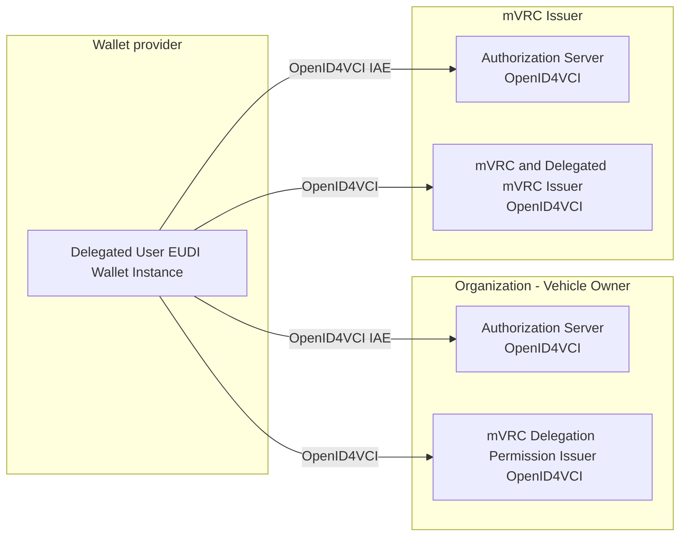

##### Sequence diagram
```mermaid
sequenceDiagram
  autonumber
  actor UD as Delegated User
  participant WD as Delegated User EUDI Wallet instance

  box Organization
    participant B1 as Organization web app (frontend)
    participant I1 as Organization - Issuer API (OpenID4VCI)
    participant AS1 as Organization - Authorization Server (OpenID4VCI)
    participant V1 as Organization - Verifier (OpenID4VP)
  end

  box mVRC and delegated mVRC Issuer
    participant B as mVRC Issuer web app (frontend)
    participant I as mVRC Issuer - Issuer API (OpenID4VCI)
    participant AS as mVRC Issuer - Authorization Server (OpenID4VCI)
    participant V as mVRC Issuer - Verifier (OpenID4VP)
  end

  rect rgba(100, 170, 120, 0.18)
    Note left of UD: Obtain mVRC Delegation Permission from Organization

    UD->>B1: Open Organization start page for delegation process
    B1->>I1: POST /init (prepare credential offer parameters)
    I1->>B1: Response with QR Code and credential offer
    B1->>UD: Display QR Code + deep link button (credential_offer_uri)

    B1->>I1: GET /status
    I1-->>B1: HTTP 201
    loop Status polling
      B1->>I1: GET /status
      I1->>B1: HTTP 200 (Status=PENDING)
    end

    alt Obtain credential offer - cross-device flow
      UD->>WD: Open EUDI Wallet and scan QR Code
    else Obtain credential offer - same-device flow
      UD->>B1: Press deep link button
      B1->>WD: Invoke EUDI Wallet
    end

    WD->>I1: Credential offer request
    I1->>WD: Credential offer

    WD->>I1: GET /.well-known/openid-credential-issuer
    I1->>WD: Credential Issuer Metadata

    WD->>AS1: GET /.well-known/oauth-authorization-server
    AS1->>WD: Authorization Server Metadata

    WD->>UD: Display mVRC Delegation Permission offer and metadata
    UD->>WD: Accept credential offer

    WD->>WD: Obtain WIA (client attestation JWT)
    WD->>WD: Create fresh Client Attestation JWT proof-of-possession

    alt Consumer verification via OpenID4VP presentation flow
      WD->>AS1: POST /par (client_id, scope, PKCE, WIA, proof-of-possession, etc.)
      AS1->>WD: request_uri
      WD->>AS1: GET /authorize (request_uri, client_id)
      AS1->>V1: Request consumer PID verification
      V1->>WD: OpenID4VP authorization request (PID)
      WD->>WD: Parse OpenID4VP authorization request
      WD->>UD: Display PID data sharing screen
      UD->>WD: Accept PID data sharing and authenticate
      WD->>WD: Prepare and sign VP token
      WD->>V1: OpenID4VP response (PID presentation)
      V1->>AS1: PID verification result
      AS1->>WD: 302 redirect to redirect_uri?code=...&state=...

    else Consumer verification via IAE-based OpenID4VP interaction
      WD->>AS1: POST /iae initial request (client_id, scope, PKCE, WIA, proof-of-possession, etc.)
      AS1->>WD: OpenID4VP request object (PID)
      WD->>WD: Parse OpenID4VP request
      WD->>UD: Display PID data sharing screen
      UD->>WD: Accept PID data sharing and authenticate
      WD->>WD: Prepare and sign VP token
      WD->>AS1: OpenID4VP response - follow-up request (PID presentation)
      AS1->>WD: IAE follow-up response (code, status)
    end

    WD->>AS1: POST /token (code, code_verifier, WIA, proof-of-possession)
    AS1->>WD: access_token

    opt Nonce endpoint used
      WD->>I1: POST /nonce (request c_nonce)
      I1->>WD: c_nonce + c_nonce_expires_in
    end

    WD->>I1: POST /credential (Authorization: Bearer access_token, proof with Key Attestation (KA))
    I1->>I1: Prepare, sign, and encode mso_mdoc object (mVRC Delegation Permission)
    I1->>WD: Credential response (mVRC Delegation Permission)
    WD->>WD: Store mVRC Delegation Permission

    opt Notification
      WD->>I1: POST /notification
      I1->>WD: 204 OK
    end

    WD->>UD: Show success screen in Wallet
    B1->>I1: GET /status
    I1->>B1: HTTP 200 (Status=OK)
    B1->>UD: Present success screen
  end

  rect rgba(200, 140, 90, 0.18)
    Note left of UD: Obtain delegated mVRC from mVRC and delegated mVRC Issuer

    UD->>B: Open mVRC Issuer start page for delegated mVRC issuance
    B->>I: POST /init (prepare credential offer parameters)
    I->>B: Response with QR Code and credential offer
    B->>UD: Display QR Code + deep link button (credential_offer_uri)

    B->>I: GET /status
    I-->>B: HTTP 201
    loop Status polling
      B->>I: GET /status
      I->>B: HTTP 200 (Status=PENDING)
    end

    alt Obtain credential offer - cross-device flow
      UD->>WD: Open EUDI Wallet and scan QR Code
    else Obtain credential offer - same-device flow
      UD->>B: Press deep link button
      B->>WD: Invoke EUDI Wallet
    end

    WD->>I: Credential offer request
    I->>WD: Credential offer

    WD->>I: GET /.well-known/openid-credential-issuer
    I->>WD: Credential Issuer Metadata

    WD->>AS: GET /.well-known/oauth-authorization-server
    AS->>WD: Authorization Server Metadata

    WD->>UD: Display delegated mVRC offer and metadata
    UD->>WD: Accept credential offer

    WD->>WD: Obtain WIA (client attestation JWT)
    WD->>WD: Create fresh Client Attestation JWT proof-of-possession

    alt Consumer verification via OpenID4VP presentation flow
      WD->>AS: POST /par (client_id, scope, PKCE, WIA, proof-of-possession, etc.)
      AS->>WD: request_uri
      WD->>AS: GET /authorize (request_uri, client_id)
      AS->>V: Request mVRC Delegation Permission and PID verification
      V->>WD: OpenID4VP authorization request (mVRC Delegation Permission + PID)
      WD->>WD: Parse OpenID4VP authorization request
      WD->>UD: Display data sharing screen
      UD->>WD: Accept data sharing and authenticate
      WD->>WD: Prepare and sign VP token
      WD->>V: OpenID4VP response (mVRC Delegation Permission + PID)
      V->>AS: Verification result
      AS->>WD: 302 redirect to redirect_uri?code=...&state=...

    else Consumer verification via IAE-based OpenID4VP interaction
      WD->>AS: POST /iae initial request (client_id, scope, PKCE, WIA, proof-of-possession, etc.)
      AS->>WD: OpenID4VP request object (mVRC Delegation Permission + PID)
      WD->>WD: Parse OpenID4VP request
      WD->>UD: Display data sharing screen
      UD->>WD: Accept data sharing and authenticate
      WD->>WD: Prepare and sign VP token
      WD->>AS: OpenID4VP response - follow-up request (mVRC Delegation Permission + PID)
      AS->>WD: IAE follow-up response (code, status)
    end

    WD->>AS: POST /token (code, code_verifier, WIA, proof-of-possession)
    AS->>WD: access_token

    opt Nonce endpoint used
      WD->>I: POST /nonce (request c_nonce)
      I->>WD: c_nonce + c_nonce_expires_in
    end

    WD->>I: POST /credential (Authorization: Bearer access_token, proof with Key Attestation (KA))
    I->>I: Validate mVRC Delegation Permission and match vehicle data
    I->>I: Map delegation data and prepare delegated mVRC
    I->>I: Sign and encode mso_mdoc object (delegated mVRC)
    I->>WD: Credential response (delegated mVRC)
    WD->>WD: Store delegated mVRC

    opt Notification
      WD->>I: POST /notification
      I->>WD: 204 OK
    end
    WD->>WD: Remove mVRC delegation permission<br> from local data storage
    WD->>UD: Show success screen in Wallet
    B->>I: GET /status
    I->>B: HTTP 200 (Status=OK)
    B->>UD: Present success screen
  end
```

---

##### Extended flow

```mermaid
flowchart LR
  subgraph WALLET[Wallet Provider]
    WD["Delegated User EUDI Wallet Instance"]
    WPB["KA / WIA status information"]
  end

  subgraph ORG[Organization - Vehicle Owner]
    AS1["Authorization Server<br/>OpenID4VCI"]
    I1["mVRC Delegation Permission Issuer<br/>OpenID4VCI"]
  end

  subgraph ISSUER[mVRC and delegated mVRC Issuer]
    AS["Authorization Server<br/>OpenID4VCI"]
    I["Delegated mVRC Issuer<br/>OpenID4VCI"]
  end

  subgraph PID[PID Provider]
    PIDSL["PID Status List"]
  end

  subgraph TRUST[Trusted Lists Provider]
    TLP["PID Provider Trusted List"]
    TLW["Wallet Provider Trusted List"]
    TLACP["WRPAC Trusted List"]
    TLRCP["WRPRC Trusted List"]
    TLMVRCDP["mVRC Delegation Permission Providers Trusted List"]
    TLMVRC["mVRC Providers Trusted List"]
  end

  subgraph REGISTRY[National Vehicle Registry]
    R["mVRC data registry"]
  end

  WD -->|OpenID4VCI IAE| AS1
  WD -->|OpenID4VCI| I1
  WD -->|Get trusted list| TLACP
  WD -->|Get trusted list| TLRCP
  WD -->|Get trusted list| TLMVRCDP
  WD -->|Get trusted list| TLMVRC

  AS1 -->|Get PID status list| PIDSL
  AS1 -->|Get trusted list| TLP
  AS1 -->|Get trusted list| TLW
  I1 -->|Get trusted list| TLW
  WPB ---|Get WIA status information| AS1
  WPB ---|Get KA status information| I1

  WD -->|OpenID4VCI| I
  WD -->|OpenID4VCI IAE| AS

  AS -->|Get PID status list| PIDSL
  AS -->|Get trusted list| TLP
  AS -->|Get trusted list| TLMVRCDP
  AS -->|Get trusted list| TLW
  I -->|Get trusted list| TLW
  WPB ---|Get WIA status information| AS
  WPB ---|Get KA status information| I

  I -->|Get mVRC data| R
```

##### Sequence diagram
```mermaid
sequenceDiagram
  autonumber
  actor UD as Delegated User
  participant WD as Delegated User EUDI Wallet instance

  box Organization
    participant B1 as Organization web app (frontend)
    participant I1 as Organization - Issuer API (OpenID4VCI)
    participant AS1 as Organization - Authorization Server (OpenID4VCI)
  end

  box mVRC and delegated mVRC Issuer
    participant B as mVRC Issuer web app (frontend)
    participant I as mVRC Issuer - Issuer API (OpenID4VCI)
    participant AS as mVRC Issuer - Authorization Server (OpenID4VCI)
  end

  participant R as Vehicle Registry or vehicle data source (optional)
  participant TL as Trusted Lists Provider (optional)
  participant PD as PID Provider (optional)
  participant WP as Wallet Provider (optional)

  rect rgba(100, 170, 120, 0.18)
    Note left of UD: Obtain mVRC Delegation Permission from Organization

    UD->>B1: Open Organization start page for delegation process
    B1->>I1: POST /init (prepare credential offer parameters)
    I1->>B1: Response with QR Code and credential offer
    B1->>UD: Display QR Code + deep link button (credential_offer_uri)

    B1->>I1: GET /status
    I1-->>B1: HTTP 201
    loop Status polling
      B1->>I1: GET /status
      I1->>B1: HTTP 200 (Status=PENDING)
    end

    alt Obtain credential offer - cross-device flow
      UD->>WD: Open EUDI Wallet and scan QR Code
    else Obtain credential offer - same-device flow
      UD->>B1: Press deep link button
      B1->>WD: Invoke EUDI Wallet
    end

    WD->>I1: Credential offer request
    I1->>WD: Credential offer

    WD->>I1: GET /.well-known/openid-credential-issuer
    I1->>WD: Credential Issuer Metadata

    opt Credential Issuer trust check
      WD->>TL: Get Organization access certificate trusted list / LOTE trust material
      TL->>WD: Organization access certificate trusted list / LOTE trust material
      WD->>WD: Validate Organization access certificate and cache trust material
    end

    WD->>AS1: GET /.well-known/oauth-authorization-server
    AS1->>WD: Authorization Server Metadata

    WD->>UD: Display mVRC Delegation Permission offer and metadata
    UD->>WD: Accept credential offer

    WD->>WD: Obtain WIA (client attestation JWT) from Wallet Provider Backend
    WD->>WD: Create fresh Client Attestation JWT proof-of-possession

    WD->>AS1: POST /iae initial request (client_id, scope, PKCE, WIA, proof-of-possession, etc.)
    AS1->>AS1: Parse and validate IAE initial request

    opt Authorization Server wallet trust checks
      AS1->>TL: Get Wallet Provider trusted list
      TL->>AS1: Wallet Provider trusted list
      AS1->>AS1: Validate WIA seal and certificate chain
    end

    opt WIA status check
      AS1->>WP: Get WIA status information
      WP->>AS1: WIA status information
      AS1->>AS1: Validate WIA status
    end

    AS1->>WD: OpenID4VP request object (PID)
    WD->>WD: Parse OpenID4VP request
    WD->>UD: Display PID data sharing screen
    UD->>WD: Accept PID data sharing and authenticate
    WD->>WD: Prepare and sign VP token
    WD->>AS1: OpenID4VP response - follow-up request (PID presentation)

    AS1->>AS1: Parse and validate VP token

    opt PID trust check
      AS1->>TL: Get PID Provider trusted list
      TL->>AS1: PID Provider trusted list
      AS1->>AS1: Validate PID issuer trust and signature material
    end

    opt PID status list check
      AS1->>PD: Get PID status list
      PD->>AS1: PID status list
      AS1->>AS1: Validate PID status
    end

    AS1->>WD: IAE follow-up response (code, status)

    WD->>AS1: POST /token (code, code_verifier, WIA, proof-of-possession)
    AS1->>AS1: Parse and validate token request
    AS1->>WD: access_token (+ optional refresh_token)

    opt Nonce endpoint used
      WD->>I1: POST /nonce (request c_nonce)
      I1->>WD: c_nonce + c_nonce_expires_in
    end

    WD->>I1: POST /credential (Authorization: Bearer access_token, proof with Key Attestation (KA))

    opt Credential request proof trust checks
      I1->>TL: Get Wallet Provider trusted list
      TL->>I1: Wallet Provider trusted list
      I1->>I1: Validate KA seal and certificate chain
    end

    opt KA status check
      I1->>WP: Get KA status information
      WP->>I1: KA status information
      I1->>I1: Validate KA status
    end

    I1->>I1: Validate proof-of-possession and holder binding
    I1->>I1: Prepare, sign, and encode mso_mdoc object (mVRC Delegation Permission)
    I1->>WD: Credential response (mVRC Delegation Permission)

    opt mVRC Delegation Permission trust check
      WD->>TL: Get mVRC Delegation Permission Provider trusted list / LOTE trust material
      TL->>WD: mVRC Delegation Permission Provider trusted list / LOTE trust material
      WD->>WD: Validate mVRC Delegation Permission signature, certificate material, and issuer trust
    end

    WD->>WD: Store mVRC Delegation Permission

    opt Notification
      WD->>I1: POST /notification
      I1->>WD: 204 OK
    end

    WD->>UD: Show success screen in Wallet
    B1->>I1: GET /status
    I1->>B1: HTTP 200 (Status=OK)
    B1->>UD: Present success screen
  end

  rect rgba(200, 140, 90, 0.18)
    Note left of UD: Obtain delegated mVRC from mVRC and delegated mVRC Issuer

    UD->>B: Open mVRC Issuer start page for delegated mVRC issuance
    B->>I: POST /init (prepare credential offer parameters)
    I->>B: Response with QR Code and credential offer
    B->>UD: Display QR Code + deep link button (credential_offer_uri)

    B->>I: GET /status
    I-->>B: HTTP 201
    loop Status polling
      B->>I: GET /status
      I->>B: HTTP 200 (Status=PENDING)
    end

    alt Obtain credential offer - cross-device flow
      UD->>WD: Open EUDI Wallet and scan QR Code
    else Obtain credential offer - same-device flow
      UD->>B: Press deep link button
      B->>WD: Invoke EUDI Wallet
    end

    WD->>I: Credential offer request
    I->>WD: Credential offer

    WD->>I: GET /.well-known/openid-credential-issuer
    I->>WD: Credential Issuer Metadata

    opt Credential Issuer trust check
      WD->>TL: Get mVRC Provider trusted list / LOTE trust material
      TL->>WD: mVRC Provider trusted list / LOTE trust material
      WD->>WD: Validate mVRC Issuer access certificate
    end

    WD->>AS: GET /.well-known/oauth-authorization-server
    AS->>WD: Authorization Server Metadata

    WD->>UD: Display delegated mVRC offer and metadata
    UD->>WD: Accept credential offer

    WD->>WD: Obtain WIA (client attestation JWT) from Wallet Provider Backend
    WD->>WD: Create fresh Client Attestation JWT proof-of-possession

    WD->>AS: POST /iae initial request (client_id, scope, PKCE, WIA, proof-of-possession, etc.)
    AS->>AS: Parse and validate IAE initial request

    opt Authorization Server wallet trust checks
      AS->>TL: Get Wallet Provider trusted list
      TL->>AS: Wallet Provider trusted list
      AS->>AS: Validate WIA seal and certificate chain
    end

    opt WIA status check
      AS->>WP: Get WIA status information
      WP->>AS: WIA status information
      AS->>AS: Validate WIA status
    end

    AS->>WD: OpenID4VP request object (mVRC Delegation Permission + PID)
    WD->>WD: Parse OpenID4VP request
    WD->>UD: Display data sharing screen
    UD->>WD: Accept data sharing and authenticate
    WD->>WD: Prepare and sign VP token
    WD->>AS: OpenID4VP response - follow-up request (mVRC Delegation Permission + PID)

    AS->>AS: Parse and validate VP token

    opt PID trust check
      AS->>TL: Get PID Provider trusted list
      TL->>AS: PID Provider trusted list
      AS->>AS: Validate PID issuer trust and signature material
    end

    opt PID status list check
      AS->>PD: Get PID status list
      PD->>AS: PID status list
      AS->>AS: Validate PID status
    end

    opt mVRC Delegation Permission trust check
      AS->>TL: Get mVRC Delegation Permission Provider trusted list / LOTE trust material
      TL->>AS: mVRC Delegation Permission Provider trusted list / LOTE trust material
      AS->>AS: Validate mVRC Delegation Permission signature, certificate material, and issuer trust
    end

    AS->>AS: Validate mVRC Delegation Permission authenticity, validity period, scope, and applicability
    AS->>WD: IAE follow-up response (code, status)

    WD->>AS: POST /token (code, code_verifier, WIA, proof-of-possession)
    AS->>AS: Parse and validate token request
    AS->>WD: access_token (+ optional refresh_token)

    opt Nonce endpoint used
      WD->>I: POST /nonce (request c_nonce)
      I->>WD: c_nonce + c_nonce_expires_in
    end

    WD->>I: POST /credential (Authorization: Bearer access_token, proof with Key Attestation (KA))

    opt Credential request proof trust checks
      I->>TL: Get Wallet Provider trusted list
      TL->>I: Wallet Provider trusted list
      I->>I: Validate KA seal and certificate chain
    end

    opt KA status check
      I->>WP: Get KA status information
      WP->>I: KA status information
      I->>I: Validate KA status
    end

    I->>I: Validate proof-of-possession and holder binding
    I->>I: Validate mVRC Delegation Permission against issuance context

    opt Vehicle data retrieval
      I->>R: Query vehicle data using identifiers from mVRC Delegation Permission
      R->>I: Vehicle data attributes
    end

    I->>I: Match vehicle data and Organization authorization
    I->>I: Map mVRC Delegation Permission data to delegated mVRC
    I->>I: Add status index for delegated mVRC instance
    I->>I: Prepare, sign, and encode mso_mdoc object (delegated mVRC)
    I->>WD: Credential response (delegated mVRC)

    opt Delegated mVRC trust check
      WD->>TL: Get mVRC Provider trusted list / LOTE trust material
      TL->>WD: mVRC Provider trusted list / LOTE trust material
      WD->>WD: Validate delegated mVRC issuer signature and certificate material
    end

    WD->>WD: Store delegated mVRC

    opt Notification
      WD->>I: POST /notification
      I->>WD: 204 OK
    end
    WD->>WD: Remove mVRC delegation permission<br> from local data storage
    WD->>UD: Show success screen in Wallet
    B->>I: GET /status
    I->>B: HTTP 200 (Status=OK)
    B->>UD: Present success screen
  end
```

### 8.6. Scenario 2C – mVRC delegation / remote data sharing

#### 8.6.1.	Functional requirements

Scenario 2C is based on OpenID4VP 1.0, aligned with the HAIP 1.0, and supports secure and interoperable remote presentation of the delegated mVRC credentials from the EUDI wallet to a verifier. The scenario enables the use of delegated mVRC data within remote service interactions, where verification of the delegated vehicle privileges and user identity is required.

**EUDI Wallet Instance**

| Index | Requirement Title | Description | Priority | Acceptance Criteria |
|------:|-------------------|-------------|----------|---------------------|
| FR-W2C-01 | Support OpenID4VP | The wallet SHALL support the OpenID for Verifiable Presentations (OpenID4VP) 1.0 protocol for remote presentation of delegated mVRC data. | High | The wallet can successfully complete an OpenID4VP flow with a compliant Verifier. |
| FR-W2C-02 | ETSI Presentation Profile Support | The Wallet SHALL support the ETSI TS 119 472-2 presentation profile elements applicable to this scenario, including signed Request Object processing, verifier identification, verifier information processing, encrypted presentation response, and holder binding. | High | Wallet successfully completes a remote delegated mVRC presentation flow with a compliant Verifier and releases delegated mVRC data only after successful request processing, user consent, and proof-binding. |
| FR-W2C-03 | HAIP 1.0 Profile Elements | The Wallet SHALL support the relevant High Assurance Interoperability Profile (HAIP) 1.0 requirements for presentation flows in this scenario. | High | Presentation flows apply the relevant HAIP-defined security and assurance requirements. |
| FR-W2C-04 | Support mso_mdoc Format | The wallet SHALL support the mso_mdoc credential format for delegated mVRC credentials, in accordance with ISO/IEC 18013-5 and applicable EUDI Wallet profiles. | High | The wallet can successfully receive, store, and present delegated mVRC credentials in mso_mdoc format. |
| FR-W2C-05 | Delegated mVRC Data Model Compliance | The Wallet SHALL support the standardized mVRC data model and structure as defined by ISO 7367 and the applicable mVRC rulebook, extended with an additional delegation object in a dedicated namespace. | High | The Wallet correctly interprets and processes delegated mVRC data elements, including the delegation object. |
| FR-W2C-06 | User Consent | The wallet SHALL require explicit user consent before disclosing any delegated mVRC data to a Verifier. | High | No delegated mVRC data is shared without an explicit user-approval action. |
| FR-W2C-07 | Key Binding Support | The wallet SHALL support key binding mechanisms to ensure that presented delegated mVRC data is cryptographically bound to the wallet instance. | High | Presentations include a valid proof of possession bound to a wallet-controlled key. |
| FR-W2C-08 | Cross-Device and Same-Device Flow | The wallet SHALL support cross-device flows using QR code scanning and same-device flows using deeplinks to initiate authorization requests. | High | Both QR-based and deeplink-based authorization requests can be successfully initiated. |
| FR-W2C-09 | Authorization Request Initialization | The wallet SHALL be able to initialize the OpenID4VP authorization request based on Verifier-provided parameters. | High | The wallet correctly processes and responds to an OpenID4VP authorization request. |
| FR-W2C-10 | Verifier Registration Certificate Handling | The wallet SHALL support processing and validation of Verifier registration certificates. | Medium | Registration certificates are successfully parsed and validated when present. |
| FR-W2C-11 | Verifier Trust Validation | The wallet SHALL verify the trust of the Verifier using registration and access certificates against trusted lists. | High | Presentations proceed only if the Verifier trust check succeeds. |
| FR-W2C-12 | DCQL Credential Sets Support | The wallet SHALL support DCQL credential sets as defined by the Verifier presentation request. | Low | The wallet correctly resolves and processes DCQL credential sets. |
| FR-W2C-13 | DCQL Claim Sets Support | The wallet SHALL support DCQL claim sets to determine which claims are requested for presentation. | Medium | Requested claim sets are correctly interpreted and processed. |
| FR-W2C-14 | DCQL Value Constraints Support | The wallet SHALL support DCQL value constraints when selecting data for presentation. | Medium | Presented data complies with DCQL-defined value constraints. |
| FR-W2C-15 | Selective Disclosure | The wallet SHALL support selective disclosure mechanisms to share only the minimum required delegated mVRC data. | High | Only user-approved and requested attributes are included in the presentation. |
| FR-W2C-16 | Data Sharing Preview | The wallet SHALL present the user with a clear preview of the data to be shared, including the Verifier identity and the purpose of data sharing. | High | The user can review requested data, Verifier name, and purpose before consent. |
| FR-W2C-17 | Optional Attribute Selection | The wallet SHALL allow the user to select or deselect optional delegated mVRC attributes prior to presentation. | Medium | Optional attributes can be toggled on or off by the user. |
| FR-W2C-18 | VP Token Encryption | The wallet SHALL encrypt the verifiable presentation when using the `direct_post.jwt` response mode. | High | The VP token is transmitted in encrypted form to the Verifier. |
| FR-W2C-19 | Success Screen Presentation | The wallet SHALL display a success screen after a successful delegated mVRC data presentation transaction. | Low | A clear success confirmation is shown to the user after completion. |
| FR-W2C-20 | Post-Presentation Redirect | The wallet SHALL support redirection after a successful delegated mVRC data presentation, when requested by the Verifier. | Low | The wallet correctly performs a redirect following a successful transaction. |
| FR-W2C-21 | Verifier Metadata Resolution | The wallet SHALL resolve and process Verifier metadata as defined by OpenID4VP to determine supported formats, algorithms, and response modes. | High | The wallet successfully retrieves and applies Verifier metadata during the presentation flow. |
| FR-W2C-22 | Nonce Handling and Replay Protection | The wallet SHALL support nonce handling and include nonce values in verifiable presentations to prevent replay attacks. | High | Presentations include a valid nonce and are rejected if nonce validation fails. |
| FR-W2C-23 | Error Handling and User Feedback | The wallet SHALL handle protocol, trust, and validation errors and present a meaningful error state to the user. | Medium | Errors are correctly detected and a user-readable error message is displayed. |
| FR-W2C-24 | User-Initiated Cancellation | The wallet SHALL allow the user to cancel the presentation process at any time before delegated mVRC data disclosure. | Medium | The user can abort the flow and no data is disclosed after cancellation. |
| FR-W2C-25 | Secure Presentation State Handling | The wallet SHALL securely maintain presentation state across redirects or application context switches during the presentation flow. | Medium | The presentation flow can be resumed or safely terminated without data leakage or corruption. |
| FR-W2C-26 | Support for DC API | The wallet MAY support remote presentation flows using a Digital Credentials API (DC API) supported by the user agent or platform. | Medium | If implemented, the wallet can be invoked through a DC API-compatible user agent or platform and can successfully complete a DC API-based presentation flow. |
| FR-W2C-27 | DC API Protocol | If the wallet supports DC API flows, it SHALL support the `org-iso-mdoc` presentation protocol value. The wallet MAY additionally support `openid4vp-v1-signed`. | Medium | When DC API support is implemented, the wallet can successfully complete a DC API-based presentation flow using `org-iso-mdoc`. Additional OpenID4VP Annex A protocol values, if implemented, are processed correctly. |

**mVRC Verifier (service provider)**

| Index | Requirement Title | Description | Priority | Acceptance Criteria |
|------:|-------------------|-------------|----------|---------------------|
| FR-V2C-01 | Support OpenID4VP | The Verifier SHALL support the OpenID for Verifiable Presentations (OpenID4VP) 1.0 protocol to request and receive delegated mVRC presentations. | High | The Verifier successfully completes an OpenID4VP flow with a compliant EUDI Wallet. |
| FR-V2C-02 | ETSI Presentation Profile Support | The Verifier SHALL support the ETSI TS 119 472-2 presentation profile elements applicable to this scenario, including signed Request Object generation, verifier identification, verifier information, encrypted presentation response handling, and holder binding validation. | High | The Verifier successfully completes a remote delegated mVRC presentation flow with a compliant Wallet and validates the presentation response, verifier context, and proof-binding. |
| FR-V2C-03 | HAIP 1.0 Profile Elements | The Verifier SHALL support the relevant High Assurance Interoperability Profile (HAIP) 1.0 requirements for presentation flows in this scenario. | High | Presentation requests and validation processes apply the relevant HAIP-defined security and assurance requirements. |
| FR-V2C-04 | Support mso_mdoc Format | The Verifier SHALL support verification of delegated mVRC presentations using the mso_mdoc credential format, in accordance with ISO/IEC 18013-5 and applicable EUDI Wallet profiles. | High | The Verifier successfully validates delegated mVRC presentations in mso_mdoc format. |
| FR-V2C-05 | Delegated mVRC Data Model Compliance | The Verifier SHALL validate delegated mVRC data against the standardized mVRC data model and structure as defined by ISO 7367 and the applicable mVRC rulebook, extended with an additional delegation object in a dedicated namespace. | High | Presented delegated mVRC data, including the delegation object, is correctly validated and rejected if non-compliant. |
| FR-V2C-06 | Authorization Endpoint Exposure | The Verifier SHALL expose an Authorization Endpoint to initiate presentation requests in accordance with OpenID4VP. | High | Wallets can initiate presentation flows using the Verifier Authorization Endpoint. |
| FR-V2C-07 | Presentation Query | The Verifier SHALL define and communicate presentation requirements using standardized mechanisms (DCQL). | High | Wallets can correctly interpret requested credential and claim requirements. |
| FR-V2C-08 | DCQL Credential Sets Definition | The Verifier SHALL support DCQL credential sets to specify acceptable delegated mVRC credentials. | Low | Wallets can resolve requested DCQL credential sets. |
| FR-V2C-09 | DCQL Claim Sets Definition | The Verifier SHALL support DCQL claim sets to specify required and optional delegated mVRC claims. | Medium | Wallets can correctly identify required and optional claims. |
| FR-V2C-10 | DCQL Value Constraints | The Verifier SHALL support DCQL value constraints to restrict acceptable values of requested claims. | Medium | Presented delegated mVRC data is validated against DCQL value constraints. |
| FR-V2C-11 | Nonce Generation | The Verifier SHALL generate and provide a nonce to bind the presentation to a specific transaction and prevent replay attacks. | High | Presentations without a valid nonce are rejected. |
| FR-V2C-12 | Direct Post Endpoint Support | The Verifier SHALL support receiving verifiable presentations using the `direct_post.jwt` response mode. | High | The Verifier successfully receives and processes VP tokens via direct_post.jwt mode. |
| FR-V2C-13 | VP Token Decryption | The Verifier SHALL support decryption of encrypted VP tokens when using `direct_post.jwt`. | High | Encrypted VP tokens are successfully decrypted and validated. |
| FR-V2C-14 | Key Binding Validation | The Verifier SHALL validate cryptographic proofs binding the presented delegated mVRC data to the wallet-controlled key. | High | Presentations without valid key binding proofs are rejected. |
| FR-V2C-15 | Selective Disclosure Processing | The Verifier SHALL correctly process selectively disclosed delegated mVRC data and validate it against the signed credential structure. | High | Selectively disclosed attributes are successfully verified. |
| FR-V2C-16 | User Redirect Handling | The Verifier SHALL support redirecting the user back to a web application or frontend after successful presentation. | High | The user is redirected after successful completion of the presentation flow. |
| FR-V2C-17 | Error Handling | The Verifier SHALL handle protocol, validation, and trust errors and provide appropriate error responses. | High | Errors are returned using standardized error responses and logged for diagnostics. |
| FR-V2C-18 | Delegated mVRC Seal Validation | The Verifier SHALL validate the cryptographic seal applied to the delegated mVRC credential against trusted lists to ensure that the credential was issued by a trusted delegated mVRC Issuer. | High | The Verifier successfully validates the delegated mVRC seal using trusted list information and rejects credentials with invalid or untrusted seals. |
| FR-V2C-19 | Delegated mVRC Status Verification | The Verifier SHALL verify the current validity status of the delegated mVRC credential using the applicable delegated mVRC status list (e.g. revocation or suspension status). | High | Delegated mVRC credentials with revoked or suspended status are correctly detected and rejected by the Verifier. |
| FR-V2C-20 | Success Screen Presentation | After successful verification of the delegated mVRC presentation, the Verifier SHALL redirect the user and present a success screen displaying the delegated mVRC data that was shared during the verification process. | High | The user is redirected to a success page and can view the delegated mVRC data that was disclosed as part of the verification. |
| FR-V2C-21 | Business Process Continuation | After successful delegated mVRC verification, the Verifier MAY allow the user to continue the intended business process, such as purchasing ferry tickets, buying an electronic toll vignette, or subscribing to a parking service. | Low | The user can proceed with the business process following successful verification. |
| FR-V2C-22 | Pre-Verification Business Flow | The Verifier MAY support initiating and maintaining the business process context prior to delegated mVRC  verification, ensuring a seamless transition into the verification flow. | Low | The business process context is preserved when transitioning from the service flow to the delegated mVRC verification flow. |
| FR-V2C-23 | Support for DC API | The Verifier MAY support remote presentation flows using a Digital Credentials API (DC API) supported by the user agent or platform. | Medium | If implemented, the Verifier can successfully complete a DC API-based presentation flow through a DC API-compatible user agent or platform. |
| FR-V2C-24 | DC API Protocol | If the Verifier supports DC API flows, it SHALL support the `org-iso-mdoc` presentation protocol value. The Verifier MAY additionally support `openid4vp-v1-signed`. | Medium | When DC API support is implemented, the Verifier can successfully initiate and process a DC API-based presentation flow using `org-iso-mdoc`. Additional OpenID4VP Annex A protocol values, if implemented, are processed correctly. |

---

#### 8.6.2	Attestation description

The data model for **delegated mVRC** is presented in the mVRC rulebook, which is based on ISO/IEC DTS 7367-2. The EU mVRC profile has been added to the rulebook based on the Proposal of the Directive of the European Parliament and of the Council on the registration documents for vehicles and vehicle registration data recorded in national vehicle registers and repealing Council Directive 1999/37/EC (November, 2025).

The delegated mVRC reuses the standard mVRC vehicle registration data structure and adds a delegation object in a dedicated namespace, `org.iso.7367.2.1.EU.delegation`, to describe the delegated right to use the vehicle. This RFC proposes an initial structure of that object for interoperability testing.

##### 8.6.2.1 Mandatory attributes

| Data Identifier | Definition | Data type | Example value |
|---|---|---|---|
| `delegation_permission_id` | Unique identifier of the mVRC delegation permission or delegated  mVRC issuance transaction. | string | `00b91349-f07a-44d8-94c6-db69f2b72a1a` |
| `privileges_scope` | Overall scope of delegated vehicle privileges. | string | `full` |
| `delegating_user` |  Name of the legal person who is the vehicle owner or holder and ordered the delegation  | object | |

##### 8.6.2.2 Conditional attributes

| Data Identifier | Definition | Data type | Example value |
|---|---|---|---|
| `partial_privileges` | SHALL be present when `vehicle_privileges.privileges_scope` is set to `partial`. | array of strings | `["drive", "road_suitability"]` |
| `organization_name` | Name of the legal person who is the vehicle owner or holder and ordered the delegation. | string | Example Rental Company |
| `family_name` | Family name of the natural person who is the vehicle owner or holder and ordered the delegation. | string | Mustermann |
| `given_name` | Given name of the natural person who is the vehicle owner or holder and ordered the delegation. | string | Max |

##### 8.6.2.3 Object encoding

| **Data Identifier** | **Attribute identifier** | **Encoding format** | **Namespace**|
|------------------------|--------------|------------------|------------------|
| `delegation_permission_id` | `delegation_permission_id` | tstr | `org.iso.7367.2.1.EU.delegation`|
| `vehicle_privileges` |   `vehicle_privileges` | map, see [Attribute vehicle_privileges](#31-Attribute-vehicle_privileges) | `org.iso.7367.2.1.EU.delegation`|
| `delegating_user` | Organization or natural person who is the vehicle owner or holder and ordered the delegation. | object | `{ "organization_name": "Example Rental Company" }` |

<br>

###### Attribute vehicle_privileges

The attribute `vehicle_privileges` is encoded as a type `vehicle_privileges`. Using CDDL notation as specified in RFC 8610, the encoding of this attribute is:

```cddl
vehicle_privileges = {
  "privileges_scope": privileges_scope_enum,
  ? "partial_privileges": [+ partial_privilege_enum]
}

privileges_scope_enum = "full" / "partial"

partial_privilege_enum = "drive"
                       / "road_suitability"
                       / "id_plate"
                       / "technical_properties"

```

`vehicle_privileges` SHALL contain the key-value pair `privileges_scope`.

If `privileges_scope` is set to `partial`, the key-value pair `partial_privileges` SHALL be present and SHALL contain one or more values from the allowed set.

If `privileges_scope` is set to `full`, the key-value pair `partial_privileges` SHALL NOT be present.

If present, `partial_privileges` SHALL contain one or more values from the following set:

**`drive`, `road_suitability`, `id_plate`, `technical_properties`**

<br>

###### Attribute delegating_user

The attribute `delegating_user` is encoded as a type `delegating_user`. Using CDDL notation as specified in RFC 8610, the encoding of this attribute is:

```cddl
delegating_user = delegating_organization / delegating_natural_person

delegating_organization = {
  "organization_name": tstr
}

delegating_natural_person = {
  "family_name": tstr,
  "given_name": tstr
}
```


If `organization_name` is present, `family_name` and `given_name` SHALL be absent.

If `given_name` is present, `family_name` SHALL also be present and `organization_name` SHALL be absent.

<br>

###### CDDL definition

```cddl
delegated_mVRC_delegation_object = {
  "delegation_permission_id": tstr,
  "vehicle_privileges": vehicle_privileges,
  "delegating_user": delegating_user
}

vehicle_privileges = {
  "privileges_scope": privileges_scope_enum,
  ? "partial_privileges": [+ partial_privilege_enum]
}

privileges_scope_enum = "full" / "partial"

partial_privilege_enum = "drive"
                       / "road_suitability"
                       / "id_plate"
                       / "technical_properties"

delegating_user = delegating_organization / delegating_natural_person

delegating_organization = {
  "organization_name": tstr
}

delegating_natural_person = {
  "family_name": tstr,
  "given_name": tstr
}

```

<br>

###### Object example in mso_mdoc

```cbor-diag
"org.iso.7367.2.1.EU.delegation": [
  24(<<{
    "digestID": 0,
    "random": h'7F9C2BA4E88F827D616045507605853E',
    "elementIdentifier": "delegation_permission_id",
    "elementValue": "00b91349-f07a-44d8-94c6-db69f2b72a1a"
  }>>),
  24(<<{
    "digestID": 1,
    "random": h'9D5ED678FE57BCCA610140957AFAB571',
    "elementIdentifier": "vehicle_privileges",
    "elementValue": {
      "privileges_scope": "partial",
      "partial_privileges": [
        "drive",
        "id_plate"
      ]
    }
  }>>),
  24(<<{
    "digestID": 2,
    "random": h'0D61F8370CAD1D412F80B84D143E1257',
    "elementIdentifier": "delegating_user",
    "elementValue": {
      "organization_name": "Example Rental Company"
    }
  }>>)
]
```

---

#### 8.6.3.	Protocol profile

**OpenID4VP**

Specification: OpenID for Verifiable Presentations 1.0  
Profile: High Assurance Interoperability Profile (HAIP) 1.0  

Characteristics:

- Request/response presentation flow using authorization requests;
- Supported request schemes: `eu-eaap`, `haip-vp`, and `mdoc-openid4vp`;
- Authorization requests implemented using JSON Web Token (JAR) by reference;
- Support for response mode: `direct_post.jwt`;
- Credential format: `mso_mdoc`;
- Support for presentation of delegated mVRC credentials;
- Support for selective disclosure of requested attributes;
- Holder binding using proof-of-possession mechanisms;
- Client identifier prefix type: `x509_hash`;
- Support for credential status verification using IETF Status Lists;
- Alignment with ETSI TS 119 472-2.

<br>

**Digital Credentials API (DC API) – optional**

Where supported, remote presentation may also be performed using a Digital Credentials API (DC API). The use of DC API is optional and depends onon the  platform support and implementation choices. OpenID4VP remains the primary and interoperable mechanism for remote presentations.

Specification: Digital Credentials API (Draft)  

Characteristics:

- Optional alternative presentation mechanism complementary to OpenID4VP;
- Browser- or platform-mediated DC API request;
- Support for presentation of delegated mVRC credentials;
- Support for credential format: `mso_mdoc`;
- Required protocol value: `org-iso-mdoc`;
- Optional support for `openid4vp-v1-signed`;
- Response mode: `dc_api.jwt`;
- Support for holder binding and proof-of-possession mechanisms;
- Support for credential status verification using IETF Status Lists;
- Support for verifier-defined presentation requirements and selective disclosure;
- Integration with platform or user-agent credential mediation capabilities.


---

#### 8.6.4.	Trust and security mechanisms

The scenario relies on a combination of cryptographic and trust mechanisms to ensure secure and reliable presentation and verification of the delegated mVRC data, including:

- Holder binding and proof-of-possession (PoP);
- Nonce-based replay protection mechanisms;
- Encryption of presentation responses where required by the selected protocol and response mode;
- Validation of verifier registration and access certificates using ETSI Trusted Lists;
- Validation of verifier trust status using ETSI Trusted Lists;
- Validation of credential authenticity, integrity, issuer signatures, seals, validity periods, and usage constraints;
- Verification of credential trust status and credential status using IETF Status Lists;
- Selective disclosure mechanisms supporting data minimisation principles;
- Alignment with ETSI TS 119 472-2 presentation profiles;
- Trust validation based on ETSI LOTE mechanisms.

---

#### 8.6.5.	Endpoints

| Standard | Endpoint | Usage in Scenario | Reference |
|----------|----------|------------------|-----------|
| OpenID4VP 1.0 / JAR / HAIP 1.0 | Authorization Endpoint | Required | [OpenID4VP 1.0](https://openid.net/specs/openid-4-verifiable-presentations-1_0.html#section-5), [JAR RFC RFC 9101](https://www.rfc-editor.org/rfc/rfc9101.html#section-5.2) |
| OpenID4VP 1.0 | Direct POST JWT Endpoint | Required | [OpenID4VP 1.0](https://openid.net/specs/openid-4-verifiable-presentations-1_0.html#section-8.3.1) |
| Implementation-specific | Init Endpoint | Optional | N/A |
| Implementation-specific | Status Endpoint | Optional | N/A |

---

#### 8.6.6.	Technical interaction flow – sequence diagrams

The following sequence diagrams illustrate the remote presentation flow for the delegated mVRC in Scenario 2C and show the technical interaction between the EUDI wallet, the mVRC verifier and supporting components.

The diagrams present the main steps involved in requesting, selecting, and securely presenting the delegated mVRC data, including user consent, selective disclosure, and validation of the presented data within a service interaction context.

##### Basic flow
```mermaid
flowchart LR
  subgraph WALLET[Wallet Provider]
    W[EUDI Wallet Instance]
  end

  subgraph VERIFIER[Service provider]
    V[delegated mVRC Verifier]
  end


  W -->|OpenID4VP| V
```

##### Sequence diagram
```mermaid
sequenceDiagram
  autonumber
  actor U as User
  participant W as EUDI Wallet instance
  participant B as delegated mVRC Verifier web app(frontend)
  participant V as delegated mVRC Verifier - API (OpenID4VP)


  U->>B: Open Verifier start page
  B->>V: POST /start-session (prepare Auth request)
  V->>B: response with QR Code and deeplink with schema and request_uri
  B->>V: GET Poll verification status (until completed with delegated mVRC Data)
  V-->>B: http 201 
  loop
  B->>V: GET /status poll request
  V->>B: http 200 (Status=PENDING)
  end
  B->>U: Display QR + deep link button (schema with JAR request_uri)

alt Obtain Auth request (cross-device or same-device flow)
  U->>W: Open EUDI mob app
  W->>B: scan QR code
  B->>W: scan QR code
  else
  U->>B: press deeplink button
  B->>W: invoke EUDI Wallet mob app
 end
  W->>V: JAR request
  V->>W: Authorization request with presentation query (DCQL)
  W->>W: parse and validate Authorization request
  W->>U: Display presentation query
  U->>W: Accept data sharing (user consent)
  W->>W: Prepare VP token(with encryption) and POST request
  W->>V: Send VP token in authorization response
  V->>V: Parse and validate VP token
  B->>V: GET /status poll request
  V->>B: http 200 (Status=OK polling ended) with delegated mVRC presentation data
  V->>W: http 200 with redirect_uri
  W->>U: present success screen on mobile app
  U->>W: close success screen
alt (cross-device or same-device)
  W->>B: redirect to Verifier success screen
  B->>U: present success screen with delegated mVRC requested data
else
  W->>B: send request GET to redirect_uri
  W->>U: redirect and present Dashboard screen
  B->>U: present success screen with delegated mVRC requested data
end
```

---

##### Extended flow
```mermaid
flowchart LR
  subgraph WALLET[Wallet Provider]
    W[EUDI Wallet Instance]
  end
  subgraph VERIFIER[Service provider]
    V[delegated mVRC Verifier]
  end
  subgraph TRUST[Trust List Provider]
    TLACP[WRPAC Trusted list]
    TLRCP[WRPRC Trusted list]
    TLMVRC[mVRC Providers Trusted list]
  end
  subgraph ISSUER[delegated mVRC Issuer]
    I[delegated mVRC status list]
  end
  W -->|OpenID4VP| V
  W -->|Get WRPAC trusted list| TLACP
  W -->|Get WRPRC trusted list| TLRCP
  V -->|mVRC Providers trusted list| TLMVRC
  V -->|Get delegated mVRC status list| I
```

##### Sequence diagram
```mermaid
sequenceDiagram
  autonumber
  actor U as User
  participant W as EUDI Wallet instance
  participant B as delegated mVRC  Verifier web app(frontend)
  participant V as delegated mVRC  Verifier
  participant I as delegated mVRC  Issuer (status list)
  participant TL as Trusted Lists Provider 


  U->>B: Open Verifier start page
  B->>V: POST /init (prepare Auth request)
  V->>B: response with QR Code and deeplink with schema and request_uri
  B->>V: GET Poll verification status (until completed)(with delegated mVRC Data)
  V-->>B: http 201 
  loop
  B->>V: GET /status poll request
  V->>B: http 200 (Status=PENDING)
  end
  B->>U: Display QR + deep link button (schema with JAR request_uri)

alt Obtain Auth request (cross-device or same-device flow)
  U->>W: Open EUDI mob app
  W->>B: scan QR code
  B->>W: scan QR code
  else
  U->>B: press deeplink button
  B->>W: invoke EUDI Wallet mob app
 end
  W->>V: JAR request
  V->>W: Authorization request with presentation query (DCQL)
  W->>W: parse and validate Authorization request
   opt Trust check (optional)
    W->>TL: WRPAC and WRPRC trusted List
    TL->>W: WRPAC and WRPRC trusted List
    W->>W: delegated mVRC Verifier access and registration certificate validation &cache Trusted list
 end
  W->>U: Display presentation query
  U->>W: Accept data sharing (user consent)
  W->>W: Prepare VP token(with encryption) and POST request
  W->>V: Send VP token in authorization response
  V->>V: Parse and validate VP token
opt Verifier trust checks (optional)
      V->>TL: mVRC Providers trusted List
      TL->>V: mVRC Providers trusted List
      V->>V: mVRC seal x5c validation
     end
    opt delegated mVRC status list check (optional)
      V->>I: Get delegated mVRC status list
      I->>V: JWT/CWT with delegated mVRC status list
      V->>V: delegated mVRC idx validation
    end
  B->>V: GET /status poll request
  V->>B: http 200 (Status=OK polling ended) with delegated mVRC presentation data
  V->>W: http 200 with redirect_uri
  W->>U: present success screen on mobile app
  U->>W: close success screen
alt (cross-device or same-device)
  W->>B: redirect to Verifier success screen
  B->>U: present success screen with delegated mVRC requested data
else
  W->>B: send request GET to redirect_uri
  W->>U: redirect and present Dashboard screen
  B->>U: present success screen with delegated mVRC requested data
end
```

### 8.7. Scenario 2D – mVRC delegation / proximity data sharing

#### 8.7.1. Functional requirements

Scenario 2D is based on ISO/IEC 18013-5 proximity presentation mechanisms and supports proximity presentation of the delegated mVRC data from the EUDI wallet to a proximity verifier enabling selective disclosure and secure offline/online verification via NFC, BLE, or QR codes. The scenario assumes that the delegated mVRC credential has already been issued and is stored in the EUDI wallet.

**EUDI Wallet Instance**


 Index | Requirement Title | Description | Priority | Acceptance Criteria |
|------:|-------------------|-------------|----------|---------------------|
| FR-W2D-01 | ISO/IEC 18013-5 Proximity Presentation Support | The Wallet SHALL support proximity-based presentation of delegated mVRC attestations in accordance with ISO/IEC 18013-5, using Bluetooth Low Energy (BLE) for device engagement and secure data transfer. | High | The Wallet can successfully establish a proximity session with a compliant Reader device over BLE, complete device engagement, and transmit requested delegated mVRC data in compliance with ISO/IEC 18013-5. |
| FR-W2D-02 | ETSI Presentation Profile Elements | The Wallet SHALL support the ETSI TS 119 472-2 presentation profile elements applicable to this proximity scenario, including reader/verifier identification, reader authentication where applicable, trust validation, encrypted session handling, holder binding, and status validation where applicable. | High | The Wallet successfully completes a proximity delegated mVRC presentation flow with a compliant Reader and releases delegated mVRC data only after successful request processing, user consent, secure session establishment, and proof-binding. |
| FR-W2D-03 | BLE Peripheral Server Mode Support | The Wallet SHALL support Bluetooth Low Energy (BLE) Peripheral Server Mode for proximity-based presentation of delegated mVRC attestations in accordance with ISO/IEC 18013-5. | High | The Wallet can operate as a BLE peripheral, advertise availability, establish a secure session with a compliant Reader acting as central, and successfully transmit requested delegated mVRC data. |
| FR-W2D-04 | BLE Central Client Mode Support | The Wallet MAY support Bluetooth Low Energy (BLE) Central Client Mode for proximity-based presentation of delegated mVRC attestations in accordance with ISO/IEC 18013-5. | Low | If implemented, the Wallet can operate as a BLE central device, discover and connect to a compliant Reader acting as peripheral, establish a secure session, and transmit requested delegated mVRC data. |
| FR-W2D-05 | BLE Transport with Optional L2CAP Support | The Wallet MAY support Bluetooth Low Energy L2CAP Connection-Oriented Channels (CoC) as a transport mechanism for enhanced interoperability and performance. | Medium | If L2CAP CoC is implemented, it functions correctly for proximity data exchange. |
| FR-W2D-06 | Session Encryption Enforcement | The Wallet SHALL establish an encrypted session in accordance with ISO/IEC 18013-5 before transmitting any delegated mVRC data. | High | No delegated mVRC data is transmitted before a secure session is successfully established. |
| FR-W2D-07 | Support mso_mdoc Format | The Wallet SHALL support the mso_mdoc credential format for delegated mVRC credentials, in accordance with ISO/IEC 18013-5 and applicable EUDI Wallet profiles. | High | The Wallet can successfully receive, store, and present delegated mVRC credentials in mso_mdoc format. |
| FR-W2D-08 | Delegated mVRC Data Model Compliance | The Wallet SHALL support the delegated mVRC data model and structure as defined by ISO 7367 and the applicable mVRC rulebook. | High | The Wallet correctly interprets and processes delegated mVRC data elements according to the standardized model and structure. |
| FR-W2D-09 | User Consent | The Wallet SHALL require explicit user consent before disclosing any delegated mVRC data to a Reader. | High | No delegated mVRC data is shared without an explicit user-approval action. |
| FR-W2D-10 | Key Binding Support | The Wallet SHALL support key binding mechanisms to ensure that presented delegated mVRC data is cryptographically bound to the Wallet instance. | High | Presentations include a valid proof of possession bound to a wallet-controlled key. |
| FR-W2D-11 | mdoc Authentication Method | The Wallet SHOULD use MAC Authentication for mdoc device authentication in accordance with ISO/IEC 18013-5. If MAC Authentication is not technically feasible in the given implementation context, the Wallet MAY use mdoc ECDSA / EdDSA Authentication. | High | The Wallet uses MAC Authentication for mdoc device authentication where technically feasible. Where MAC Authentication cannot be used, the Wallet successfully performs mdoc ECDSA / EdDSA Authentication. |
| FR-W2D-12 | Reader Registration Certificate Handling | The Wallet SHALL support processing and validation of Reader registration certificates. | Medium | Registration certificates are successfully parsed and validated when present. |
| FR-W2D-13 | Reader Trust Validation | The Wallet SHALL verify the trust of the Reader using registration and access certificates against trusted lists. | High | Presentations proceed only if the Reader trust check succeeds. |
| FR-W2D-14 | Selective Disclosure | The Wallet SHALL support selective disclosure mechanisms to share only the minimum required delegated mVRC data. | High | Only user-approved and requested attributes are included in the presentation. |
| FR-W2D-15 | Data Sharing Preview | The Wallet SHALL present the user with a clear preview of the data to be shared, including the Reader identity and the purpose of data sharing. | High | The user can review requested data, Reader name, and purpose before consent. |
| FR-W2D-16 | Optional Attribute Selection | The Wallet SHALL allow the user to select or deselect optional delegated mVRC attributes prior to presentation. | Medium | Optional attributes can be toggled on or off by the user. |
| FR-W2D-17 | Success Screen Presentation | The Wallet SHALL display a success screen after a successful delegated mVRC presentation transaction. | High | A clear success confirmation is shown to the user after completion. |
| FR-W2D-18 | Error Handling and User Feedback | The Wallet SHALL handle protocol, trust, and validation errors and present a meaningful error state to the user. | Medium | Errors are correctly detected and a user-readable error message is displayed. |
| FR-W2D-19 | User-Initiated Cancellation | The Wallet SHALL allow the user to cancel the presentation process at any time before delegated mVRC data disclosure. | Medium | The user can abort the flow and no data is disclosed after cancellation. |
| FR-W2D-20 | Device Engagement via QR and BLE | The Wallet SHALL support ISO/IEC 18013-5 device engagement using QR Code initiation and Bluetooth Low Energy (BLE) transport. | High | The Wallet can successfully initiate or respond to device engagement using a QR Code and establish a BLE proximity session with a compliant Reader. |
| FR-W2D-21 | Optional NFC Device Engagement Support | The Wallet MAY support ISO/IEC 18013-5 device engagement using Near Field Communication (NFC) as an alternative proximity transport mechanism. | Low | If implemented, the Wallet can successfully complete device engagement and data exchange over NFC in accordance with ISO/IEC 18013-5. |

**mVRC Proximity Reader**

| Index | Requirement Title | Description | Priority | Acceptance Criteria |
|------:|-------------------|-------------|----------|---------------------|
| FR-R2D-01 | ISO/IEC 18013-5 Proximity Presentation Support | The Reader SHALL support ISO/IEC 18013-5 proximity sessions for requesting and validating delegated mVRC attestations over Bluetooth Low Energy (BLE). | High | The Reader can successfully establish a proximity session with a compliant Wallet and complete device engagement in accordance with ISO/IEC 18013-5. |
| FR-R2D-02 | ETSI Presentation Profile Elements | The Reader SHALL support the ETSI TS 119 472-2 presentation profile elements applicable to this proximity scenario, including Reader identification, reader authentication where applicable, trust validation, encrypted session handling, holder binding validation, and status validation where applicable. | High | The Reader successfully completes a proximity delegated mVRC presentation flow with a compliant Wallet and validates the presentation response, Reader context, trust information, and proof-binding. |
| FR-R2D-03 | BLE Central Mode Support | The Reader SHALL support Bluetooth Low Energy (BLE) Central mode when interacting with a Wallet acting as Peripheral. | High | The Reader can scan, discover, and connect to a compliant Wallet advertising availability. |
| FR-R2D-04 | Optional BLE Peripheral Mode Support | The Reader MAY support BLE Peripheral mode for interoperability scenarios. | Low | If implemented, the Reader can accept connections from a compliant Wallet acting as Central. |
| FR-R2D-05 | Session Encryption Enforcement | The Reader SHALL establish and enforce an encrypted session in accordance with ISO/IEC 18013-5 before requesting or receiving any delegated mVRC data. | High | No credential data is accepted before a secure session is successfully established. |
| FR-R2D-06 | mso_mdoc Format Support | The Reader SHALL support parsing and validating mso_mdoc credentials in accordance with ISO/IEC 18013-5 and applicable EUDI Wallet profiles. | High | The Reader successfully parses and processes received delegated mVRC attestations in mso_mdoc format. |
| FR-R2D-07 | Delegated mVRC Data Model Compliance | The Reader SHALL interpret delegated mVRC data elements in accordance with ISO 7367 and the applicable mVRC rulebook. | High | Received attributes are correctly mapped and validated against standardized data models. |
| FR-R2D-08 | Proof-of-Possession Validation | The Reader SHALL verify cryptographic proof-of-possession and holder binding for the received delegated mVRC. | High | The Reader rejects presentations where proof-of-possession validation fails. |
| FR-R2D-09 | mdoc Authentication Method Validation | The Reader SHALL support validation of both MAC Authentication and mdoc ECDSA / EdDSA Authentication in accordance with ISO/IEC 18013-5. | High | The Reader successfully validates mdoc presentations using MAC Authentication and mdoc presentations using ECDSA / EdDSA Authentication, and rejects presentations where the authentication method or cryptographic validation fails. |
| FR-R2D-10 | Delegated mVRC Seal Validation | The Reader SHOULD validate the cryptographic seal applied to the delegated mVRC against trusted lists to ensure that the credential was issued by a trusted mVRC Issuer. | Medium | The Reader successfully validates the delegated mVRC seal using trusted list information and rejects credentials with invalid or untrusted seals. |
| FR-R2D-11 | Delegated mVRC Status Verification | The Reader SHOULD verify the current validity status of the delegated mVRC credential using the applicable status lists, such as revocation or suspension status. | Medium | Delegated mVRC credentials with revoked or suspended status are correctly detected and rejected by the Reader. |
| FR-R2D-12 | Reader Authentication | The Reader SHALL support reader authentication mechanisms in accordance with ISO/IEC 18013-5 where applicable. | High | The Reader presents valid reader authentication data and is successfully authenticated by the Wallet when required. |
| FR-R2D-13 | Replay Protection Validation | The Reader SHALL ensure protection against replay attacks by validating session freshness and verifying that each delegated mVRC presentation is cryptographically bound to the active ISO/IEC 18013-5 session. | High | Presentations that are not cryptographically bound to the active session or that reuse prior session parameters are rejected. |
| FR-R2D-14 | Error Handling | The Reader SHOULD detect protocol, validation, and trust errors and provide an appropriate system response. | Medium | Invalid or non-compliant presentations are rejected and logged. |
| FR-R2D-15 | Session Termination Handling | The Reader SHALL properly terminate BLE sessions and securely dispose of session keys after completion. | Medium | Session keys are invalidated after session closure. |
| FR-R2D-16 | Optional L2CAP Support | The Reader MAY support BLE L2CAP Connection-Oriented Channels (CoC) as a transport enhancement. | Medium | If implemented, L2CAP CoC sessions function correctly and interoperably. |
| FR-R2D-17 | Success Screen Presentation | After successful verification of the delegated mVRC presentation, the Reader SHALL present a success screen displaying the delegated mVRC data that was shared during the verification process. | High | A clear success confirmation is shown to the Reader User after completion. |
| FR-R2D-18 | Device Engagement via QR and BLE | The Reader SHALL support ISO/IEC 18013-5 device engagement using QR Code scanning and Bluetooth Low Energy (BLE) transport. | High | The Reader can scan a QR Code, establish a BLE proximity session, and successfully complete device engagement with a compliant Wallet. |
| FR-R2D-19 | Optional NFC Device Engagement Support | The Reader MAY support ISO/IEC 18013-5 device engagement using Near Field Communication (NFC) as an alternative proximity transport mechanism. | Low | If implemented, the Reader can successfully complete device engagement and receive credential data over NFC in accordance with ISO/IEC 18013-5. |
| FR-R2D-20 | Optional Attribute Request Definition | The Reader MAY define the scope and mandatory or optional property of requested delegated mVRC attributes within a proximity verification session. | Medium | If implemented, the Reader can specify the scope of requested delegated mVRC attributes or predefined delegated mVRC data sets, including which attributes are mandatory and which are optional, and the Wallet processes the request according to that query. |

---

#### 8.7.2.	Protocol profile

**ISO/IEC 18013‑5 / Proximity mdoc**

Specification: ISO/IEC 18013‑5:2021  

Characteristics:
- Proximity presentation of delegated mVRC attestations using ISO/IEC 18013-5;
- Device-to-device interaction using Bluetooth Low Energy (BLE);
- Device engagement using QR Code (required) and NFC (optional);
- Credential format: `mso_mdoc`;
- Support for presentation of delegated mVRC credentials;
- Support for selective disclosure of requested attributes;
- Holder binding using proof-of-possession mechanisms;
- Support for Reader authentication where applicable;
- Support for encrypted session establishment and secure data transfer;
- Wallet operating mode: BLE Peripheral Server (required) and BLE Central Client (optional);
- Reader operating mode: BLE Central Client (required) and BLE Peripheral Server (optional);
- Supported BLE profiles: GATT (required) and L2CAP Connection-Oriented Channels (optional);
- Support for credential status verification using IETF Status Lists;
- Support for Reader registration and access certificate validation;
- Support for trust validation using ETSI Trusted Lists;
- MAC Authentication preferred for mdoc device authentication;
- Support for mdoc ECDSA / EdDSA Authentication where MAC Authentication is not technically feasible.

---

#### 8.7.3.	Trust and security mechanisms

The scenario relies on a combination of cryptographic and trust mechanisms to ensure secure and reliable proximity presentation and validation of the delegated mVRC data, including:

- Holder binding and proof-of-possession (PoP);
- Encrypted session establishment and secure session management in accordance with ISO/IEC 18013-5;
- Use of ephemeral keys and session key derivation for proximity communication;
- Reader authentication mechanisms in accordance with ISO/IEC 18013-5 where applicable;
- MAC Authentication for mdoc device authentication where supported;
- mdoc ECDSA / EdDSA Authentication where MAC Authentication is not technically feasible;
- Validation of Reader registration and access certificates using ETSI Trusted Lists;
- Validation of Reader trust status using ETSI Trusted Lists;
- Validation of delegated mVRC issuer signatures and seals;
- Validation of delegated mVRC issuer trust anchors using ETSI Trusted Lists;
- Verification of delegated mVRC credential status using IETF Status Lists;
- Selective disclosure mechanisms supporting data minimisation principles;
- Alignment with ETSI TS 119 472-2 presentation profiles and applicable ISO/IEC 18013-5 requirements.

---

#### 8.7.4.	Endpoints

The scenario does not rely on HTTP endpoints. Communication between the EUDI wallet and the proximity reader is performed using ISO/IEC 18013-5 defined proximity communication mechanisms, such as QR code engagement and NFC.

---

#### 8.7.5.	Technical interaction flow – sequence diagrams

The following sequence diagram illustrates the proximity presentation flow for Scenario 2D and shows the technical interaction between the consumer's EUDI wallet, the proximity verifier (reader), and the supporting components.

The diagram presents the main steps involved in session establishment, secure data exchange and validation of delegated mVRC data using ISO/IEC 18013‑5 proximity mechanisms, including verification of credential integrity, signature,  and status where applicable.

##### Flow
```mermaid
flowchart LR
  subgraph WALLET[Wallet Provider]
    W[EUDI Wallet Instance]
  end

  subgraph VERIFIER[Service provider]
    V[Delegated mVRC <br /> Proximity Reader]
  end

  W -->|ISO/IEC 18013-5 BLE| V
```

##### Sequence diagram
```mermaid
 sequenceDiagram
    autonumber

    participant ho as Owner (holder)
    participant re as Proximity reader
    participant sl as Status list<br/>server

    %% ===================== Engagement =====================
    re->>re: Generate sessionID
    Note left of re: sessionID is short lived.

    re->>re: Generate ephemeral key pair ReaderKey_pair
    re->>re: Create ReaderEngagement containing ReaderKey_pub

    alt QR Code Engagement (Static/Dynamic)
        re->>ho: Display QR Code
        ho->>ho: Scan QR Code
        ho->>ho: Extract Data
    else NFC Engagement
        ho->>re: Tap (NFC Proximity)
        re->>ho: Transfer Engagement Data via NFC
        ho->>ho: Extract Data
    end
    Note right of ho : Engagement data contains :<br/>• Reader Ephemeral PublicKey(ReaderKey_pub)<br/>• Supported retrieval methods

    ho->>ho: Generate ephemeral key pair DeviceKey_pair
    ho->>ho: Extract ReaderKey_pub
    ho->>ho: Derive session secret session_secret
    ho->>ho: Generate DeviceEngagement containing DeviceKey_pub
    ho-->>re: Send DeviceEngagement
    re->>re: Extract DeviceKey_pub
    re->>re: Derive session secret session_secret

    %% ===================== Data retrieval =====================
    re->>re: Create DeviceRequest containing requested data_req
    re->>re: Encrypt using session_secret
    re->>re: Create SessionData_req containing DeviceRequest_enc

    re-->>ho: Return SessionData_req as response
    ho->>ho: Extract DeviceRequest_enc and decrypt it
    ho->>ho: Extract data_req
    ho->>ho: Create data_res containing requested data
    ho->>ho: Create DeviceResponse containing data_res

    Note right of ho : Signs the requested mdoc data<br/>using the private key matching the MSO

    ho->>ho: Encrypt DeviceResponse using session_secret
    ho->>ho: Encode encrypted DeviceResponse into SessionData_res
    ho->>ho: Create SessionData_res containing DeviceResponse_enc
    ho-->>re: Send SessionData_res

    re->>re: Extract DeviceResponse_enc and decrypt it
    re->>re: Extract data_res
    re->>re: Verify provided data_res

    Note left of re : • Verifies hashes from MSO<br/>• Certificate path validation<br/>• Revocation of doc signer<br/>• Revocation of mDoc

    re->>re: Check validity of MSO
    re->>re: Calculate hash over all hashes
    re->>re: Check signature matches this hash
    re->>re: Check hashes of provided data
    re->>re: Check doc signer is not revoked

    Note left of re : Certificates which are trustworthy are<br/>provided using VICAL files (out of scope).
    
    alt check revocation if data included in mDoc
        re->>re: Extract status list URL and index
        re->>sl: Get status list
        sl-->>re: Return status list
        re->>re: Check bit at index-th position
    end

    %% ===================== Session termination =====================
    re-->>ho: Terminate Session
    ho->>ho: Delete ephemeral keys
    re->>re: Delete ephemeral keys
```

### 8.8. Scenario 3A - mVRC & mDL remote data sharing

#### 8.8.1. Functional requirements

Scenario 3A is based on OpenID4VP 1.0, aligned with the HAIP 1.0, and supports secure and interoperable remote presentation of combined mVRC and mDL credentials from the EUDI wallet to a verifier, within a single transaction.

**EUDI Wallet Instance**

| Index | Requirement Title | Description | Priority | Acceptance Criteria |
|------:|-------------------|-------------|----------|---------------------|
| FR-W3A-01 | Support OpenID4VP | The Wallet SHALL support the OpenID for Verifiable Presentations (OpenID4VP) 1.0 protocol for combined remote presentation of mVRC and mDL data. | High | The Wallet can successfully complete an OpenID4VP flow with a compliant Verifier requesting both mVRC and mDL attestations. |
| FR-W3A-02 | ETSI Presentation Profile Support | The Wallet SHALL support the ETSI TS 119 472-2 presentation profile elements applicable to this scenario, including signed Request Object processing, verifier identification, verifier information processing, encrypted presentation response, and holder binding. | High | Wallet successfully completes a remote mVRC and mDL presentation flow with a compliant Verifier and releases mVRC and mDL data only after successful request processing, user consent, and proof-binding. |
| FR-W3A-03 | HAIP 1.0 Profile Elements | The Wallet SHALL support the relevant High Assurance Interoperability Profile (HAIP) 1.0 requirements for presentation flows in this scenario. | High | Presentation flows apply the relevant HAIP-defined security and assurance requirements. |
| FR-W3A-04 | Support mso_mdoc Format | The Wallet SHALL support remote presentation of mVRC and mDL credentials encoded as `mso_mdoc`, in accordance with ISO/IEC 18013-5 and applicable EUDI Wallet profiles. | High | The Wallet can successfully receive, store, and present mVRC and mDL credentials in `mso_mdoc` format during a remote OpenID4VP presentation flow. |
| FR-W3A-05 | mVRC and mDL Data Model Compliance | The Wallet SHALL support the applicable mVRC and mDL data models, based on ISO 7367 and the mVRC rulebook for mVRC, and ISO/IEC 18013-5 for mDL. | High | The Wallet correctly interprets and processes mVRC and mDL data elements according to the applicable data models. |
| FR-W3A-06 | User Consent | The Wallet SHALL require explicit user consent before disclosing any mVRC and mDL data to a Verifier. | High | No mVRC and mDL data is shared without an explicit user-approval action. |
| FR-W3A-07 | Key Binding Support | The wallet SHALL support key binding mechanisms to ensure that presented mVRC and mDL data is cryptographically bound to the wallet instance. | High | Presentations include a valid proof of possession bound to a wallet-controlled key. |
| FR-W3A-08 | Cross-Device and Same-Device Flow | The wallet SHALL support cross-device flows using QR code scanning and same-device flows using deeplinks to initiate authorization requests. | High | Both QR-based and deeplink-based authorization requests can be successfully initiated. |
| FR-W3A-09 | Authorization Request Initialization | The wallet SHALL be able to initialize the OpenID4VP authorization request based on Verifier-provided parameters. | High | The wallet correctly processes and responds to an OpenID4VP authorization request. |
| FR-W3A-10 | Verifier Registration Certificate Handling | The wallet SHALL support processing and validation of Verifier registration certificates. | Medium | Registration certificates are successfully parsed and validated when present. |
| FR-W3A-11 | Verifier Trust Validation | The wallet SHALL verify the trust of the Verifier using registration and access certificates against trusted lists. | High | Presentations proceed only if the Verifier trust check succeeds. |
| FR-W3A-12 | DCQL Credential Sets Support | The wallet SHALL support DCQL credential sets as defined by the Verifier presentation request. | High | The wallet correctly resolves and processes DCQL credential sets. |
| FR-W3A-13 | DCQL Claim Sets Support | The wallet SHALL support DCQL claim sets to determine which claims are requested for presentation. | High | Requested claim sets are correctly interpreted and processed. |
| FR-W3A-14 | DCQL Value Constraints Support | The wallet SHALL support DCQL value constraints when selecting data for presentation. | Medium | Presented data complies with DCQL-defined value constraints. |
| FR-W3A-15 | Selective Disclosure | The wallet SHALL support selective disclosure mechanisms to share only the minimum required mVRC and mDL data. | High | Only user-approved and requested attributes are included in the presentation. |
| FR-W3A-16 | Data Sharing Preview | The wallet SHALL present the user with a clear preview of the data to be shared, including the Verifier identity and the purpose of data sharing. | High | The user can review requested data, Verifier name, and purpose before consent. |
| FR-W3A-17 | Optional Attribute Selection | The wallet SHALL allow the user to select or deselect optional mVRC and mDL attributes prior to presentation. | Medium | Optional attributes can be toggled on or off by the user. |
| FR-W3A-18 | VP Token Encryption | The wallet SHALL encrypt the verifiable presentation when using the `direct_post.jwt` response mode. | High | The VP token is transmitted in encrypted form to the Verifier. |
| FR-W3A-19 | Success Screen Presentation | The wallet SHALL display a success screen after a successful mVRC and mDL data presentation transaction. | Low | A clear success confirmation is shown to the user after completion. |
| FR-W3A-20 | Post-Presentation Redirect | The wallet SHALL support redirection after a successful mVRC and mDL data presentation, when requested by the Verifier. | Low | The wallet correctly performs a redirect following a successful transaction. |
| FR-W3A-21 | Verifier Metadata Resolution | The wallet SHALL resolve and process Verifier metadata as defined by OpenID4VP to determine supported formats, algorithms, and response modes. | High | The wallet successfully retrieves and applies Verifier metadata during the presentation flow. |
| FR-W3A-22 | Nonce Handling and Replay Protection | The wallet SHALL support nonce handling and include nonce values in verifiable presentations to prevent replay attacks. | High | Presentations include a valid nonce and are rejected if nonce validation fails. |
| FR-W3A-23 | Error Handling and User Feedback | The wallet SHALL handle protocol, trust, and validation errors and present a meaningful error state to the user. | Medium | Errors are correctly detected and a user-readable error message is displayed. |
| FR-W3A-24 | User-Initiated Cancellation | The wallet SHALL allow the user to cancel the presentation process at any time before mVRC and mDL data disclosure. | Medium | The user can abort the flow and no data is disclosed after cancellation. |
| FR-W3A-25 | Secure Presentation State Handling | The wallet SHALL securely maintain presentation state across redirects or application context switches during the presentation flow. | Medium | The presentation flow can be resumed or safely terminated without data leakage or corruption. |
| FR-W3A-26 | Support for DC API | The Wallet MAY support remote presentation flows using a Digital Credentials API (DC API) supported by the user agent or platform. | Medium | If implemented, the Wallet can be invoked through a DC API-compatible user agent or platform and can successfully complete a DC API-based presentation flow for mVRC and mDL attestations. |
| FR-W3A-27 | DC API Protocol | If the Wallet supports DC API flows, it SHALL support the `org-iso-mdoc` presentation protocol value. The Wallet MAY additionally support `openid4vp-v1-signed`. | Medium | When DC API support is implemented, the Wallet can successfully complete a DC API-based presentation flow using `org-iso-mdoc`. Additional OpenID4VP Annex A protocol values, if implemented, are processed correctly. |

**mVRC & mDL Verifier (service provider)**

| Index | Requirement Title | Description | Priority | Acceptance Criteria |
|------:|-------------------|-------------|----------|---------------------|
| FR-V3A-01 | Support OpenID4VP | The Verifier SHALL support the OpenID for Verifiable Presentations (OpenID4VP) 1.0 protocol to request and receive combined mVRC and mDL presentations. | High | The Verifier successfully completes an OpenID4VP flow with a compliant EUDI Wallet presenting both mVRC and mDL attestations. |
| FR-V3A-02 | ETSI Presentation Profile Support | The Verifier SHALL support the ETSI TS 119 472-2 presentation profile elements applicable to this scenario, including signed Request Object generation, verifier identification, verifier information, encrypted presentation response handling, and holder binding validation. | High | The Verifier successfully completes a remote mVRC and mDL presentation flow with a compliant Wallet and validates the presentation response, verifier context, and proof-binding. |
| FR-V3A-03 | HAIP 1.0 Profile Elements | The Verifier SHALL support the relevant High Assurance Interoperability Profile (HAIP) 1.0 requirements for presentation flows in this scenario. | High | Presentation requests and validation processes apply the relevant HAIP-defined security and assurance requirements. |
| FR-V3A-04 | Support mso_mdoc Format | The Verifier SHALL support verification of mVRC and mDL presentations encoded as `mso_mdoc`, in accordance with ISO/IEC 18013-5 and applicable EUDI Wallet profiles. | High | The Verifier successfully validates mVRC and mDL presentations in `mso_mdoc` format during a remote OpenID4VP presentation flow. |
| FR-V3A-05 | mVRC and mDL Data Model Compliance | The Verifier SHALL validate presented mVRC and mDL data against the applicable data models, based on ISO 7367 and the mVRC rulebook for mVRC, and ISO/IEC 18013-5 for mDL. | High | Presented mVRC and mDL data is correctly validated against the applicable data models and rejected if non-compliant. |
| FR-V3A-06 | Authorization Endpoint Exposure | The Verifier SHALL expose an Authorization Endpoint to initiate presentation requests in accordance with OpenID4VP. | High | Wallets can initiate presentation flows using the Verifier Authorization Endpoint. |
| FR-V3A-07 | Presentation Query | The Verifier SHALL define and communicate presentation requirements using standardized mechanisms (DCQL). | High | Wallets can correctly interpret requested credential and claim requirements. |
| FR-V3A-08 | DCQL Credential Sets Definition | The Verifier SHALL support DCQL credential sets to specify acceptable mVRC and mDL credentials. | Low | Wallets can resolve requested DCQL credential sets. |
| FR-V3A-09 | DCQL Claim Sets Definition | The Verifier SHALL support DCQL claim sets to specify required and optional mVRC and mDL claims. | Medium | Wallets can correctly identify required and optional claims. |
| FR-V3A-10 | DCQL Value Constraints | The Verifier SHALL support DCQL value constraints to restrict acceptable values of requested claims. | Medium | Presented mVRC and mDL data are validated against DCQL value constraints. |
| FR-V3A-11 | Nonce Generation | The Verifier SHALL generate and provide a nonce to bind the presentation to a specific transaction and prevent replay attacks. | High | Presentations without a valid nonce are rejected. |
| FR-V3A-12 | Direct Post Endpoint Support | The Verifier SHALL support receiving verifiable presentations using the `direct_post.jwt` response mode. | High | The Verifier successfully receives and processes VP tokens via direct_post.jwt mode. |
| FR-V3A-13 | VP Token Decryption | The Verifier SHALL support decryption of encrypted VP tokens when using `direct_post.jwt`. | High | Encrypted VP tokens are successfully decrypted and validated. |
| FR-V3A-14 | Key Binding Validation | The Verifier SHALL validate cryptographic proofs binding the presented mVRC and mDL data to the wallet-controlled key. | High | Presentations without valid key binding proofs are rejected. |
| FR-V3A-15 | Selective Disclosure Processing | The Verifier SHALL correctly process selectively disclosed mVRC and mDL data and validate it against the signed credential structure. | High | Selectively disclosed attributes are successfully verified. |
| FR-V3A-16 | User Redirect Handling | The Verifier SHALL support redirecting the user back to a web application or frontend after successful presentation. | High | The user is redirected after successful completion of the presentation flow. |
| FR-V3A-17 | Error Handling | The Verifier SHALL handle protocol, validation, and trust errors and provide appropriate error responses. | High | Errors are returned using standardized error responses and logged for diagnostics. |
| FR-V3A-18 | mVRC and mDL Seal Validation | The Verifier SHALL validate the cryptographic seal applied to the mVRC and mDL credentials against trusted lists to ensure that the credential was issued by a trusted mVRC and mDL Issuer. | High | The Verifier successfully validates the mVRC and mDL seal using trusted list information and rejects credentials with invalid or untrusted seals. |
| FR-V3A-19 | mVRC and mDL Status Verification | The Verifier SHALL verify the current validity status of the mVRC and mDL credentials using the applicable mVRC and mDL status lists (e.g. revocation or suspension status). | High | mVRC and mDL credentials with revoked or suspended status are correctly detected and rejected by the Verifier. |
| FR-V3A-20 | Success Screen Presentation | After successful verification of the mVRC and mDL presentation, the Verifier SHALL redirect the user and present a success screen displaying the mVRC and mDL data that was shared during the verification process. | High | The user is redirected to a success page and can view the mVRC and mDL data that was disclosed as part of the verification. |
| FR-V3A-21 | Business Process Continuation | After successful mVRC and mDL verification, the Verifier MAY allow the user to continue the intended business process, such as purchasing ferry tickets, buying an electronic toll vignette, or subscribing to a parking service. | Low | The user can proceed with the business process following successful verification. |
| FR-V3A-22 | Pre-Verification Business Flow | The Verifier MAY support initiating and maintaining the business process context prior to mVRC and mDL verification, ensuring a seamless transition into the verification flow. | Low | The business process context is preserved when transitioning from the service flow to the mVRC and mDL verification flow. |
| FR-V3A-23 | Support for DC API | The Verifier MAY support remote presentation flows using a Digital Credentials API (DC API) supported by the user agent or platform. | Medium | If implemented, the Verifier can successfully complete a DC API-based presentation flow through a DC API-compatible user agent or platform. |
| FR-V3A-24 | DC API Protocol | If the Verifier supports DC API flows, it SHALL support the `org-iso-mdoc` presentation protocol value. The Verifier MAY additionally support `openid4vp-v1-signed`. | Medium | When DC API support is implemented, the Verifier can successfully initiate and process a DC API-based presentation flow using `org-iso-mdoc` for mVRC and mDL attestations. Additional OpenID4VP Annex A protocol values, if implemented, are processed correctly. |

---

#### 8.8.2.	Protocol profile

**OpenID4VP**

Specification: OpenID for Verifiable Presentations 1.0
Profile: High Assurance Interoperability Profile (HAIP) 1.0

Characteristics:

- Request/response-based presentation flow using authorization requests;
- Support for combined remote presentation of mVRC and mDL credentials within a single transaction;
- Support for response mode: direct_post.jwt;
- Credential format: mso_mdoc;
- Support for selective disclosure of requested attributes;
- Holder binding using proof-of-possession mechanisms;
- Support for Digital Credentials Query Language (DCQL) credential and claim requests;
- Support for DCQL credential sets, claim sets and value constraints;
- Supported request schemes: eu-eaap, haip-vp, and mdoc-openid4vp;
- Authorization requests implemented using JSON Web Token (JAR) by reference;
- Client identifier prefix type: x509_hash (as defined by HAIP 1.0);
- Use of nonce values for replay protection;
- Support for credential status verification using IETF Status Lists;
- Support for encrypted presentation responses when using direct_post.jwt.

<br>

**Digital Credentials API (DC API) – optional**

Where supported, remote presentation may also be performed using a Digital Credentials API (DC API). The use of DC API is optional and depends onon the  platform support and implementation choices. OpenID4VP remains the primary and interoperable mechanism for remote presentations.

Specification: Digital Credentials API (Draft)  

Characteristics:
- Optional alternative presentation mechanism complementary to OpenID4VP;
- Browser- or platform-mediated DC API request;
- Support for credential format: mso_mdoc;
- Required protocol value: org-iso-mdoc;
- Optional support for openid4vp-v1-signed;
- Response mode: dc_api.jwt;
- Support for holder binding and proof-of-possession mechanisms;
- Support for credential status verification using IETF Status Lists;
- Support for verifier-defined presentation requirements and selective disclosure;
- Integration with platform or user-agent credential mediation capabilities.

---

#### 8.8.3.	Trust and security mechanisms

The scenario relies on a combination of cryptographic and trust mechanisms to ensure secure and reliable remote presentation and verification of mVRC and mDL data, including:


- Holder binding and proof-of-possession (PoP);
- Nonce-based replay protection mechanisms;
- Verifier authentication and identification in accordance with ETSI TS 119 472-2;
- Signed Request Objects in accordance with OpenID4VP and ETSI TS 119 472-2;
- Validation of Verifier registration and access certificates using ETSI Trusted Lists;
- Verification of Verifier trust status using ETSI Trusted Lists;
- Encryption of presentation responses when using direct_post.jwt;
- Validation of mVRC and mDL issuer signatures and seals;
- Validation of mVRC and mDL issuer trust anchors using ETSI Trusted Lists;
- Verification of mVRC and mDL credential status using IETF Status Lists;
- Selective disclosure mechanisms supporting data minimisation principles;
- Digital Credentials Query Language (DCQL) for structured credential and claim requests;
- Alignment with ETSI TS 119 472-2 presentation profiles and HAIP 1.0 requirements.

---

#### 8.8.4.	Endpoints

| Standard                       | Endpoint                 | Usage in Scenario | Reference                                                                                                                                                                   |
| ------------------------------ | ------------------------ | ----------------- | --------------------------------------------------------------------------------------------------------------------------------------------------------------------------- |
| OpenID4VP 1.0 / JAR / HAIP 1.0 | Authorization Endpoint   | Required          | [OpenID4VP 1.0](https://openid.net/specs/openid-4-verifiable-presentations-1_0.html#section-5), [JAR RFC RFC 9101](https://www.rfc-editor.org/rfc/rfc9101.html#section-5.2) |
| OpenID4VP 1.0                  | Direct POST JWT Endpoint | Required          | [OpenID4VP 1.0](https://openid.net/specs/openid-4-verifiable-presentations-1_0.html#section-8.3.1)                                                                          |
| Implementation-specific        | Init Endpoint            | Optional          | N/A                                                                                                                                                                         |
| Implementation-specific        | Status Endpoint          | Optional          | N/A     

---

#### 8.8.5.	Technical interaction flow – sequence diagrams

##### Basic flow
```mermaid
flowchart LR
  subgraph WALLET[Wallet Provider]
    W[EUDI Wallet Instance]
  end

  subgraph VERIFIER[Service provider]
    V[mVRC and mDL Verifier]
  end


  W -->|OpenID4VP| V
```

##### Sequence diagram
```mermaid
sequenceDiagram
  autonumber
  actor U as User
  participant W as EUDI Wallet instance
  participant B as mVRC and mDL Verifier web app(frontend)
  participant V as mVRC and mDL Verifier - API (OpenID4VP)


  U->>B: Open Verifier start page
  B->>V: POST /start-session (prepare Auth request)
  V->>B: response with QR Code and deeplink with schema and request_uri
  B->>V: GET Poll verification status (until completed)(with mVRC and mDL Data)
  V-->>B: http 201 
  loop
  B->>V: poll request
  V->>B: http 200 (Status=PENDING)
  end
  B->>U: Display QR + deep link button (schema with JAR request_uri)

alt Obtain Auth request (cross-device or same-device flow)
  U->>W: Open EUDI mob app
  W->>B: scan QR code
  B->>W: scan QR code
  else
  U->>B: press deeplink button
  B->>W: invoke EUDI Wallet mob app
 end
  W->>V: JAR request
  V->>W: Authorization request with presentation query (DCQL)
  W->>W: parse and validate Authorization request
  W->>U: Display presentation query
  U->>W: Accept data sharing (user consent)
  W->>W: Prepare VP token(with encryption) and POST request
  W->>V: Send VP token in authorization response
  V->>V: Parse and validate VP token
  B->>V: poll request
  V->>B: http 200 (Status=OK polling ended) with mVRC and mDL presentation data
  V->>W: http 200 with redirect_uri
  W->>U: present success screen on mobile app
  U->>W: close success screen
alt (cross-device or same-device)
  W->>B: redirect to Verifier success screen
  B->>U: present success screen with mVRC and mDL requested data
else
  W->>B: send request GET to redirect_uri
  W->>U: redirect and present Dashboard screen
  B->>U: present success screen with mVRC and mDL requested data
end
```

---

##### Extended flow
```mermaid
flowchart LR
  subgraph WALLET[Wallet Provider]
    W[EUDI Wallet Instance]
  end
  subgraph VERIFIER[Service provider]
    V[mVRC and mDL Verifier]
  end
    subgraph TRUST[Trust List Provider]
    TLACP[WRPAC Trusted list]
    TLRCP[WRPRC Trusted list]
    TLMVRC[mVRC Providers Trusted list]
    TLMDL[mDL Providers Trusted list]
  end
  subgraph ISSUER[mVRC Issuer]
    I[mVRC status list]
  end
  subgraph ISSUER2[mDL Issuer]
    I2[mDL status list]
  end
  W -->|OpenID4VP| V
  W -->|Get WRPAC trusted list| TLACP
  W -->|Get WRPRC trusted list| TLRCP
  V -->|Get mVRC Providers trusted list| TLMVRC
  V -->|Get mDL Providers trusted list| TLMDL
  V -->|Get mVRC status list| I
  V -->|Get mDL status list| I2
```

##### Sequence diagram
```mermaid
sequenceDiagram
  autonumber
  actor U as User
  participant W as EUDI Wallet instance
  participant B as mVRC and mDL Verifier web app(frontend)
  participant V as mVRC and mDL Verifier
  participant I as mVRC Issuer (status list)
  participant I2 as mDL Issuer (status list)
  participant TL as Trusted Lists Provider 


  U->>B: Open Verifier start page
  B->>V: POST /init (prepare Auth request)
  V->>B: response with QR Code and deeplink with schema and request_uri
  B->>V: GET Poll verification status (until completed)(with mVRC and mDL Data)
  V-->>B: http 201 
  loop
  B->>V: poll request
  V->>B: http 200 (Status=PENDING)
  end
  B->>U: Display QR + deep link button (schema with JAR request_uri)

alt Obtain Auth request (cross device or same device flow)
  U->>W: Open EUDI mob app
  W->>B: scan QR code
  B->>W: scan QR code
  else
  U->>B: press deeplink button
  B->>W: invoke EUDI Wallet mob app
 end
  W->>V: JAR request
  V->>W: Authorization request with presentation query (DCQL)
  W->>W: parse and validate Authorization request
   opt Trust check (optional)
    W->>TL: WRPAC trusted List
    TL->>W: WRPAC trusted List
    W->>TL: WRPRC trusted List
    TL->>W: WRPRC trusted List
    W->>W: mVRC and mDL Verifier access and registration certificate validation 
  end
  W->>U: Display presentation query
  U->>W: Accept data sharing (user consent)
  W->>W: Prepare VP token(with encryption) and POST request
  W->>V: Send VP token in authorization response
  V->>V: Parse and validate VP token
opt Verifier trust checks (optional)
      V->>TL: mVRC Providers trusted list
      TL->>V: mVRC Providers trusted list
      V->>TL: mDL Providers trusted list
      TL->>V: mDL Providers trusted list
      V->>V: mVRC seal x5c validation
      V->>V: mDL seal x5c validation
     end
    opt mVRC status list check (optional)
      V->>I: Get mVRC status list
      I->>V: JWT/CWT with mVRC status list
      V->>V: mVRC idx validation
    end
    opt mDL status list check (optional)
      V->>I2: Get mDL status list
      I2->>V: JWT/CWT with mDL status list
      V->>V: mDL idx validation
    end
  B->>V: poll request
  V->>B: http 200 (Status=OK polling ended) with mVRC and mDL presentation data
  V->>W: http 200 with redirect_uri
  W->>U: present success screen on mobile app
  U->>W: close success screen
alt (cross-device or same-device)
  W->>B: redirect to Verifier success screen
  B->>U: present success screen with mVRC and mDL requested data
else
  W->>B: send request GET to redirect_uri
  W->>U: redirect and present Dashboard screen
  B->>U: present success screen with mVRC and mDL requested data
end
```

### 8.9. Scenario 3B - mVRC & mDL proximity data sharing

#### 8.9.1.	Functional requirements

Scenario 3B is based on ISO/IEC 18013‑5 proximity presentation and supports combined transmission of mVRC and mDL credentials from the EUDI Wallet to a proximity reader.

The scenario enables secure, device-to-device communication using BLE (and optionally NFC) and ensures interoperability through standardized data formats (mso_mdoc), session-based encryption, and trusted validation mechanisms. Both credentials are presented within a single proximity session while being validated independently by the reader.

**EUDI Wallet Instance**

| Index | Requirement Title | Description | Priority | Acceptance Criteria |
|------:|-------------------|-------------|----------|---------------------|
| FR-W3B-01 | ISO/IEC 18013-5 Proximity Presentation Support | The Wallet SHALL support proximity-based presentation of mVRC and mDL attestations in accordance with ISO/IEC 18013-5, using Bluetooth Low Energy (BLE) for device engagement and secure data transfer. | High | The Wallet can successfully establish a proximity session with a compliant Reader device over BLE, complete device engagement, and transmit requested mVRC and/or mDL data in compliance with ISO/IEC 18013-5. |
| FR-W3B-02 | ETSI Presentation Profile Elements | The Wallet SHALL support the ETSI TS 119 472-2 presentation profile elements applicable to this proximity scenario, including reader/verifier identification, reader authentication where applicable, trust validation, encrypted session handling, holder binding, and status validation where applicable. | High | The Wallet successfully completes a proximity mVRC and mDL presentation flow with a compliant Reader and releases mVRC and mDL data only after successful request processing, user consent, secure session establishment, and proof-binding. |
| FR-W3B-03 | BLE Peripheral Server Mode Support| The wallet SHALL support Bluetooth Low Energy (BLE) Peripheral Server Mode for proximity-based presentation of mVRC and mDL attestations in accordance with ISO/IEC 18013-5. | High | The wallet can operate as a BLE peripheral, advertise availability, establish a secure session with a compliant reader acting as central, and successfully transmit requested mVRC and/or mDL data. |
| FR-W3B-04 | BLE Central Client Mode Support| The wallet MAY support Bluetooth Low Energy (BLE) Central Client Mode for proximity-based presentation of mVRC and mDL attestations in accordance with ISO/IEC 18013-5. | Low | If implemented, the wallet can operate as a BLE central device, discover and connect to a compliant reader acting as peripheral, establish a secure session, and transmit requested mVRC and/or mDL data in compliance with ISO/IEC 18013-5. |
| FR-W3B-05 | BLE Transport with Optional L2CAP Support | The wallet MAY support Bluetooth Low Energy L2CAP Connection-Oriented Channels (CoC) as a transport mechanism for enhanced interoperability and performance.| Medium |  If L2CAP CoC is implemented, it functions correctly for proximity data exchange. |
| FR-W3B-06 | Session Encryption Enforcement | The wallet SHALL establish an encrypted session in accordance with ISO/IEC 18013-5 before transmitting any mVRC or mDL data. | High | No mVRC or mDL data is transmitted before a secure session is successfully established. |
| FR-W3B-07 | Support mso_mdoc Format | The wallet SHALL support the mso_mdoc credential format for mVRC and mDL credentials, in accordance with ISO/IEC 18013-5 and applicable EUDI Wallet profiles. | High | The wallet can successfully receive, store, and present mVRC and mDL credentials in mso_mdoc format. |
| FR-W3B-08 | mVRC and mDL Data Model Compliance | The wallet SHALL support the standardized mVRC and mDL data model and structure as defined by ISO 7367 (mVRC) and ISO 18013-5 (mDL) and the applicable mVRC rulebook. | High | The wallet correctly interprets and processes mVRC and mDL data elements according to the standardized model and structure. |
| FR-W3B-09 | User Consent | The Wallet SHALL require explicit user consent before disclosing any mVRC and mDL data to a Reader. | High | No mVRC and mDL data is shared without an explicit user-approval action. |
| FR-W3B-10 | Combined Presentation Support | The Wallet SHALL support the combined presentation of mVRC and mDL attestations within a single ISO/IEC 18013-5 proximity session. | High | When both mVRC and mDL attestations are requested, the Wallet transmits both within the same session context, and each attestation can be independently validated by the Reader as part of one logical verification event. |
| FR-W3B-11 | Key Binding Support | The wallet SHALL support key binding mechanisms to ensure that presented mVRC and mDL data is cryptographically bound to the wallet instance. | High | Presentations include a valid proof of possession bound to a wallet-controlled key. |
| FR-W3B-12 | mdoc Authentication Method | The Wallet SHOULD use MAC Authentication for mdoc device authentication in accordance with ISO/IEC 18013-5. If MAC Authentication is not technically feasible in the given implementation context, the Wallet MAY use mdoc ECDSA / EdDSA Authentication. | High | The Wallet uses MAC Authentication for mdoc device authentication where technically feasible. Where MAC Authentication cannot be used, the Wallet successfully performs mdoc ECDSA / EdDSA Authentication. |
| FR-W3B-13 | Reader Registration Certificate Handling | The Wallet SHALL support processing and validation of Reader registration certificates. | Medium | Registration certificates are successfully parsed and validated when present. |
| FR-W3B-14 | Reader Trust Validation | The Wallet SHALL verify the trust of the Reader using registration and access certificates against trusted lists. | High | Presentations proceed only if the Reader trust check succeeds. |
| FR-W3B-15 | Selective Disclosure | The wallet SHALL support selective disclosure mechanisms to share only the minimum required mVRC and mDL data. | High | Only user-approved and requested attributes are included in the presentation. |
| FR-W3B-16 | Data Sharing Preview | The wallet SHALL present the user with a clear preview of the data to be shared, including the Reader identity and the purpose of data sharing. | High | The user can review requested data, Reader name, and purpose before consent. |
| FR-W3B-17 | Optional Attribute Selection | The wallet SHALL allow the user to select or deselect optional mVRC and mDL attributes prior to presentation. | Medium | Optional attributes can be toggled on or off by the user. |
| FR-W3B-18 | Success Screen Presentation | The wallet SHALL display a success screen after a successful mVRC and mDL data presentation transaction. | High | A clear success confirmation is shown to the user after completion. |
| FR-W3B-19 | Error Handling and User Feedback | The wallet SHALL handle protocol, trust, and validation errors and present a meaningful error state to the user. | Medium | Errors are correctly detected and a user-readable error message is displayed. |
| FR-W3B-20 | User-Initiated Cancellation | The wallet SHALL allow the user to cancel the presentation process at any time before mVRC and mDL data disclosure. | Medium | The user can abort the flow and no data is disclosed after cancellation. |
| FR-W3B-21 | Device Engagement via QR and BLE | The wallet SHALL support ISO/IEC 18013-5 device engagement using QR Code initiation and Bluetooth Low Energy (BLE) transport. | High | The wallet can successfully initiate or respond to device engagement using a QR Code and establish a BLE proximity session with a compliant Reader. |
| FR-W3B-22 | Optional NFC Device Engagement Support | The wallet MAY support ISO/IEC 18013-5 device engagement using Near Field Communication (NFC) as an alternative proximity transport mechanism. | Low | If implemented, the wallet can successfully complete device engagement and data exchange over NFC in accordance with ISO/IEC 18013-5. |

**mVRC & mDL proximity Reader**

| Index | Requirement Title | Description | Priority | Acceptance Criteria |
|------:|-------------------|-------------|----------|---------------------|
| FR-R3B-01 | ISO/IEC 18013-5 Proximity Presentation Support | The Reader SHALL support ISO/IEC 18013-5 proximity sessions for requesting and validating mVRC and mDL attestations over Bluetooth Low Energy (BLE). | High | The Reader can successfully establish a proximity session with a compliant Wallet and complete device engagement in accordance with ISO/IEC 18013-5. |
| FR-R3B-02 | ETSI Presentation Profile Elements | The Reader SHALL support the ETSI TS 119 472-2 presentation profile elements applicable to this proximity scenario, including Reader identification, reader authentication where applicable, trust validation, encrypted session handling, holder binding validation, and status validation where applicable. | High | The Reader successfully completes a proximity mVRC and mDL presentation flow with a compliant Wallet and validates the presentation response, reader/Reader context, trust information, and proof-binding. |
| FR-R3B-03 | BLE Central Mode Support | The Reader SHALL support Bluetooth Low Energy (BLE) Central mode when interacting with a wallet acting as Peripheral. | High | The Reader can scan, discover, and connect to a compliant wallet advertising availability. |
| FR-R3B-04 | Optional BLE Peripheral Mode Support | The Reader MAY support BLE Peripheral mode for interoperability scenarios. | Low | If implemented, the Reader can accept connections from a compliant wallet acting as Central. |
| FR-R3B-05 | Session Encryption Enforcement | The Reader SHALL establish and enforce an encrypted session in accordance with ISO/IEC 18013-5 before requesting or receiving any mVRC or mDL data. | High | No credential data is accepted before a secure session is successfully established. |
| FR-R3B-06 | mso_mdoc Format Support | The Reader SHALL support parsing and validating mso_mdoc credentials in accordance with ISO/IEC 18013-5 and applicable EUDI Wallet profiles. | High | The Reader successfully parses and processes received mVRC and mDL attestations in mso_mdoc format. |
| FR-R3B-07 | Data Model Compliance | The Reader SHALL interpret mVRC and mDL data elements in accordance with ISO 7367 (mVRC), ISO/IEC 18013-5 (mDL), and applicable rulebooks. | High | Received attributes are correctly mapped and validated against standardized data models. |
| FR-R3B-08 | Combined Presentation Handling | The Reader SHALL support receiving and validating combined presentation of mVRC and mDL attestations within a single ISO/IEC 18013-5 proximity session. | High | When both attestations are received in one session, the Reader validates each independently within one logical verification event. |
| FR-R3B-09 | Proof-of-Possession Validation | The Reader SHALL verify cryptographic proof-of-possession and holder binding for each received attestation. | High | The Reader rejects presentations where proof-of-possession validation fails. |
| FR-R3B-10 | mdoc Authentication Method Validation | The Reader SHALL support validation of both MAC Authentication and mdoc ECDSA / EdDSA Authentication in accordance with ISO/IEC 18013-5. | High | The Reader successfully validates mdoc presentations using MAC Authentication and mdoc presentations using ECDSA / EdDSA Authentication, and rejects presentations where the authentication method or cryptographic validation fails. |
| FR-R3B-11 | mVRC and mDL Seal Validation | The Reader SHOULD validate the cryptographic seals applied to the mVRC and mDL credentials against trusted lists to ensure that both credentials were issued by trusted mVRC and mDL Issuers. | Medium | The Reader successfully validates the mVRC and mDL seals using trusted list information and rejects credentials with invalid or untrusted seals. |
| FR-R3B-12 | mVRC and mDL Status Verification | The Reader SHOULD verify the current validity status of the mVRC and mDL credentials using the applicable mVRC and mDL status lists, such as revocation or suspension status. | Medium | mVRC and mDL credentials with revoked or suspended status are correctly detected and rejected by the Reader. |
| FR-R3B-13 | Reader Authentication | The Reader SHALL support reader authentication mechanisms in accordance with ISO/IEC 18013-5 where applicable. | High | The Reader presents valid reader authentication data and is successfully authenticated by the wallet when required. |
| FR-R3B-14 | Replay Protection Validation | The Reader SHALL ensure protection against replay attacks by validating session freshness and verifying that each mVRC and mDL presentation is cryptographically bound to the active ISO/IEC 18013-5 session. | High | Presentations that are not cryptographically bound to the active session or that reuse prior session parameters are rejected. |
| FR-R3B-15 | Error Handling | The Reader SHOULD detect protocol, validation, and trust errors and provide an appropriate system response. | Medium | Invalid or non-compliant presentations are rejected and logged. |
| FR-R3B-16 | Session Termination Handling | The Reader SHALL properly terminate BLE sessions and securely dispose of session keys after completion. | Medium | Session keys are invalidated after session closure. |
| FR-R3B-17 | Optional L2CAP Support | The Reader MAY support BLE L2CAP Connection-Oriented Channels (CoC) as a transport enhancement. | Medium | If implemented, L2CAP CoC sessions function correctly and interoperably. |
| FR-R3B-18 | Success Screen Presentation | After successful verification of the mVRC and mDL presentation, the Reader SHALL present a success screen displaying the mVRC and mDL data that was shared during the verification process. | High | A clear success confirmation is shown to the Reader User after completion. |
| FR-R3B-19 | Device Engagement via QR and BLE | The Reader SHALL support ISO/IEC 18013-5 device engagement using QR Code scanning and Bluetooth Low Energy (BLE) transport. | High | The Reader can scan a QR Code, establish a BLE proximity session, and successfully complete device engagement with a compliant wallet. |
| FR-R3B-20 | Optional NFC Device Engagement Support | The Reader MAY support ISO/IEC 18013-5 device engagement using Near Field Communication (NFC) as an alternative proximity transport mechanism. | Low | If implemented, the Reader can successfully complete device engagement and receive credential data over NFC in accordance with ISO/IEC 18013-5. |
| FR-R3B-21 | Optional Attribute Request Definition | The Reader MAY define the scope and mandatory or optional property of requested mVRC and mDL attributes within a proximity verification session. | Medium | If implemented, the Reader can specify the scope of requested mVRC and mDL attributes or predefined mVRC and mDL data sets, including which attributes are mandatory and which are optional, and the wallet processes the request according to that query. |

---

#### 8.9.2.	Protocol profile

**ISO/IEC 18013‑5 / Proximity mdoc (BLE)**

Specification: ISO/IEC 18013‑5:2021

Characteristics:

- Proximity presentation of mVRC and mDL attestations using ISO/IEC 18013-5;
- Device-to-device interaction using Bluetooth Low Energy (BLE);
- Device engagement using QR Code (required) and NFC (optional);
- Support for combined presentation of mVRC and mDL attestations within a single proximity session;
- Credential format: mso_mdoc;
- Support for selective disclosure of requested attributes;
- Holder binding using proof-of-possession mechanisms;
- Support for Reader authentication where applicable;
- Support for encrypted session establishment and secure data transfer;
- Wallet operating mode: BLE Peripheral Server (required) and BLE Central Client (optional);
- Reader operating mode: BLE Central Client (required) and BLE Peripheral Server (optional);
- Supported BLE profiles: GATT (required) and L2CAP Connection-Oriented Channels (optional);
- Support for credential status verification using IETF Status Lists;
- Support for Reader registration and access certificate validation;
- Support for trust validation using ETSI Trusted Lists;
- MAC Authentication preferred for mdoc device authentication;
- Support for mdoc ECDSA / EdDSA Authentication where MAC Authentication is not technically feasible.

---

#### 8.9.3.	Trust and security mechanisms

The scenario relies on a combination of cryptographic and trust mechanisms to ensure secure and reliable proximity presentation and validation of combined mVRC & mDL data, including:

- Holder binding and proof-of-possession (PoP);
- Encrypted session establishment and secure session management in accordance with ISO/IEC 18013-5;
- Use of ephemeral keys and session key derivation for proximity communication;
- Reader authentication mechanisms in accordance with ISO/IEC 18013-5 where applicable;
- MAC Authentication for mdoc device authentication where supported;
- mdoc ECDSA / EdDSA Authentication where MAC Authentication is not technically feasible;
- Validation of Reader registration and access certificates using ETSI Trusted Lists;
- Validation of Reader trust status using ETSI Trusted Lists;
- Validation of mVRC and mDL issuer signatures and seals;
- Validation of mVRC and mDL issuer trust anchors using ETSI Trusted Lists;
- Verification of mVRC and mDL credential status using IETF Status Lists;
- Selective disclosure mechanisms supporting data minimisation principles;
- Alignment with ETSI TS 119 472-2 presentation profiles and applicable ISO/IEC 18013-5 requirements.

---

#### 8.9.4.	Endpoints

Proximity interactions do not rely on traditional network endpoints. Communication is performed directly between the EUDI wallet and the reader device using short range communication technologies.

Where applicable, backend services such as status list servers may be queried by the reader during validation.

---

#### 8.9.5.	Technical interaction flow – sequence diagrams

The following sequence diagram illustrates the proximity presentation flow for the scenario 3B and shows the technical interaction between the user's EUDI wallet, the reader device and supporting components.

The diagram presents the main steps involved in the establishment of the session, secure data exchange and validation of mVRC data using ISO/IEC 18013 5 proximity mechanisms.

##### Basic flow
```mermaid
flowchart LR
  subgraph WALLET[Wallet Provider]
    W[EUDI Wallet Instance]
  end

  subgraph READER[Service provider]
    V[mVRC and mDL <br /> Proximity Reader]
  end

  W -->|ISO/IEC 18013-5 BLE| V
```

##### Sequence diagram

```mermaid
sequenceDiagram
    autonumber

    Actor U as EUDI Wallet User
    participant Holder as EUDI Wallet (Peripheral, GATT Server)
    participant Reader as Proximity Reader (Central, GATT Client)
    Actor RU as Proximity Reader User

    rect rgba(230, 230, 230, 0.18)
      Note left of Holder: Initialization
      RU->>Reader: Launch Proximity Reader
 opt
      Reader->>RU: Display Screen with query presentation definition (list of attributes)
      RU->>Reader: Select and Accept presentation query
 end
      Reader->>Reader: Generate Device request
      Reader->>Reader: Turn on QR Code scanner
      U->>Holder: Open EUDI mob app and start proximity verification process
      Holder->>Holder: Prepare EDeviceKey + BLE ConnectionMethod
      Holder->>Holder: Render QR Code
end
    rect rgba(230, 230, 230, 0.18)
      Note left of Holder: Device Engagement (QR Code)
      Reader->>Holder: Scan QR Code
      Holder->>Reader: DeviceEngagement (CBOR): EDeviceKeyBytes + BLE connection metadata
      Reader->>Reader: Build SessionTranscript base
      Reader->>Reader: Scan for BLE peripheral advertising mdoc service
      Reader->>Holder: BLE Connect (Central->Peripheral)
      Holder->>Reader: BLE Connect (Peripheral->Central)
opt
      Reader->>Holder:  Read Ident = SHA-256(EDeviceKeyBytes)
end
      Reader -> Holder: Enable Notify on State and Server2Client Characteristic
end
    rect rgba(230, 230, 230, 0.18)
Note left of Holder: Session Establishment and Data Retrieval (Encrypted)
Reader -> Holder: Write State = Start
Holder -> Holder: navigate to the “Share Data” screen in loader state
Reader -> Reader: Generate EReaderKey + derive session keys (ECDH)
Reader -> Reader: Build + encrypt DeviceRequest
loop
Reader -> Holder: SessionEstablishment and Encrypted DeviceRequest (fragmented 0x01)
end
Reader -> Holder: SessionEstablishment and Encrypted DeviceRequest (0x00)
Holder -> Holder: generate derive session keys
Holder -> Holder: Decrypt, parse request and change screen state
Holder -> U: Display request
end
rect rgba(230, 230, 230, 0.18)
      Note left of Holder: Device Response
U -> Holder: Accept sharing
Holder -> Holder: Build DeviceResponse and DeviceAuthentication
alt MAC Authentication
Holder -> Holder: perform key agreement with ECKA-DH
Holder -> Holder: derive EMacKey with HKDF and calculate MAC value
Holder ->Holder: Add deviceMac to DeviceAuth in DeviceResponse and Encrypt DeviceResponse
else mdoc ECDSA / EdDSA Authentication
Holder -> Holder: sign DeviceAuthentication with ECDSA or EdDSA
Holder ->Holder: Add deviceSignature to DeviceAuth in DeviceResponse and Encrypt DeviceResponse
end
loop
Holder --> Reader: Send Encrypted DeviceResponse (fragmented 0x01)
end
Holder --> Reader: Send Encrypted DeviceResponse (fragmented 0x00)
end

rect rgba(230, 230, 230, 0.18)
      Note left of Holder: Termination
alt End Command
Reader -> Holder: Write State = End
else Session termination
Reader -> Holder: SessionData (statusCode=20 Session termination)
end
Holder -> Holder: Delete EDeviceKey and close communication channel
Reader -> Reader: Delete EReaderKey and close communication
    end

rect rgba(230, 230, 230, 0.18)
      Note left of Holder: Finalization
      Holder->>U: Present success screen 
      Reader->>RU: Present success screen with requested mVRC and mDL data
      U->>Holder: Close success screen
      RU->>Reader: Close success screen
    end     
```

---

##### Extended flow
```mermaid
flowchart LR
  subgraph WALLET[Wallet Provider]
    W[EUDI Wallet Instance]
  end
  subgraph READER[Service provider]
    V[mVRC and mDL Proximity Reader]
  end
    subgraph TRUST[Trust List Provider]
    TLACP[WRPAC Trusted list]
    TLRCP[WRPRC Trusted list]
    TLMVRC[mVRC Providers Trusted list]
    TLMDL[mDL Providers Trusted list]
  end
  subgraph ISSUER[mVRC Issuer]
    I[mVRC status list]
  end
  subgraph ISSUER2[mDL Issuer]
    I2[mDL status list]
  end
  W -->|ISO/IEC 18013-5 BLE| V
  W -->|Get WRPAC trusted list| TLACP
  W -->|Get WRPRC trusted list| TLRCP
  V -->|Get mVRC Providers trusted list| TLMVRC
  V -->|Get mDL Providers trusted list| TLMDL
  V -->|Get mVRC status list| I
  V -->|Get mDL status list| I2
```

##### Sequence diagram

```mermaid
sequenceDiagram
    autonumber

    Actor U as EUDI Wallet User
    participant Holder as EUDI Wallet (Peripheral, GATT Server)
    participant TL as Trusted Lists Provider
    participant I as mVRC Issuer (status list)
    participant I2 as mDL Issuer (status list) 
    participant Reader as Proximity Reader (Central, GATT Client)
    Actor RU as Proximity Reader User

    rect rgba(230, 230, 230, 0.18)
      Note left of Holder: Initialization
      RU->>Reader: Launch Proximity Reader
 opt
      Reader->>RU: Display Screen with query presentation definition (list of attributes)
      RU->>Reader: Select and Accept presentation query
 end
      Reader->>Reader: Generate Device request
      Reader->>Reader: Turn on QR Code scanner
      U->>Holder: Open EUDI mob app and start proximity verification process
      Holder->>Holder: Prepare EDeviceKey + BLE ConnectionMethod
      Holder->>Holder: Render QR Code
    end

    rect rgba(230, 230, 230, 0.18)
      Note left of Holder: Device Engagement (QR Code)
      Reader->>Holder: Scan QR Code
      Holder->>Reader: DeviceEngagement (CBOR): EDeviceKeyBytes + BLE connection metadata
      Reader->>Reader: Build SessionTranscript base
      Reader->>Reader: Scan for BLE peripheral advertising mdoc service
      Reader->>Holder: BLE Connect (Central->Peripheral)
      Holder->>Reader: BLE Connect (Peripheral->Central)
opt
      Reader->>Holder:  Read Ident = SHA-256(EDeviceKeyBytes)
end
      Reader -> Holder: Enable Notify on State and Server2Client Characteristic
    end

     rect rgba(230, 230, 230, 0.18)
      Note left of Holder: Session Establishment and Data Retrieval (Encrypted)
  Reader -> Holder: Write State = Start

Holder -> Holder: navigate to the “Share Data” screen in loader state
Reader -> Reader: Generate EReaderKey + derive session keys (ECDH)

Reader -> Reader: Build + encrypt DeviceRequest

loop
Reader -> Holder: SessionEstablishment and Encrypted DeviceRequest (fragmented 0x01)

end

Reader -> Holder: SessionEstablishment and Encrypted DeviceRequest (0x00)
Holder -> Holder: generate derive session keys
        Holder->>Holder: Decrypt and parse Device Request
        opt Trust check (optional)
    Holder->>TL: WRPAC trusted List
    TL->>Holder: WRPAC trusted List
    Holder->>TL: WRPRC trusted List
    TL->>Holder: WRPRC trusted List
    Holder->>Holder: mVRC and mDL Reader access and registration certificate validation 
  end
        Holder->>U: Display Device Request with query
    rect rgba(230, 230, 230, 0.18)
      Note left of Holder: Device Response
        U->>Holder: Accept data sharing
     Holder -> Holder: Build DeviceResponse and DeviceAuthentication
alt MAC Authentication
Holder -> Holder: perform key agreement with ECKA-DH
Holder -> Holder: derive EMacKey with HKDF and calculate MAC value
Holder ->Holder: Add deviceMac to DeviceAuth in DeviceResponse and Encrypt DeviceResponse
else mdoc ECDSA / EdDSA Authentication
Holder -> Holder: sign DeviceAuthentication with ECDSA or EdDSA
Holder ->Holder: Add deviceSignature to DeviceAuth in DeviceResponse and Encrypt DeviceResponse
end
loop
Holder --> Reader: Send Encrypted DeviceResponse (fragmented 0x01)
end
Holder --> Reader: Send Encrypted DeviceResponse (fragmented 0x00)
Reader->>Reader: Decrypt + verify response
opt Reader trust checks (optional)
      Reader->>TL: WRPAC trusted List
      TL->>Reader: WRPAC trusted List
      Reader->>Reader: mVRC seal x5c validation
      Reader->>Reader: mDL seal x5c validation
     end
    opt mVRC status list check (optional)
      Reader->>I: Get mVRC status list
      I->>Reader: CWT with mVRC status list
      Reader->>Reader: mVRC idx validation
    end
    opt mDL status list check (optional)
      Reader->>I2: Get mDL status list
      I2->>Reader: CWT with mDL status list
      Reader->>Reader: mDL idx validation
    end
      end
end
    rect rgba(230, 230, 230, 0.18)
      Note left of Holder: Termination
alt End Command
Reader -> Holder: Write State = End
else Session Termination
Reader -> Holder: SessionData (statusCode=20 Session termination)
end
Holder -> Holder: Delete EDeviceKey and close communication channel
Reader -> Reader: Delete EReaderKey and close communication
    end

      rect rgba(230, 230, 230, 0.18)
      Note left of Holder: Finalization
      Holder->>U: Present success screen 
      Reader->>RU: Present success screen with requested mVRC and mDL data
      U->>Holder: Close success screen
      RU->>Reader: Close success screen
    end     
```

### 9 Implementation assumptions for the scenarios

The following implementation assumptions apply to all scenarios, wher applicable, and define common operational conditions for interoperability testing within the LSP. These assumptions complement the functional requirements and ensure consistency across remote and proximity presentation flows.

#### Wallet provider

The wallet is assumed to already contain valid credentials (e.g. mVRC, delegated mVRC, and where applicable mDL) prior to the initiation of presentation flows, except for dedicated negative or false‑positive test scenarios;

The wallet provider is expected to ensure availability of test user data, including at least a minimal agreed set of test users where required for issuance scenarios, and to maintain consistency of the test dataset throughout the agreed interoperability testing cycle;

Where WUA status validation is part of the test scenario, the wallet provider should ensure that the relevant WUA status list is available to the mVRC issuer during interoperability testing and that the wallet instances used in the agreed test set can be validated against that status information.

The wallet is expected to support both remote and proximity presentation mechanisms, including:
- OpenID4VP remote presentation flows (QR code and same-device/deeplink initiation),
- ISO/IEC 18013‑5 proximity interactions (QR code and optionally NFC),
depending on the scenario;

The wallet SHALL support combined presentation of multiple credentials where required (e.g. mVRC and mDL) and ensure correct construction of presentations according to the requested scope;

The wallet is expected to correctly process presentation requests, including DCQL-based queries, and construct valid verifiable presentations aligned with the requested credential sets and attribute constraints;

The wallet SHALL enforce explicit user consent prior to any data disclosure and provide clear data sharing preview, including requested attributes and verifier context;

The wallet is expected to support selective disclosure of credential data, including user-controlled selection of optional attributes where applicable;

The wallet SHALL support cryptographic mechanisms required for secure presentation, including:
- proof-of-possession and key binding (remote flows),
- session security and DeviceMAC (proximity flows),
- encryption of verifiable presentations (e.g. direct_post.jwt);

The wallet is expected to support replay protection mechanisms (e.g. nonce handling, session binding);

The wallet SHALL support secure handling of session or presentation lifecycle, including:
- maintenance of presentation state across redirects or context changes (remote flows),
- generation and secure disposal of ephemeral keys (proximity flows);

The wallet is expected to ensure a consistent and user-friendly experience across all flows, including clear indication of presented credentials and their origin;

Supporting libraries or reusable software components may be provided within the LSP environment. Where such artefacts are provided, they should be made available through the project repository and maintained for the duration of implementation and testing activities;

Where Digital Credentials API (DC API) is implemented, Chrome is assumed to be the primary browser for initial implementation and interoperability testing. Support for additional browsers or user agents may be introduced at later stages;

The wallet is not required to support all possible combinations of credentials and attributes but SHALL support the combinations defined for the agreed interoperability testing scenarios;

#### mVRC issuer / delegated mVRC issuer

For the purpose of interoperability testing, the mVRC issuer may use fictional or pre-configured data sources, either as a standalone setup or in combination with integration to a vehicle registry;

The mVRC issuer is expected to maintain a predefined set of test users and associate each user with a predefined vehicle dataset, unless otherwise agreed for specific test cases;

Where PID-based identity verification is implemented, the dataset associated with each test user SHALL be validated against attributes provided in the PID (e.g. given name and family name);

Where PID-based identity verification is not implemented, the mapping between wallet test users and corresponding vehicle datasets SHALL be agreed in advance between the wallet provider and the mVRC issuer;

Where scenarios involve delegation, the issuer is expected to:
- support definition and enforcement of delegation scope and validity;
- maintain linkage between the original credential holder and the delegated credential;
- validate delegation permissions (including authenticity, integrity, and constraints);
- ensure subject binding between the delegated credential and the recipient;

The issuer SHALL support issuance flows in accordance with OpenID4VCI where applicable, including Authorisation Code Flow with Issuer Attestation (IAE) and integration with OpenID4VP where required for identity or permission verification;

The issuer is expected to generate and sign issued credentials (including delegated mVRC) using X.509 certificates, with a trust chain anchored to an agreed trust anchor;

The issuer is expected to maintain a registry or internal record of issued credentials (including delegated credentials), sufficient to support issuance tracking and optional lifecycle management;

If the scope includes testing the lifecycle of attestations, the mVRC issuer is expected to provide a mechanism that allows the status of an issued mVRC to be changed in order to simulate its invalidity;

The issuer is expected to provide a mechanism enabling the issuance initiation interface (e.g. QR code or deep link) to reflect the progress of the issuance session (e.g. via polling, WebSocket, or an equivalent approach);

The issuer infrastructure is not required to be permanently publicly accessible, but it SHALL be network-accessible to participating wallet implementations during agreed interoperability testing windows;

Any connectivity constraints (e.g. firewalls, IP allowlisting, VPN requirements, proxy configurations, or TLS filtering) SHALL be identified and resolved in advance of interoperability testing;

Supporting libraries or reusable software components may be provided within the LSP environment. Where such artefacts are provided, they should be made available through the project repository and maintained for the duration of the implementation and testing activities;

#### mVRC remote verifier / mVRC & mDL remote verifier

The verifier is responsible for defining the scope of data requested for presentation. Where verifier registration certificates are supported by both transaction parties, the requested scope is expected to correspond to the scope declared in the certificate, except for dedicated negative or false-positive test cases;

The verifier is expected to define presentation requests using standardised mechanisms (e.g. DCQL), including credential sets, claim sets, and value constraints, where applicable;

The verifier shall support OpenID4VP presentation flows and processing of verifiable presentations, including:
- handling of QR code-based and same-device (deeplink) initiation;
- decryption and validation of verifiable presentation tokens (e.g. direct_post.jwt);
- support for combined presentation of multiple credentials (e.g. mVRC and mDL) where required;

The verifier is expected to provide a mechanism enabling the verification initiation page to reflect the progress of the presentation session after QR code or deep link generation. Polling, WebSocket, or an equivalent mechanism may be used;

In combined presentation scenarios (group 3) the verifier shall ensure that multiple credentials presented within a single transaction are processed in a consistent manner, while allowing independent validation of each credential where required;

The verifier infrastructure is not required to be permanently publicly accessible, but it SHALL be reachable by participating wallet implementations during agreed interoperability testing windows;

Any connectivity constraints (e.g. firewalls, IP allowlisting, VPN requirements, proxy configurations, or TLS-related filtering) SHALL be identified and resolved in advance of interoperability testing;

Where credential trust validation is performed, the verifier is expected to validate:
- verifier registration and/or access certificates (where applicable);
- trust anchors (e.g. ETSI Trusted Lists);
- credential integrity and authenticity (e.g. mVRC and mDL seals);

The distribution model for verifier registration certificates and access certificates is not yet defined. It is assumed that the approach will be agreed among participating parties prior to interoperability testing, and that the certificates will most likely be provisioned through WP2;

Supporting libraries or reusable software components may be provided within the LSP environment (e.g. via WP2). Where such artefacts are provided, they should be made available through the project repository and maintained for the duration of implementation and testing activities;

Where Digital Credentials API (DC API) is implemented, Chrome is assumed to be the primary browser for initial implementation and interoperability testing. Support for additional browsers or user agents may be introduced at later stages;

#### mVRC proximity reader / mVRC & mDL proximity reader

The reader device is assumed to support proximity interactions in accordance with ISO/IEC 18013‑5;

The reader SHALL support device engagement mechanisms, including QR code-based initiation and MAY support NFC as an alternative transport mechanism;

The reader is expected to generate, present, or process engagement data (e.g. QR code or NFC exchange) required to establish a proximity session with the wallet;

The reader SHALL be capable of establishing a secure communication session using ephemeral key exchange (e.g. ECDH), deriving a shared session secret, and maintaining an encrypted communication channel;

The reader is expected to support session lifecycle management, including secure establishment, maintenance, and termination of proximity sessions;

The reader SHALL support processing of ISO/IEC 18013‑5 data structures (e.g. DeviceRequest and DeviceResponse) and extraction of credential data;

Where applicable, the reader SHALL support validation of delegated mVRC credentials;

The reader SHALL support cryptographic mechanisms for device authentication and session binding (e.g. DeviceMAC) to ensure that presented data is bound to the active session;

The reader is expected to support selective disclosure processing and correctly interpret requested and returned data elements;

Where applicable, the reader MAY access trusted list services (e.g. ETSI Trusted Lists) to validate trust anchors and issuer certificates;

Where applicable, the reader MAY access credential status list services (e.g. revocation or suspension status);

The reader is expected to handle both single-credential and multi-credential scenarios (e.g. combined mVRC and mDL presentation), ensuring consistent processing and independent validation of each credential;

The reader infrastructure (where applicable, e.g. for logging or integration) does not need to be permanently publicly accessible but SHALL be operationally available for interoperability testing scenarios;

Supporting libraries, or reusable software components may be provided within the LSP environment (e.g. via WP2). Where such artefacts are provided, they should be made available through the project repository and maintained for the duration of implementation and testing activities;

## 10. Challenges, opportunities, and concluding remarks

The work package 5 in the LSP APTITUDE is led in a diverse and evolving ecosystem, bringing together multiple wallet providers, issuers and service providers from 11 member states operating at different levels of technical maturity and practical experience. This diversity, while fundamental to the value of the pilot, naturally introduces a number of challenges. Participating countries and organisations are at different stages of development of their digital services, identity ecosystems and EUDI wallets, which affects both integration readiness and the level of alignment in implementation approaches.

The pilot operates within a structured interoperability framework based on common standards and agreed data formats. This is essential to ensure consistent behaviour across participants and to enable cross-border interoperability. The use of the mso_mdoc format as the primary representation of the credential requires alignment on shared data structures, encoding rules and presentation mechanisms. As different credential technologies follow different architectural principles, particular attention is required to ensure consistent interpretation and implementation across participating solutions. Operating in a cross-border environment also requires alignment of trust models, certificate management mechanisms and interoperability assumptions across jurisdictions. These aspects become especially important when independently developed solutions interact with one another. In addition, the variety of scenarios covered in the pilot, including remote and proximity presentation as well as delegation, introduces further complexity, as these capabilities must function consistently across different technical environments and business contexts. Despite these challenges, WP5 provides a valuable opportunity to prepare the mVRC ecosystem for the future production deployment. By operating in a controlled and secure environment, the pilot enables stakeholders to test a wide range of scenarios, identify interoperability issues at an early stage and gain practical experience without impacting real users or production systems.

The use of synthetic data ensures a high level of data protection while still supporting simulation of complex or non-standard scenarios that would be difficult to reproduce in a production environment. This approach is also driven by legal, regulatory and organisational constraints, as the pilot is not intended to process real personal data. As a result, participants can validate technical solutions while respecting applicable legal requirements, data protection principles and internal policies. An additional advantage of the pilot is the ability to simulate conditions that are difficult to recreate in real environments, as not all participants operate at the same level of maturity or currently have access to all relevant data and supporting services. Simulated environments therefore provide a consistent and practical basis for testing across participants with different levels of readiness. A key strength of the pilot lies in its cross-border dimension. Scenarios in which wallets, issuers and verifiers originate from different member states provide practical insight into how standards are interpreted and applied in real implementations. This helps identify gaps, inconsistencies and dependencies early, giving stakeholders time to adapt and align their solutions before moving towards production. The pilot also supports exploration of a wide range of business-agnostic use cases, including vehicle rental, leasing, family delegation, corporate fleet usage, access to restricted urban zones, tolling, parking and transport services. In many of these contexts, the combined presentation of credentials, particularly mVRC and mDL within a single transaction, is expected to reflect real world operational needs. The number of use cases and accompanying credentials being tested together with the mVRC, for instance, DTC, can also be broadened in the future.

Within this framework, the scope of WP5 is intentionally focused on validating the core functional capabilities of the mVRC ecosystem in a cross-border context. The pilot concentrates on issuance, presentation and delegation of credentials, which form the basis of all defined scenarios and represent the most relevant interactions from both technical and business perspectives. Presentation capabilities are addressed in both remote and proximity contexts, while delegation scenarios reflect a broad range of practical situations, including family use cases, vehicle leasing, rental services and corporate fleet management. Revocation is included only to the extent necessary to validate credential status checking during presentation and verification flows through the use of status list mechanisms. The focus is therefore placed on how status information is consumed and interpreted, rather than on how it is created or maintained. The mechanisms used by issuers to generate, publish or update status information remain outside the scope of the pilot and are left to national implementations and organisational practices. At the same time, reissuance, live updates and modification of existing credentials are explicitly excluded from the scope of the pilot. This reflects a phased approach, where the priority is to establish stable and interoperable foundations before introducing additional complexity associated with advanced lifecycle management. It is important to underline the pilot is not intended to replicate full production environments. Instead, it provides a structured and pragmatic testing framework that enables participants to validate assumptions, identify integration gaps and better understand dependencies between components. It supports gradual alignment across stakeholders while preserving the flexibility required for national implementations and differing levels of system maturity.

In conclusion, the work package 6 of the LSP APTITUDE represents a key step towards future deployment of the mVRC in the European Union. By enabling structured validation of essential capabilities in a cross-border setting, it contributes to broader objectives related to digital transformation, interoperability and simplification of services for citizens and businesses. The pilot builds on existing European regulations, standards and best practices, while providing practical input to support future policy development, standardisation and implementation efforts. The outcomes of the pilot will contribute to a shared understanding of how digital vehicle registration credentials can be issued, delegated and presented across borders, while identifying the technical and organisational conditions necessary for wider adoption. In this way, WP5 supports the development of a robust, interoperable and scalable mVRC ecosystem, aligned with ongoing efforts to digitalise public and private services across the European Union and to improve the everyday experience of citizens and businesses.


## 11. References

1.	Commission Implementing Regulation (EU) 2021/133 of 29 January 2021 establishing preliminary requirements for the digital and electronic formats for certificates of conformity for motor vehicles and trailers.
2.	Commission Implementing Regulation (EU) 2024/1061 of 10 April 2024 laying down rules for the application of Regulation (EU) 2018/858 of the European Parliament and of the Council as regards the secure exchange of data of the certificate of conformity in electronic format and read-only access to the certificate of conformity, and amending Commission Implementing Regulation (EU) 2021/133.
3.	Council Directive 1999/37/EC of 29 April 1999 on the registration documents for vehicles.
4.	Directive 2014/46/EU of the European Parliament and of the Council of 3 April 2014 amending Council Directive 1999/37/EC on the registration documents for vehicles.
5.	Directive (EU) 2015/413 of the European Parliament and of the Council of 11 March 2015 facilitating cross-border exchange of information on road-safety-related traffic offences.
6.	Proposal for a Directive of the European Parliament and of the Council on registration documents for vehicles (recast), COM(2025) 179 final, 2025/0096 (COD). 
7.	Regulation (EU) 2018/858 of the European Parliament and of the Council of 30 May 2018 on the approval and market surveillance of motor vehicles and their trailers, and of systems, components and separate technical units intended for such vehicles.
8.	Regulation (EU) 2024/1183 of the European Parliament and of the Council of 11 April 2024 amending Regulation (EU) No 910/2014 as regards establishing the European Digital Identity Framework (eIDAS 2.0).
9.	European Commission. Architecture and Reference Framework 2.9.0 (ARF). Available at: https://eudi.dev/2.9.0/architecture-and-reference-framework-main/. 
10.	European Commission. mDL Rulebook. Available at: https://github.com/eu-digital-identity-wallet/eudi-doc-attestation-rulebooks-catalog/blob/main/rulebooks/mdl/mdl-rulebook.md.
11.	ETSI. ETSI TS 119 472-3 V1.1.1 (2026-03): Electronic Signatures and Trust Infrastructures (ESI); Profiles for Electronic Attestation of Attributes; Part 3: Profiles for issuance of EAA or PID. Available at: https://www.etsi.org/deliver/etsi_ts/119400_119499/11947203/01.01.01_60/ts_11947203v010101p.pdf.
12.	ETSI. ETSI TS 119 475: Electronic Signatures and Trust Infrastructures (ESI); Relying party attributes supporting EUDI Wallet user's authorization decisions. Available at: https://www.etsi.org/deliver/etsi_ts/119400_119499/119475/01.01.01_60/ts_119475v010101p.pdf
13.	ETSI. ETSI TS 119 612 V2.2.1: Electronic Signatures and Trust Infrastructures (ESI); Trusted Lists. Available at: https://www.etsi.org/deliver/etsi_ts/119600_119699/119612/02.02.01_60/ts_119612v020201p.pdf.
14.	OAuth 2.0 Attestation-Based Client Authentication. IETF Draft. Available at: https://www.ietf.org/archive/id/draft-ietf-oauth-attestation-based-client-auth-07.html.
15.	Internet X.509 Public Key Infrastructure Certificate and Certificate Revocation List (CRL) Profile. RFC 5280. Available at: https://datatracker.ietf.org/doc/html/rfc5280.
16.	JSON Web Key (JWK). RFC 7517. Available at: https://datatracker.ietf.org/doc/html/rfc7517.
17.	OAuth 2.0 Pushed Authorization Requests. RFC 9126. Available at: https://datatracker.ietf.org/doc/html/rfc9126.
18.	OAuth 2.0 Demonstrating Proof of Possession (DPoP). RFC 9449. Available at: https://datatracker.ietf.org/doc/html/rfc9449.
19.	OAuth 2.0 Authorization Server Metadata. RFC 8414. Available at: https://datatracker.ietf.org/doc/html/rfc8414.
20.	Concise Binary Object Representation (CBOR). RFC 8949. Available at: https://datatracker.ietf.org/doc/html/rfc8949.
21.	Concise Data Definition Language (CDDL). A Notational Convention to Express Concise Binary Object Representation (CBOR) and JSON Data Structures RFC 8610. Available at: https://datatracker.ietf.org/doc/html/rfc8610.
22.	Proof Key for Code Exchange by OAuth Public Clients (PKCE). RFC 7636. Available at: https://datatracker.ietf.org/doc/html/rfc7636.
23.	SD-JWT-based Verifiable Credentials (SD-JWT VC). IETF Draft. Available at: https://datatracker.ietf.org/doc/draft-ietf-oauth-sd-jwt-vc.
24.	Selective Disclosure for JSON Web Tokens. IETF. Available at: https://datatracker.ietf.org/doc/rfc9901/.
25.	Token Status List (TSL). IETF Draft. Available at: https://datatracker.ietf.org/doc/draft-ietf-oauth-status-list.
26.	ISO/IEC TS 7367-2:2026. Personal identification — mdoc schemas. Part 2: Mobile vehicle certificate.
27.	ISO/IEC 18013-5:2021. Personal identification — ISO-compliant driving licence — Part 5: Mobile driving licence (mDL) application.
28.	ISO/IEC/TS 18013-7:2021. Personal identification — ISO-compliant driving licence — Part 7: Mobile driving licence (mDL) add-on functions.
29.	ISO/IEC/TS 23220 series. Cards and security devices for personal identification — Building blocks for identity management via mobile devices.
30.	OpenID Foundation. OpenID for Verifiable Credential Issuance 1.0. Available at: https://openid.net/specs/openid-4-verifiable-credential-issuance-1_0.html. 
31.	OpenID Foundation. OpenID for Verifiable Credential Issuance 1.1 – Editor's draft. Available at: https://openid.github.io/OpenID4VCI/openid-4-verifiable-credential-issuance-1_1-wg-draft.html.
32.	OpenID Foundation. OpenID for Verifiable Presentations 1.0 (OID4VP). Available at: https://openid.net/specs/openid-4-verifiable-presentations-1_0.html.
33.	OpenID Foundation. OpenID4VC High Assurance Interoperability Profile 1.0. Available at: https://openid.net/specs/openid4vc-high-assurance-interoperability-profile-sd-jwt-vc-1_0.html.
34.	Bundeskanzleramt Österreich. eAusweise. Available at: https://www.id-austria.gv.at/de/verwenden/eausweise.
35.	Das Kraftfahrt-Bundesamt (KBA). Digitaler Fahrzeugschein. Available at: https://www.kba.de/DE/Themen/ZentraleRegister/iKfz_App/DFZ/dfz_node.html.
36.	Bundesministerium für Verkehr (BMV). Internetbasierte Fahrzeugzulassung: So funktioniert „i-Kfz. Available at: https://www.bmv.de/SharedDocs/DE/Artikel/StV/Strassenverkehr/internetbasierte-fahrzeugzulassung.html.
37.	European Commission. EUCARIS. European Car and Driving Licence Information System. Available at: https://interoperable-europe.ec.europa.eu/collection/egovernment/document/eucaris-european-car-and-driving-licence-information-system.
38.	Government of Poland. Central Register of Vehicles and Drivers. Available at: https://www.gov.pl/web/cepik/dostep-do-danych.

<br><br>

# Annex 1. mVRC rulebook

The most updated version of the rulebook is available <a href="https://github.com/APTITUDE-Consortium/aptitude-eudi-wallet-specs/blob/main/docs/rulebook/mVRC-rulebook.md">here</a>.

# Annex 2. mVRC delegation permission rulebook

The most updated version of the delegation permission rulebook is available <a href="https://github.com/APTITUDE-Consortium/WP5-RFC/blob/main/mVRC-Delegation-permission-rulebook.md">here</a>.
